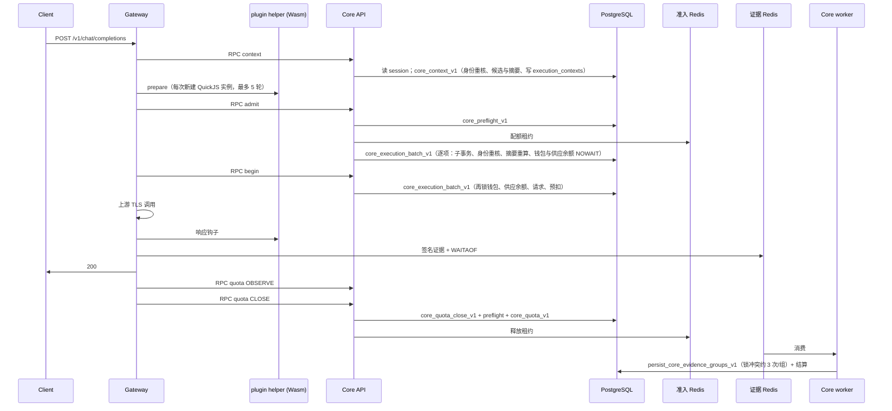
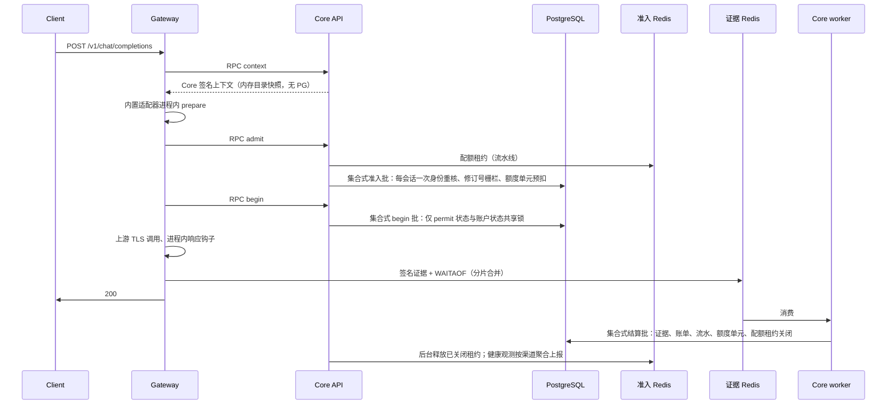

# 02 架构方案

2026-11-17 后续状态：用户已授权高性能、生产可靠性与扩展性改造，当前实施记录与单元验收见 [05-implementation.md](05-implementation.md)。原P0范围说明保留为历史，不再作为后续实现的停止条件；推荐技术方向由代理在既有不变量内落实，并不伪称用户逐项投票。

本方案已有部分实施，尚未完成目标；阶段状态见05。事实与实测见 [01-baseline.md](01-baseline.md)；服务端契约、数据与事务细节见 [03-server-design.md](03-server-design.md)；可验收需求见 [04-spec.md](04-spec.md)。

## 1. 目标、约束与非目标

### 1.1 目标

| ID  | 目标                                                                                                                                                | 来源                                        |
| --- | --------------------------------------------------------------------------------------------------------------------------------------------------- | ------------------------------------------- |
| G1  | 均匀 1000 钱包短 JSON 完整链路稳定负载 ≥ 3000 RPS：同配置连续两轮通过，并完成 60 分钟长测                                                           | 用户裁决 2026-11-16，`capacity-contract.md` |
| G2  | 请求性能与并发性能超越 new-api：同日参考对照中稳定完整链路 RPS 严格更高，且相同并发度下吞吐与延迟更优；默认与实际正额预扣配置分别报告，持平不算完成 | 本次“全面超越”要求，见 §6 D5                |
| G3  | 每请求全链路 CPU ≤ 2.0 ms（3000 RPS 时约 6 核，给发生器与系统留余量）                                                                               | 由 G1 与本机 12 核推得                      |
| G4  | 资金正确性可证明强于 new-api：同一套故障注入下，本项目零漏计费、零超支、零部分写，new-api 的对应缺陷有量化结果                                      | 本次“全面超越”要求                          |

### 1.2 保持不变的约束

- R01/R02：Gateway、Core API、Core worker 三进程；Gateway 不直连核心 PG。
- R05：atoms 字符串、`NUMERIC(38,0)`、BigInt 有理数、一次向上取整。
- R06：客户预扣、意图幂等与首次 attempt 同事务；UNKNOWN 不因时间、重启或停用释放。
- R07：成功终态前证据经 BullMQ 写入并 WAITAOF 确认；worker 在 PG 证据、账单、流水与事件共同提交后才 ACK。
- R08：上游预付可用额是每个新 attempt 的硬闸。
- 吊销线性化（`enterprise-v2-internal-identity.md:211`）：吊销先提交，则之后进入资金事务的事实一律按吊销处置。
- 不复用未经 reset 证明的 Wasm guest（`plugin-runtime-probe-2026-11-12.md:13`）。
- 容量契约口径不变：固定到达率、60 秒窗口、逐 request ID 交集、每分钟 P99 ≤ 1500 ms、120 秒排空、PG fsync/synchronous_commit/full_page_writes 开启、证据 AOF always + 副本确认。

### 1.3 非目标

- 商业控制台、支付、订阅、用户体系（R04 排除；T13 暂缓）。
- 降低耐久、关闭预扣或改变成功口径换取吞吐。
- 新协议与新供应商（另立规格，排在本方案阶段 5 之后）。

## 2. 每请求预算

| 进程        | 现状 ms   | 目标 ms   | 主要手段                              |
| ----------- | --------- | --------- | ------------------------------------- |
| PostgreSQL  | 19.6      | ≤ 0.6     | A1–A6、A8                             |
| 插件执行    | 10.4      | ≤ 0.3     | A7（内置适配器进程内）                |
| Gateway     | 7.1       | ≤ 0.6     | RPC 5→3、去掉插件 IPC、剖析后优化     |
| Core API    | 3.0       | ≤ 0.3     | RPC 5→3、会话与目录内存快照、集合式批 |
| Redis       | 1.1       | ≤ 0.15    | 配额租约流水线化、证据发布分片合并    |
| Core worker | 约 0.1    | ≤ 0.05    | 集合式结算                            |
| **合计**    | **约 41** | **≤ 2.0** |                                       |

P0 事实补充（2026-11-17，未改变本方案与 D1–D6）：35 RPS 稳定轮的 PG 为 22.19–23.50 ms，worker 为 1.19–1.23 ms，三类 Redis 合计 1.68–1.71 ms；表中现状“worker 约 0.1”不再受新测量支持。Gateway 主样本成本为完整 Wasm 模块反复 SHA-256（约 59.3%）与包快照复制（约 4.9%），RPC 签名约 1.1%；因此不能把 RPC 5→3 视为 Gateway 达到 0.6 ms 的主要收益来源。A7/P6 的后续设计需要评估模块不可变性证明、重复哈希/复制的消除和剩余开销；这里只记录依据，不授权实施。另 `trust_quota_usd=0` 在当前短提示词下实际预扣仍为 0，G2 的“关闭信任”与“正额预扣”必须分开记录；本次用户已授权追加正额预扣对照。详见 [P0 报告](../docs/performance/p0-2026-11-17.md)。

追加对照结果：真正正额预扣的参考配置在3000RPS连续两轮通过，但CPU为2.081/2.120ms、PG0.810/0.846ms，而非原默认/零预扣参考的约1.4/0.49ms。G3≤2.0与PG≤0.6仍保留为未验证目标；引用参考成本作预算依据时必须区分这两种语义，不能将默认数字视为非零预扣的实证下界。D5是否将“关闭信任”进一步明确为“实际正额预扣”仍由用户裁决，本次不修改决定。

S3c阶段事实：V2资金发送绑定与获批Worker在40目标/41到达连续两轮通过，HTTP P99为433.77/436.13ms，服务CPU为30.328/30.842ms每请求。helper进程成本归零，但Worker计入Gateway，Gateway仍为4.137/4.120、Core API4.572/4.583、worker1.603/1.621、PG18.733/19.189ms。该实测不支持“消除约9ms helper即可接近2ms总预算”的推断，A7不能单独满足G1/G3；本表目标仍是待验证预算。50档HTTP全部成功但窗口完整交集2992不足3000，60档虽HTTP全部成功且P99为358.88ms，窗口完整交集仅3336，未达到3600，均判失败。同构建Wasm40对照一轮有效通过，CPU37.159ms；另一次对照因PG全局统计驱逐判无效，不删除该轮。Worker两轮加权总CPU约下降17.7%，不能把该差值解释为执行器单独耗时。完整原始证据及差异见[实施性能记录](../docs/performance/implementation-2026-11-17.md)，不能以HTTP吞吐替代完整链路容量。

目标值是静态估算，依据是 new-api 在同机 6 条单行写 + 5 次提交只用 0.49 ms PG CPU，以及 11-11 单体版在同等资金保证下达到 2000–3951 RPS。每个阶段完成后实测，未达阶段出口不进入下一阶段（§5）。

## 3. 请求路径

### 3.1 当前（短 JSON 成功路径）

### 3.2 目标

成功路径 Core RPC 从 5 次降到 3 次；同步 PG 事务从 6–7 次降到 2 次（admit、begin），结算 1 次批量事务在 worker。

## 4. 关键决定

每项注明是否改变已确定设计、是否需要用户裁决。

### A1 集合式批处理（不改安全模型）

- 问题：`core_execution_batch_v1` 对每项调用完整 `core_execution_v1` 并开子事务，批只省往返与提交，身份、目录、锁全部逐项做。
- 推荐：新批函数按集合处理：同一事务内按会话、Key、路由、钱包、额度单元去重后各取一次锁和校验，再用集合 INSERT/UPDATE 写入；单项失败仍只影响所在组。
- 备选：保持逐项、只调大批量（无法摊薄逐项成本，舍弃）；把批处理放到 Gateway（Gateway 无 PG，违反 R02，舍弃）。
- 重评条件：集合式批的单批事务时长使 P99 超过预算，或热钱包组失败放大。

### A2 Core 签名上下文与内存目录快照（不改安全模型，需确认）

- 问题：context 每请求写 `execution_contexts` 并在 SQL 内算候选与摘要；而 context 本来“只是一份候选，不能代替当前授权”（`enterprise-v2-core-execution.md:288`）。
- 推荐：Core API 进程维护按目录修订号版本化的内存快照；context 返回 Core 签名的上下文令牌（候选、修订号、有效期、owner），admit 时验签并在资金事务内用修订号栅栏校验。设计记录已允许“Core 签名授权上下文”（`enterprise-v2-core-execution.md:163`）。
- 备选：继续持久化 context（每请求一次 PG 写，舍弃）。
- 重评条件：多 Core 实例下快照失效延迟导致 `candidate_stale` 拒绝率超过 0.1%。

### A3 目录修订号栅栏（改变“每次准入重算摘要”，需裁决 D2）

- 问题：摘要每次在 SQL 重算，原因是“当前 route/model 无通用 revision 列”（`enterprise-v2-core-execution.md:147`），这是数据模型缺口而非安全要求。
- 推荐：新增 `catalog_revisions`，由触发器在任何影响候选语义的目录写入时同事务递增；准入批对涉及的修订行 `FOR SHARE` 并比对上下文中的修订号。目录写入与修订递增同事务，与 SHARE 锁冲突，线性化与“锁下重算”等价。
- 备选：缓存摘要但不加锁比对（有 TOCTOU，舍弃）。
- 重评条件：触发器覆盖遗漏某个语义字段（由 SR 测试逐字段覆盖）。

### A4 身份：每批每会话一次权威重核（不改线性化，需确认 D1）

- 问题：每项在资金事务内锁三层身份行并重核；中间件每次 RPC 还读一次 session。
- 推荐：资金事务内按批中出现的会话去重，每会话一次 `FOR SHARE NOWAIT` 锁三层身份行并重核，锁持到外层提交，线性化与现状相同。中间件的 session 读取改为内存缓存，仅作提前拒绝；吊销通过 `LISTEN/NOTIFY` 与修订号使缓存失效，权威判断仍在资金事务内。
- 备选：会话级缓存且资金事务不再重核（弱化吊销线性化，舍弃，见 [03](03-server-design.md) §3.3）。

### A5 供应余额额度单元（不改安全模型，改账本结构）

- 问题：准入、begin、结算都锁同一 `upstream_account_balances` 行，1 个供应账户时结算交集约 19 RPS。
- 推荐：每个（账户, 币种）拆成 1 个主行 + N 个额度单元。准入按 attempt 哈希选单元预扣，单元不足时从主行补拨；begin 不锁余额；结算只锁 hold 所在单元。账户可用额 = 主行可用 + Σ 单元可用，硬闸按单元判断，总和不超过账本余额。
- 备选：只靠批处理摊薄单行锁（准入与结算两个进程仍互相等待，无法消除，作为 A5 前的过渡测量）；Redis 侧预算（不持久，违反 R08，舍弃）。
- 重评条件：A1 完成后 1 账户结算交集已 ≥ 3000 RPS，则 A5 降级为可选。

### A6 成功路径收尾合并（改变租约释放时机，需裁决 D4）

- 问题：响应后同步发 OBSERVE 与 CLOSE 两次 RPC，CLOSE 还要两次 PG 调用。
- 推荐：结算事务在终态时把该 attempt 的配额租约标为 `RELEASE_PENDING`，Core API 现有恢复循环（`core_quota_recovery_v1`）批量释放 Redis；健康观测在 Gateway 按渠道 100 ms 聚合后批量上报。失败与取消路径保留现有 abort/CLOSE。
- 代价：成功请求的并发配额占用延长到结算完成（正常为毫秒到秒级）。
- 备选：保留同步 CLOSE（每请求多 1 RPC + 2 次 PG，舍弃）。

### A7 内置适配器进程内执行（改变 R11 隔离边界，需裁决 D3）

- 问题：每次钩子调用经 Bun → Go 父进程 → worker 进程的 JSON/base64 stdio，再新建 QuickJS-Wasm 实例，10.4 ms/请求；SSE 每帧 13–18 ms。
- 推荐：平台随发布签名的内置适配包在 Gateway 进程内以同一 `runGuest` 契约执行（同一份 TS 源码，提供 `Host` 垫片），字节级输入输出与 Wasm 路径一致；第三方或运营上传的包仍走 Wasm 沙箱。增加多帧批 ABI（R23）供两条路径共用。
- 备选：helper 复用实例（缺 reset 证明，舍弃）；全部留在 Wasm 只做 IPC 优化（估计仍有数毫秒，无法满足 G3）。
- 结论：不接受 D3 时 G1/G3 不可达，应改按 §6 D6 重定门槛。

### A8 PG 耐久配置（不关闭耐久）

- 推荐：`max_wal_size` 16 GB、`checkpoint_timeout` 15 min、`checkpoint_completion_target` 0.9、`wal_compression` lz4；fsync、synchronous_commit、full_page_writes 保持开启。
- 依据：new-api 3000 RPS 时每分钟约 540 MB WAL，1 GB 上限下每 60 秒一次检查点；本项目长测 P99 尖峰与检查点周期吻合。

### 舍弃的方案

| 方案                          | 舍弃理由                                                        |
| ----------------------------- | --------------------------------------------------------------- |
| 合并 admit 与 begin           | 准入即授予发送，进程在发送前退出会产生不可释放的 UNKNOWN（R06） |
| 去掉 Core 跳，Gateway 直连 PG | 违反 R01/R02                                                    |
| 放宽 WAITAOF 或副本确认       | 违反 R07                                                        |
| 信任旁路（不预扣）            | 违反 R06，且是 G4 要证明的 new-api 缺陷                         |

## 5. 模块与数据归属（变化部分）

| 模块                          | 权威状态与规则                                    | 变化                                                        |
| ----------------------------- | ------------------------------------------------- | ----------------------------------------------------------- |
| `packages/storage` 资金 SQL   | 预扣、hold、attempt、permit、额度单元、修订号栅栏 | 新集合式批函数；`catalog_revisions`；额度单元表与账本不变量 |
| `apps/core-api` execution     | 准入编排、配额租约、上下文签名                    | 内存目录快照与会话缓存；去掉 admit 前 preflight；签名上下文 |
| `apps/core-worker` settlement | 证据、结算、租约关闭                              | 集合式结算；按单元结算；终态关闭租约                        |
| `apps/gateway` chat           | 协议执行、证据发布                                | 成功路径不再 OBSERVE/CLOSE；健康聚合；内置适配器进程内      |
| `packages/plugin-host`        | 插件执行边界                                      | 进程内执行器与 Wasm 执行器共用接口；多帧批 ABI              |
| `scripts`                     | 容量与对标装置                                    | 参考项目装置；`pg_stat_statements` 与按 PID CPU 采样入审计  |

部署形态不变：仍为三进程加 PG、准入 Redis、证据 Redis 与副本。

## 6. 待用户裁决

| ID  | 事项                                                                | 推荐 | 不接受的后果                           |
| --- | ------------------------------------------------------------------- | ---- | -------------------------------------- |
| D1  | 身份每批每会话一次权威重核，中间件会话缓存仅作提前拒绝              | 接受 | PG 预算无法达标                        |
| D2  | 候选摘要改为目录修订号栅栏                                          | 接受 | 每请求数十次 SQL 摘要，PG 预算无法达标 |
| D3  | 平台签名的内置适配器进程内执行，第三方仍 Wasm                       | 接受 | G1/G3 不可达                           |
| D4  | 成功请求的配额租约在结算时关闭                                      | 接受 | 每请求多 1 RPC、2 次 PG                |
| D5  | 请求/并发超越按 G2 对照默认、关闭信任与实际正额预扣，主对标语义待定 | 接受 | 需另定对标口径                         |
| D6  | 若 D1–D3 有不接受项，是否按实测重定本机门槛                         | —    | —                                      |

## 7. 演进顺序

| 阶段 | 内容                         | 出口（同一发生器配置实测）                                |
| ---- | ---------------------------- | --------------------------------------------------------- |
| P0   | 装置固化                     | 参考装置与 PG 语句、按 PID CPU 进入审计；当日重测双方基线 |
| P1   | A2 + A4 + A1（准入与 begin） | PG ≤ 4 ms/请求；16 账户交集 ≥ 300 RPS                     |
| P2   | A3                           | PG ≤ 2 ms/请求                                            |
| P3   | A5 + 集合式结算              | 1 账户交集等于 HTTP 吞吐；无积压增长                      |
| P4   | A6                           | 成功路径 Core RPC = 3                                     |
| P5   | A7 + 多帧 ABI                | 插件 ≤ 0.3 ms/请求；SSE 每帧成本下降一个数量级            |
| P6   | Gateway/Core 剖析优化        | G3                                                        |
| P7   | A8 + 长测 + 对标 + 故障对照  | G1、G2、G4                                                |

P1–P3 改动资金事务结构，必须保持现有资金、授信、权限与升级集成用例全部通过。阶段出口未达时先定位，不跳阶段。

## 8. 风险

- 静态估算可能偏乐观：Bun 单请求固定开销（HTTP/2 客户端、TLS、JSON）未剖析，P6 可能成为新瓶颈。
- 集合式批的热钱包组冲突会让整组重试，单钱包工作负载可能低于均匀分布，需单列报告。
- 额度单元引入账本不变量迁移，升级路径与对账必须同步改。
- 60 分钟 3000 RPS 长测按现有估算需约 62 GB 磁盘（`capacityStorageBudget` 每请求 5000 字节 + 预留），当前余量 38 GiB，P7 前需扩容或实测每请求字节数后重算。

## 9. 用户目标聚焦（P0 执行中确认，2026-11-17）

用户明确：最终目标为超越 new-api 的请求性能和并发性能，独立设计更优实现。G1 的≥3000只是最低门槛，达到参考同档不代表超越。请求性能需在相同到达模型下比较稳定吞吐和延迟；并发性能需在相同并发度下比较吞吐、成功率、P99与资源，再确定可持续并发边界，不能由本次短JSON RPS或发生器在途上限推算。CPU≤2.0ms、P99预算与资金不变量仍是约束，不新增“每一项成本都必须低于默认零预扣参考”的隐含要求。

本次P0报告保留请求基线与并发配置，未把发生器并发2048或Gateway max_inflight宣称为通过验收的服务并发能力；完整并发阶梯仍需后续同口径实测。参考项目用于建立对照，不作为产品实现模板。该目标确认不构成D1–D6的技术裁决，也不授权本次P0实施P1–P7。
