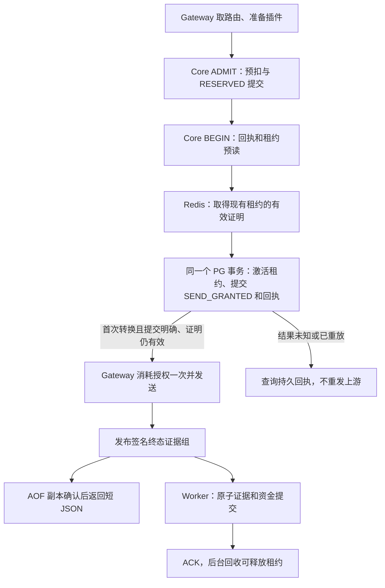

# 12 完整链路 3000 RPS：1817 之后的架构设计

2026-11-18 · 首次 `BEGIN` 合并事务已实现，供应资金锁检查实验未采纳，容量尚未验收。基线为 `main` 的 `8220082`；本文承接 [1817 已落地行为](11-hot-path.md#8-1817-准入与结算的写入边界)，不重做已有的路由票据、集合准入、终态证据组、供应资金单元及同钱包集合落账。

## 1. 目标和约束

- 首先改善 **本机、1000 个均匀钱包、正额预扣、短 Chat JSON** 的完整吞吐：同一请求在窗口内同时完成有效 HTTP、精确 PG 提交和外部 ACK。SSE、单钱包与热点钱包单独测，不从短 JSON 外推。延迟、耐久、分钟窗口和排空条件沿用[容量契约](../docs/performance/capacity-contract.md)。
- 保留 Gateway 无 PG、Core API 独占授权与 Redis 配额协调、Core Worker 独占证据落账的进程边界。保留客户与供应资金守恒、吊销及冻结栅栏、证据身份、单次发送、PG 同步提交、Redis AOF 副本确认。公开协议和计费结果不变。
- 1817 在 3000 档的两轮分别为 **199.38、196.75 完整 RPS**，并非稳定容量。独立探针的 166597 个 `503` 均来自 `ATTEMPT_BUDGET`；两轮的执行批和证据持久化入口占约 78% PG 顶层 SQL 累计执行时间。前者是拒绝点，不证明插件是根因；后者包含等待，不等于 CPU 占比。没有当前构建的 60 分钟达标证据。[1817 证据](../docs/performance/implementation-2026-11-17.md#27-1817-准入写入与热点钱包结算)
- 本机设计预算仍为 **≤2 ms 全链路 CPU/完成请求**，3000 RPS 下约为 6 核。这是目标而非测量；预算核算必须用无拒绝稳态的完整完成数，过载轮按已准入归一化的 CPU/WAL 只作诊断。

## 2. 选择：先缩小提交路径，不换进程架构

| 方案                                        | 能解决什么                                                           | 本阶段决定                                                                                                                                                     |
| ------------------------------------------- | -------------------------------------------------------------------- | -------------------------------------------------------------------------------------------------------------------------------------------------------------- |
| 现有三进程内缩短 `BEGIN` 事务链与结算写路径 | 减少每笔工作量、独立提交和锁持有；可在同库同契约对照                 | 推荐。先做可以独立回滚的提交边界实验，不预认其足以达到 3000                                                                                                    |
| 只提高插件槽、连接池或 Gateway 副本数       | 入口容纳更多请求，但共享 PG、Redis 与结算容量不随之增加              | 不作为首片。1816 四 Gateway 对照曾提高 HTTP 成功数但降低完整吞吐，[有实测反例](../docs/performance/implementation-2026-11-17.md#26-18151816-完整链路-3000-rps) |
| 多机独立资金容量单元                        | 能横向增加实际写入容量；要求钱包有唯一归属并从供应总预算安全划拨额度 | 保留为另一个部署方案，不计入本机验收；需先证明单容量单元性价比及热点能否按现有资金模型隔离                                                                     |

不把数据库工作迁回 Gateway，不用缓存替换权威校验。借鉴 LiteLLM 的容量职责分离，但不能用费用日志批写替代发送前预扣与逐笔证据提交。

## 3. 现状与目标调用链

基线：`context` 路由只读投影（不能签发票据则回退持久上下文）→ 插件准备 → `ADMIT` 在 Redis 取得草稿租约、PG 持久化预扣与 `RESERVED` 许可 → `BEGIN` 先查回执与租约，在 Redis adopt/renew，再由独立 `core_quota_v1(ACTIVE)` 提交租约 → 进入 PG 执行批提交 `SEND_GRANTED` → 首次成功返回短期发送授权。证据入队通过耐久确认后短 JSON 才能成功；Worker 独立提交资金与证据，再 ACK。入口分别为 [Gateway Chat](../apps/gateway/src/chat.ts)、[Core 执行处理](../apps/core-api/src/execution/handler.ts)、[PG 执行存储](../packages/storage/src/execution/index.ts)、[证据存储](../packages/storage/src/settlement/index.ts)。

| 所有权           | 权威状态与写入口                                                                                                                |
| ---------------- | ------------------------------------------------------------------------------------------------------------------------------- |
| Gateway          | 请求生命周期、插件准备绑定和本进程一次性发送权消费；不修改预扣、许可、租约和账单                                                |
| Core API / PG    | 客户与服务身份、目录和冻结栅栏；`ADMIT` 写客户及供应预扣，`BEGIN` 写许可和命令回执；Redis 证明由 Core 取得，不能由 Gateway 声明 |
| Redis            | 配额实时占用、租约 revision/有效期；证据队列是耐久交付通道，不是余额权威                                                        |
| Core Worker / PG | 签名验证、用量事实、精确计价和资金分录、完成后的配额释放资格；后台按现有恢复命令回收 Redis 租约                                 |

## 4. 首个实现候选：将首次租约激活并入 BEGIN

**假设：** 首次普通 `BEGIN` 不需要两次独立的 PG 写提交。合并减少一个同步数据库往返及一次独立提交，并有机会复用许可锁。收益尚未知，尤其要测租约锁在批事务里持有更久是否抵消收益。它不合并 `ADMIT` 与 `BEGIN`，不减少发送前的权威栅栏，也不增加服务。

**契约不变。** Gateway 仍发 `execution_begin_v1`，以原 `command_id`、`body_digest`、`attempt_id`、`permit_epoch`、现有授权与准备绑定标识调用。相同受权调用及命令身份的已提交重放只返回同一回执，带不同载荷返回现有冲突；回执即使显示 `SEND_GRANTED` 也不能代替 `transient_send`。例：A 的数据库提交成功但调用方没收到结果，查询可以看到 A 已提交，但不得取得第二份发送授权。[线协议](../packages/contracts/src/core-execution.ts)不变；[Core 私有执行数据](../apps/core-api/src/execution/handler.ts)携带已取得的租约描述符和证明上界。

**首片适用范围。** 已持久 `RESERVED`、无前序 attempt、无资源依赖、非流式的同步 Chat，首次采用完整的 `ADOPTION_PENDING` 租约集合。范围由 Core 权威上下文判断，不信任请求自称；匹配实际范围，不硬编码为 Key、项目、渠道三个。非首发、混合/已激活租约、续租、释放、不符合普通路径的操作均走原事务逻辑。鉴权、过期或状态错误不是退回普通路径继续尝试发送的理由。

1. **只读预检。** 保留 `prepareBegin` 的已有回执优先行为；从持久许可读取现有租约。对无回执的新命令，用原租约 ID 和按命令/租约派生的操作身份进行 Redis adopt。保留逐租约 revision、owner、generation、确定的 proof deadline。Redis 调用不放进 PG 写事务，也不因 SQL 锁冲突刷新 proof deadline。
2. **一个 PG 提交。** 复用既有执行批和 `BEGIN` 待提交写入边界。在获取现有身份、目录、资金及钱包发送栅栏后，按现有 `BEGIN` 锁序取得请求、hold、attempt、permit，再按 `lease_id` 确定顺序获取需要激活的租约行。核对完整集合、归属、epoch、revision、generation、租约状态、许可版本、相关 owner binding 和剩余有效期；把原来只读 `ACTIVE` 的放行条件改为接受**同一事务内**通过相同验证的激活。发送授权落盘前执行已有的最终权威及时间复核。`ACTIVE`、`SEND_GRANTED`、`BEGIN` 回执和审计要么一起提交，要么一起回滚；不得先提交租约再由另一个事务补发授权。既有批前缀可见性、命令和 attempt 去重以及失败隔离均保留。不能靠捕获异常后继续提交激活来处理失败。
3. **确认后才发权。** 只有 fresh transition 且 PG 提交结果确定，仍满足 proof、命令和许可截止预算，才由 Core 生成短期授权。试验中保留现有 1000 ms 最低证明余量及每一处既有截止检查。发现过期、授权材料不可用或只得到旧回执时不发权。上游可能已执行时不能据 HTTP 状态或断连推断未发送、释放资金或无条件换路。

**数据及索引。** 不新增状态表、余额副本或索引。按现有许可、请求和命令回执索引定位本次租约，不扫描全表。`ADOPTION_PENDING → ACTIVE` 与许可 `RESERVED → SEND_GRANTED` 的原状态保留，只移动首次激活的 PG 提交边界；Redis 先 adopt 仍可能先于 PG 提交，见恢复表。首次激活在现有执行批入口内重验描述符，不另调用会重验身份和锁定许可的 `core_quota_v1`。此路径要求租约均属于本次首跳，Redis revision 只比持久 revision 大 1；已激活租约的续租及释放仍使用 `core_quota_v1`。现有最小权限函数与角色边界维持不变。Core 在实际派发 SQL 和明确锁冲突重试时，按原单调截止时间重算剩余证明时间，不续签证明。

| 失败或交错                                                         | 必须得到的结果                                                                                                                                                                                       | 拟复用的验证入口                                                                                                                                                                                  |
| ------------------------------------------------------------------ | ---------------------------------------------------------------------------------------------------------------------------------------------------------------------------------------------------- | ------------------------------------------------------------------------------------------------------------------------------------------------------------------------------------------------- |
| Redis 只成功一部分，或全部成功后 Core 在 PG 提交前退出             | 无 `SEND_GRANTED`、无上游；PG 仍 `RESERVED`，已 adopt 租约继续占用，不能按草稿拒绝释放。已确认可继续的同命令复用原操作身份和余量；过期或放弃由现有 ABORT/恢复将租约转为可释放，再校对 Redis 归属回收 | [配额争用](../tests/integration/execution-quota-contention.test.ts)、[执行恢复](../tests/integration/core-execution-recovery.test.ts)、[配额到期](../tests/integration/core-quota-expiry.test.ts) |
| 等锁、等批次期间证明过期；吊销或冻结先于发送授权提交；租约版本不符 | 不发权；任何已暂存激活、许可和新回执的本次写入一并回滚。只有已知可重试的锁失败能在原截止内复用相同证明重试；不重发 Redis 操作制造新证明                                                              | [BEGIN 批](../tests/integration/core-begin-batch.test.ts)、[配额争用](../tests/integration/execution-quota-contention.test.ts)                                                                    |
| PG 提交结果未知或旧命令重放                                        | 查回执，不重新生成发送授权；无确证不能重放上游。未消费授权的请求与可能已发送的请求按现有可信证据和恢复路径分别处理，不自动退钱                                                                       | [未知提交](../tests/integration/core-commit-unknown.test.ts)、[执行恢复](../tests/integration/core-execution-recovery.test.ts)                                                                    |
| 同批两个 BEGIN 命中同一 permit，或其中一笔在最终 flush 失败        | 最多一份 fresh transition；失败项不能遗留 `ACTIVE` 租约或污染后续项。隔离执行必须在受影响写入已回滚后进行，遇到未知提交不得自动重投                                                                  | [BEGIN 批](../tests/integration/core-begin-batch.test.ts)                                                                                                                                         |

首片不改变成功证据后释放租约的时机，也不把资金责任从 PG 挪到 Redis。以上为静态推演；特别需要实测 `ADOPTION_PENDING` 的 PG 描述符能否在 Redis 已 adopt 后按原恢复路径收敛。不能收敛则止步修正设计，不上线首片。

## 5. 后续切片：结算与背压

- **结算写入：** 沿用一个签名组的原子边界，不删除 RAW/CANONICAL 事实、逐笔分录、审计或回执。对普通首次 FINAL，把已验证、已装载的 permit、hold、用量和报价在同一事务内传给集合落账，优先消除实测重复读取、构造及 UPDATE；现有 [证据暂存](../packages/storage/src/sql/core-evidence-staging.sql) 和[同钱包集合结算](../packages/storage/src/sql/core-shared-wallet-settlement.sql) 已覆盖部分，不平行再造。热点冲突的实验优先缩小同钱包、同供应单元造成的回退范围；保留组内顺序、正额逐笔取整、同一份资金原子更新。重放、修订、冲突和复杂资金继续走现有路径，不因快路扩大覆盖范围改变其语义。[证据批回归](../tests/integration/core-evidence-batch.test.ts)、[关账及释放](../tests/integration/core-success-quota.test.ts)覆盖需保留的不变量。
- **入口背压：** 先在现有预算下观测路由 RPC、准备、ADMIT、BEGIN、上游、AOF 等待、账务提交和 ACK 的阶段耗时与在途。如果路由等待显著占槽，再以独立且有界的路由预算替代纯路由等待期间的插件预占；其上限必须受下游容量约束，不能重现已知的无效路由放大。保留插件绑定后到需要它的最后阶段的实体槽；不假设准备态可卸载后重建，也不在新队列里持着资金预扣无界等待。发布队列已有积压门槛，先验证并复用，再讨论是否将最老积压年龄纳入更早的准入判断。容量拒绝与业务配额拒绝仍分别核对。

## 6. 顺序、回退与验收

1. **测基线，不先改容量。** 用当前构建重取已知的 100 档、失败的 300 档，用同样的机器、到达率、产物、钱包分布、耐久、池和预算做对照。分别记录每笔完整完成 CPU、SQL 调用/WAL、PG 锁与重投、插件持槽分段、最老结算积压及 `503` 分类。用顶层统计核算总数，嵌套语句只用于定位；若统计驱逐或基线不稳，先修正测量，不据此宣称收益。
2. **只验证首次 BEGIN 提交边界。** 对照是否取消独立 PG 激活提交，证明上述故障与混合批用例；在等负载下比较完整吞吐与等待、锁冲突。若只减少提交次数但 CPU、P99 或积压无可重复改善，不将它当作达到 3000 的依据；优先转向实测成本最大的准入/结算写入段。以追加迁移切换 SQL；先升级数据库再部署 Core，Gateway 与公开协议不变，Worker 的启动版本约束见第 8 节。新旧 Core 共存时保持旧执行路径可用；回退先恢复旧 Core 路径，再按证据以追加迁移恢复函数，不撤销已提交的账或回执。
3. **推进容量。** 第一处完整里程碑为同配置两轮 300 档，保持完整账务与延迟门槛；再按实测瓶颈推进，不预报容量。最终 3000 档连续两轮 60 秒、再做 60 分钟逐窗验收：每窗逐 request ID 达标、P99 ≤1500 ms、无额外发送或资金差异、队列不持续增长、停止后 120 秒内排空。用候选产物的实测磁盘增长重算长测预检，不临时降低耐久或缩短时长。架构约束继续由 [架构测试](../tests/unit/architecture.test.ts) 核对，运行时代码改动后再跑项目验证、产物及耐久门禁。

## 7. 首片实施证据

- [追加迁移 2026111818](../packages/storage/src/sql/core-begin-quota-commit.sql)不改历史迁移。PG 重新核对首跳资格与描述符集合；批末失败先回滚整段，再复用原有逐项隔离路径。没有新部署或在线数据库变更。
- 注入首次 `SEND_GRANTED` 写入失败：旧提交路径留下 `ACTIVE`/revision `1`；新路径保留 `ADOPTION_PENDING`/revision `0`，不产生发送授权或成功审计，随后仍能关闭并释放已采用的 Redis 租约。
- 6 个集成文件共 36 项通过，覆盖锁争用、批内首笔证明过期、COMMIT 应答丢失、资金恢复与迁移。该结果验证行为，不是吞吐达标证据。
- 全量集成首跑 590 通过、2 失败，分别是预检投影字段白名单和历史迁移序列的断言未同步。更新两处断言，仍检查精确字段集合、真实索引访问及历史版本有序保留，定向复测 4 项通过；未再执行整套集成。
- 构建、原生插件测试、插件产物、应用产物和 7 项原生耐久检查通过。`bun run verify` 在单测阶段为 452 通过、1 失败：开放环边界用例未传 `--model` 且本地配置没有 `GATEWAY_MODEL`；未修改压测工具，在干净的 1817 副本复现了相同失败。

### 同机 A/B 诊断

1817 (`8220082`) 和 1818 各测两档，每档每版仅一个 60 秒窗口，旧版先跑。使用 `scripts/bench-system.ts --online-capacity`、Bun 1.4.4、同机 PostgreSQL 17.9 和 Redis 7.4.12、1000 个均匀钱包、短 Chat JSON、1 Gateway、1 供应账户、压测并发 256、Worker 并发 8。PG 开启 fsync、synchronous_commit 和 full_page_writes；证据 Redis AOF `always` 并要求 1 个副本确认。原始审计保留在本机 `.local/begin-ab.kuhfQYp1`。完整 RPS 按同一请求在窗口内完成 HTTP、PG 和外部 ACK 的数量除以 60 计，不使用排空后的吞吐。

| 目标 / 到达 RPS | 1817 完整 RPS | 1818 完整 RPS | HTTP P99（1817 → 1818） | `overloaded`（1817 → 1818） | 容量门禁 |
| --------------- | ------------: | ------------: | ----------------------: | --------------------------: | -------- |
| 100 / 101       |        100.60 |        100.50 |   318.57 ms → 343.66 ms |                       0 → 0 | 两轮通过 |
| 300 / 301       |        154.90 |        179.05 | 1954.60 ms → 1213.67 ms |                 8573 → 7147 | 两轮失败 |

100 档顶层 PostgreSQL 调用从每笔 23.42 降为 22.17，采样总 CPU 从每笔窗口内完成请求 23.34 ms 降为 21.57 ms，P99 未改善。旧版该档记录了 6149 次独立 `core_quota_v1` 调用；新版顶层耗时前 25 条不再出现该语句。300 档仅属过载诊断：两轮因负载发生器退出状态、钱包按计划负载核对和 HTTP 有效性门禁失败，已完成请求的预扣和不平衡分录均为零。不能将一次超载改善当作稳定容量，未复测 3000。

1818 的 300 档中，执行批加证据持久化约占顶层 SQL 累计耗时的 87%，含等待，不是 CPU 占比。嵌套 `flush_admit_v1` 约 62.9 秒、证据暂存 flush 约 29.4 秒、`flush_begin_v1` 约 13.8 秒，不能与顶层相加。下一片优先拆解准入批写入、锁等待和证据持久化；不先放大入口预算。

## 8. 供应资金锁检查实验与写入诊断

1818 的 300 档记录了 77,490 次资金账户锁查询，累计 16.7 秒（嵌套 SQL，包括等待）。原资金单元行触发器分别查询排他锁和共享锁；实验在一次实际 advisory lock 查询内判断两种权限，不使用会话变量或调用方参数代替锁，不降低共享锁、排他锁和延迟覆盖约束。**锁检查实验未获可重复吞吐收益，不追加迁移，保留 1818。**

独立审查发现，实验中的类型化预扣快照比较会改变历史 SQL `NULL` 与 JSONB `null` 的等价语义；第二轮实验移除了这项改动。部署 1818 或后续追加迁移（含回退迁移）时应协调停启 Worker：它启动时要求数据库 schema 版本与产物精确一致，升级和回退都需要对应版本的 Worker 产物。

开放环边界用例现在显式传入测试模型，不再依赖开发机的 `GATEWAY_MODEL` 默认值，未改基准判定规则。仅含锁查询改动的实验构建曾通过 `bun run verify`：453 项单测、593 项真实集成，以及构建、原生插件和产物检查。未将该门禁结果沿用到撤除迁移后的工作区。保留独立验证错账户锁、共享锁不能改预算、预扣快照不可变及变更预扣额时必须持锁的资金用例。

撤除实验后，类型、lint、格式、453 项单测、44 项定向真实集成、构建、5 个应用产物脚本及 7 项原生耐久检查通过；没有再跑整套集成或备份检查。

### 两项改动合跑的实验结果

以实际 1818 产物为对照，实验版同时包含合并资金单元锁查询和类型化预扣快照比较。沿用上一节相同账务、耐久、到达率和 60 秒窗口，加开等待观察；300 档第二对交换了运行顺序。原始审计在本机 `.local/supply-ab.ucR9vDyj`。完整 RPS 仍按 HTTP、PG 与外部 ACK 的逐请求交集计算。

| 目标 / 对照对 | 1818 完整 RPS | 实验版完整 RPS | HTTP P99（1818 → 实验版） | 容量门禁 |
| ------------- | ------------: | -------------: | ------------------------: | -------- |
| 100 / 1       |        100.63 |         100.72 |     387.15 ms → 316.85 ms | 均通过   |
| 300 / 1       |        139.02 |         134.43 |   1944.04 ms → 2041.14 ms | 均失败   |
| 300 / 2       |        126.15 |         143.28 |   3130.86 ms → 1782.69 ms | 均失败   |

100 档两轮均无过载；原 `held_v1` 查询次数从 47,926 降至 24,680，**不包含新合并查询**，不能据此算出总扫描降幅。300 档四轮均大量拒绝，无可重复的吞吐收益；已处理请求均未留下预扣或不平衡分录。`DataFileExtend` 是四轮采样中最常见的非 CPU 等待（325–388 次后端观测），嵌套准入 flush 约 62–64 秒、证据暂存 flush 约 30–32 秒。

### 单改锁查询的复测与取舍

原始审计、实验 SQL 和关系采样程序保留在同机 `.local/supply-guard-final.7ZLvhA0f`。两版沿用相同耐久、到达率、钱包、插件、并发及 60 秒窗口，双方同样加开每 750 ms 只读的关系扩展诊断。

| 目标 | 1818 完整 RPS | 仅合并锁查询完整 RPS | HTTP P99（1818 → 实验版） | 容量门禁 |
| ---- | ------------: | -------------------: | ------------------------: | -------- |
| 100  |        100.58 |               100.65 |     330.88 ms → 293.72 ms | 均通过   |
| 300  |        193.80 |               178.00 |   1404.75 ms → 1213.67 ms | 均失败   |

300 档实验版窗口内少完成 948 笔，过载拒绝从 6,244 升到 7,207，不能用更低的成功请求延迟替代吞吐门禁。两版各 79 次窗口采样中，`execution_quota_leases` 分别有 13、19 次 `DataFileExtend` 后端观测，是频次最高的具名业务关系；还观测到证据回执、请求和 TOAST 关系扩展。采样不是等待总时长或因果证明。下一片优先核算租约表与关联 TOAST 的插入、激活、释放次数及 WAL，再比较减写方案，不扩大入口预算。300 尚未达标，未复测 3000。

减写方案的首个验证点是描述符重写：`BEGIN`、续租和释放目前会把完整 `descriptor` 写回，部分状态和 revision 同时已有持久字段。优先验证将不可变描述与可变 Redis 投影分离能否减少写入；尚未归属的 TOAST 采样不计为该表。设计时必须单独处理尝试归属、Redis revision、tokens 回写及重放后的有效期，续租不能复用陈旧的 `remaining_ms`，同时保持 1818 的激活与发送许可原子性。
