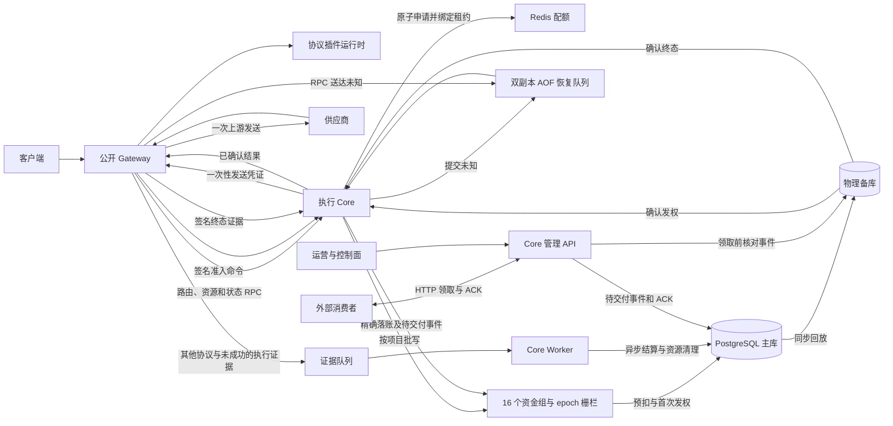

# 13 统一执行 Core 重构

2026-11-19。已开始实施。完整交付包含执行准入、发权、结算、恢复、事件交付和存量切换。下文保留短 Chat JSON 的实现与历史测量作为迁移基线。1902 产物与 [16 轮归档](../docs/performance/evidence-quota-indexes-2026-11-19/rounds.json)是原三进程基线。

单机单位成本、紧凑账本与真实插件的隔离实测，以及将首个非流式 Chat 接入同一权威资金账的迁移边界，见[执行预算与原型实验](../docs/performance/execution-budget-2026-11-19.md)。

## 完整版本的行为映射

| 路径                 | 迁移要求                                                                                                                                                              | 验收证据                                                                   |
| -------------------- | --------------------------------------------------------------------------------------------------------------------------------------------------------------------- | -------------------------------------------------------------------------- |
| 首发、重试与资源操作 | 客户及供应资金共用 PostgreSQL 权威账。首发一次提交两侧预扣、配额证明和发权。重试沿用原报价、先前 attempt 状态、原项目归属与可见输出约束。资源绑定与取消遵循当前协议。 | 实际收到的单次发送材料、冻结及撤销交错、重复命令、发送前取消、供应余额守恒 |
| 按项目分组           | 资金组在两侧状态存储中使用同一映射。单个逻辑写者串行提交组内批次。持久 epoch 栅栏控制接管。供应预分拨守恒，跨组补充走供应账户级事务。                                 | 两个 Core、单热钱包、共享供应账户、所有者接管与旧写者竞争                  |
| 结算与恢复           | 原始签名证据、增量修订与精确分录保持可重放。首次成功和迟到修订引用原许可与价格。结果未知保留资金责任，证实未发送后释放。流结束等待当前协议的耐久确认。                | 暂停备库、回执丢失、队列恢复、无重复扣款、两侧精确账务、外部领取及 ACK     |
| 运营与切换           | 管理充值、退款、冻结、争议和后台写入遵守相同资金边界。切换时验证余额、未决预扣、幂等回执和事件游标。新写入发生后，经反向交接才能转回。                                | 从历史 schema 升级、带未决请求交接、审计对账和回退演练                     |

性能诊断先用无插件直连两个 Core 的 3000 RPS、3 秒、逐请求 5 秒。目标是 9000 个请求全部按时收到发送材料并耐久保全证据，排空后逐笔核对两侧账务。公开 JSON 和 SSE 独立与 new-api 同机对照，记录首帧、`[DONE]`、完整响应和高于 3000 RPS 的实际并发边界。现有容量契约中的历史长测记录与本次短压测分别记载。

启用合并发权的首发 Chat SSE 采用与 JSON 相同的主备确认，并继续通过原有耐久证据队列交付流中的增量证据及终态。流的可见内容和结束帧仍由现有协议路径处理。与数据库相关的切换和性能结论以用例及原始测量结果为准。

合并发权的完整授权计划只写在许可证上。命令回执保留命令身份、金额、授权计划摘要和租约标识。幂等重放及状态查询通过同一笔许可记录重组原回执，历史已有完整计划的回执继续直接读取。重组后的回执不授予临时发送材料。

发权使用事务级 `remote_apply`，再由 Core 从指定备库核对准确的命令和许可证后交付发送材料。备库暂停和请求截止的交错由原生主备用例覆盖。迁移 2026111906 先部署到数据库，再部署 Core 和启用合并发权的 Gateway。退回应用版本时保留该迁移，使历史回执和紧凑回执仍经数据库重组。

## 目标行为

### 发权入口与资金组归属实验

首个交付门槛为两轮同配置 60 秒公开短 JSON 300 RPS。首先把每条内部连接的在途预算延伸到共享 TLS 握手阶段，连接建好后仍按原 32 个活动流与 224 个等候位工作。执行命令在得到流槽之后签名，使用调用开始时确定的命令、数据和截止时间。新请求遇到本地容量拒绝即结束，服务端要求重试同一命令时按原时限处理。已承担资金责任的关闭、续租和恢复保留原重试规则，终态沿用独立连接。

随后在两个 Core、四个 Gateway 身份的隔离夹具内，对比原流量分配和按项目把同一资金组送到同一 Core。按时取得发送许可、耐久证据、精确结算、单位 CPU 和写入放大决定是否推进持久写者归属及紧凑批写。公开 SSE 在实际公开入口分别核对首帧、首内容、终止帧和完整响应，再按原契约核对账务、取消和资源。

Gateway 负责公开协议、连接和背压。执行 Core 持有上游调用和结算职责，按项目固定分配资金写入组，各写入组持有独立供应额度。每批验证持久所有者版本。第一笔事务原子提交客户与供应预扣及首次发送许可。第二笔事务提交签名证据、两侧分录、请求终态与可交付事件。两类事务分别按有界批次提交。相同命令可查询原回执，只有原执行者从首次确认的发权事务取得单次发送资格。

新链路采用指定 PostgreSQL 同步备库确认成功终态。主库无法确认终态时以原签名事件身份写入现有耐久证据队列，恢复后幂等落账。无法确认上游执行结果时保留客户与供应资金责任。旧链路的 Redis AOF 成功契约在迁移完成前继续适用。新链路的验收要求同机 1000 个均匀钱包、3000 RPS 固定到达、逐请求 HTTP 成功与精确 PG 落账与外部 ACK 的交集、P99 ≤ 1500 ms、连续两轮及 60 分钟长测。按原 [容量契约](../docs/performance/capacity-contract.md)核对资金、排空和每分钟结果，单独记录两种耐久拓扑。

## 实施与切换顺序

| 单元           | 目标与验收                                                                                                                                      |
| -------------- | ----------------------------------------------------------------------------------------------------------------------------------------------- |
| 终态提交确认   | 通过真实物理备库核对确切签名回执和终态账务。主库已提交而备库暂停重放时，终态调用保持失败或未知。恢复并重投同一签名组只结算一次。                |
| 短 Chat 全链路 | 引入固定资金归属和发权事务，接入直接结算及故障证据回流。验证提交应答丢失、发权后退出、所有者接管、配额状态丢失和备库晋升。运行完整容量验收。    |
| 其余消费者     | 按 SSE、二进制、资源、后台任务、管理和事件接口迁移。保留原协议、金额及签名事实的语义，逐项覆盖迟到用量、取消、修订和争议。                      |
| 历史与切换     | 停止旧准入、排空可结算证据，迁移未决预扣、回执、资源 ID 和未 ACK 记录，核对资金和历史身份后切换。产生新账后，回退需经能读新账的转换或恢复流程。 |

## SSE 短时并发

同机使用同一固定到达驱动、1000 个均匀钱包和同一个 mock 产物。短时对照先跑 3000 RPS、3 秒、每请求 5 秒，分别覆盖无额外上游延迟和每 192 字节间隔 150 毫秒。两边分别记录有效首帧、首帧 P99、收到 `[DONE]`、完整 HTTP 响应和超时。无延迟档的参考可以全部完成。要验证更高的并发边界，双方在 3000 以上采用相同到达阶梯，并记录峰值在途数。账务与资源释放按各实现实际交付的保证核对。

第一片让无资源依赖的 Chat SSE 使用现有签名路由票据。迁移 2026111905 先更新票据绑定函数，再部署 Gateway。通过策略校验并提交准入后才持久化上下文。现有客户和供应预扣、发权、用量证据和终态耐久要求继续适用。对于未压缩、无固定长度的分块 Chat SSE，插件宿主确认完整终态后即可结束上游读取。压缩和固定长度响应仍读取到 EOF，检查传输完整性。插件收尾输出通过原解析与用量路径处理，终止帧继续等待耐久证据确认。

Chat SSE 复用短 Chat 的插件处理预算。Gateway 在调用 Core 路由前取得名额，绑定插件时把名额交给实际 attempt。路由失败或取消时归还准备名额。名额用尽立即返回 503，避免超出插件预算的请求继续竞争数据库和 Core 连接。

### 排除插件后的数据路径诊断

驱动用预构造的 Chat SSE 请求直接调用两个 Core。1000 个均匀钱包，固定到达 3 秒，每个请求的 Core 命令截止时间为 5 秒。运行真实 PostgreSQL、Redis 配额和 AOF 证据主备及结算 Worker。发权后用合成上游结果提交签名证据，按客户扣款和供应成本核对。测量过程没有启动 Gateway、协议插件或上游。该诊断测量 Core 和数据路径，未测客户端首帧、外部 ACK 或稳定吞吐。

| 到达 RPS | 发出 | 标准路径准入 | 标准路径精确扣账 | 实验版精确扣账 |
| -------: | ---: | -----------: | ---------------: | -------------: |
|      200 |  600 |          600 |              600 |            600 |
|     1000 | 3000 |         3000 |              946 |           1226 |
|     3000 | 9000 |         4682 |              576 |            516 |

实验版在隔离库内把首次配额激活并入发权事务。1000 档省去了原路径的 2915 次独立配额写入，3000 档完成数从 576 降至 516。另一次只将每个 Core 的 PostgreSQL 连接池从 4 扩到 12，3000 档完成 369 笔。两项实验均未进入运行时。[并入发权审计](../.local/core-data-sse/atomic-22338406-3000.json) · [扩池审计](../.local/core-data-sse/pool12-089b453a-3000.json)

在 3000 档标准路径上，执行批占顶层 PostgreSQL 语句累计耗时的约 73%，其中主要嵌套语句包括批量准入写入、配额租约插入和规范 JSON 摘要。累计 SQL 耗时包含等待，嵌套统计不和顶层叠加。优先降低这些写入的每请求开销，在直连 Core 的短压测中核对发送许可、耐久证据、精确扣账与供应成本，再复验 Gateway 协议和插件层。[200 档](../.local/core-data-sse/2fbcf446-200.json) · [1000 档](../.local/core-data-sse/2fbcf446-1000.json) · [3000 档](../.local/core-data-sse/322bd546-3000.json)

Core 为路由、准入和发权预检单独提供两个 PostgreSQL 连接，原执行事务的连接池上限继续按现有部署配置。两池连接同一主库，使用相同角色和超时。请求取消会同时取消等连接或已发出的预检查询。发权时若 Redis 返回的配额证明已不足最低有效期，在写入 `ACTIVE` 前拒绝。写入期间发生的过期仍由原有发权检查拦截。已采用的 Redis 租约继续经现有取消和回收流程清理。

直连复测仍为 3000 RPS、3 秒、每请求 5 秒，两个 Core 各用 4 条原池连接和 2 条预检池连接。两轮都发出 9000 个请求。发权以客户端实际拿到一次性发送凭证为准，耐久投递以证据队列副本确认为准，两项均按逐请求截止时间计数。结算在排空后按同一请求逐笔核对资金入账、用量、供应成本和实际分录。

| 最终构建 | 完成准入 | 5 秒内收到发权 | 5 秒内耐久投递 | 排空后精确结算 | 发权返回 `quota_unavailable` |
| -------- | -------: | -------------: | -------------: | -------------: | ---------------------------: |
| A        |     4680 |            565 |            565 |            565 |                         2463 |
| B        |     4752 |            623 |            623 |            623 |                         2350 |

同驱动单轮基线完成 448 笔。只分离预检池的诊断轮完成 699 笔，给准入和发权固定切分写入名额的诊断轮完成 304 笔。最终构建执行批仍占两轮 PostgreSQL 顶层语句累计耗时约 74% 和 72%。定向集成通过 33 项、288 个断言。类型、lint、格式和构建通过。[最终 A](../.local/core-data-sse-write/final-a-d24fc15e-3000.json) · [最终 B](../.local/core-data-sse-write/final-b-327f4619-3000.json) · [本轮基线](../.local/core-data-sse-write/baseline-5dfb3257-3000.json)

### 合并发权与紧凑回执复测

使用 Bun 1.4.4、两个 Core、1000 个均匀钱包、单一供应账户、物理 PostgreSQL 主备和 Redis AOF 主备。发权和耐久投递按单请求 5 秒截止计数，账务在排空后核对。运行 `bun --env-file=.env.local scripts/bench-core-funding.ts 200 3000` 可复现，审计写入 `.local/core-funding-bench`。

| 路径                                   | 到达 RPS | 发出 | 5 秒内实际取得发权 | 5 秒内耐久投递 | 排空后精确结算 |
| -------------------------------------- | -------: | ---: | -----------------: | -------------: | -------------: |
| 合并发权、紧凑回执                     |      200 |  600 |                600 |            600 |            600 |
| 合并发权、紧凑回执                     |     3000 | 9000 |               1250 |           1250 |           1250 |
| 合并发权、紧凑回执复测                 |     3000 | 9000 |               1221 |           1221 |           1221 |
| 主库刷盘后释放组锁再轮询备库的实验路径 |     3000 | 9000 |                940 |            940 |            940 |

主库刷盘后轮询备库的实验将资金组控制 SQL 累计耗时从约 15.05 秒降至 5.98 秒，执行批 SQL 从 541 次增至 1105 次。完成数下降，运行时采用 `remote_apply`。两次正式 3000 档分别有 2002 和 2682 个请求在取得路由上下文前失败，准入发权阶段大量返回 `quota_unavailable` 或截止错误。两轮各有 37 和 10 条持久许可未计为调用方已取得发送材料。复测目标到达窗为 3 秒，驱动在 3.10 秒发完 9000 个请求，调度滞后 P99 为 120.85 毫秒。该诊断不测公开 SSE 的首帧、`[DONE]` 或外部 ACK。[200 档审计](../.local/core-funding-bench/40d31e1a-200.json) · [3000 档审计](../.local/core-funding-bench/40d31e1a-3000.json) · [3000 档复测](../.local/core-funding-bench/2792f6e9-3000.json) · [主库提交实验审计](../.local/core-funding-bench/0938e508-3000.json)

新增验收覆盖主备首次发权、紧凑回执重组、正常公开 SSE、首帧后取消、AOF 副本不足时拦住 `[DONE]`、精确账务与管理 API 的外部消费确认。定向用例通过 1 项、92 个断言。构建通过，455 项单测、41 项应用产物检查和 7 项原生耐久检查通过。全量集成原轮为 596 通过、7 失败及 1 个用例间错误。历史迁移和 SSE 过载测试修正后隔离通过。历史回放合同的 30 秒预算与旧 BEGIN 应答丢失用例的 Core 退出清理仍阻塞全量通过。[全量日志](../.local/core-funding-bench/verify.log) · [产物日志](../.local/core-funding-bench/artifact.log) · [耐久日志](../.local/core-funding-bench/durability.log)

### 发权分段诊断

隔离发权使用 9000 张提前签发的唯一票据，保留真实签名校验、Redis 配额、PostgreSQL 主备和结算。基线通过 1858 笔，4644 笔未到达 Core 的发权入站观测点。在有入站记录的 4356 笔里，从客户端开始发权到第一个入站观测点的 P50 是 1.57 秒，P90 是 4.70 秒。下表只统计到达对应两个观测点的请求。

| 阶段                | P50 毫秒 | P99 毫秒 |
| ------------------- | -------: | -------: |
| Redis 配额申请      |      294 |      428 |
| Redis 租约绑定      |      336 |      437 |
| 发权批队列          |       15 |      194 |
| PostgreSQL 发权 SQL |       18 |      111 |
| PostgreSQL 同步提交 |       14 |       70 |
| 指定备库复查        |      0.8 |      6.4 |

每作用域合并 Redis 申请和绑定的实验完成 1351 笔，发压调度 P99 滞后约 800 毫秒。再加发送前限量和预算筛选完成 1783 笔，原配额流程使用同样限量和筛选只完成 936 笔。Redis 命令统计来自后者，新增 27783 次 `EVALSHA` 耗时约 0.55 秒。应用侧数百毫秒包括排队和往返。按作用域合并还可能在部分作用域拒绝时留下已绑定租约，阻塞下一个候选渠道。两项试验均已撤回。[分段基线](../.local/funding-stage-study/base-summary.json) · [合并实验](../.local/funding-stage-study/0af5cc47-rpc8-grant-merged.json) · [合并与筛选](../.local/funding-stage-study/a85e8d89-rpc8-grant-merged-gated.json) · [筛选对照](../.local/funding-stage-study/9ca9aa56-rpc8-grant-baseline-gated.json)

Core 执行 RPC 以签名截止时间约束共享 TLS 握手和本地 HTTP/2 队列。到期的等待项在返回前清理，拿到流槽后立即复核截止，确定尚未派发的命令返回 `internal_deadline / NOT_ATTEMPTED`。同口径全链路直连复测发完 9000 笔实际用时 3.02 秒，1178 笔在 5 秒内发权并耐久投递，排空后全部精确结算。定向集成通过 4 项、110 个断言。[全链路复测](../.local/core-funding-bench/23b5d444-3000.json) · [集成日志](../.local/funding-stage-study/final-tests.log)

## 首个实现单元

公开短 Chat 通过 Gateway 的 `commit_short_chat` 和 Core 的 `short_chat_funding_epoch` 启用合并发权。Gateway 用签名准入命令请求发权，Core 在 Redis 取得所有作用域的暂存租约，再把它们绑定到拟用 attempt 和初始 epoch。PostgreSQL 一次资金批写预扣客户及供应资金、持久化激活的配额、直接写入 `SEND_GRANTED` 与命令回执。指定物理备库回放相同的命令行和许可后，Core 才返回一次性发送材料。重放和状态查询只返回回执。Gateway 在上游套接字可发送时再次核对凭证的单调时钟截止时间，并在能确认本次从未发送时保全 `NOT_EXECUTED` 签名证据。Gateway 沿用既有协议适配与签名证据采集，通过直接终态入口确认成功。RPC 送达未知时，原签名组仍按耐久恢复路径保全。事件领取事务确认备库已回放同一批事件后再返回，容量测试使用外部消费者的实际 ACK。

资金组由项目 UUID 映射到 16 个固定组。准入和终态批次按组共用 Core 进程内写入调度，并在 PG 取得同一组的持久 epoch 栅栏。供应预扣写入该组对应的额度单元，额度不足时用已有的账户级独占事务补充额度。终态和恢复沿用原预扣所属单元。

短 Chat 的准入和终态写入在空闲时仍可用 2 毫秒收集同组请求，达到批次上限则立即提交。执行中的批次继续按组串行。验收比较实际批次大小、SQL 调用次数、端到端延迟、精确账务和外部 ACK。

每个 Core 进程按独立的 Redis 配额端点合批提交租约操作。各端点空闲时可直接提交单笔，积到至少两笔时收集 4 毫秒。单批最多 512 项，至多一个批次在途，等候队列最多 2048 项。Redis 按顺序执行原租约规则，逐项返回结果。一个项目达到限额时，同批其他项目仍能取得自己的结果。续租操作历史保存在 Redis，证明响应只返回调用方需要的租约数据。JSON、SSE、重试和回收继续在原分片共享滚动 RPM、分钟 TPM 与并发计数。队列满、超时或关闭时按配额不可用处理。Redis 连接就绪后及脚本缓存未命中的回退发送前剔除已超时的操作。已发出但结果未知的操作由原幂等和回收流程处理。发权仍要求 PostgreSQL 备库确认并校验租约的有效期。

在本机 Bun 1.4.4 和 Redis `appendfsync=always` 下，以每秒 3210 笔固定到达持续 30 秒，在途上限为 512。每笔覆盖项目、密钥和渠道三个作用域的申请、绑定和释放。同时段运行仓库集成测试。逐条提交对照为 410.20 个窗口内完成的生命周期每秒，因负载器并发上限丢弃 83,482 笔。合批代码为 3203.37 个窗口内完成的生命周期每秒，96,300 笔最终全部完成，失败和丢弃均为零，生命周期 P99 为 86.11 毫秒。公开接口仍按 HTTP、精确结算和外部 ACK 三项交集验收。[逐条提交](../.local/quota-transport-validation.ARAo0t/direct-3210.json) · [正式合批](../.local/quota-transport-validation.ARAo0t/formal-3210.json)

Bun 1.4.5 按相同配置复测达到每秒 3205.13 个窗口内完成的生命周期。96,300 笔最终全部完成，失败和丢弃均为零，生命周期 P99 为 66.17 毫秒。[Bun 1.4.5 复测](../.local/quota-transport-validation.ARAo0t/formal-bun-1.4.5-3210.json)

合批产物以每秒 3001 个固定到达运行一轮公开短 JSON 验收，持续 60 秒。夹具使用 1000 个钱包、4 个 Gateway、2 个 Core、按资金组固定 Core、物理 PG 主备及外部 ACK。同期运行集成测试。窗口内三项交集为 6466 笔，即 107.77 RPS，HTTP P99 为 5014.98 毫秒，收到 160,236 次 `overloaded`。该轮按 9357 笔持久请求分摊，采样的 PG 后端 CPU 为每笔 25.17 毫秒，配额 Redis 为 0.74 毫秒。CPU 统计包含过载及排空阶段。3000 RPS 验收未通过。[公开链路审计](../.local/capacity/bench-4f77e01e1eb9491b86a5fd5a8e0394cf/audit.json)

Gateway 查到匹配许可且本地能证明从未发送时，提交已签名未执行证据，并通过原执行者的 CLOSE 命令提交配额释放屏障。短 Chat 首次发权后从未发送的终态按失败零额结算，客户端断开或排空原因通过 CLOSE 记录。即使证据投递失败，仍尝试提交 CLOSE。未知发送结果继续保留资金责任。



同步终态入口为 Core 的 mTLS RPC `/_internal/core/v1/terminal-settlement`，复用现有验签和资金结算 SQL。Core 绑定请求证明和原 Gateway 证据签名身份，在写入前核对持久许可的操作、流式标记及资源范围。普通短 Chat 经结算存储返回确切证据回执主键。备库以只读授权匹配原事件、来源、attempt、签名及负载摘要，并核对原 canonical 证据绑定的客户账单和供应成本。确认通过才向调用方交付成功。主库使用事务级 `remote_apply`，主备均检查 `fsync` 和 `full_page_writes`。所有阶段共用单调时钟截止时间。主库提交结果未知、备库查询失败或身份及状态不符均返回失败或未知。

Core 的 `terminal_settlement.database_url` 和 `standby_url` 分别使用 [专用写入与只读确认权限](../infra/core-terminal-settlement-roles.sql)。完成迁移后应用 [Core 执行角色](../infra/core-execution-role.sql) 的发权授权。Gateway 启用 `commit_short_chat` 时，显式配置 `terminal_recovery_queue`，让它与 Core `terminal_settlement.recovery_queue` 指向同一 Redis 主库和命名空间。恢复主题要求至少一个 AOF 确认副本。提交或 RPC 送达未知时尝试保全原签名组，HTTP 保持失败或未知。恢复消费者在 PG 备库确认后才移除任务。超过重试上限的证据保留在失败队列。Gateway 的 `core.connections` 允许一到四条受限的 mTLS 连接，多连接时为终态单独保留一条。`plugins.max_concurrent_attempts` 控制仍在运行中的适配器尝试。此次验收范围是公开接口首次签名发权的短 Chat JSON。

[原生集成用例](../tests/integration/core-terminal-replication.test.ts)使用隔离的 PostgreSQL 17 物理主备、Redis 7.4 AOF 主备、真实正额预扣和 Core mTLS 客户端。备库暂停重放时在主库进入 `SyncRep` 后取消等待，主库可见扣款，Core 返回未知，恢复任务仍在队列。恢复重放后任务被移除，原组重投只确认已有账目。用例还覆盖跨 Gateway 提交拒绝、只读确认角色、主库冒充备库拒绝、后续合法用量修订、流式请求范围保护及落账后的事件领取与 ACK。

复现命令使用 `.env.local` 中的原生工具路径，数据库及 Redis 由用例自行创建和清理。

```sh
bun --env-file=.env.local test tests/integration/core-terminal-replication.test.ts --timeout 45000
```

前一提交阶段，源码和 Core 构建产物分别完成终态集成用例，各 1 项、28 个断言。相关单测 84 项通过。原生耐久检查 7 项通过。两类插件产物各验证 84 个案例及 112 步。应用产物验证在装有 `pg_stat_statements` 的隔离实例运行，五个脚本共 41 项通过。

一次全量 `verify` 在集成阶段退出。该轮启动后继续修改了恢复队列模块，同一 Bun 进程中的旧模块缓存引发两处导入错误，另有一项既有身份用例在清理时退出超时。该轮集成结果为 589 通过、3 失败，其中包含 2 个模块错误。最终版本定向重跑了两处导入受影响的用例和超时的身份用例，共 6 项通过。尚未取得最终版本的单次全量通过记录。

本轮容量命令、产物摘要、HTTP 结果和账务及 ACK 审计见 [短 Chat 轮次清单](../docs/performance/evidence-short-chat-2026-11-19/rounds.json)。原始结果随清单归档。1000 钱包的最终链路诊断发出 800 个请求，全部成功。含预热共 810 笔精确客户扣款和供应分录，外部 HTTP 消费者 ACK 1620 个事件，P99 为 150.89 毫秒。该诊断窗口为 8 秒，目标容量仍以完整 60 秒窗口验收。

## 400 次/秒诊断

三轮均为 1000 钱包、4 个 Gateway、12 秒固定到达及物理 PG 主备。使用同一组资金与 ACK 断言。单 Core 对照把两个执行 Core 的 Gateway 流量集中到其中一个进程。

| 写入配置                 |   有效 HTTP | 含收尾 HTTP RPS |        P99 | 累计资金组锁 SQL 耗时 | 精确结算 / 外部 ACK |
| ------------------------ | ----------: | --------------: | ---------: | --------------------: | ------------------: |
| 两个 Core，原调度        | 2476 / 4800 |          145.58 | 5014.98 ms |              119.30 s |         3886 / 7756 |
| 单 Core，原调度          | 1407 / 4800 |           82.75 | 5014.98 ms |                4.54 s |         2557 / 5114 |
| 两个 Core，空闲收集 2 ms | 4800 / 4800 |          375.21 | 1281.20 ms |              106.57 s |         4809 / 9618 |

单 Core 降低了资金组锁耗时，但 1415 次请求触发限流，整体吞吐下降。合批诊断的账务、外部 ACK 和排空均通过，含收尾吞吐低于该轮 390 RPS 目标。该轮仍耗用 75.16 秒 PostgreSQL CPU，相当于每笔 15.63 毫秒，尚需显著降低准入和终态结算的单位开销。锁耗时是语句累计时间，包含等待。

物理主备回归对每次实际 RPC 先取最终结果，再断言 11 次资金拒绝均为 HTTP 402、`REJECTED` 且不可重试。原异步断言写法在本机 Bun 1.4.4 可复现超时，独立回环诊断在超时轮捕获了有效 HTTP/2 HEADERS 和完整 DATA。调整断言写法后连续三轮通过。配额释放回归使用合成无效凭据触发已提交而未发送的许可，修复前客户预扣已经清零，逻辑请求仍未关闭，配额释放屏障也未提交。修复后，公开 Gateway 返回 503，合成上游接收 0 次请求，签名未执行事实入账，逻辑关闭及释放屏障均可查询。

另一次用例在发权事务内持锁时主动断开公开客户端。使用 `CANCELLED` 作为未执行事实的计费终态时，逻辑关闭和供应预扣释放后，客户仍预扣 100 个原子单位。改用 `FAILED` 零额结算后，供应与客户预扣均归零，合成上游没有收到请求。最终物理主备定向回归通过 1 项、71 个断言。

本轮类型、lint、格式、构建、34 项原生 Go 测试、455 项 Bun 单测及 7 项耐久检查通过。最终构建的两类插件产物各通过 84 个案例与 112 步，5 个应用产物脚本共通过 41 项检查。全量集成记录为 542 通过、53 失败、1 个未捕获错误。套件先遇到 30 秒历史回放超时及 Core 退出异常，后段隔离夹具因 PostgreSQL 输出超过 256 KiB 而关闭，大量用例随即报告连接拒绝。三个账务用例和旧版 BEGIN 应答丢失用例在独立进程按原预算通过。历史回放独立诊断通过，用例耗时 37.88 秒，仍超过默认门禁预算。

夹具退出受影响的 48 项补跑中，47 项按默认超时通过。最后一项在完整历史迁移断言中漏列已执行的 1902 和 1903 两个版本。补齐预期后，历史升级与目录升级组合的 13 项全部通过，原始数据、精确账务与外部 ACK 断言保留。

最终产物在 150 次/秒、12 秒的隔离诊断中完成全部 1800 个测量请求，P99 为 556.47 毫秒。含预热共 1805 笔精确落账和 3610 个外部 ACK。只在该诊断夹具开启 `pg_stat_statements.track=all`。该轮 1729 次准入批入口仍有 1660 次走单条命令写入，同组低并发时事务难以合并。嵌套语句累计耗时以资金组锁、签名快照批写和租约插入为主。资金组行锁的 18.26 秒累计耗时包含等待，不能计为 CPU。[短 Chat 第 16 轮](../docs/performance/evidence-short-chat-2026-11-19/rounds.json)

## 公开入口、发权排队和资金组实验

在 4 个 Gateway、2 个 Core、1000 个均匀钱包和同步 PG 主备上，短 JSON 按每秒 301 次固定到达，目标为 300 完整 RPS。每轮共 18,060 个测量请求。表中的完整请求逐 ID 同时核对有效 HTTP、精确落账和外部 ACK。PG 行锁时间是两类角色的语句累计耗时，包含等待。

| 公开短 JSON                          | 60 秒内完整请求 | 完整 RPS | P99 毫秒 | 请求超时 | 资金组锁累计秒 |
| ------------------------------------ | --------------: | -------: | -------: | -------: | -------------: |
| 改前                                 |          12,856 |   214.27 |  5014.98 |     4905 |         441.58 |
| 握手与流槽共用预算，流槽内签名       |          12,906 |   215.10 |  5014.98 |     4059 |         431.99 |
| 同一产物，驱动按项目归属选择 Gateway |          15,506 |   258.43 |  5014.98 |     2168 |           8.53 |
| 两笔继续执行的命令后放行一笔普通命令 |          13,159 |   219.32 |  5014.98 |     4541 |         382.23 |

这四轮均未达到 300 档。驱动选路实验提前知道合成钱包对应的项目。它测出了资金组写入集中后的锁等待差异和公开吞吐变化。每轮清理时客户和供应预扣均为零。请求超时后仍有已发送的尝试完成结算，因此排空后精确扣款笔数可超过有效 HTTP 数。

3 秒直连发权实验按 3000 RPS 发起 9000 个请求。普通分配下 1028 笔在 5 秒内拿到许可并提交耐久证据，资金组亲和为 816 笔，优先调度实验为 4697 笔。三组按时提交的证据在排空后均精确落账。普通分配轮的原生夹具此前运行过 200 档，其余两组分别独立启动。直连实验未经过公开 Gateway、插件、真实 HTTP 上游及外部 ACK。优先调度在公开 200 档完整处理全部 12,060 个测量请求，窗口内交集为 12,035，P99 为 1591.07 毫秒，超过 1500 毫秒预算。

同一优先调度构建物的公开 SSE 实验各发出 9000 个请求。快流返回 1022 个有效首帧，首帧 P99 为 2998.12 毫秒，49 笔完整结束。分块慢流返回 1551 个有效首帧，首帧 P99 为 3164.95 毫秒，1549 笔完整结束。两轮分别有 2418 和 52 笔传输超时。优先调度保存在实验补丁中，运行配置继续使用 FIFO。

恢复 FIFO 后使用同一构建物完成两轮 150 档。两轮各发出 9060 个请求，全部返回有效 HTTP。窗口内交集分别为 9044 和 9051 笔，即 150.73 和 150.85 RPS，P99 分别为 683.61 和 1420.04 毫秒。两轮分别在窗口结束后 101 和 67 毫秒排空。含预热每轮均有 9070 笔精确客户扣款、9070 笔精确供应分录和 18,140 个外部 ACK。该产物同时测得快流 395 笔、分块慢流 1350 笔完整结束。

隔离 PostgreSQL 17.11 的租约存储原型使用 192 个命令生成 576 条 Redis 租约。把可从命令行和租约行恢复的八个字段从描述符移出后，ADOPTED 描述符的平均大小从 818.67 B 降至 408 B。按完整、紧凑、紧凑、完整的顺序测得三次状态写入的平均 WAL 从 3,051,948 B 降至 2,331,676 B。2886 次 JSONB 比对全部相等，指定同步备库可还原 DRAFT 空绑定和 PG 与 Redis 修订不同步的状态。该原型尚无历史数据库升级和公开容量结果。

### 按已认证项目固定 Core

配置 `core.short_chat_peer` 后，客户端仍可把任一请求送往任一 Gateway。Gateway 在默认 Core 完成认证，使用签名票据对应的项目选择金额批写所在的 Core。普通和终态连接分别钉住目标证书。四条连接的总预算内，双目标各占一条普通和一条终态连接，单目标对照使用三条普通和一条终态连接。两组均使用同一份构建产物。

| 300 档公开短 JSON     | 60 秒内完整请求 | 完整 RPS | 含收尾 HTTP RPS | P50 毫秒 | P99 毫秒 | 请求超时 | 资金组锁累计秒 |
| --------------------- | --------------: | -------: | --------------: | -------: | -------: | -------: | -------------: |
| 默认                  |          12,003 |   200.05 |          194.98 |  1933.54 |  5014.98 |     4765 |         461.70 |
| 按已认证项目固定 Core |          15,776 |   262.93 |          247.11 |   559.49 |  5014.98 |     1246 |           7.95 |

先运行固定 Core，再运行默认配置，每组 18,060 个测量请求。这一对照中完整吞吐提高 31.4%。两轮仍有超时，且排空均超过 120 秒。固定 Core 轮最终有 16,308 笔精确客户和供应账、32,616 个外部 ACK，客户和供应预扣归零。该轮顶层 SQL 平均每笔已准入请求产生 45,443 B WAL，结算和准入的主要入口分别产生约 359 MB 和 321 MB WAL。P99 和失败率仍阻碍 300 档验收。

包含未发送零额修复的最终构建物在固定 Core 配置下连续跑两次 200 档。两轮各发出 12,060 个请求，所有测量 HTTP、资金和 ACK 最终核对通过。第一轮在窗口内完成 12,025 笔（200.42 RPS），含收尾 200.57 RPS，P99 为 698.58 毫秒，通过。第二轮在窗口内完成 11,670 笔（194.50 RPS），含收尾 197.24 RPS，P99 为 1986.61 毫秒，未通过。第二轮在窗口结束后 1153 毫秒排空。200 档尚未取得连续两轮达标记录。60 分钟装置预检实测可用 240,435,200,000 字节，所需 872,877,934,592 字节，未创建长测夹具。

同一最终构建物在 175 档连续两轮通过。每轮发出 10,560 个测量请求，全数有效结束。窗口内完整交集分别为 10,540 和 10,531 笔，折合 175.67 和 175.52 RPS。P99 分别为 584.26 和 694.81 毫秒，窗口结束后分别用 98 和 188 毫秒排空。含预热每轮 10,570 笔客户、供应精确落账和 21,140 个外部 ACK。第一轮开始时同机另有短时测试中继活动。

客户断开或排空时，等待 TLS、等待空闲流或等待远端重试的命令会在派发前退出。已派发命令仍接收其回执，已出现过的 UNKNOWN 身份继续走原状态查询与资金清理。物理未发送时，签名证据记录 NOT_EXECUTED，最终失败按零额结算，关单保留客户取消原因。真实双 Core 上游发送后目标 Core 停机，用例验证 HTTP 503、上游只收一次、恢复后的备库仅一笔客户扣款和一笔供应成本。

公开 JSON 两种路由使用以下入口。同一份构建物先启用 `--project-core-routing` 测固定 Core，对照轮去掉这个参数。150 档将到达率与目标分别设为 151 和 150。

```sh
bun run build
bun --env-file=.env.local scripts/bench-system.ts --replicated-short-chat --project-core-routing --online-capacity --observe --seconds 60 --rate 301 --target-rps 300 --wallets 1000 --instances 4 --concurrency 2048 --warmup-concurrency 1 --request-timeout-ms 5000 --drain-seconds 120
```

直连诊断使用 `bun --env-file=.env.local scripts/bench-core-funding.ts 200 3000`。按项目选路使用 `--project-affinity 3000`。公开 SSE 使用 `bench-system.ts --replicated-short-chat --stream --seconds 3 --rate 3000 --target-rps 3000 --wallets 1000 --instances 4 --concurrency 10000 --warmup-concurrency 1 --request-timeout-ms 5000 --drain-seconds 15`，慢流加 `--scenario '{"repeat":8,"chunkBytes":192,"chunkDelayMs":150}'`。

测量清单记录了各组产物哈希、HTTP、账务、外部 ACK 与清理结果。原始身份文件、公开亲和驱动、优先调度补丁及租约原型随清单归档。[轮次清单](../docs/performance/evidence-core-admission-2026-11-19/rounds.json) · [原始审计与实验工件](../docs/performance/evidence-core-admission-2026-11-19/audits.tar.gz)

### 本轮回归与验收状态

最终一次 `bun run verify` 完整通过。类型、lint、格式、34 项原生 Go 顶层用例、459 项 Bun 单测、607 项真实集成测试、构建和全部产物检查通过。两类插件产物各通过 84 个案例和 112 步。独立 `bun run test:durability` 通过 7 项，隔离夹具退出时记录的进程、目录、端口与定时器全部清空。未执行需要源数据库停写的 `test:backup`。

先前一轮集成有 602 项通过、5 项失败。历史回放逐笔串行准备样本超过 30 秒，Bun 随后终止共享 Core，影响后三项账务断言。夹具改为每批最多八笔真实准入，保留逐笔结算、ACK 与原时间预算，最终全量中的回放用时 14.60 秒。另一项丢提交回复的夹具曾依赖在同一段 TCP 数据中找到 SQL 和参数。现在根据实际许可的已提交状态识别目标事务，再在同一数据库连接截断提交回执。最终全量中的两种丢回执场景分别用时 2.48 和 2.65 秒。

## 公开 Chat SSE 的同步终态

对于已经获得合并发送许可的原生 Chat SSE，Gateway 可把同一 attempt 最初两份 FINAL 签名一起交给 Core。仅支持无资源、无需协议转换、客户按请求完成计价且冻结的供应价格维度均有终值的请求。Core 独立核对发送许可、epoch、资金主体、价格、会话、签名和修订。只有指定物理备库见证成功才放行同批的计量正文和终止帧。固定长度消息还须完整读到 EOF；早先的无计量内容可直接发给客户端。已发布的进度、预算不足及其他不符合条件的流沿用普通持久证据流程。慢读期间未读内容继续占用独立输出预算，取消和到期会释放该预算。

先应用更新的 `infra/core-terminal-settlement-roles.sql`，再将支持新协议的 Core 的 `terminal_settlement.commit_short_chat_sse` 配为 `false`，启动专用的 `core-sse-terminal-recovery` 消费者。确认指定备库和 AOF 副本就绪后，将选定 Core 的该字段设为 `true`，最后在已启用 `commit_short_chat` 的 Gateway 上开启 `commit_short_chat_sse`。网关只对新鲜的已认证发送许可声明的能力使用同步路径。提交结果未知时，以相同签名及事件 ID 写入 SSE 专用恢复队列，禁止再次发送上游。只有 Core 明确声明功能已禁用且从未尝试提交时，才允许原签名经普通 AOF 确认后成功返回。

回退时先关 Gateway 开关并排空在途请求，再把新 Core 字段显式设为 `false`。保留专用恢复消费者、相同队列命名空间、权限和备库，直到待处理、执行中、延迟及失败任务都归零，既有账务和外部 ACK 完成核对。此后可移除配置或回退二进制。[正式负载与测量结果](../docs/performance/stream-2026-11-20.md)
