# Super Token Gateway 系统架构图

## 系统总览

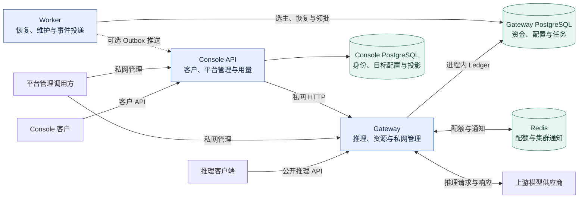

实线表示主要调用、读写或交互，箭头标明方向。虚线表示可选路径或图中标注的异步通知。Ledger 是 Gateway 与 Worker 各自在进程内使用的账本库。账务状态以 Gateway PostgreSQL 为准，Console 的用量来自已提交的事件。本地单机模式可把 Worker 运行在 Gateway 进程内。 [系统架构与数据归属](architecture.md) · [运行与恢复](reliability-and-operations.md)

- 推理与账务 · [网关内部](#网关内部架构) · [推理与切换](#推理请求与故障切换) · [定价与资金](#定价与资金账本) · [视频任务](#异步视频任务)
- 管理与恢复 · [Console 同步](#console-管理与配置同步) · [模型上架](#新模型上架与价格预览) · [Outbox 与告警](#outbox用量投影和告警) · [Worker](#worker-恢复和维护)
- 插件与部署 · [插件执行](#插件执行与宿主边界) · [插件发布](#插件发布和配置传播) · [生产](#生产部署与可观测性) · [本地](#本地开发与单机验证)

## 网关内部架构

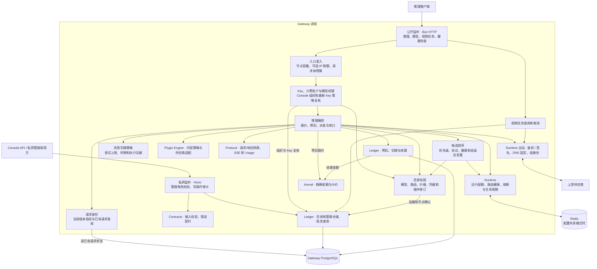

数据、快照和管理连接池在生产环境指向同一个账本数据库的写入口。管理连接使用独立数据库角色。Gateway 可通过独立队列将抽样诊断 Span 写入可选的 Trace PostgreSQL。 [Gateway 运行时](apps/gateway/src/app.ts) · [推理入口](apps/gateway/src/proxy.ts) · [管理 API](apps/gateway/src/internal-api.ts) · [Trace 队列](apps/gateway/src/trace-queue.ts)

## 推理请求与故障切换

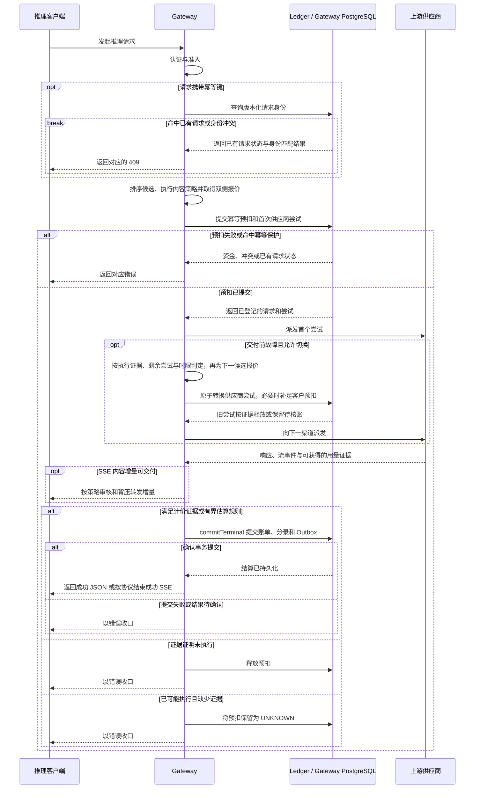

切换受发送状态、执行证据、尝试和时间预算约束。已经向客户端交付内容的 SSE 继续沿当前尝试收口。结算提交结果不明时按原请求 ID 核对。 [路由与执行](routing-and-execution.md) · [推理切换实现](apps/gateway/src/inference/route-attempts.ts) · [账务编排实现](apps/gateway/src/inference/accounting.ts)

## 定价与资金账本

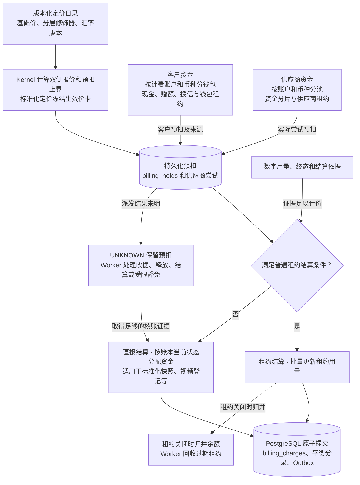

每个逻辑请求可有多个供应商尝试，客户按最终选定的尝试结算。旧尝试的供应商成本独立核账。结算与 Outbox 在 PostgreSQL 同事务提交，客户余额的租约归并可延后。充值、调账、退款和欠款通过资金操作路径保留审计。实际支付、发票及原路现金退款由外部业务系统处理。 [资金与定价](funds-and-billing.md) · [账本表和事务](database.md) · [结算分派实现](packages/ledger/src/settlement-dispatch.ts)

## 异步视频任务

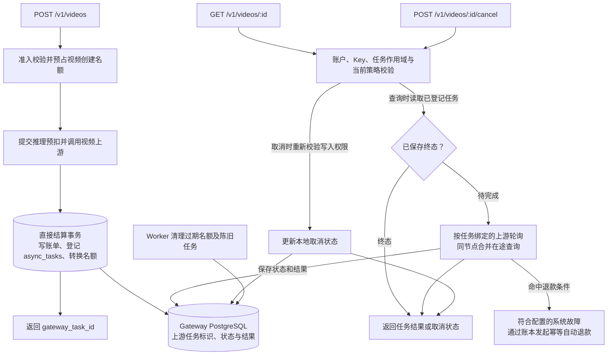

查询从 Gateway 按任务绑定的渠道读取供应商状态。取消更新本地任务状态。普通 Key 按轮换链隔离任务，账户 ADMIN 受当前 Key 策略约束。 [视频处理实现](apps/gateway/src/async-tasks.ts) · [任务仓储](packages/ledger/src/async-tasks.ts) · [个人与团队计费账户](docs/decisions/0013-personal-and-team-billing-accounts.md)

## Console 管理与配置同步

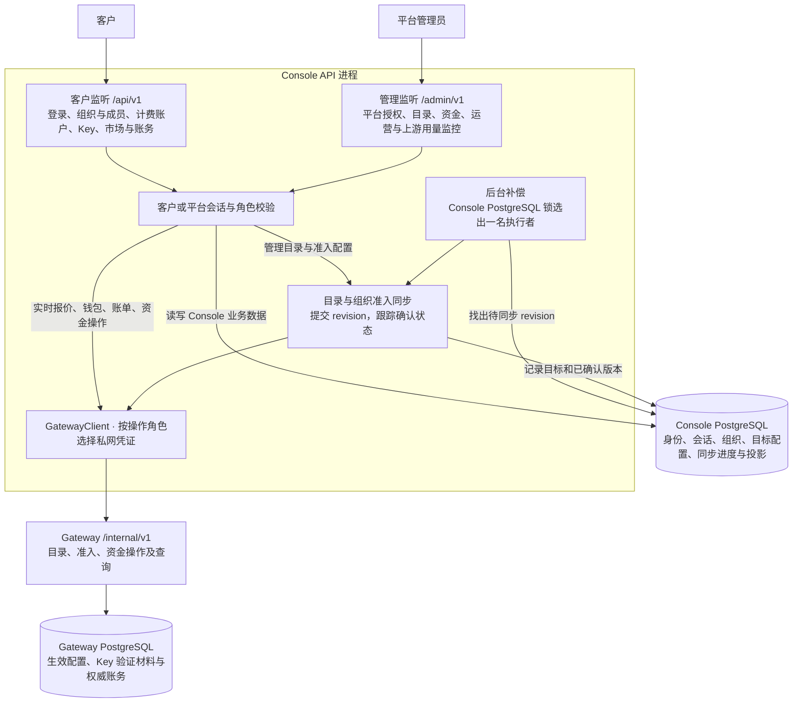

个人注册和团队创建分别开通计费账户，签发时将 Key 固定到付款账户。Gateway 使用已持久化的组织准入状态，Console 跟踪上次确认的 revision。待同步配置由 Console 保存并按可恢复条件补偿，待重新提供的渠道凭据由管理员再次提交。 [Console API 契约](docs/console-api.md) · [Console 运行时](apps/console-api/src/app.ts) · [补偿任务](apps/console-api/src/sync-reconciler.ts)

## 新模型上架与价格预览

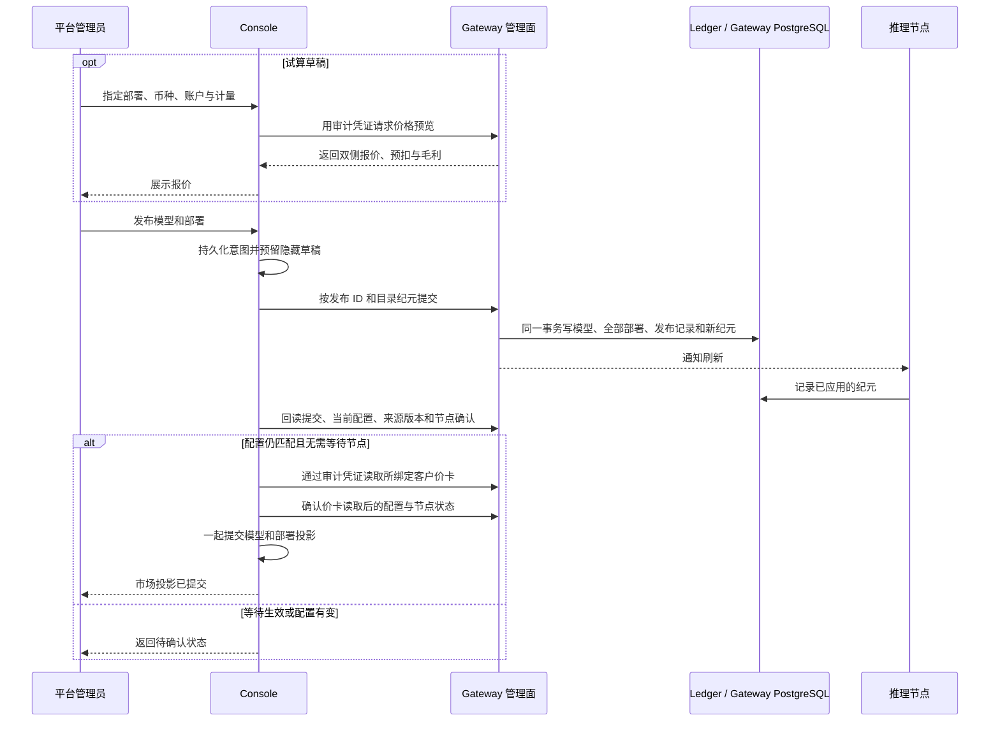

Gateway 的模型列表和推理都读取已提交快照。Console 市场在投影事务后公开模型。 [上架接口与恢复](docs/console-api.md#新模型上架与价格预览)

## Outbox、用量投影和告警

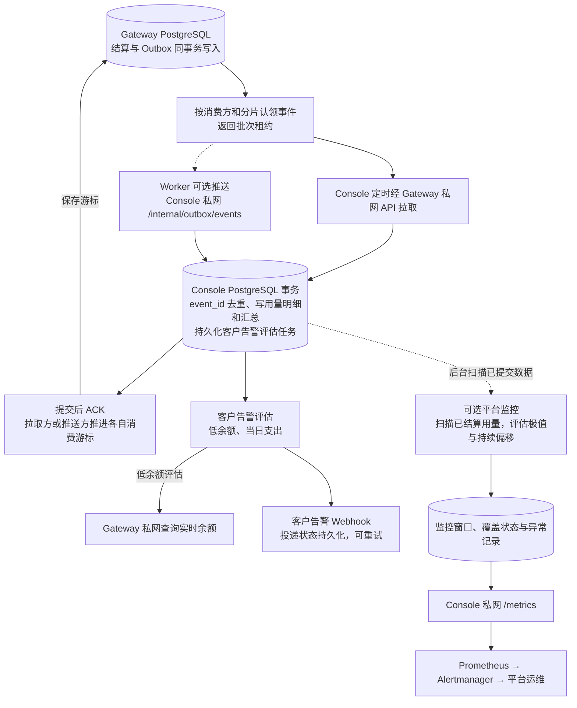

Outbox 至少一次投递。处理失败或确认未完成时，原批次可在租约释放后重投，Console 按 `event_id` 去重。平台用量异常由运维复核，相关资金操作沿用管理 API。 [消费及客户告警实现](apps/console-api/src/outbox-consumer.ts) · [上游用量监控](docs/decisions/0014-upstream-usage-monitoring.md) · [告警配置](infra/monitoring/prometheus.yml)

## Worker 恢复和维护

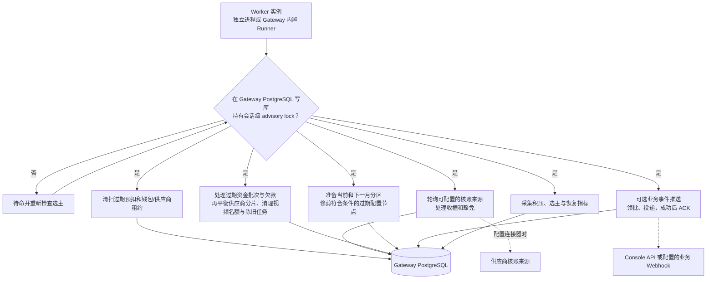

Worker 主节点负责执行恢复与维护任务。独立 Worker 可另外启用私网健康监听。失去锁后，其他 Worker 可以在稳定写库上接管。 [Worker Runner](apps/worker/src/runner.ts) · [核账轮询](apps/worker/src/reconciliation-poll.ts) · [独立进程入口](apps/worker/src/main.ts)

## 插件执行与宿主边界

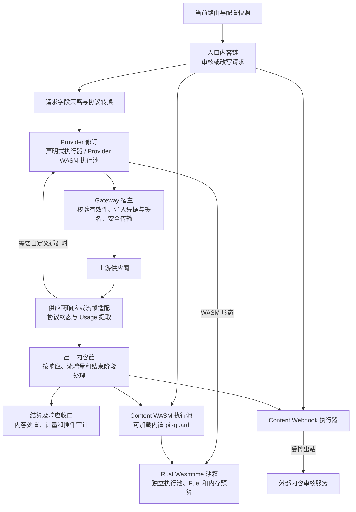

渠道固定 Provider 修订，路由固定有序的 Content 修订。宿主保管供应商秘密，并校验插件产出的用量。回程内容处理影响输出与计费处置。 [供应商插件执行器](packages/plugin-engine/src/providers/executor.ts) · [内容流水线](packages/plugin-engine/src/pipeline.ts) · [原生沙箱](native/plugin-wasmtime/src/lib.rs) · [插件架构决策](docs/decisions/0010-provider-plugin-architecture.md)

## 插件发布和配置传播

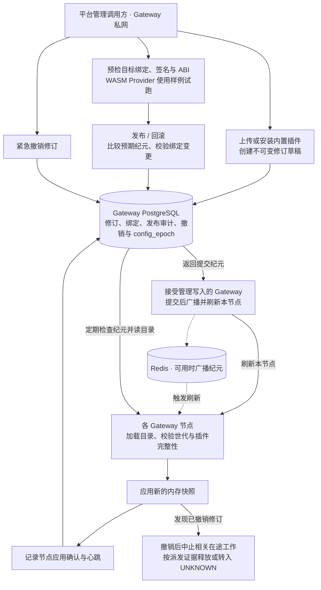

发布事务保存绑定、身份审计、纪元及提交时预期节点。Redis 加速传播，节点通过 PostgreSQL 轮询补偿并上报实际应用状态。普通发布允许在途使用原修订。紧急撤销在节点看到新快照后生效。 [发布 API](apps/gateway/src/internal-plugin-routes.ts) · [快照实现](apps/gateway/src/snapshot.ts) · [发布和撤销契约](docs/decisions/0012-plugin-revisions-and-provider-verification.md)

## 生产部署与可观测性

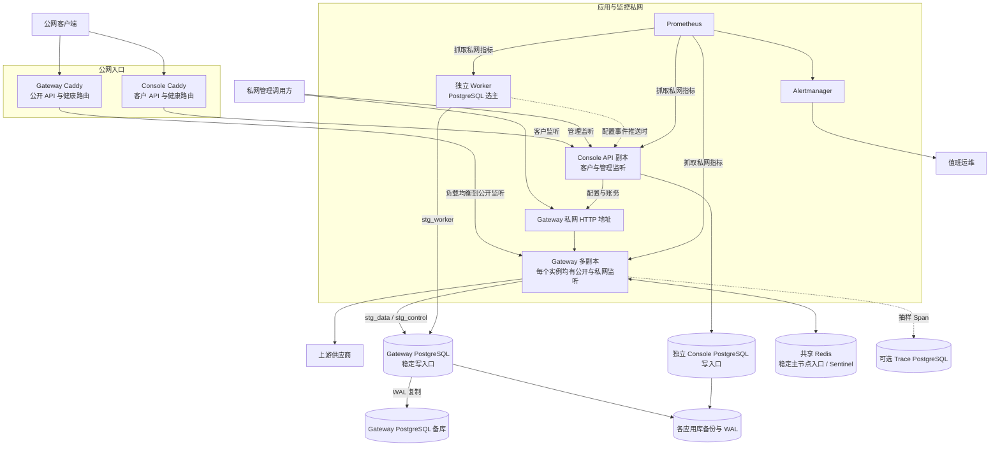

仓库提供 Caddy、systemd 和监控模板。部署环境提供 PostgreSQL 写入口切换、Redis 故障转移和故障域划分。生产指标从私网监听采集，Gateway 与 Console 各自迁移和备份。 [生产运行手册](reliability-and-operations.md) · [Gateway 入口](infra/Caddyfile) · [Console 入口](infra/console.Caddyfile) · [数据库角色](infra/postgres/roles.sql)

## 本地开发与单机验证

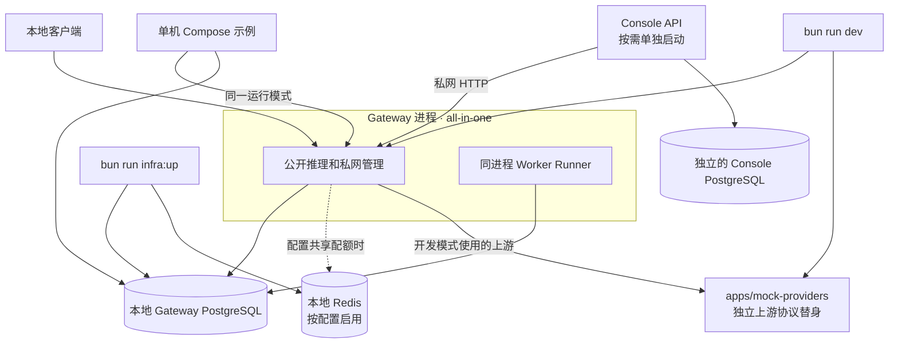

本地开发脚本同时启动 Gateway 和 Mock。仓库的 Gateway Compose 示例包含账本 PostgreSQL 和内置 Worker 的 Gateway。Console 可用独立命令或自身 Compose 启动。 [开发启动脚本](scripts/dev.ts) · [Gateway Compose](infra/docker-compose.yml) · [Console Compose](infra/console.compose.yml) · [Mock 协议覆盖](apps/mock-providers/README.md)
