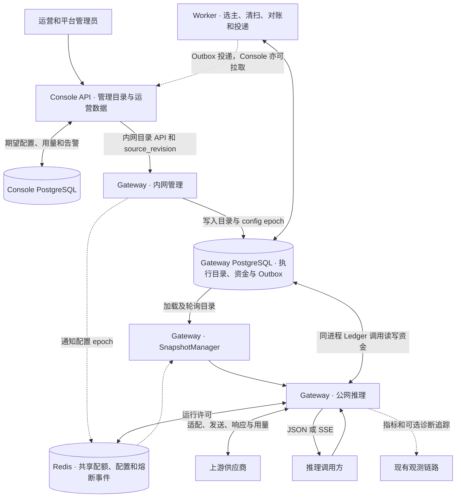
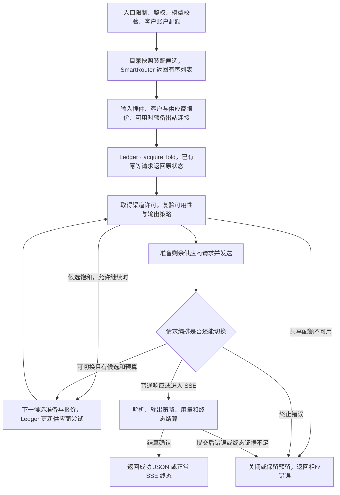
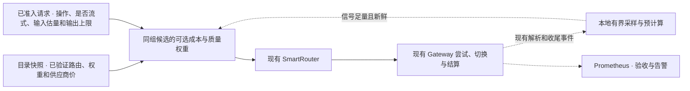

# 渠道稳定性与成本路由方案

2026-11-27 · 实现与灰度手册

**保留现有自动切换作为故障兜底，改进首次选路。** `WEIGHTED` 文本模型的 `chat` 请求默认按成本、首段内容延迟和完整率分流。首次评估可选一个有代表性的模型。实现复用现有配置发布、限流、供应商预留、结算和对账，排序只读取 Gateway 本地数据。

## 1. 当前系统架构与数据归属



- **Gateway** 在一个 Bun 进程内装配 `SnapshotManager`、`SmartRouter`、传输、插件及 `Ledger`。推理直接调用账本库。数据、快照和内网管理有独立连接池或连接角色的配置。生产配置要求独立 Gateway 和 Redis，开发可内置 Worker。 [进程装配](../apps/gateway/src/app.ts#L79) · [路由与账本装配](../apps/gateway/src/app.ts#L175) · [部署配置](../apps/gateway/src/config.ts#L251)
- **Console API** 在自己的库维护模型和路由的期望版本，通过 Gateway 内网接口同步目录。执行节点从 Gateway 库读取目录快照，Redis 通知加速更新，定时轮询补齐漏通知。热路径以本地快照执行，快照过期或谱系分叉沿用已有拒绝逻辑。 [模型与路由同步](../apps/console-api/src/sync-catalog.ts#L377) · [配置发布](../apps/gateway/src/internal-api.ts#L142) · [快照轮询](../apps/gateway/src/snapshot.ts#L323)
- **PostgreSQL 与 Worker** 持有预留、收费和账务终态。Worker 选主后清扫预留和租约、处理供应商回执及免责证据、投递 Outbox。Console 按 `event_id` 去重后生成用量投影和告警。Console 的结算事件适合运营报表，渠道故障和供应商补记成本需要从对应运行观测及 Gateway 账本取数。 [Worker 对账](../apps/worker/src/runner.ts#L85) · [Outbox 投递](../apps/worker/src/runner.ts#L193) · [Console 用量投影](../apps/console-api/src/outbox-consumer.ts#L185) · [供应商补记分录](../packages/ledger/src/reconciliation.ts#L105)

## 2. 当前推理请求如何走完



1. **入口。** `handleInferenceRequest` 创建 `request_id`、追踪与资源作用域。准入读取目录，鉴权、限制请求体，验证模型和操作，计算输出上限与客户账号 RPM、TPM、并发。`FIRST_BYTE_TIMEOUT_MS` 配好时从请求开始计算，尝试超时另由路由策略或 Gateway 默认值提供。 [推理入口](../apps/gateway/src/proxy.ts#L29) · [模型准入、客户配额与期限](../apps/gateway/src/inference/request.ts#L164)
2. **候选。** 从 `(目录快照, 模型, 操作, 客户币种)` 缓存装配路由、渠道、供应商账户和两侧价格版本。`SmartRouter` 过滤禁用、不支持操作和不可用的渠道，先按 `priority` 降序，再在同层优先原协议。未启用自适应时，`WEIGHTED` 组内用 `weight × 渠道近期成功率因子` 无放回排序。`LEAST_LATENCY` 用渠道 EWMA，另有 `ROUND_ROBIN`。供应商价格在此时已取得，启用的自适应排序用它估算进货成本。 [候选装配](../apps/gateway/src/inference/candidates.ts#L6) · [排序](../packages/runtime/src/router.ts#L374)
3. **首次预留与发送。** 首个候选先走输入插件和输出插件可用性检查，获取客户有效价和供应商保留报价。部分同协议请求可同步完成上游准备并估算输入 token。可提前取连接的无幂等键路径先预备连接，之后 `acquireHold`。有幂等键的重放通过已有指纹和账本约束识别。当前候选取得资金预留后才申请 **`channel:<id>` 的 RPM 和并发**，这一调用传入的是无实际约束的 TPM。客户账户的 TPM 是入口另一道准入。传输前仍会检查渠道与插件状态。 [输入及初次预留](../apps/gateway/src/inference/route-attempts.ts#L57) · [同步报价准备](../apps/gateway/src/inference/upstream-attempt.ts#L62) · [渠道准入](../apps/gateway/src/inference/route-attempts.ts#L332) · [发送入口](../apps/gateway/src/inference/dispatch.ts#L170)
4. **现有切换。** 自动切换沿本次已经排序的候选向后走。上游不可用或账户资金不足等可能在发送前淘汰候选。出站失败后，备选重新走输入处理、报价和出站准备，`switchSupplierAttempt` 在同一个请求下更新供应商尝试与预留。账本可按替代路由调整客户价格并补足预留。原策略以第一条完成预留的路由作为尝试上限，默认 3，且 `UNKNOWN` 受 `retry_on_ambiguous` 及可选限额控制。试点配置额外限制最多两次，遇 `UNKNOWN` 立即停止切换。当前循环计数在进入 dispatch 前增加，因此它可约束编排次数，不能直接当作供应商收到的物理请求数。 [尝试上限](../apps/gateway/src/inference/route-attempts.ts#L187) · [已有切换](../apps/gateway/src/inference/route-attempts.ts#L265) · [切换报价](../apps/gateway/src/inference/accounting.ts#L191) · [计数与收口](../apps/gateway/src/inference/route-attempts.ts#L410)
5. **响应与计量。** 普通响应由对应适配器解析和转换。SSE 只有部分路径会检查前导逻辑错误，返回流后由流处理器持有资源，已有自动切换循环就此结束。对话 SSE 可以先发正文，验证正常终态与用量并等待 `commitTerminal` 后才发正常结束。缺用量、断流和账本确认失败走既有错误及对账路径。账本按请求存一份 `billing_holds`，供应商尝试在 `supplier_holds` 中记录，`billing_charges.request_id` 唯一。预留和结算已有租约批处理与直接事务路径。 [SSE 交接](../apps/gateway/src/inference/dispatch.ts#L440) · [对话流终态](../apps/gateway/src/inference/conversation-stream.ts#L459) · [账本记录](../packages/ledger/src/schema.ts#L245) · [预留路径](../packages/ledger/src/hold-acquisition.ts#L250) · [结算队列](../packages/ledger/src/settlement-dispatch.ts#L163)

### 影响方案的现状

| 当前能力与边界                                                                                                                                          | 对本次设计的影响                                                                                                 |
| ------------------------------------------------------------------------------------------------------------------------------------------------------- | ---------------------------------------------------------------------------------------------------------------- |
| `SmartRouter` 按 `channel_id` 保存短样本、EWMA、熔断和半开 token。Redis 广播熔断与冷却事件。半开 token 目前在实例内。                                   | 现有快速隔离继续承担故障保护。模型级退化和完整率从独立的细粒度观测获取。多实例样本统计和全局探测需各自验证需求。 |
| `dispatch` 在拿到响应头并处理部分元数据后写入 `ttft_ms`。另有可选追踪单独记录首段上游文本及网关写出时点。部分半开流能在正文阶段被判探测通过。           | 路由度量用「上游已解析的首段有效内容」和「完整的上游终态」两种信号。客户端完整交付及首内容延迟另测。             |
| 传输失败按当前分支区分已知未发和结果不明。HTTP 可重试错误在部分配置下直接归为 `FAILED`，普通响应和 SSE 前导逻辑错误可携带既有 `NOT_EXECUTED` 规则证据。 | 先确认试点供应商的可切换错误和实际收费语义。仅关闭 `retry_on_ambiguous` 无法覆盖 HTTP 错误的归类分支。           |
| 供应商账户余额、渠道运行配额和结算用量有不同来源。一个客户请求已结束后仍可能有待结算供应商尝试。                                                        | 进货成本与风险从 Gateway 账本按供应商币种核对。Console 成功账单、HTTP 状态和尝试数各自保留对应口径。             |

[熔断状态与半开](../packages/runtime/src/router.ts#L143) · [Redis 事件](../packages/runtime/src/cluster-connection.ts#L590) · [延迟写入](../apps/gateway/src/inference/dispatch.ts#L294) · [首文本追踪](../apps/gateway/src/first-text-trace.ts#L164) · [HTTP 错误归类](../apps/gateway/src/inference/dispatch.ts#L88) · [连接器证据判定](../packages/plugin-engine/src/providers/executor.ts#L450)

## 3. 选路策略与配置

### 先用现有配置验证成本和稳定性

选一个请求量有代表性的 `chat` 模型，覆盖普通和流式。确认至少两条渠道提供同一模型和同等请求能力，客户基础价版本、内容策略、工具支持和关键请求变换一致。账户实体、真实上游配额与端点独立性由运营确认，网关渠道 ID 不足以证明隔离。用现有同优先级、同协议 `WEIGHTED` 让两条渠道平时分担流量，高价应急渠道放低一档并控制 RPM、并发和供应商额度。单条路由还能正常服务的模型继续使用现有策略。

记录按请求的完整交付、首内容、最终渠道，以及按尝试的失败阶段、真实发送或可能发送、429、上游完整终态和断流。测试连通性故障、响应头很快但首内容很慢、首内容正常但随后断流。若流量转移确实有收益，再启用以下排序策略。

继承默认或有显式策略的自适应 `chat` 请求自动加入采集。只采集指标的模型可通过 Gateway 启动配置 `ROUTING_OBSERVATION_MODELS` 指定，最多 16 个模型，多个名称以逗号分隔。指标走已有 Prometheus 端点。

| 指标                                                  | 口径                                                                                                                                                                                                                           |
| ----------------------------------------------------- | ------------------------------------------------------------------------------------------------------------------------------------------------------------------------------------------------------------------------------ |
| `gateway_routing_attempts_total`                      | 按模型、路由、流式模式记录已进入出站编排的尝试。`sent` 表示本地观察到请求写完或收到上游响应，`possible` 表示已进入传输且结果不明，`not_sent` 表示尚未发送。健康、资金和容量的拒绝原因继续看 `gateway_channel_failures_total`。 |
| `gateway_routing_upstream_first_content_seconds`      | 从传输写完请求到 Gateway 解析首段非空文本、拒绝正文或工具调用。只有取得两个时间点才记录。包含首段解析之前的 Gateway 处理，例如供应商请求 ID 的落库等待。按路由解读时结合已有阶段追踪。                                         |
| `gateway_routing_deliveries_total`                    | 按模型、流式模式统计请求终态。`complete` 需要有效终态和结算确认，SSE 超时或断流归 `failed`，客户端取消和请求拒绝各自计数。                                                                                                     |
| `gateway_routing_completed_delivery_duration_seconds` | 完整交付从入口至结束的耗时。可用期限所在的直方图桶作分子，将 `complete` 和 `failed` 计数之和作分母。                                                                                                                           |
| `gateway_routing_observation_overflow_total`          | 指标维度达到进程内上限后的丢样计数。比较窗口时确认该值没有增加。                                                                                                                                                               |
| `gateway_adaptive_routing_decisions_total`            | 按模型和模式统计决策。观察模式比较同组首选的 `same` 与 `different`，启用模式记录 `applied`。未使用自适应权重时记录 `insufficient`、`incomparable` 或 `incompatible`。                                                          |

按原请求归集 Gateway 账本确认的进货成本，涵盖按用量和供应商价计算的结算金额及已录入的供应商对账金额。下面的 `DATABASE_URL` 使用有读权限的 Gateway 账本连接。窗口左闭右开，最长一小时，语句超时五秒。报告按请求 UUIDv7 的时间范围使用主键索引，按供应商币种返回费用和待对账预留。金额为整数 atoms 的字符串。用近期账本窗口，已移出在线账本的归档分录需在归档分析中核对。

```bash
bun scripts/routing-cost.ts my-model 2026-11-27T16:00:00+08:00 2026-11-27T16:15:00+08:00
```

### 一处选路改造与本地反馈



**数据入口。** 在 Gateway 的候选入口使用现成的 `HydratedCandidate`、请求度量和价格版本，给 `SmartRouter` 提供可选权重修正。路由器维持现有过滤、优先级、协议顺序与三种策略的入口。修正只作用于试点 `WEIGHTED` 同组候选，空配置、数据不新鲜和样本不足时修正为 `1`。其余候选沿用当前排序和切换。

**评分。** 复用文本请求估量逻辑校验输入形状，按同模型和流式类别的近期成功结算估量输出，输出上限取本次请求的 `outputBound`。同币种按次收费使用每次费用，按 token 收费使用未缓存输入假设。多模态、无法可靠估计的收费维度或币种不一致时，同组沿用原权重。持久化金额与真实预留继续使用整数 atoms。 [评分和成本估算](../apps/gateway/src/inference/adaptive-routing.ts) · [保留报价](../packages/kernel/src/reservation.ts#L49)

组内有足够样本时使用 `运营权重 × 成本因子 × 时延因子 × 健康因子`。成本因子取组内最低估价和本候选估价的比值，下限为 0.25，免费候选取 1。健康与时延使用有界档位。每条路由至少需要 12 个成功或失败的终态样本。有至少 4 个完整响应时，还需要 4 个可以判断时延目标的样本。按 6 个 10 秒桶聚合，后台每秒刷新。429 继续走现有冷却。低样本、窗口过期和节点刚启动沿用原权重，高价备用仍按现有优先级排在后面。

**反馈。** 按路由、上游有效版本、流式模式和目标聚合，本地最多保留 256 个路由序列和 32 个模型输出序列。普通目录更新保留有效版本的样本。流式从上游请求写完量到解析首段正文或工具调用，非流式量到读完响应体。可能被落库、适配或流转发等待影响，且无法确定落在目标哪一侧的时延样本退出评分，保留原始观测指标。流可以先有首内容、后无正常终态。客户端取消、内容拦截、渠道许可失效和账本失败各自处理。 [本地采样](../apps/gateway/src/adaptive-routing-stats.ts) · [反馈入口](../apps/gateway/src/inference/telemetry.ts)

**影子与开关。** 通过 Console `POST /admin/v1/models` 发布，Gateway 内网接口 `PUT /internal/v1/models` 接受同一字段，经 `source_revision` 和目录 epoch 生效。观察模式使用同一批已准入候选，并用独立随机抽样对比同组首选。半开令牌和实际发送仍由一次真实选择管理。部署需把 Console 和 Gateway 账本迁至 `2026112702`，按现有 schema 门禁协调升级 Console、Gateway 与 Worker。切回 `observe` 恢复现有排序，继续执行已配置的预留上限和切换保护。 [模型配置入口](../apps/gateway/src/internal-api.ts#L408) · [候选排序](../packages/runtime/src/router.ts) · [Schema 版本检查](../packages/ledger/src/database.ts#L67)

未设置策略的存量和新建 `WEIGHTED` 模型默认对 `chat` 使用 `active`，延迟目标为 1500 ms。继承默认时使用路由已有的重试和执行证据规则。同组的尝试次数、超时、结果不明重试或证据要求有差异时沿用原权重。模型更新支持 `adaptive_routing: false` 关闭自适应排序，`null` 恢复默认，省略字段保留当前设置。

显式策略示例为 `adaptive_routing: { "operations": ["chat"], "mode": "observe", "first_content_target_ms": 1500, "supplier_reserve_limit": { "currency": "USD", "atoms": "100000" } }`。将 `mode` 设为 `active` 才应用自定义权重。显式策略同时应用试点切换保护。供应商预留上限可省略，配置时仅能授权指定币种，首次授权和切换共用该规则。

### 费用上限和切换边界

- **客户报价。** 同币种候选含备用需共享 `billing_price_id`，并通过协议、用量解析、关键请求配置和内容策略的兼容性检查。候选不兼容时暂停自适应。监控规则 `STGAdaptiveRoutingIncompatible` 按集群、模型和模式报告持续出现的不兼容决策。同一客户的折扣或指定价格继续由现有规则计算。显式模型策略先按原请求指纹检查幂等重放，再判断当次候选和上限。 [客户有效价格](../apps/gateway/src/pricing.ts#L73) · [幂等入口](../apps/gateway/src/inference/route-attempts.ts) · [告警规则](../infra/monitoring/alerts.yml)
- **每次供应商预留。** 带金额门槛的灰度，在现有 `quote` 后、`acquireHold` 或 `switchSupplierAttempt` 前对试点同币种精确金额做门槛检查。超限候选按候选不可用处理。这个门槛限制可授权预留金额。真实上游发生超预留费用时，账本仍记录实际证据，超额按现有账户隔离及对账规则处理。高价兜底先用现有独立供应商账户的资金及信用上限、渠道 RPM 和并发控制量级。共享同一账户的渠道不能据此声称拥有独立支出上限。 [报价入口](../apps/gateway/src/inference/accounting.ts#L125) · [供应商超额处理](../packages/ledger/src/reconciliation.ts#L120)
- **试点切换。** 显式配置 `observe` 或 `active` 时限制最多两次出站编排，原路由可配置更低上限。只在传输确认未发送，或既有可切换响应明确匹配 `NOT_EXECUTED` 时，才释放旧尝试并切换。HTTP 错误按实际状态和适配器规则最多读取 8 KiB 的 JSON 证据，超时、缺失或无法证明的结果进入 `UNKNOWN`。SSE 交付开始后由现有流终态收口。配置证据前先核对供应商实际执行语义。 [HTTP 证据与切换](../apps/gateway/src/inference/dispatch.ts) · [账本失败收口](../apps/gateway/src/inference/accounting.ts)
- **故障窗口硬预算。** 把它留到运营需要按模型、操作或时间段精确封顶时实施。归属 Ledger，在现有预留事务里同时分配窗口额度和尝试金额，按 `(预算范围, 供应商币种, 窗口)` 计数、用 `attempt_id` 做幂等。终态实际消耗、明确未执行释放、`UNKNOWN` 继续占用原窗口。届时同时覆盖租约和直接资金路径，先验证高并发预留、跨窗长 SSE、重复回执与数据库锁竞争。现有账户资金上限主要约束账户的可用资金，窗口告警只能观察趋势。

### 多实例与故障降级

首期局部统计响应本节点遇到的退化。现有 Redis 配额和熔断同步继续运行，排序无需后台依赖才能工作。Redis 已配置但共享配额不可用时保留当前拒绝和就绪语义。节点重启或统计过期用运营权重和现有熔断状态。只有灰度证明节点间样本分裂造成明显误判时，再把固定桶的计数和直方图批量合并为共享快照。多网关恢复冲击或共享供应商额度超限则单独评估全局探测租约和上游账户级配额。 [现有共享配额故障语义](../packages/runtime/src/cluster.ts#L695) · [Gateway 就绪](../apps/gateway/src/app.ts#L366)

## 4. 验收与发布顺序

| 阶段               | 交付与验收                                                                                                                                                                                                                                                              |
| ------------------ | ----------------------------------------------------------------------------------------------------------------------------------------------------------------------------------------------------------------------------------------------------------------------- |
| 现有配置与观测     | 用原路由确认独立主备有真实容量，再量化连接、429、上游慢响应、断流、本地策略、账本错误分别占多少。模型、操作、渠道和流式类别取值有界。                                                                                                                                   |
| 影子评分与安全边界 | 对照同候选时的顺序差异。证明影子运行没有额外发送、预留或影响半开状态。验证同模型不同 route 的样本隔离、价格更新和低样本回退。用真实 PG 及受控上游复测级联切换、未知成本、终态或重放。                                                                                   |
| 单模型启用         | 一个模型和操作按时间段轮换原策略与试点策略，分别看普通和流式、相近请求规模及流量。以完整交付率、P95 首内容、每千次完整交付的供应商实际成本为上线条件。若资金守恒、重复扣费或未授权发送检查失败，立即停止灰度。若成本、尾延迟、CPU 或 RSS 超出试点前约定阈值，切回观察。 |

**费用统计口径。** 比较各 Gateway 已生效同一模式的稳定时段，排除切换和预热。以原请求 UUIDv7 的时间归组，用逐请求结算金额覆盖共用供应商分录的批量结算，再补计尚未关联到同一结算记录的独立供应商对账费用。窗口关闭后确认的费用仍归原请求，待处理预留单列。不同窗口使用相同对账成熟期。正式灰度用 `ACCESS_LOG` 的结构化记录，按 `request_id` 的进入时间与账务窗口对齐。每个模型以全部 `chat` 请求中返回 `2xx` 且 `error_code` 为空的唯一请求数作完整交付分母，流式和非流式的稳定性用指标分别分析。`cohort_requests` 是留下预留记录的请求数。Prometheus 的请求终态按结束时间计入。分析额外发送与备用命中时，按现有逐请求尝试追踪读取发送证据。 [结构化访问日志](../apps/gateway/src/inference/telemetry.ts) · [成本查询](../packages/ledger/src/queries.ts) · [独立供应商对账](../packages/ledger/src/reconciliation.ts#L57)

本地验证覆盖影子和启用模式、同组加权、低样本与端点更新回退、费用上限、幂等、同状态码有无执行证据、流式终态与取消处理，以及 Console 目录发布和恢复。生产渠道故障分布、供应商未执行证据、目标阈值与灰度收益用单模型实测确认。 [自适应集成验证](../tests/integration/adaptive-routing.test.ts) · [混合及长流验收](performance/gateway-capacity-2026-11-25.md#固定到达率混合负载)
