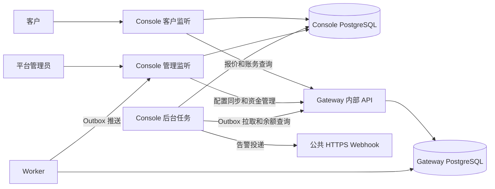

# Console API

Console 对客户开放 `/api/v1`，在独立监听端口开放 `/admin/v1` 和 Worker 推送入口 `/internal/outbox/events`。两个监听端口分别配置 CORS。客户会话、平台管理会话和 Worker 推送凭证拥有独立的授权范围。



| 业务入口                                      | 数据归属与流向                                                                                                                                                                                                                                                                              |
| --------------------------------------------- | ------------------------------------------------------------------------------------------------------------------------------------------------------------------------------------------------------------------------------------------------------------------------------------------- |
| 注册、登录、会话、组织、成员和邀请            | Console 负责身份、会话及组织权限，数据保存在专用 PostgreSQL。                                                                                                                                                                                                                               |
| 计费账户、API Key、模型、渠道、路由和价格覆盖 | Console 记录期望配置，通过 Gateway 内部 HTTP API 按 revision 同步。Gateway 持有推理生效配置和 API Key 验证材料。                                                                                                                                                                            |
| 钱包、授信、资金调整、账单和对账              | Gateway PostgreSQL 持有资金权威状态。Console 在授权后转发到 Gateway，汇总使用原子单位和币种。首次开通账户需要完成默认授信初始化，恢复时通过 Gateway 钱包版本保护已写入的策略。                                                                                                              |
| 用量和告警                                    | Worker 推送或 Console 拉取 Gateway Outbox。Console 在同一个 PostgreSQL 事务中按事件 ID 去重、更新用量投影和持久化告警任务，事务提交后即可确认事件。后台独立评估低余额和当日支出规则并投递 Webhook。低余额评估读取 Gateway 当前余额，失败可重试。接收方可按 `x-stg-alert-delivery-id` 去重。 |

账户报价读取 Gateway 已应用的价格覆盖。跨币种账单明细分别返回客户收入和供应商成本，`gross_margin_atoms` 与 `gross_margin_decimal` 返回 `null`。批量授信单次最多处理 500 个计费账户，超出时返回 HTTP 400，调用方可以按计费账户 ID 分批。预览会逐项报告钱包查询失败。上游账户显式状态变更保留待应用状态及前置条件，普通改名沿用 Gateway 当前状态。

`PATCH /admin/v1/orgs/:orgId` 持久化组织目标状态及单调递增的版本。Gateway 用组织准入记录控制已有密钥和新计费账户，账户与密钥各自的启用状态继续独立生效。管理接口返回 HTTP 200 时，Gateway 已确认该版本，后续请求使用数据库中的准入状态。已准入的请求沿用正常结算流程。确认尚未收到时返回 HTTP 202，`status` 是 Console 上次确认的状态，`requested_status` 是目标状态，`inference_sync_pending` 为 `true`。响应丢失时 Gateway 可能已经切换。Console 持久化待同步状态，在重试确认前限制该组织的 Console 操作。

渠道凭证只随同步请求发送至 Gateway。若渠道返回 `secretSyncPending: true`，管理员可使用同一渠道 ID 再次提交 `api_key`。凭证确认后才更新掩码和同步状态。

个人注册及创建团队响应包含 `default_billing_account_id`。登录用户通过 `/api/v1/billing-accounts/:billingAccountId/api-keys` 签发或列出凭证，钱包、账单、用量及告警同样遵循该账户路径。成员和邀请继续使用组织路径。注册和创建团队时可用 `billing_currency` 选择币种，默认 USD。用户随后可从 `/api/v1/auth/me` 或组织详情找到默认账户。账单、资金操作、财务摘要、任务和报价可按 `billing_account_id` 筛选。分录按 `entity_id` 或 `request_id` 等分录字段查询。未知筛选项返回 HTTP 400。网关遇到账户停用返回 HTTP 403 和 `billing_account_disabled`。账户与部署契约见 [ADR 0013](decisions/0013-personal-and-team-billing-accounts.md)。

Console 创建和轮换计费账户的 API Key 时，Gateway 签发 `sk_` 加 43 位 Base64URL 字符。明文只在签发响应的 `key` 字段返回，后续列表返回 `keyPrefix`。

Outbox 推送成功时返回 `ok`、`received` 和 `ingested`，告警结果随后写入告警记录。`CONSOLE_ALERT_EVALUATION_INTERVAL_MS` 控制评估周期，`CONSOLE_ALERT_DELIVERY_INTERVAL_MS` 控制 Webhook 投递周期。关闭 Webhook 投递时，后台仍默认每 5 秒评估一次。

构建产物包含 `dist/console-api/main.js` 和 `dist/tools/console-migrate.js`。为 Console 准备独立数据库，配置 `CONSOLE_DATABASE_URL`、Gateway 内部 URL 和服务凭证、`OUTBOX_WEBHOOK_TOKEN`。先执行迁移，再启动 Console。源码运行入口分别为 `bun run console:migrate` 和 `bun run console`。Gateway 对外 URL 通过 `GATEWAY_PUBLIC_URL` 提供给客户端示例。

Gateway 私网目录使用 `PUT /internal/v1/billing-accounts`。账单、Outbox、内容 Webhook 和 WASM 的输入统一使用 `billing_account_id`。Gateway 的私网鉴权读取 `INTERNAL_AUTH_FILE`，Console 通过操作对应的 `GATEWAY_*_TOKEN` 访问。启用 Trace 时配置 `TRACE_QUEUE_PER_BILLING_ACCOUNT`，异步任务额度使用 `MAX_ACTIVE_ASYNC_TASKS_PER_BILLING_ACCOUNT` 和 `MAX_AUTO_REFUNDS_PER_BILLING_ACCOUNT_24H`。

## 部署与验收

| 组件       | 运行方式                                                                                                                                                                                                                                                                                                             |
| ---------- | -------------------------------------------------------------------------------------------------------------------------------------------------------------------------------------------------------------------------------------------------------------------------------------------------------------------- |
| Console    | [Systemd 实例](../infra/console-api@.service) 使用独立 `llm-console` 用户。为每个副本分配端口并从 [环境模板](../infra/console.example.env) 创建权限为 `0600` 的实例配置。或者使用 [Compose](../infra/console.compose.yml)，提供容器可达的 PostgreSQL 写入地址和 Gateway 内部 URL，端口发布在宿主回环。               |
| 公网入口   | 在已有 TLS 入口顶层导入 [Console Caddy 站点](../infra/console.Caddyfile)，配置 `CONSOLE_PUBLIC_HOST`，并为 `CONSOLE_CLIENT_UPSTREAMS` 指定 Console 客户监听地址，多个地址用空格分隔。验证完整 Caddy 配置后重载。管理员通过内网 TLS 或 SSH 隧道访问管理监听。                                                         |
| PostgreSQL | Console 独立数据库使用迁移账号和运行账号。先用迁移账号初始化 schema，再由 DBA 在该数据库执行 [Console 角色配置](../infra/postgres/console-roles.sql)，将 `stg_console` 授予专用登录。运行账号通过 `CONSOLE_DATABASE_URL` 连接。Gateway 初始化后，用 [Gateway 角色配置](../infra/postgres/roles.sql) 更新准入表权限。 |
| Outbox     | [环境模板](../infra/console.example.env) 采用拉取。所有 Console 副本使用同一个 `OUTBOX_CONSUMER_NAME`，Gateway 的 `events` 凭证允许这个消费者名。采用推送时，将 Worker 的 `BUSINESS_WEBHOOK_URL` 指向管理监听的 `/internal/outbox/events`，令 `BUSINESS_WEBHOOK_TOKEN` 与 `OUTBOX_WEBHOOK_TOKEN` 一致。              |

1. 在目标 OS 和架构的构建环境执行 `bun run verify`。保留 `dist/manifest.json`、对应工件和验收结果。服务器使用已验证的工件和相同 Bun 版本。Linux Gateway 工件需要目标平台的原生 Wasmtime 库。
2. 为 Gateway 和 Console 分别创建空数据库，由各自的迁移登录担任数据库所有者。使用各自的迁移登录运行 `dist/tools/migrate.js` 和 `dist/tools/console-migrate.js`，再应用两库角色授权。Console 使用 `CONSOLE_MIGRATION_DATABASE_URL` 指定初始化连接。使用 Compose 时执行 `docker compose -f infra/console.compose.yml run --rm console-migrate`，随后执行 `docker compose -f infra/console.compose.yml up -d console-api`。Compose 使用 `CONSOLE_ENV_FILE` 加载受保护的运行配置。
3. 在推理入口开放前启动 Gateway、Worker 和 Console。创建个人和团队账户，分别签发 Key 并验证钱包扣费。确认组织准入同步的 `pending` 为 `0`，并检查所有节点连向已验收的新库。
4. 设置 `CONSOLE_ACCEPTANCE_PUBLIC_URL`、`CONSOLE_ACCEPTANCE_ADMIN_URL` 和短期 `CONSOLE_ACCEPTANCE_ADMIN_TOKEN`，执行 `bun run test:console:deployment` 或 `bun --no-env-file dist/tools/verify-console-deployment.js`。验收使用正式公网 HTTPS 并验证证书，同时检查双监听健康、公网路由白名单、匿名拒绝、组织停用同步和 Gateway 管理连通性。隔离回环实验可显式设置 `CONSOLE_ACCEPTANCE_ALLOW_PUBLIC_LOOPBACK_HTTP=1`。
5. 在隔离预发布环境运行 `bun run test:production`，验证运行账号权限、组织停用、PostgreSQL 主备切换和同集群两库 PITR。启用了 Trace 时，用实际推理请求验证新库能写入和读取 Span，核对 `billing_account_id`。验收失败时保持公开推理入口摘除。在已有环境旁新建库时，历史数据留在原库。目标环境的备份、PITR 和切换参数按实际拓扑验证。

启用 Trace 时，在启动新版 Gateway 前创建新的独立 Trace 数据库。使用具备建表权限的 `TRACE_DATABASE_URL` 执行 `bun --no-env-file dist/tools/trace-db.js migrate`，初始化现行 schema，再为 Gateway 配置指向新库的运行账号。历史 Span 留在原库，新库从切换时开始记录。

通过反向代理访问 Console 时，把 Console 实际看到的代理地址写入 `CONSOLE_TRUSTED_PROXY_CIDRS`。宿主机直接运行 Caddy 时通常为回环地址，Compose 下可能为 Docker 网桥地址。验证经代理访问的实际客户端地址被用于登录限流和审计。

在已准备服务账号、工件和 `/etc/super-token-gateway/console-1.env` 的 Linux 主机上，可用以下命令安装和核对第一个 Systemd 实例。

```sh
sudo install -m 0644 infra/console-api@.service /etc/systemd/system/
sudo systemd-analyze verify /etc/systemd/system/console-api@.service
sudo systemctl daemon-reload
sudo systemctl enable --now console-api@1.service
systemctl is-active console-api@1.service
```
