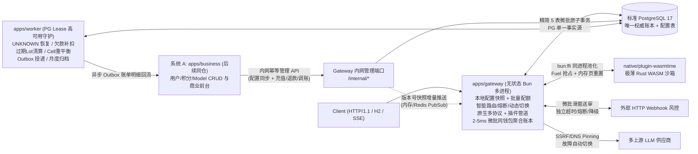

# ADR 0009: 企业级 Bun 主力架构（Gateway + Worker、精简微批 PG 核心账本、智能路由与插件管道）

- **状态**：已实施并验收通过（单机实测 12,930 RPS / 0 错误 / 全量守恒；唯一 WASM 运行时为原生 Rust `wasmtime` FFI 池化沙箱）
- **日期**：2026-11-21
- **适用范围**：`apps/gateway`、`apps/worker`、`native/plugin-wasmtime`、`packages/{kernel,contracts,protocol,plugin-engine,ledger,runtime}`（后续同仓扩展 `apps/business` 业务系统）

---

## 1. 背景、目标与非目标

### 1.1 问题根因

1. **旧 v2 三进程栈性能与维护双瓶颈**：单笔请求跨 20+ 张表写约 45 KB PG WAL，4,600+ 行巨型 PL/pgSQL 消耗约 20 ms PG CPU/笔，加上 Gateway → Core API 4 次同步 mTLS RPC 与每条 SSE 流死占 1 个插件槽位，实测仅稳定通过 175 RPS。
2. **临时 Go 原型造成双轨并存**：`apps/v3-engine` 验证了单机物理极限，但不具备多协议、多批次 lot 账本、插件处理 LLM 内容与易部署控制面，与 v2 形成新旧两套代码并存。

### 1.2 核心目标

1. **高性能与高可用**：以 **Bun 1.4.4 / TypeScript 为唯一主力栈**，依托标准 PostgreSQL + 可选 Redis，通过精简核心账本表、同钱包微批聚合提交、本地配置快照与无状态水平扩展，实现单机万级 RPS 能力与万级并发长 SSE 稳定运行。
2. **扣款准确无差错（绝对底线）**：100% 保留精确 `BigInt` 有理数单次向上取整、多币种/积分 `atoms`、多批次 `CASH`/`GRANT` lot（优先级、有效期、模型/操作限定、过期不复活）、原路退款、有界授信/欠款补扣/争议冻结、客户+供应商双侧双式平衡分录、`UNKNOWN` 挂账闭环与零模型正文持久化。
3. **可扩展的 LLM 内容处理插件体系**：内置主流官方协议原生高速实现；通过 **极薄 Rust `wasmtime`（`bun:ffi` 同进程池化）** 与 **外部 HTTP Webhook 风控插件**，安全隔离地对 LLM 请求与返回（含流式 SSE）进行脱敏、合规审查、改写与拦截止损。
4. **智能路由与故障动态切换**：基于优先级分层、策略选路（`WEIGHTED`/`ROUND_ROBIN`/`LEAST_LATENCY`）、实时 EWMA 延迟、单调时钟熔断器与 429 冷却期，在渠道故障时自动无缝切换至健康备用渠道，且严格保证绝不向客户重复扣款。
5. **双系统解耦与极简部署**：业务系统（用户/积分/Model CRUD，后续同仓 `apps/business` 开发）与本阶段交付的 **Gateway + Worker** 物理分库、通过幂等内网 API 与异步 Outbox 契约解耦；单机 `all-in-one` 模式仅需 `Bun + PostgreSQL` 即可一键运行，集群按需水平扩容。
6. **零双轨并存**：重构收口后彻底移除 `apps/v3-engine`、`apps/core-api`、`apps/core-worker`、`packages/core-client`、旧 Go stdio `packages/plugin-host` 及旧 60+ 表巨型 PL/pgSQL，全仓只保留一套最新实现。

### 1.3 非目标（本阶段排除）

- 不在本阶段开发 `apps/business` 商业用户中心、登录鉴权、支付渠道对接或运营前端（本阶段只冻结其与 Gateway + Worker 之间的内网管理 API 与 Outbox 契约）。
- 不自研多节点分布式共识/Quorum WAL 存储集群；持久化与高可用完全依托标准 PostgreSQL（主备/RDS）与标准 Redis。
- 不持久化任何模型输入/输出文本、工具参数或媒体正文。

---

## 2. 系统架构与模块职责

### 2.1 目标目录边界（单栈唯一实现）

| 路径                     | 职责                                                                                                                                         | 权威状态归属                                                  |
| ------------------------ | -------------------------------------------------------------------------------------------------------------------------------------------- | ------------------------------------------------------------- |
| `apps/gateway`           | 公网推理网关（`/v1/*`）+ 独立端口内网管理/资金 API（`/internal/*`），支持 `--mode=all-in-one\|gateway`                                       | 无持久化权威状态；内存持有配置快照、路由健康/熔断态与微批队列 |
| `apps/worker`            | 后台高可用守护（PG Advisory Lease 选主）：`UNKNOWN` 恢复、欠款自动补扣、过期 lot 清算、供应商 Cell 重平衡、Outbox 事件投递、月度分区与冷归档 | 后台任务租约与投递游标                                        |
| `apps/mock-providers`    | 独立 Hono 测试上游替身（零内部依赖）                                                                                                         | 仅测试态                                                      |
| `native/plugin-wasmtime` | 极薄 Rust `wasmtime` 沙箱共享库（~600 行）：AOT 池化、内存硬上限、Fuel 抢占、实例内存页清零、同步/异步双通道 `bun:ffi` ABI                   | 编译后模块缓存与实例池                                        |
| `packages/kernel`        | 零外部依赖纯函数：`BigInt` 有理数精确计费（`NUMERIC(38,0)`）、规范 JSON、维度与错误契约                                                      | 无状态                                                        |
| `packages/contracts`     | 公开推理、内网配置/资金同步、插件 Manifest/Hook、Outbox 事件的 Zod Schema 与类型契约                                                         | 无状态                                                        |
| `packages/protocol`      | 原生多协议转换（OpenAI / Anthropic / Gemini / Azure / Bedrock / Vertex / Embeddings / Audio / Images / Files / Batch）与零缓冲流式 SSE 解析  | 无状态                                                        |
| `packages/plugin-engine` | 统一插件管道编排（Rust `wasmtime` FFI 绑定 + 外部 HTTP Webhook 执行器 + 有界滑窗缓冲 + Ed25519 包验签）                                      | 插件实例与熔断态                                              |
| `packages/ledger`        | 精简 PG 核心账本 Schema、单一基线迁移、`BigInt` 领域状态机、2–5 ms 同钱包微批提交器、账务守恒校验与归档工具                                  | **PG 核心财务表唯一写入层**                                   |
| `packages/runtime`       | SSRF/DNS Pinning 传输层、加密/签名（AES-GCM/HMAC/Ed25519/SigV4）、本地+Redis 批量限流、智能路由健康与熔断器                                  | 本地/Redis 限流与健康态                                       |

### 2.2 彻底清理的旧双轨代码（实施完毕后零残留）

- 删除：`apps/v3-engine`、`scripts/v3-engine.ts`、`apps/core-api`、`apps/core-worker`、`packages/core-client`、`packages/plugin-host`（含旧 Go stdio `native/`）、`packages/plugin-sdk`、`packages/adapters`（协议层迁入 `packages/protocol`）、`packages/storage`（财务与目录层重构入 `packages/ledger`）、空目录 `apps/admin` 与 `apps/client`。

---

## 3. 智能路由与渠道故障动态切换

### 3.1 候选过滤与排序（纯内存，< 10 µs）

1. **快照查表**：根据 `(model, operation)` 取出全部已启用 `routes`（关联 `channel`、`upstream_account`、客户价目与供应商成本价目）。
2. **硬过滤**：剔除禁用路由/渠道、协议不支持项、熔断状态 `OPEN`、处于 429 冷却期（`cooldown_until > now`）、或本地已知供应商账户冻结/耗尽的渠道；若模型不支持所请求托管工具且无计量维度，直接返回 `422 unmetered_tool`。
3. **分层选路**：按 `priority DESC` 分组，同优先级内按模型策略无放回排序：
   - `WEIGHTED`：按 `weight * health_factor` 加权随机；
   - `ROUND_ROBIN`：进程内原子计数轮询；
   - `LEAST_LATENCY`：按渠道实时 EWMA 延迟（`0.8 * prev + 0.2 * sample`）升序。

### 3.2 单调时钟熔断状态机与 429 冷却

- 全部时间基于单调时钟（`performance.now()`），免疫系统挂钟回拨：
  - `CLOSED → OPEN`：连续可重试上游失败 `>= failureThreshold`（默认 3）或滑动窗错误率 `> 50%`（样本 `>= 10`）；熔断时长 `openDurationMs`（默认 15s，指数退避上限 120s）。
  - `OPEN → HALF_OPEN`：冷却到期后仅放行 1 路并发探针；探针成功立即重置为 `CLOSED`，失败立即回到 `OPEN`。
  - **429 精准避让**：解析上游 `Retry-After`（默认 5s，上限 60s）写入 `cooldown_until`，立即切走且不将临时限流误判为永久宕机。
  - **渠道鉴权故障快速隔离**：上游返回渠道级 `401`/`403`（上游 Key 失效或欠费）立即进入长冷却（60s）并上报渠道故障告警，自动切换备用渠道。
  - **集群同步**：多实例部署时通过 Redis Pub/Sub 异步广播熔断/冷却事件（零同步阻塞）。

### 3.3 动态故障切换与资金安全边界（核心铁律）

| 故障阶段与类型                                                                                                            | 是否允许动态切换                                                | 旧 Attempt 供应商侧资金处理                                                 | 客户侧资金处理                                                                                                     |
| ------------------------------------------------------------------------------------------------------------------------- | --------------------------------------------------------------- | --------------------------------------------------------------------------- | ------------------------------------------------------------------------------------------------------------------ |
| **Pre-First-Byte 确定未消费失败**：TCP/DNS/TLS 失败、连接超时、`429`、`500`/`502`/`503`/`504`/`529`、渠道 Key `401`/`403` | **允许**（上限 `max_attempts` 默认 3，受总请求 deadline 约束）  | 标记 `FAILED`，原子释放旧 attempt 的供应商 Cell 预扣                        | **绝不重复预扣/扣款**；仅保持单一请求 `billing_hold`，若备选渠道更贵则原子补足差额预扣，最终按成功渠道价目精确结算 |
| **Pre-First-Byte 结果未明**：请求已发出后遭遇断连或读头超时                                                               | **按路由策略可选**（仅幂等请求或路由允许 `retry_on_ambiguous`） | 标记 `UNKNOWN`，**保留旧 attempt 供应商风险预扣**交 Worker 对账，不静默释放 | 客户侧始终只按最终成功的唯一 `selected_attempt` 结算一次；若全部尝试均未明则保留客户 `UNKNOWN` 占位                |
| **不可重试客户端错误**：`400`、`404`、`413`、`422`、上游内容政策拒绝                                                      | **禁止切换**，直接返回                                          | 标记 `FAILED`，原子释放供应商预扣                                           | 原子释放客户 `billing_hold`（0 扣费）                                                                              |
| **Post-First-Byte（已向客户端输出首字节 SSE）**                                                                           | **禁止切换**（防止半截拼接另一模型正文）                        | 按已观测 usage 结算或保留 `UNKNOWN` 风险，同时触发故障渠道降权/熔断         | 按已确认证据结算或挂 `UNKNOWN` 待对账，明确返回错误终止帧                                                          |

---

## 4. 精简微批 PG 核心账本与数据结构设计

### 4.1 财务不变量底线（数据库硬约束 + 领域层双重守卫）

1. **金额类型**：全部金额为整数原子单位 `NUMERIC(38,0)`（TS 侧 `BigInt`），支持任意 3–8 位币种/积分代码（如 `USD`、`CNY`、`PTS`）。
2. **精确计费**：所有计量维度按有理数 `numerator / denominator` 通分求和后**单次向上取整**，无任何浮点运算。
3. **Lot 守恒铁律**：`wallet_lots` 每行强制数据库约束 `issued_atoms = available_atoms + reserved_atoms + spent_atoms + expired_atoms`，且各项 `>= 0`。
4. **过期不可复活铁律**：结算返还多余预扣或退款回流时，若原 lot 已过期（`expires_at <= now()`），必须转入 `expired_atoms`，严禁重新变为 `available_atoms`。
5. **双式平衡与不可变铁律**：`ledger_entries` 禁止 `UPDATE` 与 `DELETE`；同一 `journal_id` 至少 2 条分录且 `SUM(atoms) = 0`。
6. **唯一计费幂等铁律**：`billing_charges.request_id` 全局唯一；充值/退款/调账按 `(scope, external_ref)` 唯一且校验载荷 SHA-256 指纹冲突（`409`）。
7. **隐私红线**：任何表、日志、Outbox 事件均不存储 LLM 输入/输出正文或工具参数。

### 4.2 精简核心表结构（热路径仅触碰 5 张核心表，目标 PG WAL ≤ 2–3 KB/笔）

#### A. 配置与路由表（由 `/internal/*` 写入，Gateway 启动加载并内存热更新，热路径 0 DB 读）

- `projects (id PK, external_ref UNIQUE, name, currency, rpm, tpm, concurrency, enabled, config_version, created_at, updated_at)`
- `api_keys (id PK, project_id FK, verifier UNIQUE, prefix, role, allowed_cidrs text[], models text[], operations text[], enabled, expires_at, created_at)`
- `upstream_accounts (id PK, name, state CHECK('ACTIVE','DISABLED','RECONCILE_REQUIRED'), revision, created_at)`
- `channels (id PK, account_id FK, name, kind, base_url, secret_ciphertext, rpm, concurrency, enabled, routing_policy jsonb, config_revision, updated_at)`
- `models (name PK, operations text[], routing_strategy CHECK('WEIGHTED','ROUND_ROBIN','LEAST_LATENCY'), max_output_tokens, enabled)`
- `routes (id PK, model_name FK, channel_id FK, upstream_model, operations text[], priority, weight, billing_price_id FK, cost_version_id FK, request_policy jsonb, plugin_pipeline jsonb, enabled)`
- `price_versions (id PK, side CHECK('CUSTOMER','SUPPLIER'), currency, basis CHECK('PROVIDER_USAGE','REQUEST_COMPLETION','INPUT_CHARACTERS'), rates jsonb, ceilings jsonb, source_digest, created_at)` — 不可变触发器保护
- `plugins (id PK, name, version, kind CHECK('WASM','WEBHOOK'), digest, wasm_bytes bytea CHECK(octet_length<=16777216), webhook_config jsonb, signature, signing_key_id, manifest jsonb, enabled, created_at)`

#### B. 核心资金账本表（热路径 5 表）

1. **`wallets`**（客户钱包主状态，每 `(project_id, currency)` 一行）：
   - `id PK`, `project_id FK`, `currency`, `policy CHECK('GIFT_FIRST','CASH_FIRST','EARLIEST_EXPIRY')`
   - `available_atoms`, `reserved_atoms`, `spent_atoms`, `expired_atoms`, `debt_atoms`, `credit_limit_atoms`, `credit_reserved_atoms`（均 `NUMERIC(38,0) CHECK >= 0`）
   - `credit_policy_version NUMERIC(38,0)`, `manual_frozen bool`, `evidence_disputed bool`, `freeze_reason text`
   - 唯一索引：`UNIQUE(project_id, currency)`
2. **`wallet_lots`**（客户批次资金源）：
   - `id PK`, `wallet_id FK`, `kind CHECK('CASH','GRANT')`, `priority int`, `models text[]`, `operations text[]`, `expires_at timestamptz`
   - `issued_atoms`, `available_atoms`, `reserved_atoms`, `spent_atoms`, `expired_atoms`（强制行级守恒 `CHECK`）
   - 部分索引：`INDEX ON (wallet_id, priority, expires_at) WHERE available_atoms > 0`
3. **`supplier_cells`**（供应商 16 分片资金单元，消除大渠道单行锁）+ `supplier_root_balances`：
   - `supplier_cells (account_id, currency, cell SMALLINT CHECK(0..15), PRIMARY KEY(account_id, currency, cell), balance_atoms, reserved_atoms, spent_atoms, revision)`
4. **`billing_holds`**（轻量过渡占位，正常请求终态即闭合；异常 `UNKNOWN` 永久留存待对账）：
   - `request_id PK`, `project_id`, `wallet_id`, `operation`, `model`, `idempotency_key`, `fingerprint`
   - `held_atoms`, `credit_atoms`, `lot_allocations jsonb`（`[{lot_id, amount_atoms}]`）, `supplier_holds jsonb`（`[{attempt_id, account_id, cell, held_atoms, state}]`）
   - `wallet_lease_id uuid NULL`, `supplier_lease_id uuid NULL`（绑定到本节点活跃 PG 分片租约；故障切换或异常关闭时原子 `detach` 回落至 `lot_allocations`）
   - `state CHECK('HELD','SETTLED','RELEASED','UNKNOWN','CONFLICT')`, `expires_at`, `created_at`, `closed_at`
   - 唯一部分索引：`UNIQUE(project_id, operation, idempotency_key) WHERE idempotency_key IS NOT NULL`；回收部分索引：`INDEX ON (expires_at) WHERE state IN ('HELD','UNKNOWN')` 与活跃租约部分索引
5. **`wallet_leases` + `supplier_leases`**（PG 持久化节点分片租约，打破热点单行锁并保持 `SIGKILL` 零丢账）：
   - `wallet_leases (id PK, node_id, wallet_id FK, currency, lot_allocations jsonb, remaining_atoms NUMERIC(38,0), earliest_lot_expires_at, state CHECK('ACTIVE','CLOSED'), expires_at, created_at, updated_at)`
   - `supplier_leases (id PK, node_id, account_id FK, currency, cell SMALLINT, remaining_atoms NUMERIC(38,0), state CHECK('ACTIVE','CLOSED'), expires_at, created_at, updated_at)`
   - 自适应激活：同批次达到热度阈值（`count >= 4` 或 2 秒内 `>= 16` 命中）且钱包无冻结/欠款/受限 lot 时，按需从 `wallets`/`wallet_lots` 与 `supplier_cells` 预留 `<= 50%` 可用余量作为 PG 持久化租约；空闲 `250 ms` 或进程优雅 `drain()` 自动归还，节点被 `SIGKILL` 后由 Worker `sweepExpiredLeases` 原子分离未闭 `billing_holds` 并将剩余资金退回 `available_atoms`（已过期 lot 严格计入 `expired_atoms` 永不复活）。续约以 PG 返回的有效期为准。回收持有排他租约锁后重新核验到期和开放预扣，遇到已被结算事务锁定的预扣则留到下一轮。
6. **`billing_charges`** + **`ledger_entries`**（按月分区不可变终态凭证与统一双式分录）：
   - `billing_charges (id PK, request_id UNIQUE, project_id, wallet_id, selected_attempt_id, channel_id, model, operation, currency, billing_price_id, cost_version_id, usage jsonb, usage_digest, customer_atoms, funded_atoms, debt_atoms, refunded_atoms, supplier_cost_atoms, supplier_currency, lot_allocations jsonb, plugin_audit jsonb, charge_policy, outcome, customer_journal_id uuid, supplier_journal_id uuid, created_at)`
   - `ledger_entries (journal_id, ordinal, created_at, side CHECK('CUSTOMER','SUPPLIER'), entity_id, request_id, reference, kind, currency, account, atoms)` — **按 `created_at` 月分区**，不可变触发器 + 事务级 `SUM(atoms)=0` 约束；微批聚合结算时按 `(wallet_id, currency)` 与 `(account_id, currency)` 生成平衡批量凭证并把 `customer_journal_id`/`supplier_journal_id` 双向绑定至每笔 `billing_charges`，保持 100% 审计可追溯性。

#### C. 配套幂等运维与事件回流表

- `funding_operations (id PK, side, entity_id, kind CHECK('CREDIT','REFUND','ADJUST','SUPPLIER_RECHARGE','SUPPLIER_ADJUST'), external_ref, fingerprint, amount_atoms, currency, payload jsonb, receipt jsonb, created_at)` — `UNIQUE(side, entity_id, kind, external_ref)`
- `billing_resolutions (id PK, request_id UNIQUE, action CHECK('SETTLE','RELEASE'), billing_price_id, usage jsonb, reason, actor, created_at)`
- `outbox_events` 保留单调序号和稳定的 event ID。发布语句在分配序号前持有事务级锁，使可见顺序与序号一致。消费者只能确认本次有效认领的范围，失败后允许重投。升级前已经跳过的事件可用新消费者从保留的事件中重放，并按 event ID 幂等处理。

### 4.3 自适应分片租约 + 2 ms 微批 9 表 CTE 聚合事务协议（强类型 Bun/TS）

1. **双轨自适应快慢路径（同一账本引擎内，无旧代码）**：
   - **冷钱包 / 授信 / 限模型 Lot / 幂等键请求**：走 2 ms 同钱包微批聚合器（`acquireQueue`），按全局升序 `FOR NO KEY UPDATE` 锁序批量完成 lot 预扣与 `billing_holds` 写入；达到热度条件后在同一事务内无缝签发 `wallet_leases` + `supplier_leases`。
   - **热钱包租赁快路径（`fastHoldQueue`，并发度 4、单批上限 512）**：先在内存中从活跃租约划拨预扣额度，随后在一条集合 SQL 内锁定并校验当前节点持有的活跃租约，再持久化预扣。快路径只锁租约行，失效项回落到普通预扣。收到持久化确认后才派发。
2. **9 表单一 Data-Modifying CTE 微批结算（`commitQueue`，并发度 2、单批上限 512）**：
   - 严格遵循全局锁序：`1. billing_holds → 2. wallet_leases → 3. supplier_leases → 4. wallets → 5. wallet_lots → 6. upstream_accounts → 7. supplier_cells`，全线使用 **`FOR NO KEY UPDATE`** 避免与并发 `INSERT INTO billing_holds` 外键 `FOR KEY SHARE` 产生锁冲突或死锁。
   - 单条 SQL 9 表 CTE 原子完成 `wallet_leases`、`supplier_leases`、`wallets`、`wallet_lots`、`supplier_cells`、`billing_holds` 更新与 `billing_charges`、`ledger_entries`（受 PG 平衡/不可变触发器硬守卫）、`outbox_events` 批量插入，单笔 PG WAL 降至 **3.4–3.7 KB**。
3. **异常、故障切换与 `SIGKILL` 恢复**：
   - 故障切换（`switchSupplierAttempt`）、释放（`releaseHold`）、标未明（`markUnknown`）及跨租约/过期边界请求自动调用 `detachHoldFromLeaseTx` 从租约分离并安全落回标准事务路径；
   - 进程被 `SIGKILL` 强杀后，未闭合 `billing_holds` 与过期 `wallet_leases`/`supplier_leases` 由 `apps/worker` 的 `sweepTimedOutHolds` + `sweepExpiredLeases` + `expireAllLots` 全量回收，经人工或自动决议后 `auditConservation()` 100% 归零守恒。

### 4.4 Drizzle ORM 与原生 `Bun.SQL` 的职责边界

在 `packages/ledger` 内部分层协作，`apps/gateway` 与 `apps/worker` 不直接导入 `drizzle-orm`：

- **使用 Drizzle ORM（`drizzle-orm/bun-sql`）的场景**：
  1. **单一真源 Schema 声明（`packages/ledger/src/schema.ts`）**：完整声明全部 23 张表的列、类型、JSONB `$type<...>()` 与 `bytea` 自定义类型，并与 `0000_v4_baseline.sql` 在真实 PG 集成测试（`G1.6`）中逐表逐列 1:1 校验零漂移。
  2. **配置目录与快照仓储（`packages/ledger/src/catalog.ts`）**：项目、Key、渠道、模型、价目、路由、插件的全部 CRUD Upsert、配置纪元递增与全量快照读取。
  3. **非热路径查询与状态流转**：钱包/供应商余额查询、版本校验（`assertSchemaVersion`）、`markUnknown`、超时预扣扫尾、Outbox `claim`/`ack` 与月度冷归档导出查询。
- **保留原生 `Bun.SQL` 的场景**：
  1. **微批集合热路径**：`fastHoldQueue` / `acquireQueue` / 9 表单 CTE `commitQueue` 批量 `UPDATE/INSERT ... FROM unnest(...)`、显式升序 `FOR NO KEY UPDATE` 行锁与资金事务（支撑单机 12,930+ RPS 热路径）。
  2. **DDL 与 PG 专有控制**：基线 SQL 迁移（含 `PARTITION BY RANGE`、`DEFERRABLE` 复式记账触发器、`immutable_record` 触发器与 `pg_advisory_lock`）。

### 4.5 账本实现边界

`createLedgerEngine` 统一装配请求预扣、终态结算、钱包、供应商、核账、事件和守恒检查。预扣和结算各自拥有微批队列。租约管理模块拥有节点内注册表和续租、回收、停机生命周期。按持久化预扣类型选择对应的结算事务，事务模块负责锁序、分录、余额与 Outbox 的原子写入。新租约和结算结果在 PostgreSQL 提交后更新本地注册表。钱包退款、调账和收债使用钱包优先的锁序。后台清扫按资金归属使用同一实现。

人工核账对同一预扣先锁定再读取决议。释放或结算复用同一账本事务实现，将资金终态及核账凭证在同一事务中提交。写入凭证失败时保留原预扣供重试。账本确认提交后更新本地租约状态。

---

## 5. 插件管道设计（极薄 Rust `wasmtime` + 外部 HTTP Webhook）

### 5.1 统一管道语义

路由通过 `plugin_pipeline` 声明有序插件链（按 `priority` 顺序执行）：

- **Hook 点**：`on_request` →（上游调用）→ `on_response`（非流式）或 `on_stream_chunk` + `on_stream_end`（流式）。
- **动作返回值**：
  - `PASS`：放行原文；
  - `TRANSFORM`：替换为改写/脱敏后的文本，流向下游插件或客户端；
  - `BLOCK { rule_code, http_status, safe_message }`：立即短路后续插件并向 LLM 上游发出 `Abort` 止损。
- **权限铁律**：内容处理插件**无权写入或篡改 `usage` 计量维度**；仅带显式授权的协议适配器/计量插件可产出 usage。

### 5.2 WASM 沙箱执行器（唯一原生 Rust `wasmtime` FFI 池化沙箱）

- **统一 Guest ABI（零 Host Import）**：导出 `memory`、`stg_alloc(i32) -> i32` 及 `<hook>(ptr, len) -> i64`（高 32 位指针、低 32 位长度）；编译期拒绝任何 Host Import。
- **唯一原生 Rust `wasmtime` 沙箱（`createWasmtimeExecutor` + `native/plugin-wasmtime`）**：
  - 彻底移除旧 Bun `WebAssembly` Worker 回退实现；启动阶段强制执行零导入自检（`selfCheck()`），缺失原生库或自检失败拒绝启动；
  - 所有 Rust `extern "C"` FFI 入口均使用 `catch_unwind` 边界保护，启用紧致 `PoolingAllocationConfig` 复用内存页槽位，按插件硬上限通过 `ResourceLimiter` 拦截 `memory.grow` 越界与指令级精确 Fuel 计量；
  - Gateway 拆分为内容插件池（`CONTENT_WASM_POOL_SIZE`）与渠道插件池（`PROVIDER_WASM_POOL_SIZE`）两套隔离执行池；队列采用租户公平调度与 `egress > ingress` 双优先级（80% 队列水位触发 ingress 主动丢弃，保护已产生上游成本的回程校验）；
  - Guest Trap/Fuel 耗尽不再驱逐已编译模块缓存；所有 WASM 加载前均执行 `sha256(wasm_bytes) === digest` + Ed25519 签名缓存校验，生产模式（`NODE_ENV=production`）强制要求 `PLUGIN_SIGNING_PUBLIC_KEY_PEM`。
- **零长流占槽**：流式插件滑窗状态以受限字节（≤ 4 KB）寄存在 Gateway 连接上下文中，SSE 等待吐字期间占用 **0 个插件实例**。

### 5.3 外部 HTTP Webhook 风控插件

- **流式微批聚合**：按字符阈值（默认 256 chars）、时间窗（默认 300 ms）或句界聚合送审，并在 `[DONE]` 释放前必做一次终审，避免逐 token 轰炸外部风控。
- **两种可配置流式模式**：
  - `HOLD_UNTIL_APPROVED`（缓冲审核）：暂存当前有界小窗（上限 4 KB），Webhook 放行后再吐给客户端，违禁词零漏出；
  - `STREAM_AND_CUTOFF`（旁路审核）：首字直出保 TTFT，异步送审，命中 `BLOCK` 立刻截断后续流并中止上游。
- **弹性保护**：独立超时（默认 200 ms）、有界响应体上限（默认 1 MiB）、按插件并发上限（默认 64）、`HALF_OPEN` 单探针熔断恢复与可配降级策略（`FAIL_CLOSED` 严格阻断 / `FAIL_OPEN` 放行并记 `fail_open: true` 审计与指标）。

### 5.4 三分故障分类与拦截账务策略

- 所有插件结果显式区分 `content_decision`（内容策略判决）、`plugin_fault`（插件故障/Trap/非法响应）与 `host_capacity`（沙箱队列满/熔断/超载）；
- **客户侧与通道健康隔离铁律**：
  - 仅 `content_decision` 按配置执行 `CHARGE_CUSTOMER`（默认）或 `PLATFORM_ABSORB` 并返回 `content_blocked`；
  - `plugin_fault` / `host_capacity` 在 `FAIL_CLOSED` 下上游调用前返回 `500 plugin_execution_failed` / `503 plugin_capacity_unavailable`（附 `Retry-After`）且 0 扣费；上游调用后强制 `PLATFORM_ABSORB`（不向客户扣费、记入 `system:moderation_loss` 并受每租户吸收上限保护），且绝不计入上游渠道熔断器；
  - `FAIL_OPEN` 放行正文时正常向客户扣费，并在 `billing_charges.plugin_audit` 写入 `fail_open: true` 供事后对账；
  - `adapt_response` 本地故障保留 `UNKNOWN` 挂账且不误伤渠道熔断器。
- 账单 `billing_charges.plugin_audit` 记录 `{plugin_id, version, hook, action, rule_code, outcome_kind, fail_open, latency_us}`，不留存任何文本正文。

---

## 6. 业务系统对接契约（`apps/business` ↔ `Gateway + Worker`）

1. **内网管理与同步 API（独立监听端口 `/internal/v1/*`，Bearer/mTLS 鉴权）**：
   - 配置 CRUD 同步（幂等 upsert + `config_version` 递增并触发 Gateway 本地快照热更新）：`projects`、`api_keys`、`upstream_accounts`、`channels`、`models`、`routes`、`price_versions`、`plugins`。
   - 资金操作（单一权威写入 Gateway PG，强幂等 `external_ref`）：
     - `POST /internal/v1/wallets/:projectId/credits`（现金/赠送积分 Lot 入账）
     - `POST /internal/v1/charges/:chargeId/refunds`（精确原路退款）
     - `POST /internal/v1/charges/:chargeId/adjustments`（账单调账）
     - `POST /internal/v1/wallets/:projectId/credit-policy`（有界授信配置）
     - `POST /internal/v1/requests/:requestId/resolve`（`UNKNOWN` / 争议决议）
     - `GET /internal/v1/wallets/:projectId`、`GET /internal/v1/charges`（实时余额与账单明细查询）
2. **异步消费明细回流（Outbox）**：
   - `POST /internal/v1/events/claim` + `POST /internal/v1/events/ack`（以及可选 Worker 主动 Webhook 推送至业务系统），至少一次投递、按 `event_id` 幂等去重，回流 `request_id`、`usage`、精确扣款、`lot_allocations`、插件审计与最新余额快照。

---

## 7. 验收规则（客观门禁，全部必须通过）

### G1：财务准确与守恒底线（零容忍）

- **G1.1 精确计费**：覆盖 `1/3` 原子多维求和单次向上取整、18 位小数秒、超过 `Number.MAX_SAFE_INTEGER`（`9007199254740993`）直至 `NUMERIC(38,0)` 边界、缓存写入分区一致性检验。
- **G1.2 Lot 生命周期与原路退款**：跨带过期时间的 `GRANT` + `CASH` 多 lot 预扣→实结→多退（过期转 `expired_atoms` 不复活）→部分/全额原路退款→欠款自动补扣；每次操作后断言全库 `SUM(atoms)=0` 及每行 `issued = available + reserved + spent + expired`。
- **G1.3 热点并发与防双扣**：100 并发争抢同一钱包最后一笔余额，零负余额、零 `55P03` 假失败；相同 `idempotency_key` 并发重放只扣一次；进程异常后遗留 `UNKNOWN` 占位经 Worker 恢复与决议后全库守恒。
- **G1.4 插件拦截记账与隐私**：`CHARGE_CUSTOMER`（默认）与 `PLATFORM_ABSORB` 在非流式/流式拦截下分录严格平衡；全库与日志中零模型正文泄露。

### G2：智能路由与动态故障切换

- **G2.1 Pre-First-Byte 自动切换**：注入连接拒绝、超时、`500`/`502`/`503`、`429`（含 `Retry-After`）、渠道 Key `401` 故障，断言自动无缝切换至备用健康渠道并返回 200；旧渠道供应商预扣精确释放（确定失败）或留存 `UNKNOWN`（发后超时），客户侧仅扣 1 次且按实际成功渠道价目计费。
- **G2.2 熔断与恢复**：连续失败达阈值进入 `OPEN` 后，后续请求 0 ms 跳过故障渠道；冷却到期进入 `HALF_OPEN` 单探针成功后自动恢复 `CLOSED`。
- **G2.3 策略与流式边界**：验证 `WEIGHTED`/`ROUND_ROBIN`/`LEAST_LATENCY` 选路分布；验证 Post-First-Byte SSE 断流时不拼接另一模型文本、正确结算并触发渠道降权熔断。

### G3：插件内容处理与安全隔离

- **G3.1 Rust `wasmtime` 能力与隔离**：验证非流式与流式（含跨 chunk 拆分敏感词有界滑窗）脱敏/改写/拦截；恶意插件（死循环、内存爆分配、文件/网络越权、跨租户内存探测）100% 被 Fuel/上限/页重置拦截，宿主存活且其他并发请求 0 报错。
- **G3.2 外部 Webhook 风控**：验证 `HOLD_UNTIL_APPROVED`（违禁词 0 字节漏出）、`STREAM_AND_CUTOFF`（命中即断并中止上游）、超时/5xx 触发 `FAIL_CLOSED`/`FAIL_OPEN` 及独立熔断。

### G4：性能与并发目标及实测验收（Bun 1.4.4 + 真实 PG 17 `fsync=on, synchronous_commit=on, full_page_writes=on`）

- **单独立 Gateway 进程（`BENCH_SECONDS=8 bun run bench:single`，593,882 笔实结，0 错误，守恒 `ok=true`，空闲退租 `active_leases=0`）**：
  - 短 Chat JSON：512c **11,334.4 RPS**（P99 55.83 ms）、768c **12,456.9 RPS**（P99 99.71 ms）、1024c **12,930.1 RPS**（P99 100.53 ms，GW CPU 81.7%，RSS 308.7 MB，WAL 3,559 B/笔）— **超越 10,000+ RPS 单机冲刺目标**。
  - 短 SSE（512c，`[DONE]` 后置原子落库）：**9,165.4 RPS**（P99 103.04 ms，0 错误）— **超越 8,000+ RPS 冲刺目标**。
  - 单热点钱包压测（512 并发打同一钱包）：**11,484.7 RPS**（P99 67.92 ms，0 错误，WAL 3,458 B/笔，余额守恒 100% 精确）。
- **双独立 Gateway + Worker + Redis 7.4 生产拓扑（`bun run bench:prod --stress`，385,752 笔实结，0 错误，守恒 `ok=true`）**：
  - 15s 持续 JSON（256c）：**9,034.0 RPS**（P99 50.03 ms）；1,000 并发 5s 长 SSE 活流：**1,000/1,000 完成**（0 错误，RSS 仅增 1.7 MB）；实时 503 故障切换：**1,000/1,000 完成**（64 次自动切换，0 错误）。
- **安全与耐久回归验收**：
  - `G1.7` / `G1.8` 验证分片租约 200 并发快路径、批凭证追溯、过期 lot 租约内永不复活与 Worker `sweepExpiredLeases` 宕机回收；
  - `G2.4` 验证 Webhook 注册/运行期 SSRF 拦截、`/v1/models` CIDR 白名单、并发 `Idempotency-Key` `HELD` 阶段 `409 idempotency_in_progress` 防双派发、`retry_on_ambiguous` `UNKNOWN` 供应商风险保留与客户端中途断流不误伤熔断器；
  - `bun run test:durability` 验证 `SIGKILL` 强杀 16 笔在途预扣 + 活跃租约由 Worker 全部恢复且 `pg_dump`/`psql` 还原后账务 100% 守恒。

### G5 & G6：单栈无双轨、易部署与工程门禁

- 全仓零残留旧双轨代码（`apps/v3-engine`、`apps/core-api`、`apps/core-worker`、`packages/core-client`、旧 Go stdio `plugin-host` 等彻底删除）。
- `all-in-one` 模式仅需 `Bun + PostgreSQL` 单条命令启动并完成全链路闭环；独立 `dist/` 产物无 `node_modules` 启动验收通过。
- `bun run check`、`bun run lint`（0 warning/0 error）、`bun run fmt:check`、`bun run test`、`bun run test:integration`、`bun run build`、`bun run test:artifact` 全绿，且严格遵守 `AGENTS.md`（零代码注释）。

---

## 8. 分阶段高效实施路线（垂直切片，每阶段独立可验收）

1. **阶段 1 — 精简微批 PG 核心账本（`packages/ledger`）**：落地精简 14 表单一基线迁移、强类型 Bun/TS 双式财务引擎、2–5 ms 同钱包微批聚合器，跑通全部 **G1** 财务守恒与热点并发测试。
2. **阶段 2 — 全新 `apps/gateway` + 智能路由 + 原生多协议 + 外部 Webhook 插件**：收口 `packages/protocol`、构建本地配置快照、批量限流、智能路由/熔断/Pre-First-Byte 故障切换、内网同步 API 与外部 HTTP Webhook 审核管道，跑通 **G2** 与 **G3.2**。
3. **阶段 3 — 全新 `apps/worker`**：落地 PG Lease 选主、`UNKNOWN` 挂账恢复、欠款自动补扣、过期 lot 清算、供应商 Cell 重平衡、Outbox 投递与月度冷归档，打通 `all-in-one` 与拆分模式端到端验收。
4. **阶段 4 — 极薄 Rust `wasmtime` 插件引擎（`native/plugin-wasmtime` + `packages/plugin-engine`）**：实现 AOT 池化、Fuel 抢占、页重置与同步/异步 `bun:ffi` ABI，接入流式滑窗管道并跑通 **G3.1** 安全隔离与内容处理验收。
5. **阶段 5 — 彻底清理旧双轨 + 性能压测 + 全门禁收口**：删除全部旧双轨应用与包，同步更新 OpenAPI、部署模板、`README.md` 与架构门禁测试，完成 **G4/G5/G6** 全量验收。

---

## 9. 实施前唯一环境前置项

- **本机 Rust 工具链**：已核查当前环境 `PATH` 与 `.local/toolchain/` 中尚未安装 `rustc` / `cargo`。**阶段 1–3（纯 Bun + PG）可立即启动不受任何阻塞**；阶段 4 编译 `native/plugin-wasmtime` 前需安装固定版本 Rust 工具链（如 `rustup`）或指定本机已有 Rust 路径。

### 已终结客户请求的供应商核账

客户结算可以保留先前派发结果未明的供应商预扣。运营在拿到供应商账单或明确的未消费证据后，使用 `POST /internal/v1/requests/:requestId/attempts/:attemptId/resolve` 处理该次尝试。请求必须提供 `action`、`evidence_ref`、`reason` 和 `actor`。`SETTLE` 还要求实际 `supplier_cost_atoms`。`RELEASE` 使用明确的未消费证据。供应商余额、分录、尝试状态与证据记录在同一事务内落账。相同结论重试返回重放标志，已记录的结论发生冲突时返回 409。

客户人工结算要求明确的供应商金额。新预扣记录该次尝试的供应商价目版本。历史预扣缺少该字段时，操作员提供 `supplier_cost_version_id`，并按实际账单确认价格。Worker 将未取得证据的超时请求置为 `UNKNOWN`。资金清扫和业务 Webhook 使用独立的执行队列，任务运行或排队时合并重复定时触发。逻辑恢复中以已有证据进行人工处置，供应商外部账单接入由各供应商契约决定。

### 跨节点准入与流式排空

配置 Redis 时，所有节点使用 Redis 的时间维护共享配额。活跃请求周期续期，取消或完成时主动提交释放，节点退出后由原租期回收。Redis 暂不可用时，已配置共享配额的 Gateway 退出就绪并拒绝新增调用，启动连接失败后台重试。仅在未配置 Redis 的独立节点使用本地配额。

长流持有 Gateway 并发许可直至结算和资源释放。流交接后适用应用层背压、帧间空闲超时和总时长上限。环境变量 `STREAM_IDLE_TIMEOUT_MS` 默认沿用当前 Attempt 的超时，`STREAM_MAX_DURATION_MS` 默认 300000。停机停止新准入，等待在途流结束，达到排空截止时间后取消并尝试持久化未明状态。
