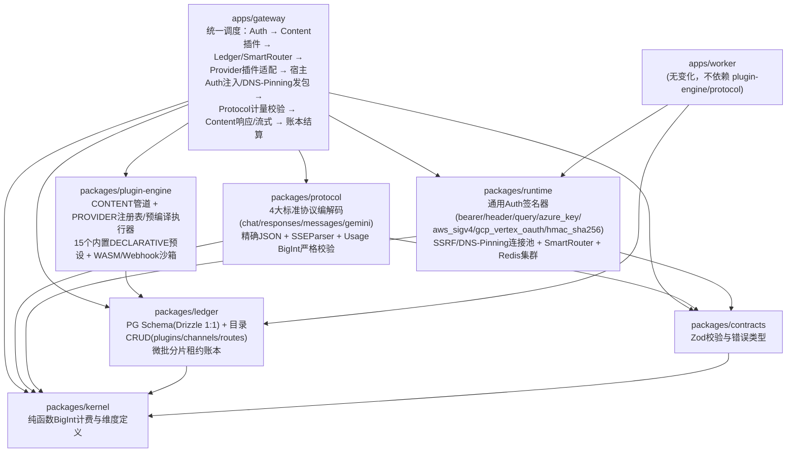

# ADR 0010: 上游模型渠道插件化架构与验收规范（Provider Plugin Architecture）

- **状态**：已实施并验收通过（全部 G7.1–G7.8 门禁与单机 13,205 RPS 回归通过）
- **日期**：2026-11-21
- **前置决定**：承接 [ADR 0009](0009-enterprise-gateway-worker-architecture.md)（Bun 1.4.4 单栈、精简微批 PG 核心账本与自适应分片租约、SmartRouter、Rust `wasmtime` FFI / Bun Worker WASM 沙箱）
- **适用范围**：`packages/ledger`、`packages/protocol`、`packages/runtime`、`packages/plugin-engine`、`apps/gateway`、`native/example-provider-wasm`（示例/测试用私有协议 WASM 渠道插件）

---

## 1. 问题、目标与范围

### 1.1 当前事实与核心问题（基于现有代码核实）

1. **厂商名硬编码于全栈 4 层**：
   - 数据库基线 [0000_v4_baseline.sql](../../packages/ledger/src/migrations/0000_v4_baseline.sql#L59) 将 `public.channels.kind` 写死为 9 个厂商枚举 `CHECK`。
   - 领域类型 [packages/ledger/src/types.ts](../../packages/ledger/src/types.ts#L8-L17) 与 [apps/gateway/src/internal-api.ts](../../apps/gateway/src/internal-api.ts#L44-L55) 写死同一枚举。
   - 请求组装层 [apps/gateway/src/upstream.ts](../../apps/gateway/src/upstream.ts#L147-L280) 通过 `switch (channel.kind)` 硬编码路径拼接、鉴权头、请求体字段及 `deepseek`/`ollama` 的 `max_completion_tokens → max_tokens` 特判。
   - 凭证校验层 [packages/runtime/src/cloud-auth.ts](../../packages/runtime/src/cloud-auth.ts#L46-L69) 按厂商名 `azure`/`bedrock`/`vertex` 硬编码分支，而非按鉴权机制解耦。
2. **`request_policy` 只能拒绝不能转换**：[packages/protocol/src/policy.ts](../../packages/protocol/src/policy.ts) 仅提供参数白名单/黑名单/范围校验（不合法直接 `422`），无法执行重命名、裁剪、注入默认值、数值钳位、Header 注入或伪 200 错误识别。
3. **现有插件引擎仅面向纯文本内容**：[packages/plugin-engine/src/pipeline.ts](../../packages/plugin-engine/src/pipeline.ts) 的 4 个 Hook 仅接收/返回纯文本字符串，不参与上游协议适配。

**直接后果**：无法预知未来要接入多少厂商与多少模型的特殊参数（如 OpenAI `o3` 禁传 `temperature`、Qwen `enable_thinking`、豆包 `thinking`、国产厂商伪 HTTP 200 限流错误体、非标 `usage` 字段、自研私有协议），每次新增厂商或适配新模型都需要改核心代码并重新发版。

### 1.2 核心目标

1. **彻底移除代码与数据库中的厂商硬编码**：全仓零双轨代码，删掉 `channels.kind` 厂商枚举与 `upstream.ts` 的 `switch (channel.kind)`，**一切上游渠道皆为 Provider Plugin（渠道插件）**。
2. **双形态统一插件体系**：在统一 `plugins` 表与 `config_epoch` + Redis Pub/Sub 集群热更新底座上，同时支持：
   - **`DECLARATIVE` 声明式渠道插件**（覆盖 ~85–90% 兼容/半兼容厂商）：零代码在线新增、热覆盖内置预设、内存预编译执行 **< 5 µs**，保住单机 **≥ 12,000 RPS**（当前基线 12,930 RPS）。
   - **`WASM` 可编程渠道插件**（覆盖 ~10–15% 私有/非标协议）：复用现有 Rust `wasmtime` FFI / Bun Worker 隔离沙箱，在线上传即可适配任意未知协议（请求、非流式响应、逐帧流式 SSE）。
3. **内置 15 个开箱即用预设渠道插件**：原 9 个核心厂商全部迁移为预设插件（零行为回退），额外内置 6 个国内及海外热门厂商预设（`qwen`、`volcengine`、`zhipu`、`moonshot`、`minimax`、`openrouter`），且支持在线同名热覆盖。
4. **两级覆盖（渠道预设 + 模型路由覆盖）**：`Channel` 绑定厂商级 `Provider Plugin`，`Route` 支持模型级 `adapter_overrides`，确保同一渠道下不同模型（如 `gpt-4o` 与 `o3`）及 `SmartRouter` 跨渠道 Failover 互不污染。
5. **在线调试预览闭环**：提供 `POST /internal/v1/providers/preview`（以及扩展 `POST /internal/v1/plugins/:pluginId/test`），上线前 1 ms 预览脱敏后的实际发包 URL/Header/Body 与样例响应解析结果。

### 1.3 明确非目标（刻意排除边界）

- **不支持密钥进入 WASM 沙箱**：按已确认安全红线，渠道解密后的 API Key / 秘钥严禁以任何形式传入 WASM 线性内存；鉴权与签名完全由宿主执行。
- **不支持网关从公网 URL 自动拉取 `.wasm` 安装**：所有插件必须经内网鉴权管理口 `PUT /internal/v1/plugins` 提交（带可选 Ed25519 签名验签）。
- **不改变核心账本资金状态机与计费主权**：渠道插件只能产出待校验的原始/映射 `Usage`，严禁读写钱包、篡改价格或绕过 `packages/kernel` `BigInt` 校验。
- **不在本阶段实现前端配置表单 UI**：仅冻结供运营控制台与未来 `apps/business` 调用的内网 HTTP API 契约。

---

## 2. 核心不变量与安全红线

以下 6 条不变量独立于实现，任何改动违反任一条均视为验收失败：

| 编号                            | 不变量                                                                                                                                                                                                                          | 保证机制                                                                                                                                                                      |
| ------------------------------- | ------------------------------------------------------------------------------------------------------------------------------------------------------------------------------------------------------------------------------- | ----------------------------------------------------------------------------------------------------------------------------------------------------------------------------- |
| **INV-1 零密钥入沙箱**          | 任何 `WASM` 插件（无论 `CONTENT` 或 `PROVIDER`）均永远无法读取明文 `secret_ciphertext`、API Key、云凭证或宿主环境变量                                                                                                           | 宿主在 `adapt_request` 返回后才按声明式 `auth` 模板注入凭证；WASM 零 Host Import（拒绝 WASI/Env/FS/Net）；预览接口自动脱敏敏感头为 `<REDACTED>`                               |
| **INV-2 零 SSRF / 主机逃逸**    | `PROVIDER` 插件（声明式或 WASM）只能控制相对 `path`、`query`、`headers`、`body`，永远无法篡改 `channel.base_url` 的协议/主机/端口，也不能覆盖 `Host` 头或发出外部连接                                                           | 宿主强制校验相对路径（必须以 `/` 开头、禁止 `://` / `..` / `\r\n`）、剥离受保护头（`host`/`content-length`/`transfer-encoding`），统一经 DNS-Pinning `transport.fetch` 发包   |
| **INV-3 计费主权在内核**        | `CONTENT` 插件绝对无权产出或修改 `usage`；`PROVIDER` 插件产出的 `usage`（声明式 `usage_aliases` 或带 `grants: ["extract_usage"]` 的签名 WASM）必须经过宿主 `packages/protocol` + `packages/kernel` 精确非负整数与分区一致性校验 | 权限分离 + `exactInteger`/`BigInt` 强校验；字段缺失、负数、浮点、溢出或别名冲突直接返回 `502 invalid_upstream_usage` / `usage_alias_conflict` 并挂 `UNKNOWN`，绝不静默 0 扣费 |
| **INV-4 Failover 隔离与无污染** | `SmartRouter` 执行多渠道故障切换时，每次 Attempt 必须基于原始 `clientBody` 经目标路由独立执行 `on_request` 后的结果独立执行目标渠道+路由适配，前一次 Attempt 的 `drop`/`rename`/`force_set` 绝不污染下一次 Attempt              | 对目标路由的处理结果独立报价和适配，宿主对已知出站协议应用报价时使用的 Token 上限                                                                                             |
| **INV-5 零双轨代码与零硬编码**  | 实施完成后，数据库 `channels.kind` 枚举约束、`upstream.ts` 中的 `switch (channel.kind)` 与硬编码 `deepseek`/`ollama` 特判彻底删除，全部厂商统一经 Provider Executor 执行                                                        | 架构单测（`tests/unit/architecture.test.ts`）与代码审计强制断言                                                                                                               |
| **INV-6 性能与长流不回退**      | 标准 `DECLARATIVE` 渠道（含 OpenAI/Anthropic/Gemini/DeepSeek/Qwen 等）热路径不进入 WASM、不额外分配正则或大对象；`WASM` 渠道流式适配采用无状态单帧调用 + 有界状态（≤ 4 KB），等待吐字期间占用 0 个插件实例                      | 按配置快照及路由缓存声明式计划；单机 `bench:single` 回归门槛 ≥ 12,000 RPS（0 错误，`conservation.ok=true`）                                                                   |

---

## 3. 技术架构与模块职责边界

### 3.1 严格无环依赖 DAG（兼容 `tests/unit/architecture.test.ts`）

现有仓库强制约束模块依赖无环且包列表固定（`kernel`、`contracts`、`protocol`、`runtime`、`ledger`、`plugin-engine`），**不新增 workspace 包**：



> **关键边界校验**：`packages/plugin-engine` 依然只依赖 `@gateway/ledger`（100% 满足 `tests/unit/architecture.test.ts` 中 `"plugin-engine": ["ledger"]` 限制，零循环依赖）。

### 3.2 模块职责与权威状态归属

| 模块                     | 权威状态 / 负责规则                                                                                                                                                                                                | 对外能力                                                                                                                                                                                          | 依赖与失败责任                                                                             |
| ------------------------ | ------------------------------------------------------------------------------------------------------------------------------------------------------------------------------------------------------------------ | ------------------------------------------------------------------------------------------------------------------------------------------------------------------------------------------------- | ------------------------------------------------------------------------------------------ |
| `packages/ledger`        | `plugins`、`channels`、`routes`、`config_epoch` 的唯一 PG 持久化写入与快照读出                                                                                                                                     | `upsertPlugin`、`listPlugins`、`upsertChannel`、`upsertRoute`、`loadSnapshot`                                                                                                                     | 持久化失败事务回滚；不执行插件代码                                                         |
| `packages/plugin-engine` | 15 个内置预设 `PROVIDER` 定义、内置 `CONTENT` 插件（`pii-guard`）、`DECLARATIVE` 规则预编译/执行引擎、`WASM` 沙箱执行器（Rust `wasmtime` FFI / Bun Worker）                                                        | `resolveProviderPlugin`、`compileDeclarativeProvider`、`applyDeclarativeRequest`、`evaluateErrorRules`、`extractUsageAliases`、`invokeWasmProviderHook`、`listBuiltinPlugins`、`getBuiltinPlugin` | 沙箱超时/超内存/非法 JSON 抛明确错误；绝不接触秘钥与网络                                   |
| `packages/protocol`      | 4 种标准协议（`chat`/`responses`/`messages`/`gemini`）的无损互转、精确数字保留、`SSEParser`、`StreamTranslator`、标准 `Usage` 精确大整数校验（按 `usage_dialect: "openai" \| "anthropic" \| "gemini"` 解耦厂商名） | `decodeRequest`/`encodeRequest`/`decodeResponse`/`encodeResponse`/`extractUsage`/`validateUsageObject`                                                                                            | 非法 `usage` 抛 `502 invalid_upstream_usage` / `usage_alias_conflict`                      |
| `packages/runtime`       | 通用上游凭证校验与注入（按 `AuthScheme` 而不是厂商名解耦，新增 `hmac_sha256` 通用签名器）、DNS-Pinning 连接池、SmartRouter、Redis 纪元同步                                                                         | `validateAuthCredentials(scheme, secret)`、`applyAuthToRequest(scheme, secret, url, headers, body, vertexTokens, signal)`                                                                         | 凭证格式非法抛 `422 invalid_cloud_credentials`；网络失败区分 pre-dispatch 与 post-dispatch |
| `apps/gateway`           | 内存中持有按 `config_epoch` 预编译的 `ConfigSnapshot`（含预编译 `ProviderPlan` 缓存）；编排全请求流、Failover 循环与 `/internal/v1/providers/preview`                                                              | 公开推理端点 `/v1/*` + 内网管理/试跑端点 `/internal/v1/*`                                                                                                                                         | 每次 Attempt 隔离转换；伪 200 错误自动转 `SmartRouter` 切换                                |

---

## 4. 数据结构与存储设计

### 4.1 PostgreSQL DDL 变更与存量升级

已发布的 v4 基线由其迁移记录的版本与校验和识别。新增迁移将已发布的账本、资金租约及渠道插件布局升级为统一结构，保留原迁移记录和业务数据。升级前应停止旧版 Gateway 与 Worker 的写入并备份。新进程启动根据新版本及迁移校验和检查数据库。

#### 1. `public.plugins` 表扩展

```sql
CREATE TABLE public.plugins (
  id UUID PRIMARY KEY,
  name TEXT NOT NULL CHECK (name ~ '^[a-z0-9][a-z0-9_-]{1,63}$'),
  version TEXT NOT NULL,
  capability TEXT NOT NULL DEFAULT 'CONTENT' CHECK (capability IN ('CONTENT', 'PROVIDER')),
  kind TEXT NOT NULL CHECK (kind IN ('WASM', 'WEBHOOK', 'DECLARATIVE')),
  digest TEXT NOT NULL CHECK (digest ~ '^[a-f0-9]{64}$'),
  wasm_bytes BYTEA CHECK (wasm_bytes IS NULL OR octet_length(wasm_bytes) BETWEEN 1 AND 16777216),
  webhook_config JSONB CHECK (webhook_config IS NULL OR jsonb_typeof(webhook_config) = 'object'),
  provider_config JSONB CHECK (provider_config IS NULL OR jsonb_typeof(provider_config) = 'object'),
  signature TEXT,
  signing_key_id TEXT,
  manifest JSONB NOT NULL DEFAULT '{}' CHECK (jsonb_typeof(manifest) = 'object'),
  enabled BOOLEAN NOT NULL DEFAULT true,
  created_at TIMESTAMPTZ NOT NULL DEFAULT now(),
  UNIQUE (name, version),
  CHECK (
    (capability = 'CONTENT' AND kind IN ('WASM', 'WEBHOOK'))
    OR (capability = 'PROVIDER' AND kind IN ('DECLARATIVE', 'WASM'))
  ),
  CHECK (
    (kind = 'WASM' AND wasm_bytes IS NOT NULL)
    OR (kind = 'WEBHOOK' AND webhook_config IS NOT NULL)
    OR (kind = 'DECLARATIVE' AND provider_config IS NOT NULL)
  )
);

CREATE INDEX plugins_provider_name_idx
  ON public.plugins (name, created_at DESC)
  WHERE capability = 'PROVIDER' AND enabled;
```

#### 2. `public.channels` 表解除厂商枚举硬编码

```sql
CREATE TABLE public.channels (
  id UUID PRIMARY KEY,
  account_id UUID NOT NULL REFERENCES public.upstream_accounts(id),
  name TEXT NOT NULL,
  kind TEXT NOT NULL CHECK (kind ~ '^[a-z0-9][a-z0-9_-]{1,63}$'),
  provider_plugin_id UUID REFERENCES public.plugins(id),
  base_url TEXT NOT NULL,
  secret_ciphertext TEXT NOT NULL,
  rpm INTEGER NOT NULL CHECK (rpm > 0),
  concurrency INTEGER NOT NULL CHECK (concurrency > 0),
  enabled BOOLEAN NOT NULL DEFAULT true,
  routing_policy JSONB NOT NULL DEFAULT '{}' CHECK (jsonb_typeof(routing_policy) = 'object'),
  adapter_config JSONB NOT NULL DEFAULT '{}' CHECK (jsonb_typeof(adapter_config) = 'object'),
  config_revision BIGINT NOT NULL DEFAULT 1,
  created_at TIMESTAMPTZ NOT NULL DEFAULT now(),
  updated_at TIMESTAMPTZ NOT NULL DEFAULT now()
);

CREATE INDEX channels_account_idx ON public.channels (account_id);
CREATE INDEX channels_provider_plugin_idx ON public.channels (provider_plugin_id) WHERE provider_plugin_id IS NOT NULL;
```

#### 3. `public.routes` 表新增模型级覆盖配置

```sql
ALTER TABLE public.routes ...
  adapter_overrides JSONB NOT NULL DEFAULT '{}' CHECK (jsonb_typeof(adapter_overrides) = 'object')
```

（写入 `0000_v4_baseline.sql` 的 `CREATE TABLE public.routes` 定义中，保持单表 23 张表结构不变、Drizzle `schema.ts` 与 SQL 列名/类型 1:1 完全一致。）

### 4.2 核心领域数据结构（TypeScript 契约）

```ts
export type PluginCapability = "CONTENT" | "PROVIDER";
export type PluginKind = "WASM" | "WEBHOOK" | "DECLARATIVE";

export type WireDialect =
  "openai_chat" | "openai_responses" | "anthropic_messages" | "gemini" | "passthrough";

export type UsageDialect = "openai" | "anthropic" | "gemini" | "custom";

export type StreamFraming = "sse" | "bedrock_eventstream";

export type AuthSchemeConfig =
  | { scheme: "none" }
  | { scheme: "bearer" }
  | { scheme: "header"; header_name: string; prefix?: string }
  | { scheme: "query"; param_name: string }
  | { scheme: "azure_key"; default_api_version?: string }
  | { scheme: "aws_sigv4"; service: string }
  | { scheme: "gcp_vertex_oauth" }
  | {
      scheme: "hmac_sha256";
      signature_header: string;
      timestamp_header: string;
      key_id_header?: string;
      signature_prefix?: string;
      encoding?: "hex" | "base64";
    };

export type BodyTransformRule =
  | { op: "rename"; from: string; to: string; overwrite?: boolean }
  | { op: "drop"; path: string }
  | { op: "set_default"; path: string; value: unknown }
  | { op: "force_set"; path: string; value: unknown }
  | { op: "clamp"; path: string; min?: number; max?: number }
  | { op: "move_to"; from: string; to: string; overwrite?: boolean }
  | { op: "delete_if_equals"; path: string; value: unknown };

export type ErrorMatchRule = {
  when_http_status?: number[];
  path: string;
  equals?: string | number | boolean;
  in?: (string | number)[];
  regex?: string;
  retry_kind: "retryable" | "rate_limit" | "auth_error" | "client_error";
  http_status?: number;
  message_path?: string;
  retry_after_path?: string;
};

export type UsageAliasRule = {
  target:
    | "input_tokens"
    | "output_tokens"
    | "cached_input_tokens"
    | "cache_write_tokens"
    | "cache_write_5m_tokens"
    | "cache_write_1h_tokens"
    | "reasoning_tokens"
    | "requests"
    | "images"
    | "audio_ms"
    | "audio_seconds"
    | "video_ms"
    | "video_seconds"
    | "music_ms"
    | "characters";
  source_path: string;
};

export type ResponseTransformRule =
  | { op: "rename"; from: string; to: string; overwrite?: boolean }
  | { op: "drop"; path: string }
  | { op: "set_default"; path: string; value: unknown };

export type EndpointTemplate = {
  path: string;
  stream_path?: string;
  query?: Record<string, string>;
  stream_query?: Record<string, string>;
};

export type DeclarativeProviderConfig = {
  base_dialect: WireDialect;
  usage_dialect: UsageDialect;
  stream_framing?: StreamFraming;
  auth: AuthSchemeConfig;
  endpoints: Partial<Record<Operation, EndpointTemplate>> & { default?: EndpointTemplate };
  extra_headers?: Record<string, string>;
  model_field?: string | null;
  stream_field?: string | null;
  include_stream_usage_option?: boolean;
  request_transforms?: BodyTransformRule[];
  response_transforms?: ResponseTransformRule[];
  error_rules?: ErrorMatchRule[];
  usage_aliases?: UsageAliasRule[];
  reasoning_field?: string;
};

export type AdapterOverrides = {
  extra_headers?: Record<string, string>;
  query_params?: Record<string, string>;
  path_override?: string;
  request_transforms?: BodyTransformRule[];
  response_transforms?: ResponseTransformRule[];
  error_rules?: ErrorMatchRule[];
  usage_aliases?: UsageAliasRule[];
};

export type WasmProviderConfig = {
  base_dialect: WireDialect;
  usage_dialect: UsageDialect;
  stream_framing?: StreamFraming;
  auth: AuthSchemeConfig;
  extra_headers?: Record<string, string>;
  hooks: ("adapt_request" | "adapt_response" | "adapt_stream_event")[];
  grants?: "extract_usage"[];
  fuel_budget?: number;
  max_memory_bytes?: number;
  failure_policy?: "FAIL_CLOSED";
};
```

> **路径语法安全约束**：`BodyTransformRule` / `ErrorMatchRule` / `UsageAliasRule` 中的 `path` 仅允许有限点分字段路径 `^[A-Za-z0-9_]+(?:\.[A-Za-z0-9_]+){0,7}$`（禁止 `__proto__`、`constructor`、`prototype` 防止原型污染），并在配置写入期通过 Zod 强校验。模板变量仅允许 `${model}`、`${encoded_model}`、`${operation}`、`${stream_action}`，绝不解析任意表达式。`ErrorMatchRule.regex` 长度限制 ≤ 128 字符，禁止嵌套量词防止 ReDoS。

### 4.3 WASM `PROVIDER` 插件 Guest ABI 规范（与现有 `wasmtime` / Bun Worker 100% 复用）

- **导出符号**（零 Host Import，禁止 WASI/FS/Net/Env）：
  - `memory`（`WebAssembly.Memory`）
  - `stg_alloc(len: i32) -> i32`
  - 按 `hooks` 导出：`adapt_request(ptr: i32, len: i32) -> i64`、`adapt_response(ptr: i32, len: i32) -> i64`、`adapt_stream_event(ptr: i32, len: i32) -> i64`
- **Hook 1：`adapt_request` 输入/输出 JSON**：
  - 输入：`{ operation, upstream_model, stream, client_protocol, body, headers }`（**严格不含任何凭证/秘钥/base_url**）
  - 输出：`{ path, query?, headers?, body }`
  - 宿主校验：`path` 必须以 `/` 开头且不含 `://` / `..` / `\r` / `\n`；自动剔除 `host`/`authorization`/`x-api-key`/`api-key`/`x-goog-api-key`/`content-length`/`transfer-encoding`。
- **Hook 2：`adapt_response` 输入/输出 JSON**：
  - 输入：`{ operation, upstream_model, client_protocol, status, headers, body }`
  - 输出：`{ status?, body?, usage?, retry_kind?, retry_after_ms?, error_message? }`
  - 宿主校验：仅当插件 `grants` 包含 `"extract_usage"` 时采纳 `usage`，并强制走 `validateUsageObject` 精确大整数验证；若返回 `retry_kind`（且未向客户端吐字），交 `SmartRouter` 切换。
- **Hook 3：`adapt_stream_event` 输入/输出 JSON（无状态单帧 + 有界状态）**：
  - 输入：`{ operation, upstream_model, client_protocol, event, data, state }`（`state` 为上一帧返回的不透明字符串，长度硬限 ≤ 4,096 字节）
  - 输出：`{ chunks?: Record<string, unknown>[], usage?, done?: boolean, state?, retry_kind?, error_message? }`
  - 宿主行为：把 `chunks` 编码为对应客户端协议的标准 SSE 帧；若首字节前收到 `retry_kind`，触发 `SmartRouter` 切换；终态收集到 `usage` 后过 `BigInt` 校验并结算；全程每帧结束立即释放沙箱，等待上游期间占用 **0 个插件实例**。

---

## 5. 15 个内置预设渠道插件完整矩阵

所有 15 个预设均定义为标准 `DeclarativeProviderConfig` 数据对象，存放于 `packages/plugin-engine/src/providers/builtins.ts`，通过 `GET /internal/v1/plugins/builtins` 统一暴露，无需数据库预置即可直接使用，也可通过 `PUT /internal/v1/plugins` 上传同名 `capability: "PROVIDER"` 插件在运行期热覆盖。

| #   | 预设名 (`kind`)     | `base_dialect`                                             | `usage_dialect` | `auth.scheme`                                 | 端点模板要点                                                                                                                                                                                                            | 预设参数/Header/错误/Usage 规则要点                                                                                                                                                         |
| --- | ------------------- | ---------------------------------------------------------- | --------------- | --------------------------------------------- | ----------------------------------------------------------------------------------------------------------------------------------------------------------------------------------------------------------------------- | ------------------------------------------------------------------------------------------------------------------------------------------------------------------------------------------- |
| 1   | `openai`            | `openai_chat`（`responses` 操作自动走 `openai_responses`） | `openai`        | `bearer`                                      | `/v1/chat/completions`, `/v1/responses`, `/v1/embeddings`, `/v1/images/generations`, `/v1/images/edits`, `/v1/audio/speech`, `/v1/audio/transcriptions`, `/v1/audio/translations`, `/v1/moderations`, `/v1/completions` | 流式自动注入 `stream_options.include_usage=true`                                                                                                                                            |
| 2   | `openai_compatible` | `openai_chat`                                              | `openai`        | `bearer`                                      | 同 `openai` 标准路径                                                                                                                                                                                                    | 通用兼容模板，支持 `stream_options.include_usage=true`                                                                                                                                      |
| 3   | `anthropic`         | `anthropic_messages`                                       | `anthropic`     | `header` (`x-api-key`)                        | `/v1/messages`                                                                                                                                                                                                          | `extra_headers: { "anthropic-version": "2023-06-01" }`                                                                                                                                      |
| 4   | `gemini`            | `gemini`                                                   | `gemini`        | `header` (`x-goog-api-key`)                   | `/v1beta/models/${encoded_model}:generateContent` / 流式 `:streamGenerateContent?alt=sse`                                                                                                                               | `model_field: null`, `stream_field: null`（URL 承载 model/stream）                                                                                                                          |
| 5   | `azure`             | `openai_chat`                                              | `openai`        | `azure_key` (`api-key` + `api-version` query) | `/openai/deployments/${encoded_model}/chat/completions`（含 `embeddings`/`completions`）                                                                                                                                | 从凭证 JSON/字符串解析 `apiKey` 与 `apiVersion`                                                                                                                                             |
| 6   | `bedrock`           | `anthropic_messages`                                       | `anthropic`     | `aws_sigv4` (`service: "bedrock"`)            | `/model/${encoded_model}/invoke` / 流式 `invoke-with-response-stream`                                                                                                                                                   | `stream_framing: "bedrock_eventstream"`；`force_set: { anthropic_version: "bedrock-2023-05-31" }`；`drop: ["model", "stream"]`                                                              |
| 7   | `vertex`            | `gemini`                                                   | `gemini`        | `gcp_vertex_oauth`                            | `/models/${encoded_model}:generateContent` / 流式 `:streamGenerateContent?alt=sse`                                                                                                                                      | `model_field: null`, `stream_field: null`                                                                                                                                                   |
| 8   | `deepseek`          | `openai_chat`                                              | `openai`        | `bearer`                                      | `/v1/chat/completions`, `/v1/completions`                                                                                                                                                                               | `rename: max_completion_tokens → max_tokens`；`reasoning_field: "reasoning_content"`；`usage_aliases: prompt_cache_hit_tokens → cached_input_tokens`                                        |
| 9   | `ollama`            | `openai_chat`                                              | `openai`        | `bearer`（密钥可空）                          | `/v1/chat/completions`, `/v1/embeddings`, `/v1/completions`                                                                                                                                                             | `rename: max_completion_tokens → max_tokens`                                                                                                                                                |
| 10  | `qwen`              | `openai_chat`                                              | `openai`        | `bearer`                                      | `/compatible-mode/v1/chat/completions`, `/compatible-mode/v1/embeddings`                                                                                                                                                | `rename: max_completion_tokens → max_tokens`；`reasoning_field: "reasoning_content"`；支持伪 200 错误规则与 `usage.prompt_tokens_details.cached_tokens`                                     |
| 11  | `volcengine`        | `openai_chat`                                              | `openai`        | `bearer`                                      | `/api/v3/chat/completions`, `/api/v3/embeddings`                                                                                                                                                                        | `rename: max_completion_tokens → max_tokens`；`reasoning_field: "reasoning_content"`                                                                                                        |
| 12  | `zhipu`             | `openai_chat`                                              | `openai`        | `bearer`                                      | `/api/paas/v4/chat/completions`, `/api/paas/v4/embeddings`                                                                                                                                                              | `rename: max_completion_tokens → max_tokens`；`clamp: temperature ∈ [0.01, 0.99]`（避免智谱对 `0`/`1` 边界报错）；`drop: stream_options`（可选）；伪 200 `error.code` 限流映射              |
| 13  | `moonshot`          | `openai_chat`                                              | `openai`        | `bearer`                                      | `/v1/chat/completions`                                                                                                                                                                                                  | `rename: max_completion_tokens → max_tokens`；`clamp: temperature ∈ [0, 1]`                                                                                                                 |
| 14  | `minimax`           | `openai_chat`                                              | `openai`        | `bearer`                                      | `/v1/text/chatcompletion_v2`                                                                                                                                                                                            | `rename: max_completion_tokens → max_tokens`；`clamp: temperature ∈ [0.01, 1]`；`error_rules`: 识别 `base_resp.status_code`（`1002`→`rate_limit`、`1004`→`auth_error`、`1000`→`retryable`） |
| 15  | `openrouter`        | `openai_chat`                                              | `openai`        | `bearer`                                      | `/api/v1/chat/completions`, `/api/v1/embeddings`                                                                                                                                                                        | `reasoning_field: "reasoning"`；支持 `channel.adapter_config.extra_headers` 注入 `HTTP-Referer`/`X-Title`                                                                                   |

---

## 6. 核心运行流程、解析顺序与故障恢复

### 6.1 Provider Plugin 解析优先级（确定性、支持在线热覆盖）

当渠道 `ch` 发起一次上游请求时，按以下 3 级优先级从当前 `ConfigSnapshot` 内存解析 `ProviderPlugin`（O(1) Map 查找，零 DB IO）：

1. **精确锁版本**：若 `ch.provider_plugin_id !== null`，查 `snapshot.plugins.get(ch.provider_plugin_id)`；若未找到、未启用或 `capability !== "PROVIDER"`，返回 `503 provider_plugin_unavailable`（并触发 `SmartRouter` 跳过该渠道）。
2. **DB 同名热覆盖**：若 `ch.provider_plugin_id === null`，查 `snapshot.providerPluginsByName.get(ch.kind)`（取同 `name` 下最新启用的 DB `PROVIDER` 插件，允许运营在不改渠道、不重启的情况下在线覆盖内置预设规则）。
3. **内置预设回退**：查内置预设表 `BUILTIN_PROVIDERS.get(ch.kind)`。
4. 若三者均未命中：在 `PUT /internal/v1/channels` 注册期即拒绝 `400 unknown_provider`；若运行期因插件被禁用导致缺失，记录告警并跳过该候选路由。

### 6.2 请求执行与 SmartRouter Failover 时序（含合并优先级）

配置合并优先级（后者覆盖前者，数组类 `request_transforms` / `error_rules` / `usage_aliases` 按序追加）：
`Provider Plugin 默认规则` → `Channel.adapter_config` → `Route.adapter_overrides`

```mermaid
sequenceDiagram
    participant Client
    participant GW as Gateway (Proxy)
    participant Content as CONTENT Plugins
    participant Router as SmartRouter + Ledger
    participant Adapter as Provider Adapter<br/>(Declarative / WASM)
    participant HostAuth as Host Auth + DNS-Pinning
    participant UpA as Upstream A (主渠道)
    participant UpB as Upstream B (备渠道)

    Client->>GW: POST /v1/chat/completions (body0)
    GW->>Content: on_request (多轮原位脱敏/防注入)
    Content-->>GW: body1 (不修改原始引用)
    GW->>Router: selectCandidates + acquireHold

    Note over GW,UpA: Attempt 1 — 主渠道 A (如 MiniMax / OpenAI o3)
    GW->>Adapter: prepare(clone(body1), ProviderA + ChannelA + RouteA)
    Adapter-->>GW: { pathA, queryA, headersA, bodyA } (无秘钥)
    GW->>HostAuth: injectAuth(AuthA, secretA) + transport.fetch(baseUrlA + pathA)
    HostAuth->>UpA: HTTP POST
    UpA-->>GW: HTTP 200 {"base_resp":{"status_code":1002,"status_msg":"rate limit"}}
    GW->>Adapter: evaluateErrorRules(200, respJson)
    Adapter-->>GW: retry_kind = "rate_limit" (伪200错误识别!)
    GW->>Router: recordFailure(chA, "rate_limit") + switchSupplierAttempt(FAILED → chB)

    Note over GW,UpB: Attempt 2 — 备渠道 B (如 DeepSeek，使用干净 body1 副本!)
    GW->>Adapter: prepare(clone(body1), ProviderB + ChannelB + RouteB)
    Adapter-->>GW: { pathB, queryB, headersB, bodyB } (独立转换，零污染)
    GW->>HostAuth: injectAuth(AuthB, secretB) + transport.fetch(baseUrlB + pathB)
    HostAuth->>UpB: HTTP POST
    UpB-->>GW: HTTP 200 + usage
    GW->>Adapter: decodeResponse + extractUsageAliases
    GW->>GW: protocol.validateUsage (BigInt 严校验)
    GW->>Content: on_response
    GW->>Router: commitTerminal (唯一一次客户扣款)
    GW-->>Client: HTTP 200
```



### 6.3 关键失败窗口与一致性保证

| 失败窗口                                                                                | 行为与恢复机制                                                                                                                                                                                                                                                                               |
| --------------------------------------------------------------------------------------- | -------------------------------------------------------------------------------------------------------------------------------------------------------------------------------------------------------------------------------------------------------------------------------------------- |
| **节点 A 在线热更新 `PROVIDER` 插件后，节点 B 尚未收到 Redis Pub/Sub（或 Redis 断开）** | 写入 PG 事务内原子递增 `config_epoch`；节点 A 立即重载并广播；节点 B 在 Redis 断连时通过现有 `snapshotPollMs` 周期轮询 PG 追平；每次请求全程绑定同一次 `snap = snapshot.get()` 快照，目录表与 epoch 在同一只读可重复读事务中加载，刷新失败保留上一致快照并重试，超过新鲜度阈值时实例退出就绪 |
| **`WASM` 渠道插件执行超时（死循环）、超内存或返回非法 JSON**                            | `adapt_request` 阶段失败（尚未发包）：标记当前 Attempt 失败、释放供应商预扣、交 `SmartRouter` 切下一渠道或返回 `502 provider_adapter_failed`；`adapt_response`/`adapt_stream_event` 阶段失败（上游已执行）：标 `UNKNOWN` 交 Worker 对账，不静默释放预扣                                      |
| **运营误删/禁用某渠道正在引用的 `provider_plugin_id`**                                  | 禁用操作允许生效（用于紧急止血），下次请求该渠道解析失败返回 `503 provider_plugin_unavailable` 并由 `SmartRouter` 自动切走至健康备渠道；若无备渠道，预扣原子释放（0 扣费）                                                                                                                   |
| **HTTP 200 伪错误发生在流式 SSE 首帧 vs 吐字中段**                                      | **首字节送出给客户端前**命中 `error_rules` / `retry_kind`：允许 `SmartRouter` 无感切换备渠道；**已向客户端输出首字节后**命中错误：严禁切换拼接另一模型，按既有流式错误契约发送 `event: error`（不发 `[DONE]`）并正确落账或挂 `UNKNOWN`                                                       |
| **`usage_aliases` 映射出非整数/负数/冲突值**                                            | 宿主 `packages/protocol` 立即抛出 `502 invalid_upstream_usage` / `usage_alias_conflict`，预扣挂 `UNKNOWN` 待人工/Worker 核账，绝不静默跳过扣费                                                                                                                                               |

---

## 7. 内网控制面 HTTP API 契约（`/internal/v1/*`）

全部接口沿用既有 `Authorization: Bearer <ADMIN_TOKEN>` 鉴权、Zod 严格 `.strict()` 校验与 `{ error: { code, message } }` 错误格式。

### 7.1 `PUT /internal/v1/plugins`（扩展支持 `PROVIDER` 声明式与 WASM 插件）

- **在线安装声明式渠道插件示例（接入一个代码里从未出现过的私有厂商）**：

```json
{
  "name": "acme-llm",
  "version": "1.0.0",
  "capability": "PROVIDER",
  "kind": "DECLARATIVE",
  "provider_config": {
    "base_dialect": "openai_chat",
    "usage_dialect": "openai",
    "auth": { "scheme": "header", "header_name": "X-Acme-Key", "prefix": "Key " },
    "endpoints": {
      "chat": { "path": "/v2/infer/chat", "query": { "api_ver": "2026" } }
    },
    "extra_headers": { "X-Client-App": "super-token-gateway" },
    "request_transforms": [
      { "op": "rename", "from": "max_completion_tokens", "to": "max_tokens" },
      { "op": "drop", "path": "stream_options" },
      { "op": "clamp", "path": "temperature", "min": 0, "max": 1 },
      { "op": "set_default", "path": "thinking_mode", "value": "auto" }
    ],
    "error_rules": [
      {
        "when_http_status": [200],
        "path": "err_code",
        "equals": 42901,
        "retry_kind": "rate_limit",
        "message_path": "err_msg"
      }
    ],
    "usage_aliases": [{ "target": "cached_input_tokens", "source_path": "usage.cache_hit_tokens" }]
  }
}
```

- **在线安装 WASM 渠道插件示例**：

```json
{
  "name": "acme-proprietary",
  "version": "1.0.0",
  "capability": "PROVIDER",
  "kind": "WASM",
  "wasm_bytes_base64": "AGFzbQEAAA...",
  "signature": "<ed25519-base64>",
  "signing_key_id": "prod-key-1",
  "provider_config": {
    "base_dialect": "passthrough",
    "usage_dialect": "custom",
    "auth": { "scheme": "bearer" },
    "hooks": ["adapt_request", "adapt_response", "adapt_stream_event"],
    "grants": ["extract_usage"],
    "fuel_budget": 5000000,
    "max_memory_bytes": 8388608
  }
}
```

- **错误语义**：
  - `400 validation_error`：非法路径表达式、禁止字段（`__proto__`）、`capability` 与 `kind` 不匹配、WASM 缺少必需导出符号或含非空 Host Import；
  - `400 unsafe_upstream`：Webhook URL 触发 SSRF；
  - 幂等性：按 `(name, version)` 幂等 upsert 并原子递增 `config_epoch`。

### 7.2 `GET /internal/v1/plugins/builtins` 与 `POST /internal/v1/plugins/builtins/:name/install`

- `GET /internal/v1/plugins/builtins`：返回全部内置插件（含 `capability: "CONTENT"` 的 `pii-guard` 与 `capability: "PROVIDER"` 的 15 个预设厂商），支持可选 `?capability=CONTENT|PROVIDER` 过滤。
- `POST /internal/v1/plugins/builtins/:name/install`：将内置插件（或基于预设附加覆盖字段 `provider_config`）一键持久化入 PG（便于后续在线二次微调与版本锁定）。

### 7.3 `PUT /internal/v1/channels` 与 `PUT /internal/v1/routes`

- `PUT /internal/v1/channels`：
  - `kind` 由硬编码枚举改为任意合法 provider 标识 `^[a-z0-9][a-z0-9_-]{1,63}$`；
  - 新增可选 `provider_plugin_id?: uuid` 与 `adapter_config?: AdapterOverrides`；
  - 写入前自动解析目标 `ProviderPlugin`，若不存在返回 `400 unknown_provider`，并按该 Provider 的 `auth.scheme` 执行 `validateAuthCredentials(auth.scheme, api_key)`（取代原先按厂商名硬编码的凭证校验）。
- `PUT /internal/v1/routes`：
  - 新增可选 `adapter_overrides?: AdapterOverrides`（与 `request_policy` 互补：`request_policy` 管客户端入口校验，`adapter_overrides` 管发往该上游模型的参数转换）。

### 7.4 `POST /internal/v1/providers/preview`（上线前在线干跑预览）

- **请求示例**：

```json
{
  "provider": "deepseek",
  "base_url": "https://api.deepseek.com",
  "operation": "chat",
  "upstream_model": "deepseek-reasoner",
  "stream": false,
  "client_body": {
    "model": "ds-r1",
    "messages": [{ "role": "user", "content": "hi" }],
    "max_completion_tokens": 512,
    "temperature": 1.5
  },
  "adapter_overrides": {
    "request_transforms": [{ "op": "drop", "path": "temperature" }]
  },
  "mock_upstream_response": {
    "status": 200,
    "body": {
      "choices": [
        { "index": 0, "message": { "role": "assistant", "content": "ok" }, "finish_reason": "stop" }
      ],
      "usage": { "prompt_tokens": 10, "completion_tokens": 5, "prompt_cache_hit_tokens": 4 }
    }
  }
}
```

- **响应示例**（鉴权头自动脱敏为 `<REDACTED>`，不发出任何真实网络请求）：

```json
{
  "resolved_provider": { "name": "deepseek", "source": "builtin", "kind": "DECLARATIVE" },
  "prepared_request": {
    "url": "https://api.deepseek.com/v1/chat/completions",
    "headers": {
      "content-type": "application/json",
      "authorization": "Bearer <REDACTED>"
    },
    "body": {
      "model": "deepseek-reasoner",
      "messages": [{ "role": "user", "content": "hi" }],
      "max_tokens": 512
    }
  },
  "decoded_response": {
    "retry_kind": null,
    "extracted_usage": {
      "input_tokens": "10",
      "output_tokens": "5",
      "cached_input_tokens": "4"
    }
  }
}
```

---

## 8. 方案取舍与重评条件

| 关键决策           | 最终采用方案                                                                             | 舍弃备选                              | 取舍依据                                                               | 重评触发条件                                                                           |
| ------------------ | ---------------------------------------------------------------------------------------- | ------------------------------------- | ---------------------------------------------------------------------- | -------------------------------------------------------------------------------------- |
| **渠道适配架构**   | 双层统一 `PROVIDER` 插件（`DECLARATIVE` + `WASM`），删光内核硬编码                       | 纯硬编码 / 全量走 WASM                | 兼顾 90% 厂商零代码热配 + 12,930 RPS 原生性能 + 10% 私有协议无限扩展   | 仅当未来出现超越 JSON/SSE 的双向长连接（如 WebSocket Realtime 音频）时需扩展协议层     |
| **渠道与插件绑定** | `channels.kind` 自由标识（DB 插件优先 → 内置预设回退）+ 可选 `provider_plugin_id` 锁版本 | 强制所有渠道必须先建 DB 插件再填 UUID | 兼容现有全部调用方，支持一键热覆盖内置预设，同时允许高敏生产渠道锁版本 | 无                                                                                     |
| **秘钥与签名边界** | **秘钥永不进 WASM 沙箱**；宿主内置 7 种标准鉴权 + 通用 `hmac_sha256` 签名器              | 允许签名 WASM 读取渠道秘钥            | 杜绝插件越权或通过输出外泄上游秘钥，满足企业安全审计底线               | 若确实遇到无法被 `hmac_sha256` 表达的罕见非对称/自定义云签名，再在宿主新增受控签名原语 |
| **WASM 流式适配**  | 无状态单帧 `adapt_stream_event` + 有界 `state`（≤ 4 KB）                                 | 每条流常驻 1 个 WASM 实例             | 长流零占槽，万级并发 SSE 内存有界，与内容插件架构一致                  | 单帧转换延迟在极端大帧下超过 5 ms 时可引入 Rust 异步线程池通道                         |

---

## 9. 分阶段垂直切片实施顺序与兼容说明

按垂直切片顺序落地，确保每一步均可独立编译验证、零双轨残留：

1. **切片 1 — 数据层与契约（`packages/ledger` + `packages/runtime` + `packages/protocol`）**：
   - 更新 `0000_v4_baseline.sql`、`manifest.json`、`schema.ts`、`types.ts`、`catalog.ts`（`plugins.capability`/`provider_config`、`channels.kind` 解除枚举 + `provider_plugin_id`/`adapter_config`、`routes.adapter_overrides`）。
   - `packages/runtime/src/cloud-auth.ts` 改为按 `AuthSchemeConfig` 校验与签名（新增 `hmac_sha256` 通用签名器）。
   - `packages/protocol/src/usage.ts` 支持按 `UsageDialect` 解耦厂商名，并新增 `validateUsageObject` 供渠道插件产出校验复用。
2. **切片 2 — Provider Plugin 引擎与 15 个内置预设（`packages/plugin-engine`）**：
   - 落地 `DeclarativeProviderConfig` 预编译转换器（`request_transforms`、`response_transforms`、`error_rules`、`usage_aliases`、模板路径与原型污染防护）。
   - 落地 15 个内置预设定义（`openai`、`openai_compatible`、`anthropic`、`gemini`、`azure`、`bedrock`、`vertex`、`deepseek`、`ollama`、`qwen`、`volcengine`、`zhipu`、`moonshot`、`minimax`、`openrouter`）。
   - 扩展 `WasmRuntimeExecutor` 与 `PluginPipelineEngine` 支持 `PROVIDER` WASM 钩子（`adapt_request`、`adapt_response`、`adapt_stream_event` + 4 KB `state` 限长 + `extract_usage` 授权校验）。
3. **切片 3 — Gateway 全面去硬编码与内网控制面（`apps/gateway`）**：
   - 重写 `apps/gateway/src/upstream.ts` 与 `proxy.ts`：删除 `switch (channel.kind)` 与硬编码特判，接入统一 Provider Executor、每 Attempt 隔离适配、伪 200 错误转 `SmartRouter` Failover、WASM 私有流式适配。
   - 扩展 `apps/gateway/src/internal-api.ts`：`PUT /internal/v1/plugins`、`GET /internal/v1/plugins/builtins`、`PUT /internal/v1/channels`、`PUT /internal/v1/routes`、`POST /internal/v1/providers/preview`、`POST /internal/v1/plugins/:pluginId/test`。
4. **切片 4 — 示例 WASM 私有协议插件 + 全套验收与性能回归**：
   - 编写真实 Rust → `wasm32-unknown-unknown` 私有协议渠道插件测试用例（覆盖 `adapt_request` / `adapt_response` / `adapt_stream_event` + `usage` 提取），跑通全部 **G7** 验收用例、`bun run verify`、`bun run test:durability` 与 `bun run bench:single`。
5. **存量库演进与回退说明**：
   - 使用同一迁移命令初始化新库或升级已发布 v4 基线。跨 schema 版本发布使用停写窗口。确认存量渠道、价格、插件和资金记录，再启动新版本。回退需按发布前备份和既定数据恢复流程执行。

---

## 10. 验收规范（客观门禁 G7，全部必须通过）

| 验收项                                                   | 前置状态与测试动作                                                                                                                                                                                                                                                 | 期望可观察结果与副作用                                                                                                                                                                                                                           | 保证机制                                                                  | 验证入口                                                                                                |
| -------------------------------------------------------- | ------------------------------------------------------------------------------------------------------------------------------------------------------------------------------------------------------------------------------------------------------------------ | ------------------------------------------------------------------------------------------------------------------------------------------------------------------------------------------------------------------------------------------------ | ------------------------------------------------------------------------- | ------------------------------------------------------------------------------------------------------- |
| **G7.1 零硬编码与架构门禁**                              | 扫描全仓源码、Drizzle Schema 与 SQL 基线                                                                                                                                                                                                                           | `channels.kind` 无厂商枚举 `CHECK`；`upstream.ts` 无 `switch (channel.kind)` 与 `deepseek`/`ollama` 硬编码；workspace 依赖 DAG 保持无环且 `G1.6` 1:1 零漂移通过                                                                                  | 静态架构测试 + Drizzle/PG 反射比对                                        | `tests/unit/architecture.test.ts` + `ledger-v4.test.ts` (`G1.6`)                                        |
| **G7.2 15 个内置预设与兼容零回归**                       | 分别通过内置预设注册 `openai`/`anthropic`/`gemini`/`azure`/`bedrock`/`vertex`/`deepseek`/`ollama`/`qwen`/`volcengine`/`zhipu`/`moonshot`/`minimax`/`openrouter` 并执行请求/预览                                                                                    | 15 个预设均出现在 `GET /internal/v1/plugins/builtins?capability=PROVIDER`；全部原有集成测试（含跨协议 Anthropic/Gemini/Bedrock/Vertex）100% 通过；`deepseek`/`qwen`/`zhipu`/`moonshot`/`minimax` 参数改名、钳位、Header 与路径模板精确生效       | 预编译声明式执行器 + 现有全量集成套件                                     | `packages/plugin-engine/src/__test__/providers.test.ts` + 全部既有测试                                  |
| **G7.3 在线新增未知厂商 & 热覆盖内置预设**               | 网关运行期间（不重启），调用 `PUT /internal/v1/plugins` 注册全新 `DECLARATIVE` 厂商 `"acme-llm"` 与覆盖内置 `"deepseek"` 规则，再发推理请求                                                                                                                        | 1) `"acme-llm"` 立即可建渠道并成功转发自定义路径/Header/Body/Usage 映射；2) `"deepseek"` 立即应用新规则（DB 同名插件优先于内置预设）；3) Redis 双节点场景下节点 B 自动同步生效                                                                   | `config_epoch` 递增 + Redis Pub/Sub + 3 级解析优先级                      | `tests/integration/gateway-v4.test.ts` (`G7`) + `cluster-and-media.test.ts`                             |
| **G7.4 模型级覆盖与 SmartRouter Failover 零污染**        | 同模型配置主路由（`adapter_overrides` 删 `temperature` + 注入 `a_flag`）与备路由（`rename max_completion_tokens → max_tokens` + 注入 `b_flag`）；主上游返回 503                                                                                                    | 主上游收到无 `temperature` 且带 `a_flag` 的请求；故障切换后备上游收到保留 `temperature`、无 `a_flag`、带 `b_flag` 且已转为 `max_tokens` 的请求；客户仅扣款 1 次，账本守恒                                                                        | 每 Attempt 独立克隆转换                                                   | `tests/integration/gateway-v4.test.ts` (`G7`)                                                           |
| **G7.5 伪 HTTP 200 错误识别触发切换**                    | 主上游（如 MiniMax / 自定义厂商）返回 HTTP `200` 但响应体为 `{"base_resp":{"status_code":1002,"status_msg":"rate limit"}}`                                                                                                                                         | 网关识别为 `rate_limit`，写入主渠道冷却态，无缝切换备渠道返回正确 `200`；主渠道供应商预扣原子释放，客户按备渠道精确计费 1 次                                                                                                                     | `error_rules` 匹配 + SmartRouter 熔断冷却                                 | `tests/integration/gateway-v4.test.ts` (`G7`)                                                           |
| **G7.6 真实 WASM 私有协议渠道插件（全周期 + 安全红线）** | 编译真实 Rust `.wasm` 私有协议渠道插件（非 OpenAI JSON 入参/出参 + 非标 SSE 帧 + 跨帧 `state` + `usage` 提取），在线上传并挂渠道；同时测试：1) 试图改写 `path: "http://evil.com/"` 或 `Host` 头；2) 未获 `extract_usage` 授权返回 `usage`；3) 返回非法负数 `usage` | 1) 正常私有协议非流式与流式均无损转回标准 OpenAI 响应并精确扣款；2) WASM 输入中 **0 秘钥**；3) 路径逃逸/`Host` 覆盖被宿主拒绝；4) 无授权或非法 `usage` 返回 `502` 并挂 `UNKNOWN`，绝不静默 0 扣费；5) 死循环 WASM 渠道插件被 Fuel 抢占，宿主存活 | 零 Host Import + 宿主机鉴权/SSRF 边界 + `grants` 授权 + `BigInt` 计量校验 | `packages/plugin-engine/src/__test__/providers.test.ts` + `tests/integration/gateway-v4.test.ts` (`G7`) |
| **G7.7 在线预览试跑与安全脱敏**                          | 调用 `POST /internal/v1/providers/preview` 传入自定义参数、模型覆盖及样例响应                                                                                                                                                                                      | 1 ms 内返回实际转换后的 `url`/`headers`/`body` 与 `extracted_usage`/`retry_kind`，所有鉴权头值严格脱敏为 `<REDACTED>`，且不触发任何外网请求                                                                                                      | 复用同一预编译执行器 + 鉴权头脱敏                                         | `tests/integration/gateway-v4.test.ts` (`G7`)                                                           |
| **G7.8 性能、耐久与全仓门禁**                            | 运行 `bun run verify`、`bun run test:durability`、`BENCH_SECONDS=8 bun run bench:single`                                                                                                                                                                           | 全部门禁 0 错 0 告警；单机 `bench:single` 短 JSON 保持 **≥ 12,000 RPS**（0 错误，`conservation.ok=true`，`active_leases_after_idle=0`）；独立 `dist/` 产物与 `SIGKILL` 耐久全通过                                                                | 声明式预编译零拷贝热路径 + 分片租约账本                                   | 全仓 CI 门禁 + `scripts/bench-single.ts`                                                                |

---

## 11. 未决事项、假设与实测验收记录

- **当前无阻塞未决项**（预设清单、解析优先级、零密钥入沙箱、流式与试跑设计均已实施并验收通过）。
- **非阻塞假设**：
  - 6 个新增国内/海外预设（`qwen`、`volcengine`、`zhipu`、`moonshot`、`minimax`、`openrouter`）采用各厂商当前公开的 OpenAI 兼容端点与参数规范作为默认值；因全部支持通过 `PUT /internal/v1/plugins` 同名热覆盖及 `channels.base_url` / `routes.adapter_overrides` 微调，厂商后续接口微调无需改动网关代码。
  - `hmac_sha256` 通用宿主签名器默认采用 `canonical = "${method}\n${path}${query}\n${timestamp}\n${sha256(body)}"` 标准模板（凭证 JSON 可配置 `keyId` 与 `secretKey`），满足常规 AK/SK 动态签名需求。
- **验收记录（Bun 1.4.4 + PostgreSQL 17 `fsync=on / synchronous_commit=on / full_page_writes=on`）**：
  - `bun run fmt:check` / `bun run check` / `bun run lint`：全部通过（97 文件零类型错误，98 文件零告警零错误）。
  - `bun run test`：**87/87** 通过（1,649 断言，含 `G7.1` 零硬编码架构检查、`G7.2` 15 内置预设矩阵、`G7.6` 真实 Rust 编译 `tests/fixtures/example-provider.wasm` 在 Bun Worker 与原生 Rust `wasmtime` 双沙箱验证）。
  - `bun run test:integration`：**17/17** 通过（451 断言，含 `G1.6` Drizzle/PG 1:1 零漂移、Redis 双节点 `PROVIDER` 插件同步、与完整 `G7.2–G7.7` 端到端链路）。
  - `bun run build` + `bun run test:artifact` + `bun run test:durability`：独立产物验收与 `SIGKILL` / `pg_dump` 恢复全通过，`conservation.ok=true`。
  - `BENCH_SECONDS=8 bun run bench:single`（560,043 笔实结，0 错误，`active_leases_after_idle=0`，`conservation.ok=true`）：短 JSON 1024c 达到 **13,205.3 RPS**（P99 107.14 ms），单热点钱包 512c **11,316.6 RPS**（P99 63.67 ms），流式 SSE 512c **9,038.3 RPS**（P99 93.01 ms）。

## 12. 媒体 SSE 终态

媒体和原样转发 SSE 在收到完成帧、确认用量并提交结算后，才向客户端发送完成帧。`[DONE]`、`done`、`completed` 和各操作的标准完整终态作为成功标记。图片生成使用 `image_generation.completed`，图片编辑使用 `image_edit.completed`，语音合成使用 `speech.audio.done`，转写使用 `transcript.text.done`。缺少完整终态、收到错误或缺少必需用量时，返回 SSE 错误并保留 `UNKNOWN` 预扣。

非标准流可在声明式 `provider_config`、渠道 `adapter_config` 或模型路由 `adapter_overrides` 设置 `media_stream_terminal`。使用 `{"event":"vendor_finished"}` 匹配 SSE 事件名，或用 `{"path":"payload.status","equals":"ready"}` 匹配业务状态。优先级为路由、渠道、Provider，配置的匹配规则替代通用事件名判断。`[DONE]` 仍是协议完成标记。宿主复用缓存的路由计划解析字段路径，并通过 `usage_aliases` 读取非标准计量。

标准图片接口按响应中实际交付的图片计量，最高为本次授权的张数。非流式计算 `data` 中有有效 Base64 或 HTTP(S) URL 的成品，流式只计算标准完成帧中的成品。非标准渠道可通过 `usage_aliases` 提供厂商计量。重复成品、成品数超出授权、别名与标准成品数冲突或按张计价缺少证据时，保留 `UNKNOWN` 待核账。

## 13. 渠道执行证据与账本核账

渠道或模型路由可在 `adapter_config` 或 `adapter_overrides` 配置 `reconciliation_response_id_header`。此字段默认同时启用 `reconciliation_evidence_required`，也可单独启用后者。开启后，已派发的 HTTP 错误、业务错误和首帧错误在缺少未执行证据时保留供应商预扣。需要按既有风险限额启用 `retry_on_ambiguous` 才能在首帧前切换。精确渠道错误规则可声明 `execution: "NOT_EXECUTED"`，仅用于供应商明确保证未执行且已通过样例验证的状态。错误类别继续决定路由降权和冷却。旧渠道按作用域逐步启用。

Gateway 把可获得的供应商请求 ID 记到尝试记录，逐尝试保留实际使用的客户价目、折扣和供应商成本版本。历史记录没有客户价目与折扣快照时，Worker 不自动扣客户费用。向客户输出开始后继续遵守既有 SSE 切换限制。

内网 `POST /internal/v1/reconciliation/receipts` 仅由财务角色提交逐条已核验证据。证据含 request、attempt、account、channel、currency、provider request ID、evidence ref 和结论。无已保存供应商 ID 的历史行必须包含有来源的关联说明。金额使用最小原子单位字符串。FINAL 回执中可选的 `customer_usage` 表示财务已确认该笔适用客户计费政策，并提交完整用量。仅有成本的回执自动入供应商账，后续可凭同一证据补充已批准客户用量。无法入账的记录和身份冲突进入 REVIEW，财务可按证据记录 RESUME 或 DISMISS。现有人工决议入口与待处理回执互斥，已驳回回执保留审核历史。

Worker 可启用 `WORKER_RECONCILIATION_CONNECTORS`，其值是按供应商账户、渠道和币种配置的 JSON 数组。连接器只访问已配置的 HTTPS 查询地址，使用独立只读凭证，从返回内容提取明确的逐笔结论。可将厂商字段映射为标准回执，或由可信的供应商账单适配器返回该结构。404、查询超时、金额歧义、账户汇总和不匹配的请求 ID 保留待核账。尚无可信逐笔查询能力的渠道使用财务批量导入。

```json
[
  {
    "account_id": "00000000-0000-4000-8000-000000000001",
    "channel_id": "00000000-0000-4000-8000-000000000002",
    "currency": "USD",
    "endpoint": "https://receipts.example.com/v1/lookup",
    "token_env": "SUPPLIER_RECEIPTS_TOKEN",
    "request_id_parameter": "request_id",
    "status_path": "result.state",
    "request_id_path": "result.request_id",
    "evidence_path": "result.receipt_id",
    "currency_path": "result.currency",
    "cost_path": "result.supplier_cost_atoms",
    "final_value": "settled",
    "not_executed_value": "rejected_without_charge",
    "timeout_ms": 2500,
    "interval_ms": 60000,
    "max_interval_ms": 900000
  }
]
```

平台兜底默认关闭。财务配置供应商币种的累计风险预算，再按项目、渠道和供应商币种启用策略，配置等待时间、单笔客户预扣上限和作用域累计预算。等待时间从进入待核账开始，旧记录缺时间戳时使用原预扣到期时间。自动豁免限于单一未结供应商尝试且缺少回执的记录，预算和客户解冻同事务；供应商预扣继续占用。迟到回执只闭合供应商侧，客户豁免持续有效。多次派发、金额超限和已存在争议证据的记录继续进入财务队列。只有显式启用 `include_historical` 的策略才考虑策略启用前的数据。

旧 MiniMax 待核账由 `GET /internal/v1/reconciliation/cases` 列出。迁移仅新增元数据、索引和核账表。历史账务由实际回执驱动，或者由已经批准并指定适用历史范围的兜底策略处理。部署步骤沿用拆分角色配置和单版本数据库升级，迁移后重新应用 `infra/postgres/roles.sql`。

## 14. 同一上游域名的连接回退

推理和轮询传输在拨号前校验完整的 DNS 返回结果，并优先尝试 IPv4。存在多个地址时，首地址最多使用本阶段剩余连接时间的一半，余下时间分配给同一次解析中的后续地址。最后一个地址前，各地址分配的时间同时受 `UPSTREAM_DIAL_QUEUE_WAIT_MS` 限制，预备派发等待某个地址的拨号许可超时后可以继续尝试。每次连接都保留原始域名的 Host、TLS SNI 与证书校验，仍受连接池和拨号队列限制。证书校验失败、取消和本地容量拒绝立即结束。HTTP 请求可能已经发出时，同域名地址回退结束，由现有渠道路由和账务规则处理结果。

## 15. SSE 首正文追踪

开启 `ACCESS_LOG` 后，对话 SSE 完成或失败时的访问日志包含 `first_text_trace`。其中记录渠道尝试编号与 ID、当前尝试开始、收到上游响应头、识别到第一条含非空正文的上游帧，以及首条客户端正文进入 HTTP 响应流队列的时刻。字段以 Gateway 接受请求为共同起点，使用单调时钟计算。流失败、无正文、私有协议无法判定原始正文时，未观测字段为 `null`。现有 `ttft_ms` 指标继续按原口径供监控使用。

模型 SSE 集合同一帧内的一段或多段文本，计时按最早完整正文帧观察。角色、心跳、推理增量、工具参数与用量帧排除。服务端发出时刻观察 HTTP 响应流入队，包含 Gateway 解析、转换、审核和背压相关开销。`scripts/trace-first-text.ts` 使用客户端单调时钟记录收到响应头及解析首正文的时间，并输出同一个 `x-request-id`、`x-trace-id`。服务器和客户端分别输出纯数字计时，无需上传正文或凭证。两端在同一主机时可用 Unix 时间锚点拆分 Gateway 入队到客户端解析的延迟。跨主机需要已知时钟误差，客户端可独立报告端到端首正文。第三方界面实际显示正文的时刻需该客户端自身采集。

## 16. 自有 PostgreSQL Trace 存储

`TRACE_METRICS` 控制 SSE 分段聚合，独立于访问日志和存储开关。`gateway_sse_phase_seconds` 按固定协议和阶段记录观测到的分段样本，缺失阶段没有样本。`gateway_sse_first_text_total` 记录送出、取消、失败和无正文结果。`gateway_sse_waiting_first_text` 观察在途等待。现有 `gateway_ttft_ms` 继续使用原响应头口径。连接池等待和 DNS 可能发生在渠道尝试开始前，分段值允许与 Gateway 准备阶段重叠。

配置 `TRACE_DATABASE_URL` 后，Gateway 以 OpenTelemetry Span JSON 记录请求、渠道尝试和事件。请求完成时优先投递慢首正文、5xx、499 和跨渠道尝试，普通成功请求按 `TRACE_SAMPLE_BPS` 抽样。请求 ID、Trace ID 和尝试 ID 用于关联，正文、凭证和目标地址不进入存储。队列同时限制条数、估算字节和每项目占用，容量计入单个在途批次。独立 Bun Worker 序列化并批量写入独立数据库。写入按配置有限重试，`TRACE_BATCH_DEADLINE_MS` 限制 Gateway 等待批次确认的时间，超时后重建写入 Worker。后台定期分批清理过期记录，失败、超时、丢弃和清理结果通过 `/metrics` 查看。观测写入与资金数据库事务各自独立。

为 Trace 单独建 PostgreSQL 数据库。在该数据库用所有者执行 `bun scripts/trace-db.ts migrate`。给 Gateway Trace 写入账户授予 `telemetry` schema 的 `USAGE`，以及 `telemetry.spans` 的 `SELECT, INSERT, DELETE` 权限。资金库权限无需授予该账户。设置 `infra/gateway.example.env` 中的 `TRACE_*` 参数。没有设置数据库地址时，仍可使用指标和现有访问日志。

用 `bun scripts/trace-db.ts read <trace_id 或 request_id>` 从自有数据库读取 Span。受控客户端探针传入 `--persist` 可补存客户端 Span。探针使用服务端回传的关联 ID，核对已保留 Gateway Span 的父子关系，再使用运维凭证写入同一 Trace 数据库。普通第三方客户端仍可使用原推理接口。DB 凭证只放在受控运维环境。

## 17. 渠道错误诊断

所有推理协议的渠道失败使用同一个请求 ID 关联。尝试 Span 记录渠道、失败阶段、错误分类、上游状态和供应商请求 ID。预派发失败单独记录，后续切换成功时仍保留失败尝试。请求 Span 在结算已确认后记录账单选择的尝试 ID。渠道诊断只观察现有路由和账务决策。

Provider、渠道和路由可配置 `error_diagnostics`，按路由、渠道、Provider 的优先级取整组配置。可以从指定响应头或 JSON 路径取供应商错误码，并通过 `summaries` 精确匹配预置的错误说明。`request_id_header` 可指定用于排障的供应商请求 ID 响应头。只保存允许的错误码、预置说明和经过格式校验的关联 ID。普通 HTTP 错误使用已缓冲的 JSON，最大解析字节数由 `TRACE_ERROR_BODY_BYTES` 控制。正文尚未缓冲时记录 HTTP 状态和可用的响应头，错误采集不增加上游等待。逻辑错误复用已解析的 JSON 或 SSE 事件。

`gateway_channel_failures_total` 按渠道、阶段和有限的错误分类聚合。渠道标签预算用尽后，新组合计入按阶段和分类聚合的 `gateway_channel_failure_overflow_total`。Trace 优先保留渠道失败和切换，成功请求按配置抽样。保留期、队列和降级策略沿用自有 Trace 数据库配置。看板可通过失败、超时和丢弃指标观察存储拥堵。

## 18. 输出审核准入

Gateway 按请求的流式或非流式模式确定适用的输出钩子，并在资金预扣前检查 `FAIL_CLOSED` Webhook 在当前节点的熔断和调用容量。开路期间直接返回插件容量错误。冷却结束后单个请求可占用半开探测资格，由实际审核回调决定恢复。请求取消、派发失败或未到达审核钩子时释放资格。熔断状态按代次更新，早于当前熔断发起的回调只决定其自身请求。请求的审核、重试和账务继续遵循原策略。
