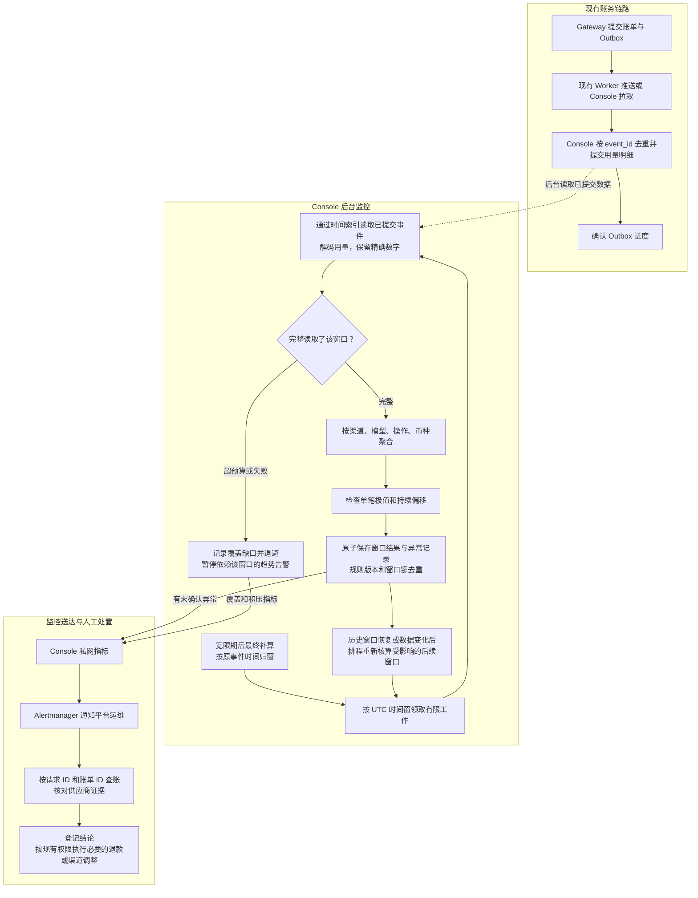

# ADR 0014 上游用量异常监控

2026-11-27。监控按配置启用。默认继续使用现有账单、推理和告警链路。上线要求和验收见末节。

## 决定

在 Console 后台监控已结算的上游用量。单笔极值或一组请求的用量持续偏移时通知平台运维，由授权人员查账、核实供应商证据并决定处置。客户和供应商的资金记录继续以 Gateway 账本为准。

首版只处理结算结果为 `SETTLED` 或 `DEBT` 的 `billing.settled` 事件。监控使用结算时保存的规范化用量。相同用量可能来自供应商申报、协议适配或网关已有规则，所以告警表达「用量异常待核实」。`UNKNOWN` 和账本失败由已有告警覆盖。首笔异常可能在告警前扣费，长期稳定的虚报可能无法被已有数据识别。

## 数据归属和数据流

| 组件                       | 权威数据与责任                                                                 |
| -------------------------- | ------------------------------------------------------------------------------ |
| Gateway 与账本             | 执行推理和结算，在已有事务内写账单和 Outbox。监控从已投递账单取数              |
| Console 接收端             | 接收 Worker 推送或主动拉取，按 `event_id` 去重，提交 `usage_events` 后确认事件 |
| Console 监控任务           | 读取已提交的事件，按 UTC 窗口分批评估。负责样本统计、异常记录、回看与恢复      |
| Prometheus 与 Alertmanager | 从 Console 私网指标采集告警状态和监控健康指标，送达平台运维                    |
| 平台管理员                 | 复核和登记人工结论。查账、退款及渠道管理沿用现有平台管理入口                   |

现有入口为 [账单 Outbox](../../packages/ledger/src/settlement-direct.ts) 和 [Console 入库与确认](../../apps/console-api/src/outbox-consumer.ts)。客户告警规则继续由计费账户持有。平台监控结果走独立的管理授权及运维告警路由，从 Console 管理监听的 `/metrics` 采集低基数指标。[客户告警表](../../apps/console-api/src/db/schema.ts) · [生产告警配置](../../infra/monitoring/prometheus.yml)



## 数据契约

事件时间用 `usage_events.occurred_at`。以半开区间 `[window_start, window_end)` 归窗。主分组为 `channel_id + model + operation + currency`，其中 `model` 是事件中的网关模型名。渠道映射、模型和价格调整可以改变分布，复核时结合实际路由和捕获的价目版本确认。首批仅启用经运营配置的分组。

| 字段     | 读取方式                                                                                                                                     |
| -------- | -------------------------------------------------------------------------------------------------------------------------------------------- |
| 关联标识 | 取已持久化的 `event_id`、`request_id`、`charge_id`、`channel_id`。异常记录保存固定数量的样本 ID                                              |
| 用量     | 从 `usage_events.payload.usage` 读取输入和输出 token。接受契约内的非负十进制整数字符串，区分有效的 `0`、缺失与非法，比较和持久化保持整数精度 |
| 金额     | 用 `customer_atoms` 与 `currency` 做金额规则。人工查看供应商成本时从权威账单读取供应商币种和成本版本                                         |
| 状态     | 用 `kind` 和 `outcome` 筛选已结算样本。退款和调整供人工核账参考，基线样本仍取原结算事件                                                      |

Console 摄取路径可以把事件 payload 保存为 **JSONB 字符串**。监控兼容 JSONB 对象和其中装有对象的 JSONB 字符串，后者只解码一层。在已配置的分组内，非法载荷、缺失或非法维度记录质量计数，超过 64 KiB 的载荷按非法处理。缺少分组维度的事件无法归属配置中的监控分组。现有用量投影把超出安全整数范围的 token 映射成零，因此异常检测直接读取准确的 payload。[现有转换与入库](../../apps/console-api/src/outbox-consumer.ts)

监控只持久化数值、规则版本、必要标识和人工原因。凭证、正文、工具参数及媒体继续遵守 [数据保留约束](0009-enterprise-gateway-worker-architecture.md)。平台全局样本仅对已认证的平台管理员开放。Prometheus 标签采用固定规则类型和严重级别，样本 ID 仅在 Console 查阅。

## 规则与持久化

**单笔极值。** 对输入 token、输出 token 和客户费用分别设置作用域阈值，严格超出阈值即命中。金额阈值与币种绑定。同一分组、规则版本和窗口合并成一条异常，保存命中笔数、最大值和按超限程度排序的有限样本。事件 ID 作为样本排名的稳定次序。

**持续偏移。** 分别对输入和输出 token 计算离散 P95，按同一分组和维度比较近期完整窗口。基线取策略指定的历史完整窗口 P95 的离散 P50。要求当前样本数和有效历史窗口数达到下限、基线大于零、同时满足相对增幅和绝对增量，并连续命中规定窗口数。比较使用精确整数和有理数。覆盖不完整、基线不足或样本不足的窗口记为未评估，并中断连续计数。实际阈值由预览数据和运营确认，初版可用五分钟 UTC 窗口校准。

| 存储                         | 键、约束与查询                                                                                                                                                                                                              |
| ---------------------------- | --------------------------------------------------------------------------------------------------------------------------------------------------------------------------------------------------------------------------- |
| 已有 `usage_events`          | 按 `event_id` 唯一。Console 部分索引按 `(channel_id, model, operation, currency, occurred_at, event_id)` 排序，支持先按配置分组再读窄窗。单个渠道监控也可限制扫描范围                                                       |
| `usage_monitor_windows`      | 主键 `(policy_version, window_start)`。一行从初算阶段 `INITIAL` 推进至终算阶段 `FINAL`。记录规则参数快照、计划时间、租约令牌、到期时间、下次尝试时间、执行结果和覆盖统计。待执行工作按 `next_attempt_at, window_start` 查询 |
| `usage_monitor_window_stats` | 主键为规则版本、窗口起点和分组键。保存有效样本数、缺失与非法数、各维度离散 P95、最大值和完整性。计数与金额采用足够精度的列或规范化整数串。历史查询用分组键和窗口起点定位                                                    |
| `usage_monitor_findings`     | 稳定身份为 `(policy_version, rule_key, window_start, channel_id, model, operation, currency)`。记录匹配口径、关键统计、样本和观察时间。人工状态为 `OPEN → ACKNOWLEDGED → RESOLVED`，状态更新用版本条件拒绝并发覆盖          |

同一告警重算可刷新统计、样本与当前是否命中。曾经命中的告警保留历史，运维指标仅统计当前仍命中且待确认的告警。人工结论记录管理员当时看到的证据版本，重算保留结论和审计。运维通知按集群、规则类型和严重级别分组。

异常详情使用 `GET /admin/v1/usage-monitor/findings`，按时间与 ID 游标分页。确认和关闭可用版本条件的 `PATCH /admin/v1/usage-monitor/findings/:id`，写入操作者、版本、原因与平台审计。查询和修改沿用平台管理员认证，过期版本返回冲突。对客户的资金调整调用原有 finance 接口并使用既有业务幂等键。[平台管理认证](../../apps/console-api/src/routes/admin.ts) · [现有查账与退款](../../apps/console-api/src/routes/admin-finance.ts)

## 调度、重复与恢复

1. 调度器按启用时间和可回放范围安排窗口。初算在窗口关闭后的正常投递宽限之后执行。终算在较长的迟到宽限之后执行，从相同时间范围重读已提交事件，覆盖初算之后到达的事件。窗口大小、两级宽限、积压预算和单批上限由策略版本固定。
2. 短事务领取到期工作并写租约。读取和评估在结算确认之外完成。每个窗口按一份稳定的只读快照读取有限行数，设置最大扫描行数、3 秒语句时限和 5 秒读取事务时限。同一策略版本和窗口的源查询持有 PostgreSQL 事务级 advisory lock，租约到期也不会出现两个副本同时扫描这个窗口。超过预算标记覆盖不完整，退避重试或降频。持续超限时暂停趋势结论并报告覆盖缺口。
3. 独立事务先锁定窗口行，检查阶段、租约令牌、到期时间和回放状态，再原子提交窗口统计、异常记录和处理状态。初算和终算共用一行和一份有效租约。调度延迟到终算时间时，可直接领取终算。消费者退出后租约过期可重领，过期执行结果不能覆盖新执行者。重投已由源表去重，重算异常由唯一键去重。趋势仅使用所需的已终算且覆盖完整的历史窗口。回放请求和覆盖失败会立即暂停依赖该窗口的趋势匹配，保留原证据和人工结论。
4. 终算宽限之后到达的历史事件可按时间范围人工回放。同版本的显式回放按历史窗口顺序执行。回放尚未领取时合并重复请求。回放已领取时，新请求立即使旧任务的结果失效。旧任务成功返回或失败时立即释放租约，新回放在后续调度中重新读取已提交明细。旧进程中断时以 30 秒租约到期兜底。旧任务退出期间，另一副本仍可领取其他窗口。正常情况下全局同时处理一个任务，人工回放的交接期间最多保留两份未过期租约。单实例在旧任务退出后继续处理队列。已到期的日常窗口优先于刚排入的人工回放和历史趋势补算。补算任务从到期时间等待满 60 秒后恢复按到期时间排序，以便持续积压时继续推进。较新普通窗口仍会执行单笔极值规则，趋势须等所需历史窗口恢复。恢复或已终算快照变化时，系统在同一事务排程有限范围内受影响的后续终算窗口补算。规则修改创建新版本，新版本从明确启用时间开始。已终算窗口可用原规则版本重算。监控同时暴露最老待处理窗口时间、覆盖缺口和成功周期时间。
5. 监控和指标导出读取本地 Console 数据库。采集失败时保留已提交异常，恢复后重新暴露状态。Console 抓取失败由 Prometheus 的实例存活规则告警。通知冷却由运维告警侧负责。账单入库、确认和聚合继续走现有 Console 路径。

### 配置和发布

先暂停 Console 实例，执行现有 `console:migrate`，再应用 `infra/postgres/console-roles.sql` 并启动新版本。增量迁移保留已有账单和投影。创建索引会访问历史 `usage_events`，应按部署环境安排迁移窗口。索引和监控查询采用相同的字节范围，覆盖策略允许的模型、操作和币种。范围之外的历史明细仍可从原表读取。迁移执行 DDL 时使用事务级 15 分钟语句超时，锁超时仍为 5 秒。旧版 Console 启动时会拒绝更新后的迁移历史。发布前保留可恢复的迁移前快照，升级后可通过关闭监控配置停用功能，版本回退需同时恢复兼容的数据库版本。

监控默认关闭。先配置 `CONSOLE_USAGE_MONITOR_POLICY` 进入观察模式，检查范围和负载后再设置 `CONSOLE_USAGE_MONITOR_NOTIFICATIONS=true` 发送用量告警。删除策略配置并关闭通知可停止后台监控。历史记录仍可由平台管理员查询。

```json
{
  "effective_from": "2026-11-27T00:00:00.000Z",
  "window_ms": 300000,
  "scopes": [
    {
      "channel_id": "62aa9be2-9641-4d10-a928-d3a8eff2b5dc",
      "model": "example-chat",
      "operation": "chat",
      "currency": "USD",
      "max_output_tokens": "50000",
      "max_customer_atoms": "1000000000000000000",
      "trend": {
        "minimum_samples": 20,
        "baseline_windows": 6,
        "consecutive_windows": 3,
        "increase_bps": 5000,
        "minimum_delta": "100"
      }
    }
  ]
}
```

`CONSOLE_USAGE_MONITOR_POLICY` 接受上述对象的单行 JSON。将渠道标识、模型、阈值与启用时间替换为环境实际值。默认每 15 秒领取至多一个窗口，并使用一个独立的 Console 数据库连接。默认窗口为五分钟，初算宽限一分钟，终算宽限十五分钟，累计回追 24 个新窗口，单窗口读取上限为 4,000 行。超出回追范围但尚未排程的窗口以累计指标登记，运行期间最近一小时出现的跳过会触发覆盖告警。需要补查未排程的历史范围时，按原始明细留存期调整策略启用时间和回追范围。已终算窗口可通过 `POST /admin/v1/usage-monitor/replay` 以原策略版本和最长一天的时间范围请求补算，单次最多 288 个窗口。策略版本由完整配置摘要生成。

策略版本应保留至对应诊断数据和告警过期。正式保留期限以现行用量明细可读取期限为上界。

## 验证与放行

| 场景               | 可观察判据                                                                                                                          | 当前验证                             |
| ------------------ | ----------------------------------------------------------------------------------------------------------------------------------- | ------------------------------------ |
| 真实账单投递与重放 | 现有推送和拉取正常，重复事件仅入账一次，慢告警评估期间确认及时完成                                                                  | 现有 Console 账单集成套件            |
| 大整数、缺失和零   | 申报 `9007199254740993` 在监控读回时精确可比较，独立观测缺失和显式零                                                                | 真实 Console HTTP 和 PostgreSQL 探针 |
| 极值和趋势边界     | 阈值相等不命中，大一个 token 命中。低样本和低绝对增量不触发窗口趋势条件                                                             | 真实持久化样本的规则探针             |
| 迟到和并发重投     | 晚到事件回到所属半开时间窗口，重复投递只计一次，边界事件落下个窗口                                                                  | 真实 Console HTTP 和 PostgreSQL 探针 |
| 重算与人工处置竞争 | 同键并发只生成一条结果，后续重算不重新打开人工关闭的告警                                                                            | 独立原型表的并发写入探针             |
| 租约过期和终算覆盖 | 终算取得新租约后，旧初算提交影响零行，终算结果可读                                                                                  | 独立原型表上的租约条件更新探针       |
| 监控写入堵塞       | 监控锁等待已经出现时，真实 Console 确认仍完成，源事件可查                                                                           | 真实 Gateway 结算和 Console 确认     |
| 窄窗口读放大       | 对同一时间范围比较部分索引前后的执行计划、命中行数和访问块                                                                          | 十万行合成明细的 PostgreSQL 探针     |
| 完整服务验收       | 验证运行时抢占与重启恢复、终算前后迟到、连续窗口评估、人工处置权限和运维收告警                                                      | Console 集成测试和回环告警送达演练   |
| 性能放行           | 用相同负载比较现状、仅新增索引、索引加监控三组。观测吞吐、JSON P99、SSE 首字与结束延迟、Console 确认延迟、PostgreSQL I/O 和监控积压 | 上线前测量                           |

### 本地执行结果

基于提交 `6cc94be`，使用 Bun 1.4.5、隔离 PostgreSQL 17.11、真实 Console HTTP 路径和合成事件。现有 `tests/integration/console-api-billing-outbox.test.ts` 通过 11 项，独立数据探针通过 8 项。监控租约、异常写入和索引的原型只在临时测试数据库中执行。

查询探针在十万行合成明细中读取同一五分钟窗口，两次都返回五行。加部分索引后 PostgreSQL 选择索引扫描，共享访问块从 693 降到 4。部分索引会给 Console 用量写入增加维护成本，窄窗查询结果用于确认索引访问路径。真实生产窗口的读取成本和入库开销属于性能放行项。

真实 Console HTTP 和 PostgreSQL 集成测试覆盖历史明细迁移、精确 P95、独立绝对增量门槛、基线失效和恢复、回放作废旧结果、结束即释放租约、其他窗口继续评估、同窗口扫描互斥及扫描上限。另一项集成测试确认监控写入等待数据库锁时，真实 Gateway 请求仍能结算，Console 仍能持久化事件并确认 Outbox 进度。Prometheus 规则测试覆盖观察模式、实例去重和 Console 抓取故障恢复。回环演练确认 Alertmanager 分别送达 `MAX_OUTPUT` 和 `MAX_CHARGE`。
