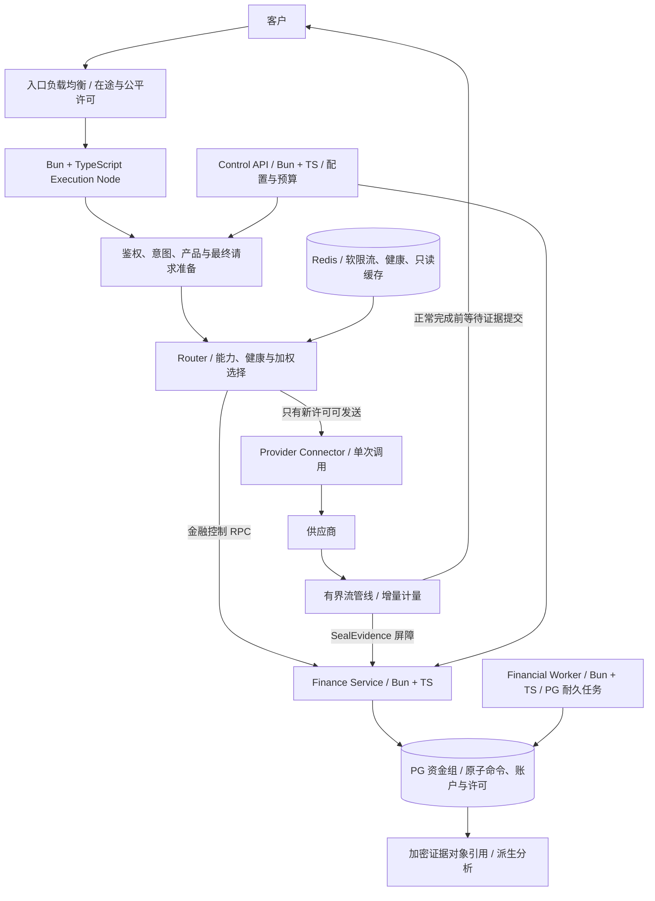
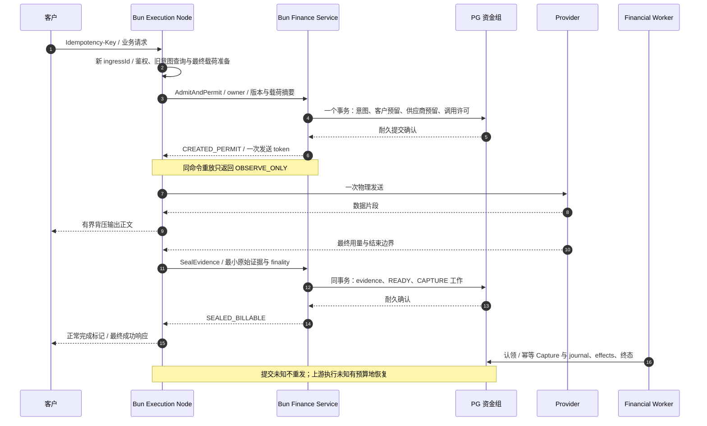
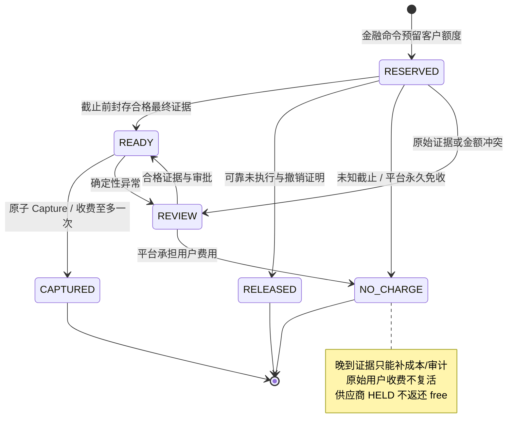
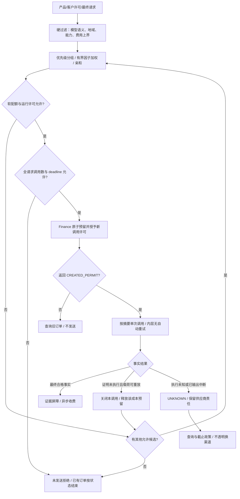
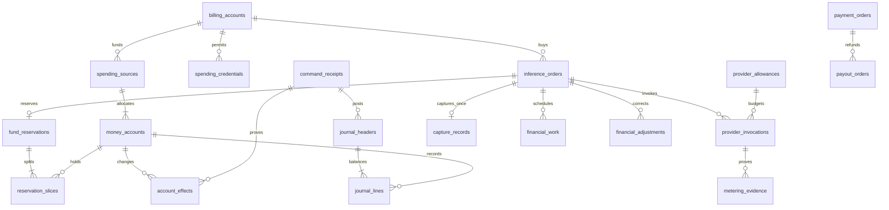
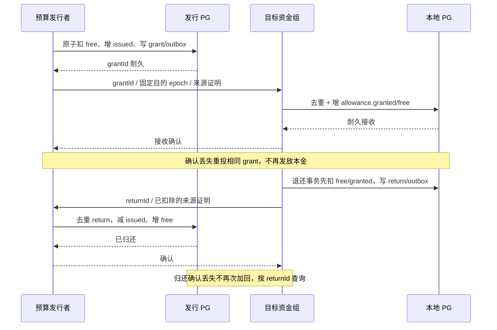
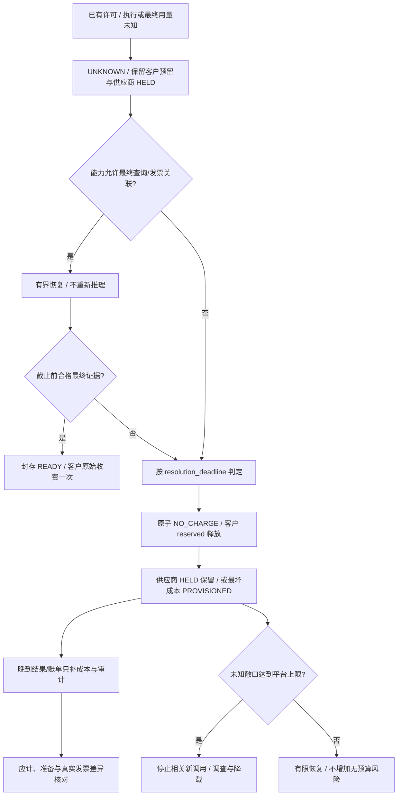
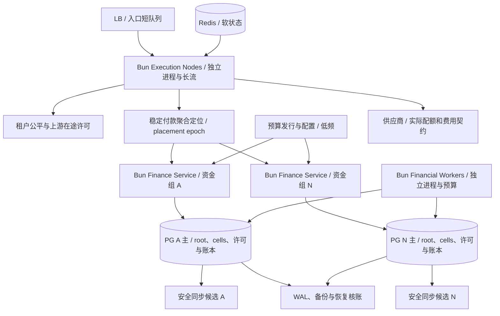

# 全新网关架构图集

8 张图均为新系统目标设计，当前尚未实现。各运行面均为 Bun + TypeScript 独立进程，运行细节见 [Bun 运行规范](bun-runtime.md)。返回[总体架构](architecture.md)。

## 1. 总体架构

执行面处理字节流；金融面处理权威状态。初期可以单物理资金组，聚合/额度身份从一开始支持扩组。

## 2. 授权、发送与收费时序

首次同步请求只有一次合并的发送前金融事务；异步排队的预留/认领是显式变体。重放命令不重复返回发送能力。

## 3. 用户收费决策

用户收费、调用执行和供应商成本是三种状态。NO_CHARGE 不等于供应商已取消。

## 4. 智能路由与调用责任

每次费用性物理发送独立占预算；没有隐藏 SDK 重试。错误码不自动证明未执行。

## 5. 核心数据关系

图是逻辑实体关系，具体复合外键、资产与命令约束见数据库设计。预算发行与资金组之间没有跨库本地事务。

## 6. 供应商额度划拨

pool 不逐请求更新；本地额度申请/归还采用唯一身份和保守的在途本金，不依赖响应是否收到推断资金回滚。

## 7. 未知结果与客户免收

用户可以按政策结束账单，平台的上游责任仍有本金覆盖。没有真实 usage 就不伪造精确客户费用。

## 8. 部署与容量边界

执行节点与金融池分开，各自使用独立 Bun 进程/容器；同一镜像可以有不同启动入口与资源配置。物理资金组数量由完整旅程基准决定。消费单元是已入账本金分配，不是复制缓存余额。

