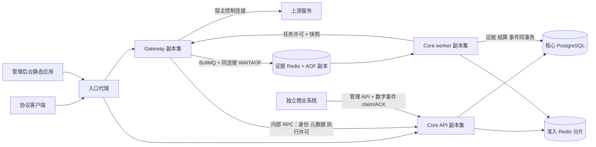

# Enterprise v2 迁移规格与执行记录

状态：基础/SDK/ORM/资金前置、插件目录、native启动、内部身份及T04.b.2a资金准入已核验合入main。最近主树单次完整verify通过：Go33/45、unit284/4057、integration463/10411、全部产物；独立原生耐久8项通过（仍为legacy单账本范围）。v2026111206冻结，只能追加v7。b.2b结算/c三进程及后续迁移继续；独立冷假helper首次未READY历史失败保留UNKNOWN，不宣称根因解决。日期：2026-11-12。起点：`main`，`ce5b4145a18959efcb7cc7cb927db2295cd8dd8f`，当前保持未提交。本文是本次范围、设计裁决、迁移矩阵、任务依赖和验收状态的权威记录；实现改变设计时先更新决定和影响。

## 1. 授权、事实与完成边界

### 1.1 已确认需求

| ID  | 本次必须交付的结果                                                                                                                                                                                                                                                                                               |
| --- | ---------------------------------------------------------------------------------------------------------------------------------------------------------------------------------------------------------------------------------------------------------------------------------------------------------------- |
| R01 | 全面架构迁移，采用粗粒度服务化：Gateway、Core API、Core worker 三个独立生产进程；每个服务内部按业务模块组织。保留所有有效公共功能、协议与接口，差异须逐项有本次授权依据。                                                                                                                                        |
| R02 | Gateway 负责协议适配、上游连接、有界流转发与计量；通过 Core 获得身份、元数据及执行许可。不直连核心 PostgreSQL，不持有渠道运营、钱包或资金管理实现。                                                                                                                                                              |
| R03 | Core API 拥有技术身份授权、模型/渠道/客户费率、调用准入、客户钱包授信退款、渠道资金及插件注册发布。Core worker 拥有证据消费、同事务结算、异步补证、恢复和对账。共享一个核心 PG，保留准入与结算原子边界。                                                                                                         |
| R04 | 商业业务系统保持独立数据库、身份与发布，只通过稳定 API 和数字事件连接。真实支付执行、支付订单、商业用户登录、套餐、营销不进入本系统。技术租户、组织、principal、Key 与管理员凭证属于本系统。                                                                                                                     |
| R05 | 金额为币种内 `10^-18` 单位的 atoms 字符串和 `NUMERIC(38,0)`；使用 BigInt 有理数，多维度求和后仅向上取整一次。客户售价和供应成本独立、不可变、按调用捕获版本。不隐式换汇。                                                                                                                                        |
| R06 | 客户预扣、意图幂等和首次 attempt 同事务。授信、债务、现金/赠款来源、退款、调账及 UNKNOWN 保留规则全部延续；UNKNOWN 不因时间、改路由、进程重启或后台停用释放。每个物理 attempt 记录供应成本，客户仅按现有最终交付规则收费。                                                                                       |
| R07 | 正常成功 JSON/流终态之前，证据必须经 BullMQ 写入，并在同一 Redis 连接完成 WAITAOF 所需落盘确认。worker 在 PG 证据、账单、平衡流水和可投递事件共同提交之后才 ACK。不得降低耐久或成功口径换取吞吐。                                                                                                                |
| R08 | 新增供应商品牌、上游资金账户、渠道连接、模型路由；多个渠道可共享资金账户。渠道连接包含 URL、Key/凭证、插件版本和配置快照。上游预付可用额为账本余额减全部在途占用，作为每个新 attempt 的硬闸。                                                                                                                    |
| R09 | 只登记已经完成的上游充值，不执行支付。付款币种/金额与供应商实际入账币种/金额分别记录。充值、调账、幂等回执、平衡账本和审计同事务。包括账本、按账户/渠道/币种报表、人工对账和可选自动余额观测；观测不能覆盖账本。实际成本超预估完整入账并关闭新的许可。                                                           |
| R10 | 交付完整线上动态插件：平台管理员上传、校验、发布、绑定、停用、回滚；统一 SDK/ABI、不可变包、摘要、配置 schema 和合成 fixtures。现有所有适配器迁入同一接口。线上增加现有公共操作/计量维度内的新协议适配，无需重发 Gateway。                                                                                       |
| R11 | 插件可转换请求、响应、增量流、用量、错误及异步资源操作，可选余额查询。宿主控制网络、凭证、背压、期限和成功终态耐久；插件无数据库、资金、任意网络或日志正文权限。最终发出参数先校验并绑定预扣，每个 attempt/资源绑定不可变插件版本与配置快照。新增公共操作/计量维度仍需核心契约升级。                             |
| R12 | 交付独立且可实际操作的管理后台页面：插件、渠道、资金和审计，通过管理 API 实现真实读写和授权；现有管理能力也要能使用。不能以静态 UI、API 清单、方案或将来任务替代功能。                                                                                                                                           |
| R13 | 拆解 Store、execute 和全量 Dependencies；kernel 只留纯规则，协议解析归适配模块，HTTP 不识别 PG 码。普通 schema/CRUD/版本迁移采用 Drizzle，关键资金 SQL 函数保留。迁完删除旧实现、旧内部路径和无用兼容层。                                                                                                        |
| R14 | 完整迁移测试并补齐新行为、并发、故障、资源清理、性能与容量证据；独立审查；原生全门禁、产物、耐久及备份验收。按本机当前可合理运行条件测最大稳定负载，逐档给出完整链路曲线、热点、SSE、并发和故障证据；不再以固定6000RPS作为门槛。99.99%是部署目标，未实测跨故障域HA不得宣称满足；最终全部原生测试，无Docker依赖。 |
| R15 | 全部mock、本机门禁与最大稳定负载验证后，最后真实MiniMax少量代表性验证，禁止真实压测；含文本两协议、语音识别、图片、音乐、视频。music是新增产品能力，进入公共操作/SDK/计量/预扣/资源/测试完整链。多渠道与CNY/USD/HKD各100单位测试资金明确隔离，不冒充真实上游支付/充值，不虚构换汇。                              |

### 1.2 本次授权边界和实施选择

- 只在开发环境迁移，允许新建独立数据库基线；不要求把 schema06–10 等历史开发数据升级到 v2。移除旧升级路径及仅验证旧版本的夹具有此授权依据，但其中的幂等、回滚、资金/证据保持、归档和恢复语义必须迁移。绝不清空、重建或停止未知/既有数据库、Redis 或容器。
- 用户最新裁决覆盖原容量和容器安排：不使用Docker，最终全部原生进程，部署交付原生/systemd配置；性能目标为本机可合理运行的最大稳定负载。当前只有本机，先完成全部可执行实现与验证；跨故障域HA、资源预检拒绝的长测明确未验证，不阻止可交付代码，也不成为待用户问题。T17同步更新历史容量契约。
- 默认在当前 `main` 开发。并行实施必须使用物理隔离 worktree；只集成点名的自身文件。未获 commit、push、publish 或生产部署授权；本计划不授予这些操作。
- 新路径、RPC、表、状态、环境配置和错误码在本文件中是**拟定 v2 契约**，不冒充现有定义。实现时在相应契约包和 OpenAPI 落实，不能悄悄改变公开语义。
- 插件运行时路线已按 T02 实证选定：Bun 1.4.4 三主服务及 Gateway 所属原生 Go/Extism/wazero 受限执行器。T02 历史探针使用 Go 1.27.3 / Extism Go SDK 1.7.1 / wazero 1.9.0；T02.a 正式运行器已锁定 Go 1.27.4 / Extism Go SDK 1.7.1 / wazero 1.12.0，经独立复核与主工作区组件集成验证接纳。T04/T08/T14 完成产品集成与限制验收；不将探针 GO 写成生产验收。T03已锁定Drizzle 0.45.4 / Drizzle Kit 0.31.11，Bun SQL精确金额、新基线迁移及主工作区完整门禁已通过并集成。
- 管理 UI 采用独立静态应用及构建产物，由入口代理提供页面，API 路由到 Core API；不引入第四个必需应用服务器。选用轻量 TypeScript UI，实现可访问的表单、列表、详情及错误反馈；具体 UI 库由 T13 结合构建证据选定，不能改变业务范围。
- 管理员使用本系统技术管理员凭证，不新增商业账号登录。现有 `ADMIN_KEY` 保留为部署 bootstrap 管理员，新增可撤销、带操作权限的管理员技术凭证，用于实名技术 actor 审计；不把项目 `ADMIN` Key 当平台管理员。

### 1.3 当前证据与明确未验证项

已经阅读 `AGENTS.md`、`package.json`、`.github/workflows/verify.yml`、`tests/unit/architecture.test.ts`；核对 Gateway app/admin/openapi/assembly/context/execute/resource/recovery/worker、kernel 契约及精确计费、Store/FundsStore/schema/maintenance、连接器能力、耐久队列、构建/迁移/验收入口与测试清单。参考 Tillgate 的 `recharge-channel.ts` 和 `channel-exposure.ts` 仅为只读设计材料。

本次主会话基线实跑结果保存于 `.local/enterprise-v2/evidence/`，T01 核对了日志：类型检查 99 文件无错误，oxlint 零警告，格式检查 156 文件；单测 **100 通过 / 0 失败 / 1564 断言 / 17 文件**；真实 PG/Redis/HTTP 集成 **276 通过 / 0 失败 / 6984 断言 / 5 文件**；构建通过；独立产物 **8 项通过**。对应 `baseline-check.log`、`baseline-lint.log`、`baseline-format.log`、`baseline-unit.log`、`baseline-integration.log`、`baseline-build.log`、`baseline-artifact.log`。这些只证明迁移前版本，不能作为 v2 验收。

现有原生PG/Redis在本次开始前已运行，必须保留。原生耐久基线8项通过，日志为 `baseline-durability.log`。Docker按最新用户要求退出验收范围。当前磁盘可用约20GiB，持续实验先按实际负载和证据放大预检。T01不执行产品测试或修改数据库。T02 已交付并由协调者核验：Go/wazero 方案可进入实现，Bun JS SDK 与当前 Node SDK 原样均 NO-GO；边界和证据摘要见[插件运行时探针裁决](../performance/plugin-runtime-probe-2026-11-12.md)。现有容量报告为历史失败，60分钟、全协议容量和跨故障域HA未验证，不能改文案当通过。

独立基线契约审计已完成静态盘点，入口为 `/Users/wrr/work/super-token-gateway-contract-audit-20261112/.local/contract-inventory/report.md` 与同目录 `report.json`，源版本同为 `ce5b4145a18959efcb7cc7cb927db2295cd8dd8f`。其 50 项能力、83 项 HTTP 操作、278 个静态 test 声明、9 项缺口和17组结构测试裁决是各任务逐项迁移的验收清单；278 是未展开循环的源码声明数，不能当运行用例数。该审计未运行产品测试，不能代替上面的基线日志或 v2 验收。报告 SHA-256 分别为 `37ef2f5796580d8c9bd295cd0b1e402c6ec1d188ffb016f17335b10b6be313fe`、`70bb19df77dcd28010a4c20e8256b61006e1b22a8397a7516c10b73cafcb5cb8`。

## 2. 目标模块、依赖与状态所有权

### 2.1 部署和请求路径



内部 RPC 和公网路由分别监听或由入口明确隔离。公网永不暴露内部许可、包分发及补证端点。Core worker 负责调度异步补证；所有供应商网络交互由 Gateway 的相同沙箱/传输宿主执行，worker 不复制协议适配和上游凭证处理栈。

### 2.2 目标目录及内聚职责

下列是职责目录，不要求一个表/接口一个文件。紧密协作的私有函数共置，避免只有转发的层。

```text
apps/
  gateway/src/
    main.ts assembly.ts config.ts http/
    execution/       许可执行、重试边界、响应/流转发及取消
    adapters/        入口协议处理、资源字段解析、Batch 和计量宿主装配
  core-api/src/
    main.ts assembly.ts config.ts http/
    identity/ catalog/ admission/ customer-funds/ upstream-funds/
    plugins/ resources/ events/ audit/
  core-worker/src/
    main.ts assembly.ts config.ts
    settlement/ recovery/ reconciliation/
  admin-ui/src/      插件、渠道、资金、审计及既有管理页
  mock-providers/   独立真实 HTTP 替身，不依赖产品业务包
packages/
  kernel/src/       纯金额、有理数、预扣规则、状态规则、维度和领域值
  contracts/src/    公共/内部 schema、DTO、错误分类、证据和插件版本契约
  core-client/src/  有界内部 RPC、认证、截止时间、命令回执查询
  plugin-sdk/src/   ABI、配置/能力清单、合成 fixture 工具和开发 SDK
  plugin-host/src/  沙箱、包校验、流上下文、资源预算、宿主能力桥
  plugin-host/native/ 原生 Go 受限运行器及公开 IPC 测试，独立 go.mod/go.sum
  adapters/src/     现有协议实现与内置插件包源码；替换 connectors
  runtime/src/      网络池、队列、限流、内存、指标和生命周期
  storage/src/
    schema/ migrations/          Drizzle schema 与单一版本迁移清单
    identity/ catalog/ admission/ customer-funds/ upstream-funds/
    plugins/ resources/ events/ audit/ maintenance/
    sql/                        关键资金和证据原子 SQL
scripts/            迁移、构建、seed、验收、容量和归档入口
tests/integration/  真实 PG/Redis/多进程 HTTP 与 UI 浏览器验收
tests/unit/         只放架构约束
tests/support/      公开共享测试装置，不跨引模块私有 __test__
infra/              三进程权限、代理、原生服务与 HA 配置
docs/               同步后的契约、部署、容量与本迁移记录
```

依赖约束：`kernel` 不导入 I/O、HTTP 框架、PG、Redis、协议解析或应用代码；`contracts` 只依赖 kernel 和 schema 库；`plugin-sdk` 依赖 contracts/kernel；`adapters` 依赖 SDK 和纯规则，不依赖 storage/Core；`plugin-host` 依赖 SDK/contracts/runtime；`runtime` 不依赖 storage/应用。Batcher 的计时与 I/O 协作、crypto/摘要归 runtime；storage 依赖 kernel/contracts/Drizzle/PG 驱动，并只允许通过 runtime 的 `./batcher`、`./crypto` 两个内聚子路径复用这些能力，不依赖 runtime 根入口、队列、Redis或网络，不复制算法或为此新建泛化公共包。core-client 只依赖 contracts 和通用网络支持。Gateway 只组合 core-client、runtime、plugin-host、adapters、contracts/kernel，不依赖 storage 或 Core 业务模块。Core API/worker 可依赖 storage/runtime/contracts/kernel，不导入 Gateway 私有模块。UI 只使用公开管理契约，不导入 storage。架构测试检查上述窄边界及任意方向循环依赖。

`Dependencies` 被每个进程的装配对象和各内聚模块需要的窄接口替代；不通过一个全量 Store 或全服务容器绕过边界。storage 将数据库异常翻译为领域失败，Core HTTP 只映射领域失败。Gateway HTTP 只映射 Core 契约错误和本地协议/传输失败，不识别 SQLSTATE。

Core的插件验证组件可以依赖plugin-host/SDK的公开包验证和fixture执行接口，且仅在独立受限helper内执行；这不允许Core复制Gateway的供应商传输、认证注入或正文处理栈。builtin发行资产由受控allowlist提供，验证组件不从调用方任意路径加载源码或脚本。

### 2.3 权威状态和凭证

| 状态                                                   | 唯一写入责任                        | 其他进程的使用方式                                                            |
| ------------------------------------------------------ | ----------------------------------- | ----------------------------------------------------------------------------- |
| 组织/principal/project/Key、管理员凭证、权限版本       | Core identity                       | Gateway 提取请求凭证与可信传输地址，通过 RPC 授权；不缓存可绕过撤销的授权结果 |
| 模型、供应商品牌、渠道、路由、费率和配置版本           | Core catalog/plugins                | Gateway 获得有版本的候选与最终许可；Core 在发放每个新执行授权时重新检查       |
| 请求意图、客户 hold、attempt、上游 hold、执行归属      | Core admission 的单个 PG 事务       | Gateway 只按不可变许可执行；worker 只按持久化状态恢复，不重发生成             |
| 原始数字证据、供应成本、客户账单、流水、争议、事件     | Core worker settlement              | Gateway 产生事实；外部系统通过 Core API claim/ACK 消费                        |
| 充值/调账/退款/人工对账、凭证及操作审计                | Core funds 管理事务                 | UI 和商业系统发出幂等管理命令，不直接写库                                     |
| 资源公共 ID、归属、远端 ID、插件/config 版本和补证租约 | Core resources                      | Gateway 收受不可变资源操作许可并回报事实；worker 租约调度                     |
| 分布式 RPM/TPM/并发、路由健康、half-open 代次          | Core API/worker 的 runtime 限流端口 | Gateway 通过许可续租/释放；不拥有第二套准入实现                               |
| 上游响应正文、用户 prompt、工具参数、媒体字节          | 只存在于 Gateway 的有界内存/流      | 不进入 PG、Redis、事件、审计、日志或插件 fixture 持久化                       |

Core 持有 Key pepper 与凭证加密主密钥；Gateway 不配置核心 `DATABASE_URL`、迁移凭证、Key pepper 或资金权限。Core 通过认证加密的内部通道给宿主发放受执行许可约束的凭证句柄/短期密封凭证；插件永远拿不到可读取的原始 Key。句柄不是任意签名或摘要 oracle，宿主将认证动作绑定 permit、attempt 或资源 action、目标、method、规范化 body/headers 摘要与期限；Authorization、OAuth/session token 和签名结果只由宿主传输消费，不返回 guest。上游 secret 不进入日志/包/fixture/外部元数据。现有 `/admin/providers` 列表的遮盖语义和新凭证仅返回一次语义保留。

## 3. 公共能力与迁移矩阵

### 3.1 外部路由完整映射

入口 URL 继续兼容现有客户端。现有 `/v1` 中执行/媒体/资源路径归 Gateway；技术身份、目录、账务查询可由入口路由 Core API，保持路径、认证和返回契约。没有入口代理的开发模式也必须提供同一公开入口；Gateway 的窄 Core 代理只能转发这些既有端点，不包含业务实现。`/admin` 管理 API 全部由 Core API 提供，原路径保留。

| 能力 ID | 当前外部能力与现状来源                                                                                                                                         | v2 行为与消费者                                                                                                                                                  | 目标模块 / 任务 / 验证                                                               |
| ------- | -------------------------------------------------------------------------------------------------------------------------------------------------------------- | ---------------------------------------------------------------------------------------------------------------------------------------------------------------- | ------------------------------------------------------------------------------------ |
| C01     | `POST /v1/chat/completions`、`/v1/responses`、`/v1/messages`；原生/跨协议 JSON、SSE、工具、精确数值、终态；app/openapi、connectors                             | 全部保留；不能表示的语义 422，不静默丢参数；空 JSON、仅终态流和截断不得正常成功                                                                                  | Gateway execution + adapters / T04,T09 / gateway、conversion、metering、bedrock 回归 |
| C02     | `GET /v1beta/models`；`POST /v1beta/models/{model}:generateContent` 和 `:streamGenerateContent`                                                                | 原生 Gemini URI/反馈/安全语义、Key/IP 和模型限制保留                                                                                                             | Gateway 入口协议 + Core catalog / T09 / Gemini JSON/SSE、SAFETY、blocked prompt      |
| C03     | `POST /v1/embeddings`、`/v1/moderations`、`/v1/completions`                                                                                                    | 原生操作、字符计费、能力限制保留                                                                                                                                 | adapters + worker / T09,T10 / HTTP matrix、字符收费                                  |
| C04     | `POST /v1/images/generations`、`/v1/images/edits`                                                                                                              | JSON/multipart、`n` 校验、对象/分片/SSE 图片数量、每图价格与预扣保留                                                                                             | Gateway media + adapters / T10 / image n=2、payload 数量、策略边界                   |
| C05     | `POST /v1/audio/speech`、`/v1/audio/transcriptions`、`/v1/audio/translations`                                                                                  | JSON/SSE/二进制/文本格式、字符与 ms/decimal seconds 精度、背压保留                                                                                               | Gateway media / T10 / 125ms、非JSON费用、relay-binary                                |
| C06     | `POST /v1/files`、`POST /v1/batches`                                                                                                                           | Batch JSONL 验证/改写、单模型、唯一 custom_id、原始 endpoint/model pin、请求/图片/媒体聚合 ceiling；不保存正文                                                   | Gateway Batch + Core resources / T11 / Batch 现有全套回归                            |
| C07     | `POST /v1/videos`                                                                                                                                              | OpenAI 与 Gemini 视频、multipart 转 JSON、异步 usage、内容下载保留                                                                                               | Gateway media/resources / T10,T11 / 视频及跨origin无凭证下载                         |
| C08     | `GET /v1/{files,batches,videos,responses}`；拥有者内 keyset 分页                                                                                               | 归属与模型/操作授权在 limit 前；cursor 不越权；响应不暴露远端身份                                                                                                | Core resource index + Gateway / T11 / pagination、restricted key                     |
| C09     | files：GET/DELETE `/{id}`、GET `/{id}/content`；batches：GET `/{id}`、POST `/{id}/cancel`                                                                      | 始终回原始渠道/插件/config；取消后实际 usage 结算；内容流不落库                                                                                                  | Core resources + Gateway plugin resource ABI / T11                                   |
| C10     | videos：GET/DELETE `/{id}`、GET `/{id}/content`；responses：GET/DELETE `/{id}`、POST `/{id}/cancel`、GET `/{id}/input_items`                                   | 稳定公共 ID、previous_response_id/文件引用隔离、异步无用户轮询也补证；不支持的 unmanaged 存储字段仍拒绝                                                          | T11 / resource ownership、Responses、后台恢复                                        |
| C11     | `GET /v1/models`、`/v1/usage`、`/v1/requests/{id}`                                                                                                             | 模型/操作限制、100条 usage 和 before、技术证据查询保留，元数据不含内容                                                                                           | Core catalog/events / T07,T12                                                        |
| C12     | `GET/POST /v1/project/keys`；DELETE `/v1/project/keys/{id}`                                                                                                    | ADMIN 委派不能扩大 principal/model/operation/角色/CIDR/配额/到期权限；即时撤销                                                                                   | Core identity / T07 / delegation、cross tenant、Key/IP                               |
| C13     | `GET /v1/wallets`、`GET /v1/requests/{id}/billing`                                                                                                             | 只允许项目 ADMIN/BILLING；币种隔离、精确字符串、完整来源/债务/退款凭证                                                                                           | Core customer-funds / T05                                                            |
| C14     | `/admin/organizations` POST、`/{id}` PATCH；`/admin/organizations/{id}/principals` POST；`/admin/principals/{id}` PATCH                                        | 技术组织及成员角色、启停、层级配额保留；不变为商业身份系统                                                                                                       | Core identity / T07                                                                  |
| C15     | `/admin/projects` GET/POST、`/{id}` PATCH；`/admin/projects/{id}/keys` GET/POST；`/admin/keys/{id}` PATCH/DELETE                                               | 技术租户、Key 生命周期、角色和作用域保留；审计随事务                                                                                                             | Core identity / T07                                                                  |
| C16     | `/admin/providers` GET/POST、`/{id}` PATCH                                                                                                                     | 继续作为**唯一渠道连接集合**；现有 kind/base_url/api_key/rpm/concurrency/enabled 输入有效；新增 account/brand/plugin binding。内部不再使用 provider 单体混合模型 | Core catalog/upstream-funds/plugins / T06,T08                                        |
| C17     | `/admin/models` GET/POST、`/{model}` PATCH；`/admin/models/{model}/routes` GET/POST；`/admin/routes/{id}` PATCH                                                | 逻辑模型、策略、输出上界、priority/weight、三路由策略、请求策略、独立成本版本保留                                                                                | Core catalog/admission / T07,T09                                                     |
| C18     | `/admin/tariffs` GET/POST                                                                                                                                      | 客户费率 provider-specific 与通用价格、basis、所有 rate 的 ceiling、币种/version 保留                                                                            | Core customer-funds / T05                                                            |
| C19     | POST `/admin/projects/{id}/credits`；GET `.../wallets`、`.../wallets/{currency}/lots`、`.../journal`；PATCH `.../wallets/{currency}`；POST `.../credit-policy` | 现金/赠款作用域、过期、选用优先、冻结、版本化授信、精确幂等回执保留                                                                                              | Core customer-funds / T05                                                            |
| C20     | POST `/admin/charges/{id}/refunds`、`/adjustments`；POST `/admin/requests/{id}/resolutions`                                                                    | 原来源退款、不复活过期赠款、债务/减免守恒、人工 RELEASE/SETTLE 和版本引用保留                                                                                    | Core customer-funds / T05                                                            |
| C21     | GET `/admin/usage`；POST `/admin/consumers`、`/{id}/claim`、`/{id}/ack`                                                                                        | 数字 attempt snapshot、至少一次交付、租约 token fencing、历史回放不漏并发提交、消费者真实 ACK 保留                                                               | Core events / T12                                                                    |
| C22     | POST `/admin/recover`；GET `/admin/queue`；POST `/admin/queue/jobs/{id}/retry`；GET `/admin/metrics`                                                           | Core 调度恢复、队列运维、重试审计、指标保留；禁止管理员重试导致上游生成重发                                                                                      | Core API/worker / T11,T12,T14                                                        |
| C23     | GET `/livez`、`/readyz`、`/openapi.json`；worker health/metrics                                                                                                | 三进程各自健康、依赖/排空真实 readiness；公共 OpenAPI 覆盖现有与新增契约                                                                                         | T04,T14 / 独立进程及产物验证                                                         |
| C24     | `db:migrate`、`db:archive`、seed、build、artifact、container、durability、backup、bench                                                                        | 除按用户要求退役container依赖外沿用脚本入口；参数变更同步调用方/CI/部署文档；三产物、原生权限/归档/耐久/备份及精确证据验证                                       | T03,T12,T14,T18                                                                      |
| C25     | 八种 provider kind：openai/anthropic/gemini/deepseek/ollama/azure/bedrock/vertex                                                                               | 全部迁到统一插件 ABI，含云凭证刷新/签名、Bedrock 二进制事件、native 和 conversion；正常新插件不改 enum 重编宿主                                                  | adapters + plugin-host / T02.a,T08,T09                                               |
| C26     | 新增music和MiniMax真实代表性接入，旧版无music                                                                                                                  | 公共operation/music_ms、生成/流式/资源、客户/成本费率及预扣/证据/账本完整实现；模型/路径先核对官方契约                                                           | T03,T08,T10,T11,T19 / mock全链后少量真实验证                                         |

`resourceActions` 的组合以当前实现为准：responses 无 `/content`，其他资源无 `/input_items`；不为矩阵补造未实现端点。Rerank、Realtime 和 Responses WebSocket 当前没有实现，本次不把它们当成“保留能力”，也不在报告写为已覆盖。

### 3.2 有意差异与删除条件

| 差异                                                                | 授权/原因                               | 兼容与删除条件                                                                                                                                                                                             |
| ------------------------------------------------------------------- | --------------------------------------- | ---------------------------------------------------------------------------------------------------------------------------------------------------------------------------------------------------------- |
| Gateway 不再直连 PG、无后台管理/恢复循环，worker 移到独立应用       | R01–R03、R13                            | 同外部入口路由到 Core；删除旧 assembly Store/FundsStore 装配和 gateway worker-main，产物脚本、CI、部署同步                                                                                                 |
| 原 providers 混合实体拆成 brand/account/channel/route               | R08                                     | 保留 `/admin/providers` 和外部 `provider_id` 表示渠道连接；不增加同义 `/admin/channels`，不产生 provider_id/channel_id 双轨字段。旧 kind 是插件目录中的稳定 key，现有八个 key 仍有效，扩展目录可增加新 key |
| 旧 provider 创建时无资金门槛，v2 新账户初始为零                     | R08–R09 的新资金硬闸                    | 旧 payload 可原子创建独立 brand、零余额 account、channel，并返回新增账户身份；只有已登记上游入账后才可执行。现有测试 fixtures 明确充值，不用无限预算/自动虚拟充值隐藏差异                                  |
| 新核心基线不升级历史开发 schema                                     | 用户已确认只有开发环境且可重建数据库    | 新库必须显式指定和证实为空；旧库拒绝且保持不变。移除历史 SQL 兼容路径及只测其版本的 fixtures；保留有效业务/恢复断言。新基线之后仍有受版本管理的迁移与回滚/恢复验证                                         |
| 领域契约与协议解析移出 kernel，全量 Store/Dependencies/execute 拆解 | R13                                     | 受影响消费者和测试逐项迁移后删除旧导出、connectors 包名及路径；不保留内部别名                                                                                                                              |
| 一次性发送授权存在响应丢失的 UNKNOWN，不自动重发                    | R06、R11，外部供应商无通用 exactly-once | 现有外部 Idempotency-Key 409 行为保留；明确区分意图、准入命令、发送授权和物理请求                                                                                                                          |
| 管理员操作新增 actor/权限与审计                                     | R09–R12                                 | ADMIN_KEY 仍可管理；项目 Key 不获平台权限。单个共享 bootstrap key 的 actor 明确为 bootstrap，不能伪装成个人                                                                                                |

## 4. 内部 RPC、许可与执行生命周期

### 4.1 通道、身份和基本契约

实施选择：内部 HTTP/JSON v1，连接复用、请求体和响应体有界，服务端严格 schema；服务身份使用 mTLS 或已由部署验证的等价双向工作负载身份，必须绑定 `gateway_instance_id` 与每次启动唯一 `incarnation_id`。身份凭证不复用项目 Key/ADMIN_KEY；Core 对身份/操作授权，Gateway 只允许 Core API/worker 调用内部执行接口。T14 实证证书轮换、伪造身份、过期和重放防护。

T04.c.transport-probe实测后，内部listener采用Bun 1.4.4下的`node:http2.createSecureServer`、TLS且仅ALPN h2（禁用HTTP1/h2c）；真实stream handler从`stream.session.socket`核对authorized、对端证书指纹和预配置service/instance映射。Bun.serve没有该公开peer入口，node:https在此版本实际缺getPeerCertificate，不能依赖Node类型声明伪装可用。双方验证CA/hostname，已连接socket也须在每个新命令复核当前可信绑定。公开API仍是独立监听职责，不因内部h2而更改公共协议。

每次启动生成内存Ed25519新key与boot nonce，经已认证peer的challenge/持有证明注册到共享PG，生成session/incarnation；公钥唯一身份必须先解析再以规范DER SPKI求摘要，不能hash可重排/换行的PEM文本。注册challenge消费、key唯一性和幂等回执同事务；注册回执丢失可恢复同一session，不能再造owner。允许多个未撤销启动session共存，注册新session不接管或释放旧attempt。命令证明覆盖独立签名域、cluster audience、contract_version、可信service/instance、session/incarnation、类型/id、method/规范path、实际body digest、deadline及trace；UUID/header不代替认证。当前session停用阻新admission/begin；已SEND_GRANTED证据保留捕获公钥与owner作历史签名验证，不能因session过期永久拒收或向新incarnation移交发送权。探针共享Map、PEM文本hash等演示代码不直接作为产品实现；PG锁、跨进程/反向认证、client边界和历史证据仍由T04.b/c实测。

已接纳的具体实施合同见 [内部身份设计](enterprise-v2-internal-identity.md)。生产身份作为T04.b.1后的串行前置单元T04.b.identity，完成后再做金融b.2：runtime只提供通用真实h2/crypto能力，完整认证与私有WeakMap归Core应用；storage接窄可信投影并同事务重核权威身份，不越过既有依赖边界。历史收证对全group所有producer的instance/cert/session按序FOR SHARE NOWAIT并持至外层receipt/资金commit，与安全撤销UPDATE线性化；普通到期/正常停用不套新准入谓词。

上游执行计划采用该设计第7节的两阶段摘要合同。完整request-target（path/query）、header名值和body字节只在Gateway私有有界内存；Core只收strict DispatchProjectionV1技术标量与target/header/body摘要、完整有限auth描述及版本引用，并重算外层dispatch摘要。Core在admit内补真实owner/permit epoch形成AuthorizationPlan，外层commit后返回RESERVED，首次begin再发host-only短期材料；不让完整文本经计划、permit、receipt或日志进入Core。较早设计中“Core重算完整plan”的表述以此投影合同为准，不能为补未知ID在fund后reprepare。真实guest/Gateway/Core/PG/log双canary和变更实际字节0send验收由identity/b.2/c执行，设计模型不冒称产品通过。

所有金额、计数和序号中超出安全整数范围的值使用十进制字符串。每个命令包含 `command_id`、`body_digest`、`caller_incarnation`、`deadline_at`、`trace_id`、`contract_version`；`command_id` 是调用前生成、重试保持不变的 UUID。命令去重键包含命令类型、调用方服务身份和 command_id；同键不同 digest 返回 409 `command_conflict`，既不重做副作用也不换回执。日志只记录技术身份、数字、错误类型和时延，不记录请求正文或密钥。

以下端点和失败类型是新增契约，不是现有实现名称：

| 拟定内部端点                                              | 输入要点                                                                                                     | 返回及原子性                                                                                                                               |
| --------------------------------------------------------- | ------------------------------------------------------------------------------------------------------------ | ------------------------------------------------------------------------------------------------------------------------------------------ |
| `POST /_internal/core/v1/context`                         | 客户端 token 的短期内存副本、可信 transport IP、operation/model、请求摘要；不传 prompt                       | 身份结果、作用域、模型、候选顺序及路由/plugin/config/price 版本。拒绝不创建请求/hold。候选不是可执行许可                                   |
| `POST /_internal/core/v1/admissions`                      | 意图键 hash、原始规范化指纹、选定候选、最终发出 digest/计费参数 manifest、客户币种、资源引用身份、进程归属   | 单个 PG 事务复核授权/目录/版本、创建 request + 客户 hold + 首 attempt + 上游 hold + 命令回执；返回 `RESERVED`，尚不能发送                  |
| `POST /_internal/core/v1/attempts`                        | 已有 request、下个 ordinal、选定候选、独立命令身份、最终 manifest                                            | 重试时当前授权复核、全局 attempt 预算、上游独立 hold/attempt 和回执同事务。此前 UNKNOWN hold 不释放；客户 quote 上界不足则先原子补足或拒绝 |
| `POST /_internal/core/v1/attempts/{id}/begin`             | 所有者、不可变 digest、执行授权命令身份、尚未发送的本地上下文                                                | CAS `RESERVED -> SEND_GRANTED`；只在第一次成功的响应发放一次性发送许可。重复调用/命令查询只返回状态，不再次发放许可                        |
| `GET /_internal/core/v1/commands/{id}`                    | 原调用方身份与命令类型                                                                                       | 只读 `NOT_FOUND/COMMITTED/REJECTED` 及安全回执。能重取 RESERVED 准入回执，不能重取 SEND_GRANTED 的发送权                                   |
| `POST /_internal/core/v1/attempts/{id}/lease`             | owner/incarnation、permit epoch、期限                                                                        | 续期或释放准入并发租约；不更换执行 owner，不解除资金 hold，不把续租失败认作 NOT_EXECUTED                                                   |
| `POST /_internal/core/v1/attempts/{id}/abort-before-send` | 所有者、命令身份、取消理由                                                                                   | 仅在未发放发送权的 RESERVED 状态，原子取消与释放相应占用；与 begin 竞争只有一个胜者                                                        |
| `POST /_internal/core/v1/resources/commit`                | 严格白名单的公共/稳定 opaque 远端 ID、operation、attempt、已定义状态及必要数字                               | 归属/绑定一次确立；同一资源保留原 plugin/config/channel；拒绝 URL、signed query、正文和任意扩展 metadata                                   |
| `POST /_internal/core/v1/resource-permits`                | public resource ID、action 类别、可信授权身份或 worker task lease、最终动作摘要、owner/incarnation、命令身份 | 只读 query 返回有界查询许可；cancel/delete 等变更动作只在首次提交响应授予一次发送权，重复命令只返回状态；固定原渠道/版本及动作预算         |
| `GET /_internal/core/v1/plugins/{digest}`                 | 服务身份、内容 digest                                                                                        | 有界不可变包及签名清单；缓存按 digest，校验失败拒绝执行，不回退任意本地版本                                                                |
| `POST /_internal/gateway/v1/resource-operations`          | worker task lease、resource permit、动作执行身份、截止时间                                                   | 按只读或变更类别执行声明能力并发布数字事实；变更许可仅指定 Gateway/incarnation 消费一次，不重派其他 Gateway；不接受任意 URL/HTTP 隧道      |

跨进程只读操作可在总期限内重试；持久化命令只能用同一 command_id 恢复同一回执，不能因此重获任何一次性外部发送权。Core 先规范化并保存摘要，业务拒绝也返回有类型回执。Core/插件不可用不自动换成无计费直连。管理查询、租约续期及异步补证有各自有界并发/期限，不能抢光结算连接池。

`resources/commit` 的 schema 逐资源种类列出允许字段并拒绝未知字段，仅接受稳定 opaque ID、核心已定义枚举和必要的计数/用量/时间等数字；绑定身份从 permit 派生并核对。远端 ID 必须有长度与字符约束，不能接受 URL、带 query 的定位符或把下载凭证编码成 ID。图片、音频、视频、文件、Batch、Responses 与 music 统一遵守此规则，不能用通用 metadata/扩展对象暗存正文或 signed URL。下载 URI 和跳转链只存在 Gateway 的有界内存，经受控网络验证后消费；不进入 Core、PG、Redis、事件、审计或日志，失效后只允许按原绑定重新只读查询取得。

### 4.2 从客户请求到正常成功

1. Gateway 使用有界读取、可信 peer IP 与路由规则提取请求；保留原始精确数值及 multipart 字段冲突校验。Core context 完成技术身份/操作/模型/资源授权。Gateway 不把客户端可伪造的 `X-Forwarded-For` 直接视作已验证 IP。
2. Core 返回候选顺序。Gateway 对候选调用同一 ABI 进行 prepare，宿主验证能力、最终输出上界、请求策略、资源字段和成本参数；不能表示请求的候选排除。只有兼容候选进入报价与许可。原 prompt/媒体字节不送 Core，规范化计费 manifest 只包含所需数字和技术身份。
3. Core admissions 对当前授权、candidate revision、客户售价和成本版本、钱包/授信及上游资金硬闸进行单事务准入。Redis 组织/principal/project/Key/provider 配额先取得有界可释放租约，PG 失败释放租约；PG 提交与 Redis 不是假定原子，丢失回执通过命令查询恢复，清理不决定资金是否释放。
4. Gateway 收到 RESERVED 回执后复核本地 deadline/abort、缓存 digest/快照和最终发出 digest 完全一致，调用 begin。Core 在 begin 再检查普通停用/撤销生效条件及 owner；CAS 只发放一次发送权。宿主把 attempt 标记为本进程已消费后才进入网络发送；同一上下文只能消费一次，不暴露给插件/调用方重用。
5. 宿主控制 DNS/IP/redirect、连接池、凭证注入/签名、header/total/idle/downstream-stall 期限。每次物理发送对应唯一 attempt，重试前重新向 Core 申请 next attempt；已输出可见内容后不重新生成。Retry-After 不能延长总期限，MAX_ATTEMPTS 跨渠道共享。
6. Gateway 持续获取用量、错误及终态，仅向证据队列发送契约允许的数字和身份。成功 JSON 在响应交付前完成 durable publish；SSE 的正常 terminal 与 binary 的正常 EOF 由宿主扣住，直到同连接 WAITAOF 成功。中途已交付字节不能撤回，失败必须表现为错误/截断，不能补造正常终态。
7. worker 消费证据，绑定 attempt 的不可变费率/config，PG 同事务写证据/争议、全部 attempt 供应成本、客户最终选定交付账单、双方平衡流水、资源状态和外部事件；提交后 ACK。失败重投不能重复扣款或生成。请求仅有 request-rate 时不得因缺 token usage 丢失已知供应费用；按维度缺少所需最终事实时继续占用。
8. 客户“最终交付”沿用现有宿主认定的有效可交付响应和最终成功终态规则，不宣称能证明客户端已经读取每一个 TCP 字节。一次选定的交付 attempt 不被更早 attempt 的迟到补证替换；早先 attempt 的真实供应成本仍独立结算。

### 4.3 丢包、幂等与 UNKNOWN

| 故障窗口                                    | 必须结果                                                                                                                                                                                                                                      |
| ------------------------------------------- | --------------------------------------------------------------------------------------------------------------------------------------------------------------------------------------------------------------------------------------------- |
| 客户相同 Idempotency-Key 并发/跨 Gateway    | 作用域为 project + 意图键；相同规范化 payload 只有一个 request/执行链，重复返回现有 409 `already_accepted`、original_request_id 与状态；不同指纹 409 冲突。`x-gateway-currency` 等影响资金/执行语义的输入必须进入指纹，不能通过换币种重复占用 |
| admissions 提交但响应丢失                   | Gateway 不把连接超时视为未准入；用原 command_id 查询或重试，只获取同一 request/attempt/hold。未确认 RESERVED 之前不发上游                                                                                                                     |
| begin 提交，响应丢失/延迟至本地截止后       | **不发送**，不通过查询/重试重新获得发送权；状态为可能已启动，UNKNOWN 资金责任保留。只有接收到首次有效授权且本地上下文未消费、未取消、未过期才允许发送                                                                                         |
| begin 成功返回后 Gateway 在发送前退出       | 核心无法分辨是否发出，UNKNOWN；不把 owner 移交给另一进程，重启新 incarnation 不重发。此保守窗口有意牺牲可用性，避免重复生成                                                                                                                   |
| 多个并发 begin、重复 HTTP 响应或 owner 冒用 | PG CAS 只允许一个首次 grant；重复请求不返回可消费许可；宿主本地 attempt registry 防止一个有效 grant 重入发送；新 incarnation 不可重用旧 grant                                                                                                 |
| 确认尚未 dispatch 的本地失败                | 在 grant 前走 abort-before-send；grant 后只有宿主可证明未进行网络发送的有类型事实才能 NOT_EXECUTED，不能按 HTTP 状态/超时猜测。数字证据耐久后结算释放                                                                                         |
| 上游读超时、损坏响应、响应头丢失或进程强杀  | UNKNOWN/PARTIAL；允许既有 availability-first 路由策略在无可见输出且预算允许时创建**新** attempt，旧供应占用保留。外部 Idempotency-Key 不重放正文                                                                                              |
| 客户取消与准入/begin 竞争                   | cancel 胜于 begin 时没有物理发送并释放 RESERVED；begin 胜出则中止网络、保留已知证据及未证实成本；取消不撤销真实供应费用。租约、timer、reader、插件上下文和任务全部清理                                                                        |
| worker PG 提交后 ACK 丢失                   | 同一 job/evidence group 重投不重复记账；外部事件也仍是至少一次，消费者 ACK 独立于 worker ACK                                                                                                                                                  |
| 普通停用/Key 撤销/路由更改                  | 在 Core 新 admission、next attempt 与 begin 的检查提交点生效；尚未 grant 的 RESERVED 不可开始，已经 SEND_GRANTED 的执行允许继续收证/终结；每次新尝试重新复核。撤销响应之后不能新发放 grant                                                    |
| 插件紧急隔离或包不可加载                    | 停止新 grant；现有执行可因进程安全被中断，但保留 UNKNOWN 和补证责任；不能释放资金并自动换版本处理旧资源                                                                                                                                       |
| 资源 cancel/delete 等变更动作授权或回执丢失 | 动作身份固定原 Gateway/incarnation、原资源/版本与最终请求摘要；一次性授权丢失或发送结果不明进入动作 UNKNOWN，不凭查询重新取发送权、不跨 Gateway 重派；可继续只读查询并耐久记录供应商事实                                                      |
| 资源任务租约过期、旧 owner 仍在执行         | fencing 只约束本地任务所有权和状态提交，不证明外部副作用唯一；replacement worker 不重发未知变更动作。只读 query 可按新租约重试，迟到数字事实按身份/版本幂等收敛，不能把 lease expiry 当 NOT_EXECUTED                                          |

不以“预扣幂等”或任务 lease fencing 推导供应商 exactly-once。资源动作按真实外部语义分类，不能仅按 GET/POST 推断：get/content/input_items 和余额观测属于已声明只读能力，cancel/delete 等是变更动作。Gateway 先取得原绑定并 prepare 最终动作摘要，再申请许可；宿主本地 registry 在网络发送前消费变更 grant，跨进程超时/重试不会再次消费。若供应商对特定动作明确声明 idempotency，插件必须同时声明其键作用域/有效期，并用真实 HTTP fixture 证明重复键、丢响应与结果一致，才能按该能力和同一键安全重放；“DELETE 看似幂等”或合成插件自报不成立。未知变更动作不能自动换 Gateway、换插件版本或发新动作逃避保守窗口。

### 4.4 错误与缓存

内部错误结构包含 `code`、`category`、`retryability`、`command_state`、`request_id/attempt_id` 和安全 message；不暴露 SQLSTATE、secret、正文或堆栈。拟定领域类别：`INVALID_INPUT`、`UNAUTHENTICATED`、`FORBIDDEN`、`NOT_FOUND`、`CONFLICT`、`INSUFFICIENT_CUSTOMER_FUNDS`、`INSUFFICIENT_UPSTREAM_FUNDS`、`RATE_LIMITED`、`UNSUPPORTED`、`DEPENDENCY_UNAVAILABLE`、`DEADLINE`、`EXECUTION_UNKNOWN`。public 映射保留既有 error code 语义；新上游资金拒绝使用 503 `upstream_funds_unavailable`，不能以客户 402 误导客户充值。金额溢出是有类型拒绝/争议，不能污染同批独立钱包。

缓存仅用于不可变版本、插件包和有版本元数据。新准入/begin 读取权威状态，不能靠 TTL 缓存延迟撤销。普通配置变更只影响新许可；已开始调用使用捕获版本。配置命令带 expected revision，旧操作重放返回旧回执，不能覆盖更新配置。内部 RPC 熔断/连接重建有界，不把不确定持久化命令当普通 GET 重试。

## 5. 资金、数据与事务

### 5.1 客户资金必须保持的不变量

- cash 与 gift lots、各币种、来源和作用域独立。现金不设模型范围/到期；gift-first/cash-first/earliest-expiry 策略保留。过期赠款可以消耗既有已预留部分，退款/释放不能复活到期资金。
- 默认授信 0；现有欠款与在途信用共同占用额度，准入和调额并发不能超承诺。实际应收超预扣/授信时完整入账为 receivable，冻结新的承诺，不人为封顶抹账。
- 退款/调账/人工 RELEASE/SETTLE 使用稳定 external_ref、规范化 payload 指纹及原始回执；相同 key 不同 payload 冲突。退款不超原来源额度，现金偿旧债，赠款不偿旧债；债务、支付、减免、退款守恒。
- FINAL/PARTIAL/UNKNOWN/ESTIMATED 明确区分。迟到 FINAL 可补齐 PARTIAL/UNKNOWN，不能被晚到取消降级；矛盾 FINAL 形成持久争议并冻结，不能先收费后忽略冲突。
- 精确算例由人工独立推导：两个维度各 `1/3 atom` 合计收费 `1 atom`，不能各自取整收费 2；125ms 按 `8 atoms/second` 收费 1 atom；`9007199254740993` atoms 不经过 Number。SQL 与 kernel 分别对人工结果校验，不能以互相调用作为期望值。

### 5.2 新上游资金模型

拟定表的具体列由 T03 落实，但所有权、键和约束在此固定：

| 实体                          | 核心字段及约束                                                                                                                                                                                        |
| ----------------------------- | ----------------------------------------------------------------------------------------------------------------------------------------------------------------------------------------------------- |
| `supplier_brands`             | 供应商品牌身份、名称、enabled；不持余额/secret，不等同渠道                                                                                                                                            |
| `upstream_accounts`           | 账户身份、brand、名称、状态、revision；品牌改变不得悄悄迁移既有资金。账户下有每币种独立 ledger wallet                                                                                                 |
| `upstream_account_balances`   | `(account_id,currency)` 唯一，balance/reserved/spent/adjustment 等精确 atoms；available = balance - reserved。不能跨币种汇总出一个可消费值                                                            |
| `channels`                    | 对外 ID 仍为 provider_id；account、brand 一致性、endpoint、插件不可变 binding/config revision、encrypted credential reference、rpm/concurrency、enabled；多个 channel 可绑定同账户                    |
| `upstream_funding_operations` | account、operation type、external_ref、payload_digest、payment_currency/payment_atoms、credited_currency/credited_atoms、voucher digest/reference、actor、reason、receipt；唯一账户+类型+external_ref |
| `upstream_holds`              | 唯一 attempt_id、account、currency、estimate、captured cost_version、state、实际最终 cost；UNKNOWN 与其他 attempt 独立，不因改选 channel 释放                                                         |
| `upstream_costs`              | attempt、evidence revision、currency、cost_atoms、complete、dispute；只有一个当前权威快照，不能把所有 revision 相加当多次成本                                                                         |
| `upstream_journals/entries`   | append-only、币种内平衡、account/channel/attempt/operation 归因、来源引用；账本重算可与缓存余额核对                                                                                                   |
| `balance_observations`        | account/channel、plugin/config、币种、精确观测值、observed_at、source、结果；不可变事实，不 UPDATE balance                                                                                            |
| `reconciliations`             | 人工对账记录、账面/观测/供应商账单差额、证据、处理说明、关联调整/核销、actor 及 revision                                                                                                              |

每个 PREPAID account/currency 的新 attempt 必须满足 `balance_atoms - reserved_atoms >= estimated_cost_atoms`，同时没有冻结/争议/待对账状态。零费率必须显式配置，不能把缺价格当零；缺所需成本 ceiling 或必要维度无法估算时拒绝。共享账户的不同渠道在同一行/约束下仲裁，不以各渠道本地预算分散超卖。

客户币种和供应成本币种可以不同，分别记账，不生成 FX。上游付款与入账的示例：付款 `CNY 700000000000000000000`、供应入账 `USD 100000000000000000000` 是一笔双币种外部事实；只有入账 USD 增加 USD 账户余额。系统既不计算 7:1 汇率，也不把 CNY 用于抵扣 USD attempt。

每次物理 attempt 先预留其供应成本。最终完整成本入账并释放对应估计占用；超预估不得截断，必要时账面余额可为负并记录差额责任。**任何超预估**使该账户进入 `RECONCILE_REQUIRED`，停止新 grant；管理员以追加调整/对账解决并审计后才可恢复。仍有其他 UNKNOWN 时继续保留其占用。即使最终成本低于估计，也必须先有足够证据再释放差额。

对尚未确定的 usage，仅按完整维度结算已知费用/保持不完整状态，不能假装供应商欠费风险已经消失。相同 attempt 后续证据是累计快照修订，应用 delta 时引用已结算版本，避免重复扣费；矛盾最终成本进入争议。人工核销/补录必须留下与原 hold/attempt 的关系及原因，不删除旧事实。

### 5.3 充值、调账、凭证与报表

新管理接口统一置于 Core，以下为拟定增量，不另造旧接口别名：

- `/admin/supplier-brands`：GET/POST，`/{id}` PATCH；`/admin/upstream-accounts`：GET/POST，`/{id}` GET/PATCH；渠道操作继续 `/admin/providers`。
- `/admin/upstream-accounts/{id}/recharges`：POST 仅登记已完成上游充值，必填正整数 credited_atoms/credited_currency、payment_atoms/payment_currency、external_ref、凭证引用、确认完成时间和理由；GET 回执列表。没有支付执行接口。
- `/admin/upstream-accounts/{id}/adjustments`：POST 带 signed atoms、币种、external_ref、reason、证据和 expected revision；不允许借“调整”删除原充值。负调整不可使既有承诺失去安全性而继续发放新许可；不足即冻结。
- `.../{id}/balances`、`.../holds`、`.../journal`、`.../reports`：GET，account/channel/currency/time keyset 过滤；channel 成本与 hold、account 充值与余额分别归因，账户充值不能在各渠道重复求和。
- `.../{id}/reconciliations`：GET/POST，人工对账与处理记录；`.../{id}/balance-observations`：GET/POST，只有绑定插件声明支持才可发起自动查询，不支持返回明确 capability 错误，不偷偷抓网页。
- `/admin/vouchers`：POST 有界上传、GET `/{id}` 授权读取；凭证存储为受权限和保留期管理的不可变财务证据，与模型正文禁止持久化区分。拟定最大单张 5 MiB，只接受明确允许的 image/PDF 类型，服务端核对内容、摘要并以安全下载方式输出；无任意 URL 抓取或可执行 HTML。

充值事务在锁账户/币种之后，完成幂等仲裁、已完成事实/凭证引用验证、入账余额、平衡流水、操作回执和 actor 审计；审计失败整个事务回滚。幂等 payload 包含规范化金额、两个币种、凭证内容摘要、完成时间等业务字段，不能只比较“有无凭证”。凭证提前上传时只产生暂存对象；资金事务引用并标记关联，过期清理仅处理确定未引用对象。包/凭证可存核心 PG 中有界 bytea，避免本次为它们引入未定义的外部共享文件系统；T03/T08 验证其大小、查询隔离及备份成本。

Tillgate 参考中的“余额与审计同事务”可复用为规则；其 Decimal、渠道自身 budget、换渠道释放旧敞口和充值自动复活策略不移植。此处 UNKNOWN 属于每个物理 attempt，普通充值也不能绕过独立的禁用/安全隔离/对账冻结。

### 5.4 PostgreSQL 与 Drizzle

Drizzle 是普通 schema、CRUD、索引和版本迁移的唯一声明入口；金额列使用字符串/BigInt 的无损映射，不使用 JS Number。资金仲裁、证据/账单/流水/事件原子提交和批处理保留显式 SQL 函数，SQL 文件在同一迁移 manifest 中按版本执行，禁止从整份 dump 用正则临时提取函数升级。生成迁移必须经 diff 审阅，禁止运行自动破坏性 schema push。

T03.jsonb-probe核实锁定版本的JSONB双编码与scalar二次parse缺陷，接纳的修正方向是公开customType的原生`Bun.sql.json`参数映射及identity读取，真实生产修正仍由fix2实施后验收。SQL-expression cast候选在prepared placeholder执行中写入AST，明确否决。生产列迁移必须保留SQL类型/check/default和既有migration，真实CRUD/returning/事务/prepare及最新schema零漂移再验。钱和超安全整数仍用JSON字符串；裸JS JSON大整数的精度不能由此helper恢复。JSON null与SQL NULL显式区分；where placeholder须经column encoder（公开sql.param），Kit scalar-string默认值须显式JSON SQL，不能把本修正宣传为所有Drizzle调用形式的通用修复。默认Bun singleton只可作纯参数编码，业务查询仍只用显式拥有的pool，且须核对生命周期和实际db:generate命令的运行时兼容。

按领域拆 repository 和事务能力，只暴露实际用到的操作。对一个请求在锁客户 wallet、供应 account/currency、request/attempt 时采用全局稳定锁顺序；批次按账户排序，独立业务拒绝可隔离，同一 job 内相互矛盾证据必须共同裁决，不拆成会先收费的多个提交。行锁、FK reader、死锁重试和锁超时分别验证；一个热点钱包不得阻塞无关钱包。数据库异常只在 storage 边界转换。

新基线迁移：显式指定新开发 DB，检查目标身份和空库，迁移 advisory lock + 事务 + manifest checksum。未知/旧版本/非空库拒绝且不修改；重复运行当前基线无副作用。后续 v2 迁移在 fixture 中验证保留 settled receipt、ACK/open hold、plugin/config 与 account ledger。只重建本次工具明确创建并登记的临时库。

### 5.5 首条执行链的已接纳事务细化

T04.b.plan修订1已由协调者核对冻结产物及全新独立复核后接纳为实施依据；这不是产品验收，T04.b实现仍等待T04.a。冻结方案及复核保存在本次证据目录的`core-execution-design-fix1`和`core-execution-design-fix1-review`，方案SHA-256为`dfa76dd607387731163be1a0aed405abf54894eb32643e1b30ec27be116e22e9`。以下规则优先于早期摘要中的含糊表述：

- 宿主prepare前生成实际proposed_request_id/proposed_attempt_id；Core验证启动session、租户、命令仲裁及ID未占用后采纳同一UUID，next attempt同样处理。UUID本身不是授权，不以占位ID或准入后重新prepare绕过状态绑定。
- 捕获完整estimated_quantities向量e及其digest/算法/manifest版本。估计E与后续未知维度U使用同一e；不能以小估计准入却按较大配置ceiling保留。K只包含已有可信final事实且完整定价的维度，累计成本C=ceil(K)，剩余预留R=ceil(K+U)-C；请求费也须有明确可计费事实，不能把进入发送函数当final。非final PARTIAL只作观测；可信数量超e时扩大保守风险预留并冻结，不提前入费用。ESTIMATED仅诊断。超额或矛盾final不截断、不自动复活；普通成本修订不靠负delta掩盖早先错误收费。
- 首条链的retry候选若超出原捕获客户quote则拒绝，不隐式补扣。每个物理attempt有自己的上游hold和累计成本head；选中B不释放UNKNOWN的A，也不让A迟到证据替换客户已选交付。
- 单一usage/index/payload链明确RAW、CANONICAL、DISPUTED角色；source保留execution/async_final/batch_cancelled等语义，不编码revision。追加迁移删除旧attempt/source唯一仲裁，receipt引用准确raw/merged/disputed snapshot及cost head；所有旧writer、查询、view、cursor与replay同步迁移，RAW不重复外发或计费。新writer保留消费者注册排他/写入共享的advisory fence 81442592，并将既有不漏在途提交与分页回放回归迁到新入口。
- Redis共享lease引用不代表清理所有权。所有pre-PG失败、BUSY、rollback、commit未知或NOT_FOUND只等待固定30秒DRAFT TTL，不ZREM、不续命；只有确认已提交的REJECTED回执或RELEASE_PENDING许可可执行破坏性清理。PG提交后先ADOPTION_PENDING，Redis adopt成功再PG ACTIVE，begin核对generation/revision及保守有效期证明；过期tombstone不能复活。函数局部结果不是外层事务已提交的证据。
- mutable授权用FOR SHARE与禁用UPDATE形成撤销屏障，immutable/FK行才可KEY SHARE；全局稳定锁序和结算强锁从开始取得，避免后续升级死锁。一个evidence group先共同核验再写任何费用；矛盾final不能先扣后发现。38位溢出保留数字故障/责任并冻结，不变成零额。
- T04.b负责首链所需真实builtin register→validation/helper fixtures→publish→binding及成本ceilings管理纵切，T08复用同一能力扩展在线上传。仅接受已接纳SDK的allowlisted不可变签名发行包；外部发行信任锚不能由包自证。真实状态、worker epoch/lease、CLEANUP_PENDING、publication receipt及actor审计完整落库；不通过直接写PUBLISHED或fixture SQL伪造安装成功。

2026111202基线已接纳且不可改写；上述结构由单一迁移owner追加版本。原writer仅可在没有Core permit的过渡路径存活，T04.c撤权切换、T16最终删除，不能留下永久双实现。本设计的Fraction/有限交错核对不是SQL/Lua/HTTP产品测试，实际并发和丢包验收仍由T04.b/c执行。

## 6. 插件 ABI、发布与运行边界

### 6.1 已选运行时、隔离及预算

T02 最终裁决已核验：三主服务使用 **Bun 1.4.4**；插件执行使用 Gateway 所属原生 Go/Extism/wazero helper。历史探针的 **Go 1.27.3 / Extism Go SDK 1.7.1 / wazero 1.9.0** 保持为原始证据；T02.a 正式实现已锁定 **Go 1.27.4 / Extism Go SDK 1.7.1 / wazero 1.12.0**，修复1经独立复核和主工作区组件验证后接纳；完整产品能力仍按后续任务验收。Bun `@extism/extism 2.0.0-rc13` 的真实 TS-PDK WASI 加载失败，死循环不能由 timeout/close 中止；Node 26.9.0 同 SDK 虽能超时中止，却在 close 后留下未完成调用并挂住退出，二者原样均 NO-GO。不再把宿主选型列为未知，也不因此绕过隔离。完整实测边界和不可变证据摘要见[插件运行时探针裁决](../performance/plugin-runtime-probe-2026-11-12.md)。

复用边界固定为：按 digest 缓存 `CompiledPlugin`、有界 helper 和执行槽；每批处理只接收同一 attempt 的有限输入，创建 fresh WASM 实例，调用后无条件关闭。槽位不是常驻 guest 池，不能在批次或请求间复用未完整 reset 的 guest。真实 TS-PDK 的隐藏 global 已在探针中泄漏前次合成正文；探针未证明 snapshot/reset 可以恢复完整 guest，因此本次不使用该优化。并发流的延续状态由宿主显式持有，绑定 tenant/attempt、plugin/config、session 与单调批序号，guest 只得到当前 attempt 的状态副本；验证输出后原子替换，不能按 guest 自报 session 读取其他状态。trap、取消、超时和 dispose 清除在途副本、迟到输出、句柄和任务，正常完成后释放状态。

预算覆盖以下独立维度，部署配置必须给出有限正值并在接收/分配之前保留额度；缺失、溢出或排队超时拒绝，不允许以无限队列或只统计 guest memory 代替。T02 已实跑的128页/8MiB guest 上限和8槽组合可作为受限实现验收向量，生产预算调整必须有对应 fixture 与全局内存证据。

| 预算面        | 必须执行的上限及归属                                                                                                                      |
| ------------- | ----------------------------------------------------------------------------------------------------------------------------------------- |
| guest         | 每个允许 memory 的最大页数、memory/table/import 类型与总模块限制；原生运行器验证，不信任 SDK `maxPages` 或包自报                          |
| 每批输入/输出 | 原始及编码后 IPC frame、feed 输入、drain 输出与累计输出的最大字节；先验长度检查，输出达到额度即停止消费                                   |
| 显式状态      | 单 attempt 与全部活跃状态的最大字节，含 UTF-8 残片、工具参数、未发事件与活跃内容；Gateway 宿主预留并在替换/结束时归还                     |
| 执行与排队    | helper 数、执行槽数、排队项数/字节、最长等待、每批计算与总 attempt 截止；同一流受公平调度和下游背压                                       |
| 流转发        | 网络响应、解压后数据、IPC 编码副本、状态副本、待发响应及 blob/segment 的总内存；不能把多处局部上限当总量控制                              |
| 编译缓存      | 已编译模块数量/估算字节、进行中编译数量/输入字节、排队项数/字节及编译期限；原生运行器按 digest 去重，有引用计数的淘汰                     |
| 整体进程      | 每个 helper、验证/编译子进程与整组 helper 的 CPU、总 RSS、存活/关闭期限；原生 supervisor/服务限额强制执行并 kill/reap，不只依赖协作式取消 |

Go 探针在有限 guest memory 下通过真实增量 UTF-8/工具、大整数 `9007199254740993`、精确小数、默认网络/文件拒绝及 loop/cancel/OOM 后继续工作。8槽 fresh-instance-per-batch 短探针约20,186帧/秒、batch32 p95约17.65ms、结束 RSS约115MiB；单位不是请求 RPS，输入预先就绪，不含等待凑批时间。约3.9MB的额外物理实例成本、约339MiB的压力后 HeapSys 高水位说明8MiB guest 不等于进程 RSS；一万空闲显式状态的较小样本也不含活跃正文。不得照搬一万物理实例或据此认定网关容量通过。真实流按字节与短 flush deadline 发批，不能为了凑32帧等待；首字节、尾延迟、积压及稳定吞吐由 T17 完整链路测定。

尚须生产实现和验收：T02.a 的原生运行器与公开 IPC；T04 的 Gateway supervisor/取消传播；T08 的真实包、host capability、跨租户正文金丝雀及 trap/cancel 后无残留；T09 的 Bedrock 任意 binary 边界；T14 的强杀/重启/总 RSS与服务限制。helper 随原生产物交付，属于执行隔离单元，不是新增资金服务；不可用时拒绝新执行，强杀保留 UNKNOWN，不移交旧发送权。macOS 探针没有验证 Linux/systemd CPU/RSS 限制、完整安全或耐久，不能写为通过。

### 6.2 ABI v1 的必要契约

统一版本：`abi_version` + `sdk_version` + 内容 digest；请求与响应采用严格可演进 envelope。ABI 中只有 kernel 已定义的公共 operation、dimension 和 finality 可流入核心。未知 dimension/operation 是升级需求，不能让插件直接写任意账本项目。

| 能力                                 | 插件可做                                                                                  | 宿主必须验证/控制                                                                                                            |
| ------------------------------------ | ----------------------------------------------------------------------------------------- | ---------------------------------------------------------------------------------------------------------------------------- |
| `describe`                           | 声明协议、operation、资源动作、可用量维度、auth 模板、balance capability、config schema   | schema 自洽、ABI 兼容、无未知操作；capabilities 只声明，不自动授予权限                                                       |
| `prepare`                            | 将原始协议输入转换为目标 path/method/body、计费参数 manifest、请求/响应格式和资源引用计划 | path/query/header allowlist、目标 origin、最终输出界限/ceiling、请求策略、body digest；此后请求不可改变，任何改变需重新准入  |
| `response` / `error`                 | 有界 JSON/错误转换、用量及 finish reason 归一化；错误不自动等于未执行                     | 核对数字、维度、missing/partial、body/event 预算、资源 ID 替换；NOT_EXECUTED 只能来自受限分类和宿主已证实事实                |
| `stream_open/feed/drain/close`       | 按显式状态增量解析/转换、用量快照、终态候选、白名单资源事实                               | consumed bytes/输入/输出/状态预算，fresh guest、背压驱动 feed；宿主接管 terminal/EOF 及 durable publish；EOF/trap 不生成成功 |
| `resource_prepare/resource_response` | get/content/delete/cancel/input_items 及 Batch 状态/结果解析                              | 原始资源绑定、归属、下载目标、action 权限/期限；不允许插件改投新渠道                                                         |
| `balance_prepare/balance_parse`      | 声明支持时生成余额查询与观测结果                                                          | 仅账户声明币种、精确 atoms/观测时间；不直接写资金；失败/不支持均有可观察反馈                                                 |

协议必须定义 `open`、有限 `feed`、可重复 `drain`、`finish` 与无条件 `dispose`；返回显式后继状态、consumed bytes、输出预算/需要更多输入/终态/trap，不能返回任意 Promise/流对象跨沙箱。session_id 由宿主生成并绑定 tenant/attempt、incarnation、plugin/config 与批序号；其生命周期跨多批，但每批使用新的物理 guest，不由插件选择或借 session 固定复用实例。截断、迟到、重复 feed 及 close 后调用严格处理。大媒体使用受限宿主 blob/segment handle，不复制整段进入多个沙箱；句柄只限当前请求、不落持久化且 dispose 失效。跨租户金丝雀必须让同一 helper/缓存模块/执行槽先处理 A 的正文，再让 B、trap 后新批和 cancel 后新批尝试读取，证明只有各自显式状态可见。

配置 schema 区分普通配置和 secret reference。网络由宿主传输执行，guest 不能直接 fetch；限定绑定 base origin、声明的相对路径及经验证的下载 origin，保留 DNS 私网/重定向防护和跨 origin 凭证隔离。插件只输出受限认证描述/动作请求，现有 bearer/api-key、AWS 签名、session token 及 Google OAuth 刷新仍由宿主完成。每个认证能力绑定 permit、attempt 或资源 action、目标 origin/path/query、method、规范化 body/headers 摘要与期限，宿主在最终不可变请求上复核并消费；不能把凭证句柄用作任意 sign/digest oracle。Authorization、OAuth/session token 和可重放签名结果只进入宿主传输，不返回 guest，不进入插件响应、用户输出或下载 URL。无密钥摘要仅可对当前获准输入使用已声明算法并受字节/CPU限制，不能间接访问其他 attempt 或凭证。新认证超出现有宿主能力时属于 ABI/宿主升级，不谎称可无限扩展。验收包含改目标/method/body/header、过期/重复能力、签任意消息及把可重放凭证输出用户的拒绝路径。

T04.a 实证后的JSON body裁决：所有Chat prepare/response统一使用宿主创建的opaque JSON document handle，不按正文大小保留另一条直接转换路径。现有16MiB输入合同不降低。真实TS-PDK在64MiB guest中重复JSON/base64拷贝的原型处理1MiB约1.2秒、2MiB编码阶段可重复GUEST_TRAP；提高调用超时不能解决内存复制。宿主只实现通用严格JSON索引、精确字节切片和受限计划物化，不能调用旧connector或加入Chat/供应商转换分支；模型映射、参数选择、输出上界、usage/finality及协议转换决定仍由WASM作出。inspection每轮最多16个RFC6901指针、最多4轮，只返回有界节点类型/数量/字节等统计或最多4KiB精确scalar，数值以原始literal字符串传递；body plan最多32个set/remove、单literal最多4KiB、合计最多64KiB。指针与所有修改按同一不可变原文快照解释，冲突/重复/祖先重叠或无法无歧义物化的计划拒绝，不能靠顺序漂移修改别的值。所有未修改字段保留原始数字和UTF-8语义；未知能力明确拒绝，不静默丢参数。

JSON handle绑定session/attempt/incarnation/plugin/config，只存在当前宿主有界内存；不同输入文档的引用不可混用，dispose/取消/失败后全部失效。原文、索引、计划、最终body及编码副本分别纳入总预算；原文最多16MiB、深度64、字段100000，重复键及非法编码拒绝。最终物化body另有明确有限上限，允许已授权计划的小额扩张并在资金准入前验证和计算摘要。SSE仍走同SDK的有界增量feed，终态仅为candidate；未来协议/媒体需要新的通用组合或codec能力时以具体fixture追加ABI能力，不在宿主硬编码协议旁路。T04.a必须用真实helper验证16MiB、精确大整数/小数/UTF8、非法指针/跨session/重放/体积边界、同helper隔离与清理，再接纳此实现。

T04.a SSE兼容裁决：现有`MAX_EVENT_BYTES`默认1048576，旧通用SSEParser能接受的70067B合成事件在原型私定64KiB/frame处实际返回502，不能把此回退留待T09或降低既有合同。所有SSE输入统一采用宿主通用标准SSE分帧和opaque frame/data/JSON document handle，不按小/大事件保留不同协议处理路径。宿主只处理UTF-8、CR/LF/CRLF、多data行、event/id/comment等标准帧语法、严格JSON索引和受限计划物化；协议类型、模型映射、usage/finality、错误与正常terminal判断仍由WASM决定，不导入旧connector或加入供应商分支。WASM通过有界inspection/计划选择透传或转换帧，guest和IPC不复制整块大event，正常终态仍只是host耐久屏障前的candidate。

SSE上限沿用原配置及归一化行计数语义，同时对原wire（至多归一化计数的2倍）、部分帧、句柄/索引、排队帧数、输出与累计字节设置明确独立上限并计入同一owner/global ledger；不得把CRLF额外字节或编码副本漏算。每个frame句柄绑定当前stream/session/attempt/incarnation/plugin/config及文档序号，取消、失败、消费或dispose后失效；重放、跨frame/stream引用和terminal后内容拒绝。新增fixture须证明合法大事件跨任意chunk/一字节UTF-8边界和1MiB边界、超限/非法编码/截断、精确数字/用量/工具增量、取消/trap/关闭后内存与子进程清理；取得原型70KB症状失败证据后再确认修订通过。不得仅扩大timeout或guest/native预算掩盖完整event复制问题。

跨frame字符串累积是另一个明确的通用host能力：WASM只能请求从**当前frame的JSON string指针**追加到当前stream拥有的opaque accumulator，或请求其JSON语法检查/受限物化；host不识别工具、协议字段或终态，不把累计内容送回guest。accumulator绑定完整owner和单调序号，可以跨同stream的frame存活，不能使已消费的raw frame/data/document句柄重新有效。累计沿旧converter的1048576字节聚合上限（各追加片段解码后的UTF-8 byteLength累计，不仅按最终拼接长度），另限制累积器数量/每次操作数并预留UTF-16/UTF-8/索引/输出实际内存。解码保留JSON string的Unicode code units，不能在每片段TextEncoder转换时把跨frame的surrogate pair损坏；原文精确数值仍用既有JSON索引校验。重放追加、跨owner引用、超限、trap/取消、helper重启或dispose后失败并释放，不留下无法归属的隐藏正文状态；检查失败只返回安全类型，不输出正文片段。是否追加、何时检查/结束及协议错误由WASM决定，不能把该能力写成宿主工具参数转换分支。

finish与dispose职责明确：finish结束协议输入并产出最后数字事实/终态candidate，但交付与耐久屏障完成前仍需保留的opaque输出由当前owner持有，调用方必须在有界总期限及finally中dispose。取消/失败不能留下owner，最终所有frame/document/accumulator/ledger与native引用归零。failure可附带此前已通过校验的最后数字usage，供UNKNOWN/PARTIAL耐久补证；不能带入失败帧未验证的值或把旧观察升级为final。每次feed/drain可按有限物理helper调用数短flush以保持公平和低延迟，不能等待凑足帧数；公开need-drain/consumed信号必须让调用方完整取出原有全部语义输出，goldens应核对完整输出/usage/terminal而不是绑定私有调度顺序。

计量结果只作为数字事实，经契约/schema 校验及 captured pricing 计算；插件不能提供最终客户 charge 或账户余额写入。宿主保留模型使用内容不持久化保证，plugin fixture 必须为合成数据，不允许上传真实请求/响应做自动保存样本。

### 6.3 包与生命周期

拟定不可变包包含：manifest、WASM module、config schema、合成 fixtures 与期望、许可/来源元数据。SHA-256 覆盖规范化包文件及长度，防 zip slip、重复路径、压缩炸弹和 unsigned replacement；上传包上限32MiB、fixtures总计2MiB，压缩与解压后的逐文件/总字节、文件数和嵌套深度均有独立上限。T02真实TS-PDK受限模块为2,496,056字节，未要求扩大这些上限。Core PG 存储有界不可变包和发布清单，避免某 Gateway 本地目录成为唯一副本；Gateway 只缓存已验证 digest 的包，可清理缓存，不能删除仍被引用的权威版本。

T04.a实际包格式选择为无压缩严格JSON文件映射，二进制文件以base64封装；32MiB指解码后所有文件总量，wire另明确限44MiB以容纳base64和有界清单开销，不能把二者混算。逐文件/路径/文件数/metadata/fixtures和实际解码分配前后的限制同时执行；Core后续上传/分发与PG存储按该同一格式同步，不提供ZIP/任意路径解包或unsigned分支。此为新内部包格式的实施裁决，不能把44MiB传输限制误用于模型正文/guest/IPC预算。

上传只接收并验证预编译 WASM，不在 Core API 或 Gateway 中执行管理员上传的任意构建脚本/TypeScript。内置源码的可复现构建采用 TypeScript→esbuild 0.28.2→官方 extism-js release v1.7.0；该发布二进制自报1.6.1，必须同时锁定来源与摘要，不能隐藏差异。WASM生产验证器检查所有 memory/imported memory、有限 maximum、table/模块预算及允许 imports，拒绝未支持的 memory种类；探针的 memory重写器不能直接充当生产验证器，也不能暗改已签名包的 digest。

确定性builder修订：官方v1.7.0编译器在Wizer预初始化阶段会把随机/时钟状态固化，同目录相同源码的字节仍不同。有界探针已验证只在builder使用Wizer4.0.0公开make_linker，以最小源码patch固定preinit random_get/clock_time_get/clock_res_get；Wasmtime/WASI仍为原锁定16.0.0，不更换依赖版本。patch SHA-256 `28dbd8480b2705040bbb1c6fec79c6773ea55bd3dc67a52b588adf5c41d9c805`；runtime Go、guest产物字节、运行时能力与预算均不改。bootstrap engine从校验过的官方release CLI中按完整section边界原样提取，锁定engine SHA-256 `739a7cb0d6379e4896bab6a8740088b8c61f2b9bd3b55fed583c993441d4dc8c`，明确没有从源码重建engine。正式builder必须保留来源/许可、patch/lock/engine身份和工具版本差异；fixed seed只为构建确定性，不能作为运行时凭证/密码学熵。探针skip-opt与opt各3次跨目录构建同hash，两类产物各经未改正式helper的6项行为/8MiB验证；协调者核对实物摘要后允许T04.a集成。SDK自己的真实适配包重建一致、全部goldens和签名/预算/隔离门禁仍须再验，不把探针GO冒充完整接纳。

Core worker 拥有 `VALIDATING` 任务的租约、状态和审计，解包/验证/编译/fixtures 在无凭证、无网络、无用户内容的独立受限 helper 中执行。配置为每任务 CPU/墙钟/RSS、编译并发、排队项/字节、临时空间与产物总量设置硬上限；编译不是不受预算的首次请求慢路径。任务超时/取消/worker退出时必须停止并 wait/reap 全部子进程，删除本次临时目录和失败半产物、释放租约与缓存引用，记录有类型失败后才结束；启动时仅回收确认为本任务遗留的对象。Gateway 原生运行器按包 digest和运行时/验证策略版本缓存 `CompiledPlugin`，并发同键编译去重，受数量/字节/TTL预算约束；活跃引用不可淘汰，零引用项淘汰时关闭模块及相关文件/映射，关闭 helper 时关闭全部缓存。RSS高水位超过预算时 supervisor 有期限排空后重启；超过硬限强杀并保留受影响执行 UNKNOWN。T02.a提供受限编译/关闭协议，T08验证发布任务，T04/T14实证监督与清理责任，当前不记为已实现。

状态顺序为 `UPLOADED -> VALIDATING -> VALIDATED -> PUBLISHED`，失败 `REJECTED`；发布后可 `DISABLED`，安全隔离使用独立 `QUARANTINED`。发布、停用、回滚是追加发布/binding 事实，不覆写包。只有平台管理员可以上传/发布/绑定/停用/回滚；审计与状态变更同事务，包含 actor、old/new digest、config schema digest、fixture 结果和原因。

新增管理契约：`/admin/plugins` GET/POST 上传；`/admin/plugins/{id}/versions` GET；`/admin/plugin-versions/{id}` GET；`.../{id}/validate`、`.../publish`、`.../disable`、`.../quarantine` POST；`/admin/providers/{id}/plugin-binding` PUT，提交明确 version/config/credential reference/expected revision；绑定历史与回滚使用该接口选择历史不可变版本并生成新 revision，不增设写旧包入口。

验证必须执行全部合成 fixtures，含正常/错误/截断/极端数字/取消/无 usage/资源动作；schema 校验、签名/摘要、资源预算、未知 ABI 和声明能力一致性失败不能发布。上传和后台验证是有状态任务；UI 能查看进度、失败证据和历史，不用同步 HTTP 长请求绕过任务限制。

发布不自动切换所有渠道。每次绑定生成不可变 config snapshot，Core 新许可捕获 binding revision；运行中 attempt 和已创建资源继续用旧 digest/config，普通停用阻止新 grant 不删除旧包。回滚只改变未来许可；已有资源仍需保留旧版本补证。删除条件是没有任何 attempt/resource/审计保留引用，不能把“已解绑”当安全删除。多 Gateway 在线上传/发布/绑定后验证全体可加载，期间缺包节点拒绝新许可；不得回退任意内置默认适配。

## 7. 管理后台与操作审计

后台静态应用与公共推理 UI 分离，入口路径拟定 `/console/`，同源 `/admin` API。管理员输入技术凭证后仅保存在内存，不写 URL、localStorage、日志或静态 bundle；刷新重新提供凭证。未授权页面不泄漏列表/账户资金/插件配置，API 是最终权限边界，隐藏按钮不能替代授权。现有 ADMIN_KEY 可启动 bootstrap 会话；支持凭证撤销及权限失效反馈，无商业密码/登录系统。

| 页面                  | 必须可完成的操作与验证                                                                                                                         |
| --------------------- | ---------------------------------------------------------------------------------------------------------------------------------------------- |
| 插件目录/版本详情     | 上传真实包，查看校验任务和 fixture 错误，发布，按渠道绑定配置，停用与回滚；只有 platform admin 可见且 API 复核；旧 in-flight/资源版本可追溯    |
| 供应商/账户/渠道/路由 | 新建品牌和账户，创建带 URL/Key/plugin 的渠道，共享账户绑定，模型路由与 priority/weight/策略，普通停用；secret 掩码，轮换时只提交新值           |
| 上游资金              | 双币种完成充值登记与凭证、幂等重试、调账、在途/UNKNOWN 列表、账本、报表、观测和人工对账；资金不足/超预估冻结原因可见，不能直接编辑余额         |
| 客户资金/费率         | 钱包、来源、授信、现金/赠款、冻结、客户费率、退款/调整/人工 resolution；精确 atoms 展示及校验，不用浮点汇总                                    |
| 技术身份与现有运维    | 组织/principal/project/Key 的角色/范围/IP/配额/撤销，模型目录，queue/recovery、消费者 claim/ACK、指标和 request evidence；不能露 prompt/output |
| 审计/账务详情         | actor、时间、命令身份、对象、old/new revision、原因与关联凭证；可按账户/渠道/币种/请求定位，稳定分页；敏感字段脱敏且审计不可改                 |

新增 `/admin/audit-events` GET，权限只读与平台管理/资金管理明确分开；`/admin/operator-keys` POST/GET、`/{id}` DELETE 为技术管理员凭证生命周期。拟定权限：`platform_admin` 包含插件/渠道/身份全部管理，`finance_operator` 仅授权的客户/上游资金命令，`auditor` 只读账本/审计/报表；普通 project ADMIN/INVOKER/BILLING/VIEWER 完全不能访问此管理凭证体系。任何列表、下载、详情和写操作都复核相同权限与归属。

UI 验收要启动真实三进程、真实 PG/Redis，用浏览器操作上述关键流程并在独立 HTTP/账本查询验证结果；覆盖加载/空态/校验/冲突/超时/权限撤销和重复提交。不能仅快照组件或断言自己构造的数据。选定浏览器工具/依赖后纳入实际脚本和 CI，并记录浏览器版本。

## 8. 部署、故障与资源生命周期

- 三进程独立配置、连接池、readiness、指标、伸缩及优雅关闭。Gateway只需要Core内部地址/服务身份、证据队列及宿主插件/网络预算；Core API/worker持有各自最小PG role。部署交付原生进程、systemd和本机启动/恢复入口，无容器依赖。迁移/备份角色独立，Gateway在网络与凭证层无法访问核心PG。
- 沿用 `DATABASE_URL`、`REDIS_URL/REDIS_EXTRA_URLS`、`QUEUE_REDIS_URL`、队列耐久及预算含义，仅Core使用DB/准入配置。拟定新增 `CORE_INTERNAL_URL`、`GATEWAY_INTERNAL_URLS`、内部TLS identity/CA路径、插件进程/内存/IPC预算、各进程端口；具体schema在T04/T14落实并同步 `.env.example`/原生service/CLI。新增私有真实验证变量 `MINIMAX_API_KEY`，不传入沙箱、不写示例值；不能共享整个process.env给插件。
- Core API runtime role 只能执行准入/管理所需函数及受限 CRUD；worker role 只能执行证据/结算、资源/恢复租约、对账工作；双方不得任意改 usage/流水或 DDL。追加账本 immutable trigger、约束与函数权限沿用并扩展。运行身份与测试 superuser 分开验证。
- PG 保留 `fsync/synchronous_commit/full_page_writes`。生产资金 RPO 目标为已确认数据不丢失，依赖已确认同步副本集合和 fenced 主切换；本地单 PG 不能证明跨故障域保证。worker 仅在交易提交后 ACK，PG 中断/重连/提交回执不明用证据幂等恢复。
- 证据 Redis AOF always/noeviction、禁止截断装载。生产要求所有可晋升候选落盘确认，publish 与 WAITAOF 必须同一连接；故障时不降低 replicas 伪造成功。成员变化需 fencing 与持久化证明，新成员未满足条件不得进入可晋升集合。Redis failover 控制面和 PG failover 分开配置与测试。
- 准入 Redis 与证据 Redis 分离。任一准入分片/权限 epoch 丢失时停止新许可，按 PG 活跃执行和有界租约恢复或等安全边界，不直接空预算重启放行。并发许可不等于资金责任，租约过期不释放客户/供应 hold。
- Gateway 进入 draining 后拒绝新请求/新内部任务，已有流在 grace 内收证、正常终态经耐久栅栏；过期限后 abort、记录 PARTIAL/UNKNOWN，关闭 reader/transport/plugin/helper/RPC/queue 连接。Core API 不再发 grant；worker 停止 claim 新任务，完成在手 PG 提交/ACK，有期限关闭。进程退出后不得残留 timer/子进程/连接或未归属任务。
- Gateway supervisor 拥有原生 Go helper 的启动、有限 IPC、取消、退出等待与重建；Core worker 拥有上传验证 helper。二者均登记 PID/启动身份/临时目录，关闭先停止入队再有期限回收，超时精确 kill/reap；整组 CPU/RSS 限制包含编译缓存及子进程，不能把 guest 8MiB 当进程内存上限。helper故障影响的原发送责任保留，不能自动移交到新helper/Gateway重新发送外部变更。
- 审计、指标和 trace 只含技术身份、错误/数字/时延；包缓存可以落盘，用户/模型正文永不落盘。归档/备份同时覆盖数字证据、资金账本、插件包与版本、配置和凭证加密数据；密钥备份与恢复访问单独控制。

故障验收必须至少包含：Core commit 后响应丢失、begin grant 丢失、Gateway/worker SIGKILL 各窗口、WAITAOF 超时/副本丢失/旧副本晋升拒绝、PG commit 前后断连与恢复、准入分片丢失/黑洞、插件 trap/死循环/OOM/helper kill、上传/发布/绑定中断、插件回滚与老资源、取消/重试竞争、热钱包与共享上游账户竞争、归档迁移失败回滚及备份恢复。每个场景记录成功/失败判据、资金 RPO、恢复时长、故障期间新许可和旧责任，不以进程能启动作为 HA 通过。

## 9. 测试迁移与可复现验证

### 9.1 旧测试去向

所有已有效用例在所属切片逐项记录保留/改写/删除及原因。下表是完整测试文件基线；每个任务完成时在证据清单关联用例名、旧/新入口和执行结果，不能因改了组织方式只保留一个 happy path。

| 现有测试文件                                                          | 保留行为 / v2 迁移入口                                                                                                      | 任务            |
| --------------------------------------------------------------------- | --------------------------------------------------------------------------------------------------------------------------- | --------------- |
| `packages/kernel/src/__test__/kernel.test.ts`、`metering.test.ts`     | 纯精确金额与维度留 kernel；usage 协议解析/SSE/终态移 `adapters/__test__/`；人工金额/大数/TTL partitions 不减弱              | T03,T09,T10     |
| `packages/kernel/src/__test__/batcher.test.ts`                        | 批处理 flush/close/背压/失败隔离移其实际拥有模块；不得为“纯 kernel”保留 I/O batching                                        | T03,T04         |
| `packages/connectors/src/__test__/conversion.test.ts`                 | 工具顺序/ID、0参数、strict/effort/多媒体不支持语义、JSON/SSE finish/EOF 全迁 adapters，插件 ABI 外部行为重用                | T09             |
| `packages/connectors/src/__test__/bedrock-stream.test.ts`             | 任意读边界、CRC/截断/大帧、usage 保留、取消和 memory release 经正式插件入口测，T02未覆盖Bedrock                             | T09             |
| `packages/connectors/src/__test__/policy.test.ts`                     | 转换后参数策略、嵌套路径、精确数值范围、工具 schema 不误扫                                                                  | T07,T09         |
| `packages/runtime/src/__test__/network.test.ts`、`bounded-io.test.ts` | TCP/DNS/IP/redirect 安全、内存有界、stall/cancel cleanup、CIDR/proxy trust；RPC 与 helper IPC 新增相同预算证据              | T04,T07,T14     |
| `packages/runtime/src/__test__/cloud-auth.test.ts`                    | Vertex refresh 合并/失效、Bedrock payload/session/region/encoded path 签名；宿主能力接口验证                                | T09             |
| `apps/gateway/src/__test__/input-policy.test.ts`                      | native output bound、foreign字段不能少预扣、hosted tools 拒绝、client tool/null 允许；最终插件参数再验证                    | T04,T09         |
| `apps/gateway/src/__test__/batch-input.test.ts`                       | JSONL、精确计费 ceiling 和输入校验迁 Gateway Batch，shared helper 只走 tests/support                                        | T11             |
| `apps/gateway/src/__test__/relay-binary.test.ts`                      | 正常EOF耐久、取消/失败、最后一块/reader释放                                                                                 | T10             |
| `apps/gateway/src/__test__/openapi.test.ts`                           | 全部现有路由/新增 schema/角色/金额契约；不拿照抄静态文档当独立业务证据                                                      | T07,T13,T18     |
| `apps/gateway/src/__test__/regressions-2026-11-10.test.ts`            | 逐条按实际归属迁移保留症状，包括恢复、结算、数值/计量和不释放未知                                                           | T04–T12         |
| `scripts/__test__/benchmark-lib.test.ts`、`capacity-evidence.test.ts` | 有效JSON/SSE、未四舍五入吞吐、全计划发出、分钟交集、尾批P99、120s排空及清理安全保留                                         | T14,T17         |
| `tests/unit/architecture.test.ts`                                     | 更新为目标依赖、Gateway无PG/资金、kernel纯规则、无正文持久化和唯一schema清单等有意义边界；删除只绑定旧路径/单文件名的断言   | T03,T04,T18     |
| `tests/integration/gateway.test.ts`                                   | 真实协议矩阵、媒体/资源/Batch/Key/IP/RBAC、正文金丝雀、两Gateway、队列/worker故障、云认证、取消与资金收敛全部按公开入口保留 | T04,T07,T09–T12 |
| `tests/integration/routing.test.ts`                                   | 失败分类、Retry-After/预算、输出前后重试、每attempt成本/最终交付价、版本策略、half-open fencing、共享配额                   | T07,T09         |
| `tests/integration/billing.test.ts`                                   | 全部资金/信用/过期/来源/退款/争议/幂等/并发/批处理/回放/最小权限用例迁真实Core+worker；新增上游账本镜像责任规则             | T04–T06,T12     |
| `tests/integration/lifecycle.test.ts`                                 | 保留幂等迁移、非空/错版本拒绝、失败回滚、资金证据/ACK/open hold一致、月分区及归档；仅旧schema版本升级fixture按授权删除      | T03,T12         |
| `tests/integration/capacity.test.ts`                                  | 分片失败仍清本次fixture、邻居namespace不删；扩展到Core/Gateway/helper/插件缓存清理                                          | T14,T17         |

基线审计确认旧OpenAPI为68paths、83method+path、15operations（4文本+11扩展），不代表全部行为已覆盖。逐项验收入口为第1.3节审计 `report.md`/`report.json`：50能力行、83路由映射、9项缺口和17组结构裁决在所属任务完成时关联新入口、保留/修正/删除依据与实际结果；278静态test声明只用于防漏盘点。必须补正向真实HTTP断言：Ollama/Azure embeddings、video get/content/delete、Responses delete/cancel/input_items、正常files delete、project Key DELETE；azure/bedrock/vertex旧HTTP仅Chat JSON+SSE，新增声明能力逐项实证。lifecycle schema06后半的分区/归档/不可变/微秒/checksum保障独立迁出，不能随升级fixture删除。

新增行为验收包括共享account并发硬闸、币种隔离、双币种付款/入账、凭证摘要幂等/审计失败回滚、超预估完整成本冻结、UNKNOWN跨渠道保留、观测不改余额；命令/grant丢包与归属；在线新插件、老资源版本、终态耐久/沙箱清理。插件须覆盖跨租户隐藏global金丝雀、trap/cancel后无残留、输入/输出/显式状态/队列/总RSS与编译预算、受限认证能力不作签名oracle、资源白名单拒绝URL/正文/任意metadata；资源query重试与cancel/delete一次性授权分别测试，覆盖丢回执/过期lease/多Gateway及已证明供应商幂等的特例。UI真实操作、music完整链与三币种100单位、多渠道最终真实验收同属必需。每个bug保留症状回归和先红后绿证据；无法取得旧失败时说明原因与实际验证。

### 9.2 命令、环境与证据规范

现有真实命令以 `package.json` 为准：`bun run check`、`lint`、`fmt:check`、`test`、`test:integration`、`build`、`test:artifact`；`bun run verify` 串行覆盖上述七项。CI 还执行 `bun run test:durability`。模块单测仍放同目录 `__test__/`，`tests/unit` 只放架构，真实服务/浏览器行为放 integration 或明确公共装置。新增目录必须更新 test 脚本实际扫描范围，不能新测存在却没进入门禁。

每个切片先运行相关检查，里程碑及最终运行完整门禁。`test:durability`和`test:backup`全部原生执行。现有`test:container`与Docker依赖按最新用户要求退役，其有效独立产物/HTTP/权限/生命周期断言迁入原生装置。原生耐久沿用 `bun run test:durability`，工具由已定义的 `PG_TOOLS_DIRECTORY` 与 `DURABILITY_REDIS_SERVER` 指定；备份沿用脚本已支持的 `PG_TOOLS_DIRECTORY`，参数/工具先核对。macOS原生结果不冒充Linux/systemd或跨故障域实测。

所有运行保存：命令/参数、目标源码及产物 hash、依赖版本、配置脱敏摘要、开始结束时间、退出码、用例/断言数、原始日志、请求/attempt/evidence/账单/流水/ACK审计、资源创建清理清单。证据在 `.local/enterprise-v2/evidence/<task-id>/`，清单可校验 SHA-256；交付文档引用可保留证据路径，不能引用已丢失工作树作为当前通过依据。只清理本次创建且登记的库/namespace/端口/进程，失败清理不得阻止其他独立资源清理。

无仓库覆盖率阈值；若运行 `bun run test --coverage`，报告 functions/lines 实值、加载文件范围及其不含集成/全仓的限制。不用凑用例/skip/删有效断言/改成功定义通过。纯文档 T01 仅做内容/引用/格式核对，不重跑产品检查。

### 9.3 本机最大稳定负载与可用性验收

用户最新要求替代历史固定6000RPS门槛。T17同步更新 [capacity-contract.md](../performance/capacity-contract.md)，明确历史目标与本次目标；强耐久、完整完成和逐身份账务交集保留。

- 同机原生多实例、1000钱包、正费率短Chat JSON，包含Core RPC、插件、客户和上游预留/结算、在线worker及外部真实ACK。报告硬件OS/版本、产物hash、三进程实例/池/批次、helper预算、上游延迟和尺寸。
- 固定到达率逐档递增，记录计划/实际发送、有效HTTP、PG证据/账单、外部ACK的逐request ID交集与尾批完成；全部计划发送且有效完成、传输/HTTP/语义错误0、额外物理尝试0、账务/来源/流水/ACK差异0、失败队列0、稳态积压不持续增长才是稳定候选。首次失败/资源触顶后细化上下界复测，不把过载拒绝算成功吞吐。
- 短JSON候选继续使用P99≤1500ms作为有界尾延迟预算；若无负载也无法满足须如实记录。给P50/P95/P99/P99.9、CPU/RSS、磁盘/WAL/队列、事件循环延迟/连接数曲线。CPU/内存/磁盘预算先登记，不能临时改门槛涂绿；流/媒体按真实时长和尺寸记录各自有界预算。
- 每档先60秒，边界候选至少两轮同配置稳定；资源允许时对推荐运行档做60分钟稳定性验证，逐分钟核对，不重启/清库，计划到达后120秒内排空。约20GiB磁盘预检拒绝时明确长测未验证及可完成窗口；不要求固定6000，不以资源受限阻止其他本机交付，不降低耐久。
- 最大稳定负载只表示本机、所报配置和实跑时长中最高重复通过档；另报推荐运行档和最高失败档。若负载器先饱和，说明服务边界仍未知，不从短实验外推永久稳定。
- 均匀1000钱包、90%热点、10钱包、单钱包分别给稳定边界。SSE5/30/120秒报告到达率、TTFT、完整完成、token间隔、并发和取消；协议/媒体/异步/music不从短JSON外推。
- 先预检磁盘、WAL/索引/副本/备份/幂等身份增长和有界发生器/审计预算；结束核对客户/供应账户、attempt、证据、流水、ACK，仅清理本次fixture。
- Tillgate/new-api只读参考；同硬件/成功语义/费率/预扣/耐久/账本范围才比较。旧 [funds-capacity-2026-11-11.md](../performance/funds-capacity-2026-11-11.md) 的失败仍为历史失败，不改写记录或当当前性能证据。
- 本机执行PG/队列/准入/Gateway/Core/worker/helper故障并报RPO、RTO、故障成功率和恢复容量；交付原生生产HA/恢复配置。跨故障域与99.99%SLO因只有本机明确未验证，不阻止本机可验证实现交付。

### 9.4 最后真实MiniMax代表性验证与新增music

全部mock功能/并发/故障/UI/原生门禁及最大稳定负载测试完成后，由主协调者做少量真实调用，不真实压测。只读取私有环境变量 `MINIMAX_API_KEY`；不复制密钥到文档、fixture、子代理、命令行参数或日志。真实模型和多渠道配置入DB，secret只加密入PG。证据记录技术身份、模型/端点、状态码、数字usage/费用、双方账本、时延和资源结果，不保存生成正文/媒体。

2026-11-12官方核对及用户输入差异：

| 能力       | 用户提供                                                                              | 官方证据与实施要求                                                                                                                                                                                                                            |
| ---------- | ------------------------------------------------------------------------------------- | --------------------------------------------------------------------------------------------------------------------------------------------------------------------------------------------------------------------------------------------- |
| 文本两协议 | `https://api.minimax.cn/anthropic`、`https://api.minimax.cn/v1`；`MiniMax-M3.1-Flash` | 与[Anthropic SDK](https://platform.minimax.cn/docs/api-reference/text-anthropic-api)、[OpenAI SDK](https://platform.minimax.cn/docs/api-reference/text-openai-api)匹配；测试原生JSON/SSE/工具/usage，正确保留原生thinking和输出上界           |
| 语音识别   | `speech_to_text`、`Speech-2.8-HD`                                                     | [官方ASR](https://platform.minimax.cn/docs/api-reference/speech-to-text)为`POST /v1/speech_to_text`，示例模型`asr-1.0`；与用户模型名有差异，T10核对当前模型，不猜Speech-2.8-HD适用ASR或静默换模型                                             |
| 图片       | `image_generation`、`MiniMax-H3-Image`                                                | [官方H3图片](https://platform.minimax.cn/docs/api-reference/image-generation-h3-generations)与[旧图片接口](https://platform.minimax.cn/docs/api-reference/image-generation-t2i)分开，T10核定H3真实路径，不把旧image-01路径当通用路径          |
| 音乐       | `music_generation`、`music-3.0`                                                       | [官方音乐](https://platform.minimax.cn/docs/api-reference/music-generation)确认`POST /v1/music_generation`、JSON/stream、hex/URL、music_duration；注明2026-08-20后新用户不再开放付费音乐API。实际账户权限最后少量实证，不假成功或改用免费模型 |
| 视频       | `v2/video_generation`、`MiniMax-M3`                                                   | [官方V2创建](https://platform.minimax.cn/docs/api-reference/video-generation-v2-create)列H3系列视频模型；MiniMax-M3同时为文本模型，T10/T11核对model/路径/query/cancel/content，不按名字拼请求或擅扩大真实调用                                 |

新增拟定公共契约：operation `music`，`POST /v1/music/generations`，支持模型别名、prompt/lyrics、纯音乐及官方确认的音频参数、stream和hex/受控URL输出。SDK/schema/OpenAPI、模型/Key operations、客户/供应费率与ceiling、预扣/usage/证据/events/报表同步扩展。新维度 `music_ms` 表示生成音乐毫秒，可配显式requests费率，不混为识别audio_ms；music_duration单位和终态需官方schema+fixture核对。缺usage保留责任，超预估完整入账/冻结，不以浮点/截媒体掩盖成本。

music生成直接受控返回供应商真实响应/流；hex、音频字节及signed下载URL只在有界内存/响应中存在，不存正文、下载URI或把URL塞进remote_id。仅官方确认稳定opaque资源ID及可回查操作时才进入现有统一resource索引；当前不新增持久化GET/music、下载、cancel/delete或假异步task。resource ABI明确报告实际支持/不支持，不能伪造成成功。终态仍经WAITAOF；实际存在的资源固定插件版本。

三币种验收：建立明确命名的隔离测试账本/账户与多个渠道，CNY、USD、HKD各100单位即 `100000000000000000000` atoms。初始化使用显式测试opening资金，不伪装已完成供应商支付/充值或真实余额；三币种独立核对许可/预扣/结算/流水/审计、不同客户币种与渠道成本。一个真实共享供应账户不能统计成三份资产，真实供应商计费币种/余额观测独立留痕；可在隔离测试环境依次采用三币种明确测试费率，禁止默默改变实际成本币种或造汇率。测试opening入口必须受测试配置/角色保护，不进入生产充值语义。

最后真实验收覆盖两文本协议JSON/SSE和一个工具循环、短合成音频识别、单张图片、一次music、一次短视频及查询/内容，均走产品入口并核对耐久证据、双方账本、资源及外部ACK。供应商不支持/无权限/额度不足保留准确结果和产品错误处理证据，不能宣称该能力已成功。模型/路径差异按官方事实解决，无需重开技术访谈。

## 10. 执行任务图与验收状态

### 10.1 任务执行规则

任务 ID 固定，追加细分可用 `Txx.a` 而不重排已派发 ID。`待执行`、`执行中`、`待验证`、`已完成`、`环境阻塞`分别表达实际状态；环境阻塞不代表全部迁移可结束。每次尝试登记 owner、worktree/HEAD、输入版本、文件范围、实际命令/结果、审查结论和未完成项；不能以“实现完成”覆盖失败门禁。下表未执行任务尝试为0，执行者领任务时更新为1及证据入口。

先完成 T04 一个真实垂直单元，验证三个进程、PG资金、证据队列、插件、客户端响应和构建路径，再推广；后续可并行仅在依赖满足且物理 worktree 隔离时进行。不同切片修改共享 schema/契约/脚本时串行集成并重验，禁止共享产物混入他人未完成改动。

| ID    | 任务与依赖                                                       | 文件范围                                                                                                                                            | 可观察验收 / 完成证据                                                                                                                                                                                                                   | 状态 / 尝试              |
| ----- | ---------------------------------------------------------------- | --------------------------------------------------------------------------------------------------------------------------------------------------- | --------------------------------------------------------------------------------------------------------------------------------------------------------------------------------------------------------------------------------------- | ------------------------ |
| T01   | 规格与完整任务图；无依赖                                         | 本文件及插件运行时裁决摘要                                                                                                                          | 需求、能力、数据、故障、UI、测试完整映射；独立规格审查已完成，四项安全边界修订和探针/审计入口归入修订1；本轮仅文档验证                                                                                                                  | 已核验 / 1               |
| T02   | 插件运行时隔离与流式探针；与T01并行，依据已确认隔离约束          | 独立探针worktree的.local/plugin-probe；正式仓库只保留裁决摘要和证据索引                                                                             | Go原生宿主GO、Bun/当前NodeSDK原样NO-GO；真实TS-PDK增量UTF-8/工具/精确数值、取消/OOM/隔离/退出及局部fresh批次对照已交付；不含正式Bedrock/背压/产品或最大稳定负载验收                                                                     | 已完成、协调者已核验 / 1 |
| T02.a | 原生Go受限运行器；依赖T02，可与T03隔离并行                       | 仅packages/plugin-host/native，独立go.mod/go.sum、源码、合成fixtures与公开IPC测试；不改root manifests或Bun装配                                      | 锁定Go/Extism/wazero；缓存CompiledPlugin+有界槽+每批fresh guest+显式状态；模块/编译/IPC/输入输出/期限预算、默认无网络FS/凭证；公开IPC证实循环取消/OOM/隔离与退出清理。Gateway监督、真实认证/上传/产品集成留T04/T08/T14                  | 已集成 / 首次+修复1      |
| T03   | 领域契约、纯kernel、Drizzle和新库基线；依赖T01                   | packages/kernel、contracts、runtime/batcher及crypto、storage/schema+migrations+sql、db CLI、架构及迁移测试、package/lock；全仓调用方imports机械迁移 | 新库初始化/重复应用/非空拒绝/失败回滚；金额手算大数/TTL/ms/music_ms；最小权限清单；旧升级路径映射；驱动版本锁定。storage仅复用runtime ./batcher和./crypto窄子路径；同步消费者，无旧alias；语义插件重写留T09                             | 已集成 / 首次+修复1      |
| T04   | 单路Chat真实垂直单元；依赖T02.a,T03                              | apps/gateway、core-api、core-worker基础装配；core-client、plugin-host Bun桥/监督、内置OpenAI适配；storage准入/结算；build/mock/integration          | 客户与上游已充值→许可→最终参数→一次发送→JSON/SSE→同连接WAITAOF→PG证据/双方账本/事件→ACK；两Gateway重复意图、grant丢包UNKNOWN、worker暂停/恢复、取消与drain；Gateway无PG；原生helper预算/强杀/重启不重发                                 | b.2a已接纳 / b.2b实施    |
| T05   | 客户钱包/授信/价格/退款完整迁移；依赖T04                         | Core customer-funds、storage/customer-funds、kernel金额、现有billing API/tests                                                                      | C13,C18–20全API；来源/过期/债务/版本/并发/争议/批次全旧用例迁移；超额应收完整且冻结；独立钱包不相互阻塞；最小权限实测                                                                                                                   | 待执行 / 0               |
| T06   | 供应商/共享账户/渠道资金完整纵切；依赖T04                        | Core upstream-funds/catalog、storage相应模块、provider管理API、财务凭证、integration                                                                | R08–09与C16：双币种充值、证据摘要幂等、审计失败回滚、共享账户并发硬闸、UNKNOWN跨渠道保留、超预估完整账本冻结、人工对账/观测不改余额、报表按account/channel/currency守恒                                                                 | 待执行 / 0               |
| T07   | 技术身份、目录、路由与分布式准入；依赖T04,T05,T06                | Core identity/catalog/admission、runtime limits、公开元数据API、storage、routing/gateway测试                                                        | C11–12,C14–17；Key/IP/层级RBAC/委派/即时撤销；weighted/RR/latency、priority、策略、Retry-After、全局预算、熔断代次；retry/begin复核配置；Redis丢失fail-closed及恢复                                                                     | 待执行 / 0               |
| T08   | 动态插件发布全生命周期；依赖T02.a,T04,T06,T07                    | Core plugins、plugin-sdk/host、artifact schema、管理API、fixtures、integration                                                                      | 线上上传新协议并发布/绑定，两Gateway不重建调用；旧attempt/resource固定digest/config；验证/编译CPU/RSS/队列与清理、隐藏global金丝雀/取消/trap、认证oracle/网络/权限拒绝、停用/回滚/任务恢复均有真实证据                                  | 待执行 / 0               |
| T09   | 全部文本/云适配与策略迁移；依赖T07,T08                           | packages/adapters、Gateway入口/输出、宿主cloud-auth、kernel解析迁移、connectors旧包                                                                 | C01–03,C25全矩阵，八provider、JSON/SSE工具/安全/EOF/usage、Bedrock边界、Vertex刷新、Azure路径、精确数值和不支持语义；全部走同ABI，无隐藏内置旁路                                                                                        | 待执行 / 0               |
| T10   | 媒体、music与binary流完整迁移；依赖T08,T09                       | Gateway media、adapters媒体、runtime relay、SDK/operation/music_ms、客户/成本费率、mock与integration                                                | C04–05,C07,C26，MiniMax媒体官方端点/模型核对；music生成/流式/计量/预扣/证据完整链；图片数量/multipart/n=2、音频精度/非JSON、视频转换、终态耐久/取消、失败不多发；PG/Redis/HTTP计费                                                      | 待执行 / 0               |
| T11   | 资源、Batch和异步补证完整迁移；依赖T08,T09,T10                   | Core resources、worker recovery、Gateway资源ABI/Batch（music仅真实可回查能力）、storage资源、integration                                            | C06,C08–10,C22,C26：归属/cursor/固定渠道版本、Batch row identity/ceiling、完成取消失败usage、背景补证/迟到、数字资源白名单；query重试与变更单次grant/UNKNOWN/不跨Gateway重派分开验证，lease fencing不替代供应商幂等；补正常动作HTTP覆盖 | 待执行 / 0               |
| T12   | 数字事件、审计、月归档与恢复；依赖T05,T06,T07,T11                | Core events/audit、worker结算、storage maintenance、archive/backup工具、相关integration                                                             | C21–24，claim/ACK/replay与并发提交不漏，事件无正文；所有资金/配置审计同事务；v2 partition迁移/归档失败回滚、恢复后ledger/ACK/plugin/resource一致                                                                                        | 待执行 / 0               |
| T13   | 独立管理后台完整功能；依赖T05–T08,T11,T12                        | apps/admin-ui、Core管理凭证/API补齐、UI构建、公开契约、真实浏览器装置                                                                               | 第7节全部页面真正可用；插件上传发布绑定回滚、共享账户双币种充值/调账/对账、客户资金/Key/审计；真实浏览器操作+独立资金查询；401/403/撤销/冲突/重复提交/secret不泄漏                                                                      | 待执行 / 0               |
| T14   | 三进程原生部署、产物、故障与可观测性；依赖T09–T13                | infra原生/systemd、三进程config/lifecycle、scripts build/artifact/native durability/backup/bench、CI、部署/OpenAPI；退役container依赖               | 独立空cwd三产物+包/SQL/UI资产、原生故障全窗口、最小PG/网络权限、内部身份/轮换、helper泄漏、shutdown；容器有效断言迁原生；跨域未验证明确记录；容量发生器含Core及上游账本                                                                 | 待执行 / 0               |
| T15   | 独立迁移与安全/资金/并发审查；依赖T14                            | 只读全部当前diff、旧基线、本文映射及证据                                                                                                            | 全新上下文审查者检查授权/并发/资金/插件边界/协议丢失/命令丢包/资源/迁移清理；发现以文件行号、场景、影响和回归依据登记，无实现写入                                                                                                       | 待执行 / 0               |
| T16   | 修复审查发现并集成全行为门禁；依赖T15                            | 仅被证实发现及关联测试/文档                                                                                                                         | 每个有效发现先红后绿或记录不可重现原因；独立复核处置；完整verify和所有迁移矩阵入口通过；清理旧Store/execute/connectors/worker路径及无用fixtures，无双实现                                                                               | 待执行 / 0               |
| T17   | 本机最大稳定负载/热点/SSE/故障容量；依赖T16                      | scripts容量入口、必要产品性能修复、docs/performance/capacity-contract.md及新报告、本文件索引                                                        | 第9.3节逐档曲线/边界复测/各分钟交集与尾延迟/CPU内存/积压/排空/供应账本/热点/SSE；不固定6000；资源不足长测未验证，不阻塞代码交付；性能改动回归/独立复核                                                                                  | 待执行 / 0               |
| T19   | 最后真实MiniMax少量代表性验收；依赖T16,T17及全部mock/UI/原生检查 | 主协调者私有环境、正式产品入口、模型/多渠道/测试opening配置、脱敏数字证据；必要bug回归                                                              | 第9.4节两协议/识别/图片/music/视频，CNY/USD/HKD各100单位，多渠道/双方账本/ACK；真实Key仅私有env和加密PG；供应商模型/权限差异准确记录，无真实压测                                                                                        | 待执行 / 0               |
| T18   | 最终独立复核、全部本机门禁与交付清理；依赖T17,T19及前项本机验收  | 清理本次资源、更新本文件和契约/部署/性能报告；缺陷修复另记尝试                                                                                      | 最终HEAD/manifest的check/lint/fmt/test/integration/build/artifact、原生durability/backup、UI；功能/资金/权限/归档/最大稳定负载/真实MiniMax证据完整；跨域HA/受限长测未验证明确；无残留；不commit/push/publish                            | 待执行 / 0               |

T04 按以下有界交付顺序实施；各子项通过不等于 T04 全链验收通过，下游 T05/T06 仍依赖完整 T04：

| 子任务         | 依赖                      | 交付与独立验收                                                                                                                                                  | 当前状态                       |
| -------------- | ------------------------- | --------------------------------------------------------------------------------------------------------------------------------------------------------------- | ------------------------------ |
| T04.a          | 已核验并集成的 T02.a、T03 | Bun 插件宿主监督、ABI/SDK、可复现内置 OpenAI Chat 包；真实 helper 验证 JSON/SSE 精确数值、UTF-8、显式状态隔离、终态候选与取消/重启/预算，不能接触资金或网络凭证 | 已集成 / 首次+修复2            |
| T04.b          | T04.a                     | Core 准入与双方资金事务、一次发送命令/许可、数字结算；真实 PG/Redis 验证重试/响应丢失、共享账户硬闸、UNKNOWN 与结算幂等，定义服务端消费的稳定 RPC               | b.2a已接纳 / b.2b实施          |
| T04.b.identity | b.1接纳及内部身份设计     | 真实h2/mTLS startup注册、共享PG challenge/session/撤销、core-client与Core私有认证投影；两个独立Core进程验证伪造/丢包/唯一身份/权限，资金和历史收证在b.2实际消费 | 已接纳 / 主树verify通过        |
| T04.b.2a       | 已接纳 b.1、b.identity    | 真实context/命令/准入/重试/一次begin/abort与安全回执，客户和供应预留及quota清理权；追加迁移、最小权限与真实PG/Redis/HTTP验收                                    | 已接纳 / 主树verify通过        |
| T04.b.2b       | 已接纳 b.2a               | RAW/CANONICAL/DISPUTED数字事实与历史producer验证，双方结算/流水/事件同事务和提交后ACK；追加迁移、独立审查                                                       | 审查与复核发现已修复，门禁通过 |
| T04.c          | T04.b                     | 三进程装配、Gateway Core client、宿主受控传输及 OpenAI Chat 产品路径；完整执行 T04 表列出的独立进程、双 Gateway、耐久终态、双方账本/事件/ACK、取消与排空验收    | 待执行 / 0                     |

子任务的实现者、独立审查者和修复者均使用全新上下文。产品工作树只在协调者核验后集成；不得让后续子任务读取仍在写入的前序工作树作为已验收依赖。

T04.b内部按b.1、b.identity、b.2三个可验收单位串行交付，避免资金测试依赖伪造插件状态：T04.b.1在接纳T04.a后先交付真实受信builtin注册/validation任务/helper fixtures/发布/绑定，以及首链成本ceilings目录输入迁移；b.identity在该版本后实现真实mTLS/共享PG启动身份并独占追加2026111205，再由T04.b.2以两个已接纳前项实现命令/准入/双方资金/一次grant/quota清理权/组证据结算及稳定Core调用合同。两个单位分别拥有追加迁移版本，不能改写2026111202或前项已接纳版本。b.1不冒充T04资金或三进程验收；b.2不得用fixture直接写PUBLISHED替代b.1。b.2进一步按准入/双方预留的b.2a、数字事实/双方结算的b.2b串行实施并分别追加迁移、独立审查；完整T04.b通过后才启动T04.c，T05/T06依赖仍不变。实施设计已版本化为[Core金融事务设计](enterprise-v2-core-execution.md)，身份设计覆盖其早期认证与完整DispatchPlan建议，所有最终行为与故障验收均保留。

T04.b.math是独立就绪的纯规则单元，只依赖已接纳T03和§5.5事务设计，不依赖在写SDK。仅在kernel实现§7算例所需的累计final费用、未知/超界PARTIAL/争议保守敞口及剩余预留计算，输入使用已存在Pricing/Usage领域值、明确final维度及可信数值事实；不做证据可信性裁决、不连接PG/Redis、不修改schema/ABI/RPC、不操作账户状态或资金。复用现有BigInt有理数而非第二套计价，返回NUMERIC(38,0)可表示结果或明确溢出。b.2必须实际消费该规则并以独立SQL/PG算例验证；此单元不解除b.1的SDK依赖，也不构成资金事务验收。

T04.b.funding是依赖已接纳T03/资金设计的另一首链前置单元，只交付storage公开能力：有界不可变凭证登记/关联与仅登记已完成充值的幂等事务、余额/平衡journal/receipt/actor审计同提交，以及真实PG并发/失败回滚/追加升级验证。不依赖SDK或编写Core HTTP/权限框架，可信actor与权限仍由后续Core入口提供并验证，不能据storage测试宣称身份授权通过。该单元独占追加迁移2026111203；baseline四个SQL文件及既有checksum不改。b.1随后从该接纳版本追加插件迁移，b.2实际复用充值能力，T06补齐全部管理/调账/对账/报表/UI。此拆分不解锁完整T04.b或跳过首条真实插件安装。

T03.jsonb-probe是追加升级fixture发现的基础驱动缺口核实：当前typed Drizzle/Bun SQL把plugin_packages.manifest对象绑定为JSONB string，实际23514 plugin_manifest，隔离库去掉check后的jsonb_typeof证明为string。只在独立.local探针和自有PG库验证现版本映射原因、官方支持的最小修正及完整JSONB类型往返，不改在写funding或主产品。后续T03.jsonb.fix2须从已接纳版本实施真实生产列/仓储修正、先红后绿和独立审查；不能以fixtures显式cast或所有CRUD退回raw SQL代替ORM修复，不改历史baseline。T04.b.1真实插件安装依赖该修复接纳，funding可继续验证其显式资金SQL。

T04.b.plan 是依赖已接纳T03的只读事务设计准备，可以与T04.a隔离并行：以现有资金函数和新表给出准入/命令/单次grant/供应成本增量结算的具体锁序、SQL/RPC输入与故障验收。它不读取在写入的SDK契约、不实施产品或修改公共合同；T04.b实现仍等待T04.a及协调者核验的设计，两项之间字段对接在实现前确定，不能靠猜测推进。

T04.a.build-probe为实证构建缺口的有界隔离探针：官方extism-js v1.7.0相同JS/d.ts/目录重复构建的WASM data段不同，SDK源码→字节复现门禁尚未关闭；已签名artifact/digest/version不可变规则保持。允许仅builder侧研究Wizer固定random/clock的最小受支持Linker方案，不改guest产物字节或Go运行器、不盲升级依赖、不全球安装。资源上限为新增磁盘8GiB、Cargo至多2jobs、15分钟墙钟，至少保留4GiB磁盘；用冻结的合成native fixture做相同目录/独立目录重建、真实helper行为与来源/许可核验。结果不自动接纳，SDK构建门禁不因困难删除；若不可行须报告精确限制再由协调者裁决，不启动无限编译研究。

T04.c.transport-probe只依赖已接纳Bun/native基础和第4节身份规则，可以隔离验证实际Bun 1.4.4的双向TLS/peer身份接口、每次启动session持有证明及跨Core副本验证方式；只用临时合成证书和loopback，不实施服务或读取在写SDK/资金代码。结果经协调者核验才供T04.b/c使用，不把UUID、客户端header或不验证证书的TLS称作可信启动身份。

### 10.2 就绪项、决策记录和退出条件

T02探针、T02.a正式运行器修复1及T03基础层修复1均已由协调者核验并集成，主工作区完整Bun门禁与8项原生durability通过。T04.a正在独立worktree执行；T04.b/c须等待其实际核验版本，不能拿探针脚本代替正式宿主。T05/T06只有在T04真正验证完垂直路径后才可隔离并行。T13页面实现可以复用已落地API分批推进，但任务完成必须等所有依赖和浏览器证据，不能只做静态界面。

| 决策/风险                 | 当前结论                                                                                | 关闭证据/责任任务                                      |
| ------------------------- | --------------------------------------------------------------------------------------- | ------------------------------------------------------ |
| 插件运行时及隔离          | 已选Bun三主服务+原生Go/Extism/wazero；T02局部GO，Bun/NodeSDK原样NO-GO；每批fresh guest  | T02已核验；T02.a/T04/T08/T14正式实现及生产限制验收     |
| credential/resource边界   | 认证结果不返guest；资源严格数字白名单；变更动作单次授权/UNKNOWN，不凭lease跨Gateway重派 | T08认证/隔离、T11资源故障、T15独立审查                 |
| 内部命令/发送授权丢包     | 采用单次grant、进程归属、不移交、不凭查询重发；保守UNKNOWN窗口                          | T04多进程故障和并发回归，T15独立审查                   |
| Drizzle+Bun及资金SQL协作  | 版本已锁定；新增JSONB双编码缺陷已实证，native参数映射候选有界GO，生产fix2待实施         | 基础已接纳；T03.jsonb.fix2与独立审查，后续资金实测     |
| 旧开发库升级              | 明确不迁移，保留原库，空库新基线；旧升级专用路径可删                                    | T03/T12覆盖有效业务和拒绝误操作                        |
| Docker退出范围            | 用户明确全部原生测试，无Docker依赖                                                      | T14退役依赖/迁移有效断言，T18原生全门禁                |
| 本机磁盘约20GiB与持续实验 | 按实际稳定负载/证据放大预检，受限长测未验证                                             | T17曲线/边界复测及预检证据，不降低耐久，不阻止代码交付 |
| 99.99%及跨故障域HA        | 目标保留，本地不构成跨域证据                                                            | T14部署验证和T17故障容量；缺环境时未验收               |

执行登记（实现结果尚未回传的条目不标通过）：T01修订1 owner为`/root/t01_spec_corrections`，工作区`/Users/wrr/work/super-token-gateway`，输入为本规格基线及协调者已核验的T02/独立审查/基线审计；仅本文与裁决摘要。T02证据工作区为`/Users/wrr/work/super-token-gateway-plugin-probe-20261112`，detached基线`ce5b414`，报告/索引见裁决摘要，已确认无探针进程残留。T02.a 首次实现 owner为`/root/t02a_native_plugin_host`，隔离工作区`/Users/wrr/work/super-token-gateway-plugin-host-20261112`；T03 owner为`/root/t03_foundation`，隔离工作区`/Users/wrr/work/super-token-gateway-foundation-20261112`。T03 仍在完成最终整套门禁，尚未集成；不把中间测试结果标成最终通过。

T02.a 首次候选已冻结19文件，patch SHA-256为`cb1e8319e5d08f5c450aa004527332ec2f5768235695f8ddd89727888f1463d8`；协调者逐文件核对作者和审查树的字节数/摘要一致。作者标准及race均27顶层/34含子例通过，漏洞扫描无报告，Bun关闭/强杀场景退出后worker为0。这些结果只覆盖已运行场景：全新只读审查者`/root/t02a_native_review`（fork_turns=none，独立`super-token-gateway-plugin-host-review-20261112`）复现worker管道背压下20ms调用在约1510ms后才失败，命中同步写入未服从调用期限的缺陷，因此候选**拒绝集成**。原始复现位于审查树`.local/T02a-repro/probes.json`，未覆盖为成功。首次修复由全新`/root/t02a_native_fix1`（fork_turns=none，独立`super-token-gateway-plugin-host-fix1-20261112`）执行；产品只限native目录，先红后绿及独立复核后才可解锁T04.a。上述工作树均为detached `ce5b414`加明确候选patch，无提交或推送。

T03 已冻结129路径，patch SHA-256为`da2fb2db6e154be1b3e44f7d7c061b77a9a1d7dfa10ec3c74120bf73def002e0`；协调者逐文件核对作者和独立审查树摘要、长度及删除状态一致。作者最终check117文件、lint零警告、fmt179文件、109单测/1644断言、284集成/7043断言、build、artifact8项通过；协调者已读取最终原始日志及201旧约束无缺失审计。空库enum/domain/额外extension和资源URL的红绿证据已保存。全新只读审查者`/root/t03_foundation_review`（fork_turns=none，独立`super-token-gateway-foundation-review-20261112`）核对基础迁移；审查和主工作区集成门禁尚未完成，因此未解锁下游。精确候选、报告与原始证据已归档至主工作区`.local/enterprise-v2/evidence/foundation/`，不依赖后续删除worktree保留记录。

T03 首次独立审查最终确认4项P2，候选拒绝集成：bench初始化仍ANALYZE已删除providers表；协议时长DomainError未转换使资源HTTP从502退化500；RECHARGE的NULL payment_atoms及Batch manifest的JSON null摘要穿透新增CHECK。后两项只证实DB约束漏洞，当前没有公开写入路径，未发生外部资金错误。审查独立单测109项通过，PG复现只使用独有pool1临时库并已清理。审查与复现归档`.local/enterprise-v2/evidence/foundation-review/`。全新修复owner `/root/t03_foundation_fix1`（fork_turns=none，独立`super-token-gateway-foundation-fix1-20261112`）仅修这4项并补红绿；尚未接纳的baseline可同步纠正schema/生成产物/checksum，已应用的正式版本以后必须追加迁移。

T02.a 修复1候选已冻结20文件，相对首次版本只变更原生process.go/README并新增期限回归；完整patch SHA-256 `b1351f659e995d4fedfa9fc6dbcafd6582ba1e4bfb73dfad444daa9858b7a0db`。作者标准与full race均31顶层/43含子例通过，0skip；原始20ms背压故障定向验证已缩短到有限期限并准确分类。协调者核对作者与独立复查树20文件摘要一致；全新复查owner `/root/t02a_native_fix1_review`（fork_turns=none，独立`super-token-gateway-plugin-host-fix1-review-20261112`）核验R1实际消除及相关并发退化。复查未完成，T04.a仍未解锁；没有把修复自查写成独立接纳。

T02.a 修复1独立复核已完成并接纳，R1关闭，无新增已证实相关缺陷。复查独立标准31顶层/43含子例与定向race9顶层/16含子例通过，旧实现同一新用例4顶层/9含子例全红；原SIGSTOP探针3次26.589/28.749/28.124ms返回CALL_TIMEOUT且响应时worker已回收。协调者实际读取报告/原始证据、核对完整patch及20文件摘要后，将精确候选应用到主工作区main，再次逐文件校验一致；没有提交。正式运行器锁定Go1.27.4/Extism1.7.1/wazero1.12.0。主工作区构建/真实Bun监督集成复验正在执行；T03尚未完成修复/复查/集成，所以T04.a仍未就绪。

主工作区T02.a集成复验已完成：原生Go构建、Bun check99文件、lint零警告、fmt165文件、真实Bun监督3场景通过；16384帧有界观测完成，close后的worker/module/pending/缓存/缓冲均为0、stderr为空。该观测不是产品最大稳定负载。原始记录位于`.local/enterprise-v2/evidence/native-host-integrated.json`与`native-host-integrated-acceptance.jsonl`；完整Bun运行门禁等待与T03合并后统一执行，未冒称已通过。

全部R01–R15、C01–C26和插件/资金/UI/music有实现及可观察证据，旧有效用例有去向，本机完整门禁和独立审查通过，最大稳定负载/真实MiniMax验证据实报告，没有本次残留资源或无必要旧实现，才可称本次本机可验证迁移交付完成。跨故障域HA/99.99%及资源受限长测明确未验证，不伪装通过也不阻止本机代码交付。不能用本规格完整代替产品功能。

协调者核验记录：T01原始规格由`/root/t01_migration_spec`（fork_turns=none）交付；独立审查`/root/t01_spec_review`（fork_turns=none）提出四项边界修订，修订1由`/root/t01_spec_corrections`（fork_turns=none）完成。协调者核对修订文档SHA-256、实际第4/6节、任务依赖及探针摘要，四项已纳入；核验前规格摘要为`c2e9064806ecae9f8910330f7bbbfc1408cddbf0508e9cccb6dc0edf70b43762`。T02探针与T01并行开展，依据已确认运行约束，不等待规格落盘；没有把此探针计作正式产品实现。正式宿主依赖精确版本可在T02.a安全/兼容验收后更新，探针版本不冒充最终锁定版本。

T03修复1独立复查已完成：F01–F04全部关闭，独立19用例/278断言通过；另在独有PG库实际验证10表ANALYZE、201旧约束、11关键索引、重放和清理，初末130路径摘要一致。协调者读取全部报告与原始证据后，将精确patch `2fcb75573a7e7192200a455673aeb7b72779b9ab2634dbe51e5186da1e08cce5`集成main并逐文件复核。合并正式native后的主工作区check118文件、lint零警告、fmt190文件、115单测/1666断言、286集成/7072断言、build、artifact9项均通过；记录`.local/enterprise-v2/evidence/foundation-and-native-integrated.json`及`integrated-*.log`。原生durability补充复验在独立fixture运行，backup尚未执行，真实供应商请求为0。T04.a依赖现已满足；没有提交。正式2026111202基线从此冻结，后续DDL/函数变更必须追加版本，不再改写已接纳SQL/checksum。

当前执行：T04.a owner `/root/t04a_plugin_sdk`（fork_turns=none），物理worktree `/Users/wrr/work/super-token-gateway-plugin-sdk-20261112`，detached `ce5b414`加已接纳foundation/native两个patch（130+20路径逐项核对）。实现者已在首个产品编辑前冻结231个输入文件快照，交付仅相对该输入的本task delta。scope为Bun宿主监督、插件ABI/SDK、真实内置OpenAI Chat WASM与可复现构建/行为测试；无PG/Redis/真实供应商/env访问。正式包发布与资金链分别留T08/T04.b/c。root已完成合并版本原生durability8项（3个singular charges，UNKNOWN reserved100保留），无Docker；记录integrated-durability.log。

并行只读准备T04.b.plan owner `/root/t04b_financial_design`（fork_turns=none），worktree `/Users/wrr/work/super-token-gateway-core-design-20261112`，同一已接纳150路径输入。只读取既有SQL/Store/FundsStore/契约并在.local交具体锁序、命令/单次grant、双资金原子结算和部分成本revision设计，不改产品、不用env/PG/Redis、不读取在写SDK；T04.b实现仍未就绪。已要求明确mutable授权行用与禁用UPDATE冲突的锁，KEY SHARE不能替代撤销屏障；服务启动身份来自验证上下文，不能只信JSON的incarnation UUID。

T04.a大JSON设计修订已取得真实helper有限验证：16MiB request→16MiB+29 bytes、16MiB response→16MiB-1 byte，原始数字与UTF8用独立golden hash核对；64MiB guest与native默认256KiB input/output均未扩容，prepare约382.8ms（含cold compile）、response约76.7ms，采样树RSS峰118849536 bytes。此为组件样本而非全网关容量；恶意计划/隔离/最终门禁和独立审查未结束，SDK尚未集成。证据`.local/enterprise-v2/evidence/plugin-sdk-payload-probe/json-handle-16m.json`。

T04.b.plan原件已归档`.local/enterprise-v2/evidence/core-execution-design/`，文档SHA948116a7774827f24034ef45a6429a29d250114743b7163af2eaef46e88b3ebd；作者0产品测试，未冒称实跑。协调者指出并在初次执行内修正非final费用入账混合，现明确K只含完整定价已final维度、U保留未知完整ceiling、无普通负cost delta；mutable授权FOR SHARE与每次启动可信session规则已纳入。全新只读`/root/t04b_financial_design_review`（fork_turns=none，worktree `super-token-gateway-core-design-review-20261112`）正在核对此冻结设计对现有SQL/索引/批次/来源语义能否实施；产品未执行，T04.b仍待SDK与设计核验。

T04.b.plan修订1已接纳为实施依据。初次独立审查的三项阻断为旧attempt/source唯一键阻止真实revision、共享lease失败清理误删成功者、首链PUBLISHED/binding与T08循环依赖；全新`/root/t04b_design_fix1`修订后，全新只读`/root/t04b_design_fix1_review`确认三项在设计层面关闭、无新增确认阻断。协调者读实物并核对方案SHA`dfa76dd607387731163be1a0aed405abf54894eb32643e1b30ec27be116e22e9`、复核SHA`29a5e0404d72c21ebbc69e3592f3954d6e804febd0ed5cc7515cbaed9793652f`，将精确规则纳入§5.5；原审查/修订/复核共11文件已归档。独立设计验证8组算术、4组journal、4种BUSY排序和4种外层commit授权通过，产品用例0。T04.b仍须等已接纳SDK实际exports/签名适配后派发。

T04.a.build-probe已GO：全新`/root/t04a_builder_probe`在独立worktree用14分37秒、新增1.48GiB、峰值owned RSS约813MiB完成；同目录两次和另一目录一次、skip/opt两组分别同hash，两类产物各经真实未改helper的6项检查。协调者逐项验证六个产物和CLI/patch摘要，按§6.3接纳builder侧方案供T04.a集成；SDK真实包仍待重建与验收。1446文件/138586516字节的原始报告、patch、源码、engine、工具、产物和日志已归档`.local/enterprise-v2/evidence/plugin-builder-probe/`，排除Cargo/target缓存（仅保留精确CLI实物）。

T04.c.transport-probe已派给全新`/root/t04c_transport_probe`（fork_turns=none），独立worktree `super-token-gateway-transport-probe-20261112`，从接纳输入复制152路径且不复制任何env/cache。仅.local、loopback合成证书、20分钟/512MiB上限，禁止PG/Redis/真实渠道和产品写入；结果尚未接纳。该探针不依赖在写SDK，也不能解锁T04完整验收。

T04.c.transport-probe已由协调者核验并仅接纳HTTP2真实peer入口及其可实施方向：能力7 PASS/1真实FAIL（node:https NO-GO），HTTP2合成32/32、3个TS文件无类型错误，最终输入152项无漂移，owned服务/进程回收。报告SHA`16f0cff7904d9f81064aef049ca2061dda01bb388ceb804bb6b4624e753af112`，78文件/367701字节归档到`.local/enterprise-v2/evidence/transport-probe/`，其中76项manifest逐一核对。协调者另实证同一公钥的LF/CRLF PEM文本hash不同而规范DER相同，将规范公钥身份要求纳入§4.1；合成startup骨架不是可直接集成的产品。PG/历史证据/反向认证/真实begin及HA未验证，产品用例0，后续依赖义务不变。

T04.a确定性正式setup已报告真实Chat三次同hash`0a28d2fad014078d53211a3d2048f473d13641049354d9566005764423ec7188`、isolation fixture三次同hash`5bd4b610a6bed05df044f1109a1ae444858945b78bfd2b26f55b2038ab7ae7b2`，仍待最终冻结/独立核验。作者随后复现原型70067B SSE事件被64KiB限制拒绝而旧1MiB parser接受；协调者已读失败实物（SHA`42b94a4cd83eafcea548156e2ce9fdc80c97ce60ef0e580e78705996bb49e473`，归档payload-probe），按§6.2裁决统一通用SSE frame/JSON handle现在修正，不降合同、不延期T09。中间2个并行编译负载下WRITE_TIMEOUT日志保留，最终串行完整gate尚未通过，不能标T04.a接纳。

独立就绪的T04.b.math派给全新`/root/t04b_upstream_math`（fork_turns=none），worktree `super-token-gateway-upstream-math-20261112`，复制已接纳152路径而不含任何env/cache。仅kernel纯规则/同目录单测及独立说明文档；不读在写SDK，不操作PG/Redis，不改schema/RPC/资金状态。当前执行中；b.2未来实际消费规则，SDK及完整T04.b依赖不变。

T04.b.math候选已冻结4文件，delta SHA`daf393017c804fc1686f3baf357c574346ddeca15be299d2106c051680c5c0b9`：新增calculateUpstreamCost/同目录行为测试/专项文档与index单export，既有计价器和领域类型不改。作者check120、lint0、fmt192、定向30例106断言、完整141例1770断言通过；PG/产物/耐久未跑，不表示资金验收。协调者核对58项冻结产物和4个before状态后归档59文件到`.local/enterprise-v2/evidence/upstream-math/`；全新只读`/root/t04b_upstream_math_review`（fork_turns=none，worktree `super-token-gateway-upstream-math-review-20261112`）核对155路径精确候选，尚未接纳或集成。新入口number费率舍入的red/green、缺API的初始失败与类型检查初错均保留，未删有效门禁。

T04.b.math已由协调者核验并集成4个精确审查输出。全新独立审查无确认发现；独立41例82断言、原定向30例106断言、架构3例203断言及静态检查通过，155路径/HEAD/index/status不变。协调者核对审查29项冻结产物及报告SHA`efc141458b0cf24952abe00f1a226277a1698e599952225dd50167c51b3590fa`、归档31个唯一文件，并在main复跑check120/lint0/fmt193/完整141例1770断言全部通过。原始日志及接纳记录为`.local/enterprise-v2/evidence/upstream-math-integrated*`；组合SDK里程碑的PG/产物/耐久门禁仍待执行，不把此前foundation结果冒充本次组合版本。SDK在写worktree不变，后续集成须保留新增kernel导出并复验产物。

T04.b.funding派给全新`/root/t04b_upstream_funding`（fork_turns=none），worktree `super-token-gateway-upstream-funding-20261112`，复制接纳155路径，独占追加迁移2026111203。仅storage/必要严格DTO/PG验收与专项文档，不写apps/SDK/主spec或重写baseline；本树0600的.env.local仅来自已核验allowlist测试环境，不含MINIMAX。仅新建并登记的隔离测试DB/前缀可清理，既有native服务及旧库不动；当前执行中。b.1须从其接纳版本追加插件迁移，b.2复用真实充值能力；此storage单元不声称Core HTTP/权限/双方attempt资金或HA通过。

T04.a统一SSE frame/JSON handle路径已有真实helper的70067B red→green及1048576B完整事件green，协调者读实物并归档SHA`43f448f5492e667694ba095abf73d62df861417567e4411f3dc92f81045cb5a9`。这两个观察分别约14.4/18.3ms，后者JSON ledger峰值24255000字节、Bun进程RSS约77.7MB；仅局部缓存helper样本，不能当RPS/全Gateway容量。per-attempt释放后documents/outputs/state/ledger均0；共享supervisor的最终close/进程回收仍须最终套件验收。作者另报告5条真实WASM边界与5条通用framer用例通过，含CRLF raw1572863B/normalized1MiB、逐字节UTF8和跨frame surrogate；恶意句柄/append后trap/cancel与最终整套gate仍在执行，SDK尚未接纳。

T03.jsonb-probe已派全新`/root/t03_jsonb_probe`（fork_turns=none），worktree `super-token-gateway-jsonb-probe-20261112`，155路径接纳输入及0600无MINIMAX测试env，仅.local与自有PG库、20分钟/512MiB，不写产品以免与funding schema owner重叠。原最小typed insert、23514及jsonb_typeof=string证据已归档`.local/enterprise-v2/evidence/jsonb-original-repro/`；funding升级fixture可用既有SQL显式cast恢复历史事实，但该做法不关闭生产ORM缺陷。探针实际结果尚未接纳，后续fix2必须迁移真实列/仓储并独立验证，b.1依赖不变。

T03.jsonb-probe已由协调者读源码/原始证据、核对artifact摘要后接纳native映射的有界候选方向：18JSON向量、主461及prepared72断言，54表16JSONB列元数据相同/迁移差异[]；原typed manifest仍23514，cast prepared AST损坏反例及Kit原生scalar-string default问题均保留。报告SHA`c34c3ada6ff674abc3411e5039d2c74b6ff1dc0e268eec72a29483049fe637b5`，JSON SHA`d7f79b754510489fb0d2d74199ce35fc8ff7477c5432de6f023f4275c5665c4c`，完整证据归档`.local/enterprise-v2/evidence/jsonb-probe/`。本地pure encoder TCP前后0，10个独有DB及session最终0，输入155路径不变；未改产品。fix2仍等待funding接纳版本，实际db:generate的node shebang/Bun schema运行兼容在生产修复中必须验证，不能仅凭API schema比较关闭。

T04.b.funding已冻结23路径，delta SHA`2e5c4fbd2cbc8e851c7919dffba0a03bd042223d2742e69f001c0d8a08d9b6c8`；最终作者check127/lint0/fmt201/unit141-1782/PG定向36-270/全integration305-7218/build/artifact9通过，旧baseline四SQL及0000快照不变。协调者读真实充值/公开入口/专项文档/v3 SQL，核对23产物、主树before状态和123项证据，归档148文件；全新只读`/root/t04b_upstream_funding_review`（fork_turns=none，worktree `super-token-gateway-upstream-funding-review-20261112`）核对167路径候选，当前未接纳。锁等待expiry/ref两个真实red→green、SELECT投影装置误报及改为backend PID阻塞链、179独有DB drop/14自身Redis键归属/原97键保留证据均归档。不把303例修前版本当305例修后证据，非零UNKNOWN/真实Core授权仍未验。

T04.a已冻结60路径（4修改56新增），delta SHA`8603697a616e3a6785258ec5f4c0f9928c2996bd533934fe581542d7b202a420`，report SHA`e0b6f97c92ef77e7e727fc7a33186fd8cb4d64245f41f3f75d76b1dded720798`。最后源码版本check149/lint0/fmt232/unit193-3514/build/独立plugin-artifact15cases24steps pending0通过；native源码0改，标准31top/43含subtest0skip。实际Chat三hash`37f3c0f21326aa747204781a77e5dba87cf2d22098bca95c6dda673941abe70f`、isolation三hash`272a5b997bc0a8a3133fd86a1ce00c882c14ebd22cfa3b75285f2a09e66c539b`；包digest`a9ffcda49df33aebc53081913b23a924ae9116dbfd40718f53a4846eca35418c`。协调者读完整报告，核对60产物及35关键原始证据，归档100文件；全新只读`/root/t04a_plugin_sdk_review`（fork_turns=none，worktree `super-token-gateway-plugin-sdk-review-20261112`）核对206路径精确候选，工具缓存/helper为私有副本且无env。idle helper退休、cancel control在途、临时registry observer与terminal误升FINAL的red/green保留，实际main组合/PG/原Gateway artifact/三服务仍未验，候选尚未接纳。

T04.b.funding初次独立审查已结束：资金行为无确认缺陷，42例488断言通过；167路径/23产物/123证据及baseline前缀不变，40独有DB/2角色回收。确认1项P3规范不符合：新增class无所需class特有语义，AGENTS函数优先没有本次例外。协调者核实报告SHA`fb4be661f30453e00f615f8315db3c2bfdf59e984bd0cb9431d7654fefc6086d`并归档26文件；全新`/root/t04b_upstream_funding_fix1`（fork_turns=none，worktree `super-token-gateway-upstream-funding-fix1-20261112`）仅改函数工厂/实际调用方/测试/文档，不动资金SQL或schema。修复结果尚待核验，不把规范项夸大为资金安全缺陷，也不忽略明确规则。

T04.a初次独立审查确认2项P2，候选拒绝接纳：共享冷load后加入B的abort未及时返回，约795ms且50ms时仍占owner/额度；单帧4096上限在分帧前按整chunk误算，两条各3083B匹配回复合并时均FRAME_BUDGET并退休helper。独立193例3514断言、静态、六WASM重建/完整包bytes、bundle及15/24隔离产物均通过，但不覆盖上述缺陷。报告SHA`ab6466d1900c320edb5a65db7e1e31973bc2cab4fd2d1e35bf1c1963413ef404`与20项证据由协调者核实、归档25文件。全新`/root/t04a_plugin_sdk_fix1`（fork_turns=none，worktree `super-token-gateway-plugin-sdk-fix1-20261112`）修每waiter取消/清理和JSONL逐帧预算，先红后绿，不改ABI/guest/native/预算；独立复核后才能接纳。私有tool-cache/helper副本、不含env，funding重gate与真实cold-helper套件按窗口协调。

T04.b.funding修复1已独立窄复核并集成main。仅4路径替换createUpstreamFundingStore函数工厂/两个真实测试调用方/文档，原资金SQL与其余19路径不变；作者新版本全部静态/单测141-1782/定向36-270/集成305-7218/build/artifact9通过。全新只读`/root/t04b_upstream_funding_fix1_review`（fork_turns=none）确认P3关闭、无直接新增问题，check127及公开入口4例40断言通过、4独有DB回收；报告SHA`563e74ae798648644a2317b1fb17af7eacac2022024064da8fcc368b10921ed3`及20项证据由协调者核对归档22文件。最终23路径delta SHA`fb940f3a6a5b93b19e92a0c8faf847edae2c1b9451ed3fe752595e82365b6297`逐输出核对后集成，main复跑check127/lint0/fmt202/unit141-1782通过；2026111202与1203全部checksum匹配且两版本均不可再改写。组合SDK/JSONB的主树重门禁仍待执行，不把作者分支重门禁冒称主树已跑。仅storage前置已接纳，Core权限/非零UNKNOWN/完整T04.b未验。

T03.jsonb.fix2已派全新`/root/t03_jsonb_fix2`（fork_turns=none，worktree `super-token-gateway-jsonb-fix2-20261112`），精确167路径已接纳v3输入。只修公开native JSONB参数/identity读取、16表列及2视图列的真实声明与回归/说明，baseline v2/v3 SQL与快照不改。作者已取得真实typed manifest 23514/scalar字符串误解码两项red→green；lazy全局Bun.sql.json不做runtime bun import，原db:generate/Node shebang在v3私有副本成功且无schema changes，无需脚本/依赖改动。当前JSONB定向8例184断言、check129/lint0/fmt204、54表最新v3 metadata/迁移差异[]通过，完整重门禁执行中，尚未接纳。root另观察纯编码自然退出无需显式close默认singleton，生产pool/生命周期仍以本修复测试核实。

T04.a修复1已冻结3路径（supervisor、新16条IPC回归、专项文档），fix delta SHA`72c96b4a705c24acff55cba4086f3b2d81f5e37d7b0a216df880a4202f5464fb`，完整61路径delta SHA`95eddf07fa987800ef3318e118b81be598c6d791fa867000150949e009d3fc0c`。原58路径/WASM/Go/工具不改；原源码核心2例真实red，修后16例116断言、全209例3630断言、check150/lint0/fmt233、直接bundle与15/24隔离产物通过。协调者读修复/diff、核对61最终before/after和44项证据并归档108文件；全新只读`/root/t04a_plugin_sdk_fix1_review`（fork_turns=none，worktree `super-token-gateway-plugin-sdk-fix1-review-20261112`）核对207路径、私有tool/helper副本无env，当前复核中。原两公开probe已在新树重放，匹配多帧resolved、取消50ms时只剩A owner/262144预留；最终复核/主树组合gate仍待，不提前接纳。

T04.a修复1独立复核确认两项P2关闭，无新增确认发现。独立16例116断言和额外9例50断言、最终全209例3630断言、bundle及15cases/24steps隔离产物通过。完整套件第一次208通过/1失败为16MiB WRITE_TIMEOUT，单例cold重跑及完整cold重跑通过；原失败保留，不宣称已确定环境根因。报告SHA`96e06b7584bd896ee52a8008178e2cb30ab93133d64eba32dfb63c78641cbe86`，40文件归档`.local/enterprise-v2/evidence/plugin-sdk-fix1-review/`。协调者核验61精确输出后集成main，实际native build、check159/lint0/fmt248及六个WASM重新构建通过；所有61产物仍逐字节一致。主树实际`bun run test`为234通过/1失败/3744断言，未通过组合门禁：合成Bun helper的shebang未禁用自动dotenv，读入cwd环境文件，使仅两项数值环境键断言失败；生产spawn已显式提供数值环境，不能将测试装置失败冒称生产凭证泄露。全新`/root/t04a_plugin_sdk_fix2`（fork_turns=none，独立worktree `super-token-gateway-plugin-sdk-fix2-20261112`，224输入路径冻结）仅修测试装置并以非敏感环境文件补先红后绿，实际主树组合门禁仍待。

T03.jsonb.fix2已冻结9路径，delta SHA`093b22cf7d2ecec688dbbaa276cdd87fd27d3778dca83b877a0db3f7fcc01e95`，报告SHA`ae8dc7b49fe33160b7daee2ab494a86742f3d5f1b298fac8ccb55ad301f41b3a`。作者check129/lint0/fmt204/unit141-1783/全integration313-7402/build/artifact9通过；schema SQL metadata与v3迁移输出不变，原Node shebang CLI生成无差异，lazy纯编码无TCP且无需关闭默认singleton自然退出。协调者核对9输出及76证据并归档86文件；全新只读`/root/t03_jsonb_fix2_review`（fork_turns=none，独立worktree `super-token-gateway-jsonb-fix2-review-20261112`）已完成目标PG8例184断言及独立3例21断言，正在冻结最终范围/资源审计。未接纳或集成此候选，不能提前解锁T04.b.1。

T03.jsonb.fix2独立复核已完成并接纳，报告SHA`80242c960767643fe4d5efbe39d6ffde73392595d0a76c20980a0b826e1ffefb`、53项原始证据逐摘要核验后归档56文件。复核无确认新增问题，11例205断言、check129、真实原CLI/54表零差异及无encoder连接均通过；170输入、9受保护artifact与HEAD/index/status无漂移，12自有库全部回收。协调者确认main的9个before摘要匹配，按原delta应用并复核所有after摘要，记录`jsonb-fix2-integrated.json`。主树组合重门禁等待SDK测试装置fix2；独立局部复核不代表Core、三服务或HA验收。

T04.a测试装置修复2冻结2路径，delta SHA`c668f9b27c0d240df94493a688b70f8ebf29238922569817f126e17c5e5656d1`。同一临时cwd sentinel用例旧shebang仅多标记键而红、新shebang绿，未知/重复回复和精确两键断言保留；目标29例180断言、完整235例3746断言、check159/lint0/fmt247通过。协调者读取实际diff，核对35项证据及2路径before/after，归档38文件；其余222输入路径不变。全新只读`/root/t04a_plugin_sdk_fix2_review`（fork_turns=none，独立worktree `super-token-gateway-plugin-sdk-fix2-review-20261112`）取得main接纳JSONB后的227路径与此两路径候选，仅复核测试隔离/清理与目标套件。未集成fix2，不将作者235单测充当主树组合通过。

T04.a测试装置修复2已通过独立窄复核并集成。协调者读取独立29例180断言原log、旧/新shebang sentinel探针及final scope/资源审计后，再核对两路径精确before/after并应用原delta；最终复核报告SHA`b65aeb4103028c6e6e38058fcd0c7599acf2854c30cd5ce029e76af6ff440423`，21项证据全部逐hash核验、归档22文件。227输入、HEAD/index/status/native均无漂移，50个本次helper/native PID及25个fixture目录全回收。生产代码未变，原真实env失败和首次修前red均保留。

main组合里程碑实际`bun run verify` exit0：check161文件、lint0、fmt251、Go31顶层/43含子用例0失败0skip、单测235例3747断言/34文件、PG/Redis/HTTP集成313例7402断言/8文件、build、隔离plugin-artifact15cases/24steps/pending0、Gateway artifact9项全部通过。原log SHA`91e2d174a35bc2bad8541d3f16c176cf015f6600020f5c0e25d5c52a9aef55ed`，证据`sdk-jsonb-funding-combined-verify.log`及`sdk-jsonb-funding-combined-verified.json`（位于`.local/enterprise-v2/evidence/`）。SDK真实六WASM重建已在同主树核验；本组合未重复durability/backup/race，后续三进程及最终原生里程碑仍必须执行。真实供应商请求0、无Docker、无提交。T04.a/JSONB/math/funding前置完成，仅解锁T04.b.1；完整T04、三服务、HA与后续DAG仍未完成。

T04.b.1 owner为全新`/root/t04b1_plugin_catalog`（fork_turns=none），物理worktree `super-token-gateway-plugin-catalog-20261112`，detached `ce5b414`加227个已接纳输入路径；仅接收0600无MINIMAX测试env和私有helper/tool/Go编译cache。允许Core插件/catalog/必要平台认证、storage受控发布/绑定及追加迁移2026111204、真实route pricing+ceilings管理及测试/CLI/OpenAPI；不改SDK/host/Go/WASM或已接纳v2/v3。首编辑前已确认身份采用既有ADMIN_KEY显式bootstrap或启用未过期technical credential及权限，mandatory外部trust policy，Core无发行私钥。实现、独立审查及主树集成均待完成；尚未执行准入/双方资金/三服务。

T11.resource-poll-probe是只读基线准备，依赖当前已接纳基础与contract-inventory G06，不依赖在写b.1。只在隔离.local和自有PG/loopback mock核实旧resource claim过期/替换后迟到query的状态及数字证据行为，区分静态风险、可复现偏差与未覆盖项，为T11保留独立回归场景；不修产品、不更新目标合同、不读取在写b.1。它不解锁T11实现或替代T04第一纵切。

T11.resource-poll-probe owner为全新`/root/t11_resource_poll_probe`（fork_turns=none），隔离worktree `super-token-gateway-resource-poll-probe-20261112`，227接纳输入冻结，无模型凭证；只.local及登记自有PG/loopback资源，20分钟/512MiB上限，不改产品。须区分30秒claim与10秒HTTP超时实际边界，逻辑推进poll_until时明确建模深度，不以静态推测声称已发生资金错误。结果待回传核验。

T04.b.identity-plan为金融设计已列待接点的只读实施细化，由全新`/root/t04b_internal_identity_design`（fork_turns=none）在`super-token-gateway-internal-identity-design-20261112`执行，227接纳输入及已核验transport/financial设计副本，无env/PG/Redis。范围为§4.1已确定的mTLS真实peer、PG startup/challenge/历史key、命令签名和受owner约束凭证数据流；仅.local、20分钟/256MiB，不重做已通过探针、不建第二套平台IAM、不读在写b.1、不分配实际DDL版本或改产品。输出用于判定b.2内部身份实施边界及故障验收，不代表身份产品已实现或解锁资金。

T11.resource-poll-probe已由协调者核对原始red、SQL/独立Decimal资金观察、21项证据及227输入后接纳为旧回归基线，报告SHA`147acbff47dfe4dbdfea94c0b20f81ccd8d8819ec2dc7c711f25f562bdbf9c98`，归档22文件。16个诊断场景不冒称Bun测试数；video/response/operation迟到running可回退终态，真实31.2秒SIGSTOP跨30秒lease也复现；最小单调终态期望仍red，尚未修复。旧completePoll未清掉B lease；所测矛盾FINAL产生争议/冻结而非覆盖head9/6或单笔69 atoms客户收费/流水，不能扩称新上游账户结算已验。子进程只在query结束后观察aborted=true，未证明SQL发出前定时器顺序。两个自有库及所有进程/临时物回收、无Redis操作、依赖缓存已删。T11必须在新Core资源/worker路径实现fenced状态提交、保留有效迟到数字争议证据和正常客户query能力，并补red→green及真实队列/recoveryTick覆盖；不在旧Gateway结构添加永久兼容层。

T04.b.identity-plan首次候选已冻结43,974字节，SHA`69a016a434087808a0e07fe486140f9d100c5d45168001a13811ff6e220c2a70`，5项产物核验归档6文件；22项纯crypto验算、产品测试0。全新只读`/root/t04b_internal_identity_design_review`（fork_turns=none，独立`super-token-gateway-internal-identity-design-review-20261112`）确认两项设计级P1阻断：runtime私有完整认证context与storage受控snapshot没有满足现有窄依赖的调用路径；历史收证未明确对producer安全撤销行持SHARE至外层receipt/资金提交，允许撤销先提交而旧判定后入账。报告SHA`19e593f0c3791c5868705159deedd3d0639c2cb3ce6d10618ec19abf4fb49ef5`，8项证据核验归档9文件；这不是实测产品bug。全新`/root/t04b_internal_identity_design_fix1`（fork_turns=none，独立`super-token-gateway-internal-identity-design-fix1-20261112`）仅修两项及catalog caller nullable分支、完整SDK auth descriptor、credential非秘密版本摘要的先后接点；不改产品或放宽依赖，结果待核验。

主树组合verify后的资源差额已只读核实：原97个Redis键仍在，新增4个无TTL的私有测试队列metadata，分别来自billing的queue-failed和gateway的worker-role fixture；后者event时间23:48:25与本次主树integration吻合。原finally只删failed集合或close连接，未清完整私有队列；这是测试夹具清理缺口，不将生产close改成删除持久队列。证据`combined-verify-new-redis-keys.json`，尚未删除以保护b.1已捕获101键baseline。T04.validation-cleanup在b.1接纳后修两个fixture、保留原断言并补namespace残留red→green/无关键保护，然后精确清理本次4键；不操作原97键或flushDB。该项及最终资源审计未完成。

T04.b.identity-plan修订1冻结SHA`c098950f0a75bc0898fbd3a8c15c399ccb7fb51dc9cffba71a1e31d73836c6ef`，15项产物核验归档16文件。全新只读`/root/t04b_internal_identity_design_fix1_review`（fork_turns=none，独立`super-token-gateway-internal-identity-design-fix1-review-20261112`）确认R1/R2及A/B/C在设计层面关闭，原crypto22、WeakMap模型7、9场景147调度反例0，产品测试0；报告SHA`e83ea1c1c4a6b8b19654dfdb07e8f23a777ee8bb66e80ab24f9ca2006169865c`，13项证据核验归档14文件。发现相邻P1 R3：完整DispatchPlan把guest可合法填入prompt的x-* header值或path/query原文传Core并持久化，违反Gateway独占正文。复核用实际SDK/header/path/schema及inspect能力定位，没有冒称产品漏洞。全新`/root/t04b_internal_identity_design_fix2`（fork_turns=none，独立`super-token-gateway-internal-identity-design-fix2-20261112`）作为第二次修订，仅将host完整私有网络材料与Core严格技术摘要投影分开，保留其余闭合合同；结果和独立窄复核仍待。微批遵循原金融方案成功group保锁、后group仅try不阻塞的既有例外，不重开已关闭锁序问题。

内部身份修订2已独立复核并接纳为实施依据，原文SHA`5234db3d800f9a519951758fb687de00563e44f29d35ad98a37f0ed7384c0e0b`，32来源/19产物核验归档20文件。全新`/root/t04b_internal_identity_design_fix2_review`（fork_turns=none）报告SHA`9c15620b47ed6a6cbc4fb849557861a64653dbf9b42936d49bc3218184e10e29`确认R3关闭且R1/R2/A/B/C不重开，16证据核验归档17文件。版本化实施文档为`enterprise-v2-internal-identity.md`，仅替换接纳状态段落并规范格式；2个旧canary泄露在新模型为0、6变更拒绝、20未知字段拒绝均只是设计模型，产品测试0。四表真实PG/mTLS/跨Core、金融与真实guest隐私验收仍待b.identity/b.2/c，不因方案接纳冒称产品完成。

T04.b.1首次候选56文件冻结，正确delta SHA`edd44893f3f0518c2466ed242f4682dfe8c569f92fb67ee458cb5a40f4119068`。作者最终check177/lint0/fmt269/完整integration341-7635/build/plugin-artifact15-24/artifact旧9+编译catalog7通过；先前native31/43及unit238-3767、最终受影响unit6-236保留而不冒称最后整体verify通过。首导patch漏无LF标记，root核对发现manifest header被拼入SQL；仅.local重新Git导出、临时apply及root独立apply后56 after hash全匹配，不改SQL字节。185证据共7517621字节核验归档；自有225temp及12Redis键回收，原4DB/18role/Redis0-101保留。原坏导出与非命中probe均保留并明确纠正。

全新只读`/root/t04b1_plugin_catalog_review`（fork_turns=none，隔离`super-token-gateway-plugin-catalog-review-20261112`）确认两缺陷，候选拒绝集成：P1个人credential/admin启停/权限/expiry在行锁等待后失效却仍成功绑定，5个公开Request-handler真实PG/helper场景；P2 core_catalog受控SQL的finish省略owner/epoch以NULL绕过fencing，2个低权限SQL场景，未声称匿名HTTP攻击。既有21例335断言通过不能抵消这7个独立反例。报告SHA`0b5639d4d531ffc205cbc90fd22faf1406b09efa467ab4bc87fdf53c5122fa84`，21证据核验归档22文件；252输入/135保护文件及HEAD/index不变，12自有库/13roles/11temp/登记helper全回收、Redis命令0。

修复1由全新`/root/t04b1_plugin_catalog_fix1`（fork_turns=none，独立`super-token-gateway-plugin-catalog-fix1-20261112`）实施，253冻结输入含候选与root已接纳身份文档；仅修private授权投影/同事务SHARE与时间重核、各action required字段NULL-safe fencing及关联真实调用/回归/专项文档。已在新树重放原0pass/2fail的7矢量，当前执行中，未接纳或应用main；v4仍未接纳可修其SQL/checksum，v2/v3及SDK/host/Go不改。既有安全回执、owned任务失败/取消/清理和bootstrap兼容必须保留；合法线性化按PG授权锁/commit而非HTTP回包顺序。identity产品及测试fixture清理仍等待b.1通过。

T04.b.1修复1已冻结12条fix路径、完整58条产品路径；完整delta SHA`d135db870d0ec4f6e8f84d9de4a08e9dcd71fad3fdcc782b4be8d061ccfc5059`。协调者核对253输入/135保护、92项实物证据和完整58输出，并在全新复查树实际apply后逐after hash一致。作者最终check179/lint0/fmt272、影响unit6-236、插件PG37-597、完整integration351-8024、build/pluginartifact15-24及旧9+编译catalog7 artifact通过；未冒称最后完整verify。全新只读`/root/t04b1_plugin_catalog_fix1_review`（fork_turns=none，独立`super-token-gateway-plugin-catalog-fix1-review-20261112`）取得255输入，复核R1权限撤销线性化/R2 NULL fencing与直接回归；main尚未应用。登记资源最终0、原4DB/18roles及Redis0/101保留。

补充插件PG专项存在一轮36通过/1失败的真实native WRITE_TIMEOUT（0cases/0steps、cleanup_confirmed=true且已reap）；原参数两次单例及随后同版37专项通过，原因未解释，失败log完整保留而不调timeout或弱化断言。追加独立只读诊断`T04.native-write-diagnosis`，全新`/root/t04_native_write_diagnosis`（fork_turns=none，独立`super-token-gateway-native-write-diagnosis-20261112`）使用228已接纳输入、无env/PG/Redis，先核写入/启动/取消机制和有界实验；真实helper窗口与复查者错开。该项不能用反复绿跑宣称根因消失，也不默认重开无关功能。

修复1窄复查新增独立R1/P1边界：`permissions text[] NOT NULL`允许数组内NULL，SQL的`NOT(permission=ANY(...))`产生NULL会被IF放过。真实签名/实际helper发布后，revoker将权限改为`[plugins:read,NULL]`先commit，PG blocking证明命令曾等revoker，绑定仍201且新增revision/receipt/audit；独立0通过/1失败、预期403。协调者核对实际test/log/schema/SQL后，派全新`/root/t04b1_plugin_catalog_fix2`（fork_turns=none，独立`super-token-gateway-plugin-catalog-fix2-20261112`，255输入）仅修显式TRUE授权判断、直接回归、v4 SQLchecksum和专项文档。不改已接纳v2、不加全IAM模型；修复1仍不接纳，main未应用。先前非NULL撤销与租约定向通过不能覆盖这个真实边界。

原生写入诊断已核验并收束，报告SHA`9f59ba0aa4039f029b313de0419b2b34013f30d38027ca36fbabe7c3e973dc51`，22证据/19564933字节归档`native-write-diagnosis/`。真实独占2场景通过、15fixtures/24steps、71写入均回调，纯IPC16例116断言通过；受控延迟读2200ms与主动主loop阻塞2150ms各触发一次预期超时，只证明充分触发条件，不解释历史真实失败。默认call/stats期限早于2000ms write、load较晚，不能按失败用例标题认定16MiB正文帧或0cases包装值代表首步。228输入/helper/HEAD/index/status不变，自有7helper+2worker及tmp清零；无受证据支持的产品修复，不调timer。T14/T17若再现必须保留实际op/帧大小/write与callback时间/事件循环/RSS/队列及reap现场和分母，历史根因仍未确认。

T04.b.1修复2已通过全新只读复查13例563断言（原独立blocking向量403且完整无写入、NULL正反边界、body伪造、换凭证安全重放与owned收尾）；报告SHA`d8359837dd0099191ccf87c61c5ecd919bef35e5588ba23da94d891a785ea0ea`，32证据867724字节归档。完整58路径delta SHA`c9ac80f6075f0399761395cb45839ffdabdc1d87dd76bec4f1bb2b5f4619b4f6`经root独立全patch干净树apply与逐afterhash核对后合入main，未提交。主树完整verify实际check179/lint0/fmt272、Go31顶层43含子例、unit238-3767、integration353-8040、build均过；`test:plugin-artifact`再次真实WRITE_TIMEOUT导致verify exit1，后续test:artifact未运行。失败log SHA`89b1ff6a1f8aa6af943666cd5d461b51cc46e95c2bb3390d54a3be464f4a2930`，没有将作者分阶段通过冒称主树完整通过。

新全新只读`/root/t04_native_write_repro`（fork_turns=none，独立`super-token-gateway-native-write-repro-20261112`，255输入）以root实际失败后dist副本与原产物检查入口最多6次带观测复现，记录op/帧大小/write-callback/reply/loop/RSS与回收，不改产品/超时/断言、无PG/Redis/env；该窗口独占真实helper。失败后即时全量进程过滤无native残留；memoryfree81%/loadavg约2只是事后观测，不作为原因。身份产品仍等待该主树门禁处理。

root已精确清理两轮自己完整verify遗留的8个queue-failed/worker-role测试metadata；另2个reconnect键自然到期，原Redis0/97全量key/type不变，证据`root-test-redis-cleanup.json`。原测试夹具清理修复仍须交付。T04.validation-cleanup改以已合入b.1精确测试输入及主树353集成通过为依赖，不依赖未改到的native产物机制；可独立编写测试修复，真实运行窗口与native复现错开。此调整不解锁b.identity/b.2或将失败verify标通过。

T04.native-startup是新独立可观察生命周期交付，不把历史WRITE_TIMEOUT猜测成已定位bug：五个真实带观测复现均过，历史根因未确认；观测到冷parent在dyld/读取前消耗数百毫秒，现有write计时从spawn后立即开始。目标将本机可信native parent的“启动可收命令”与“单帧有进展写入”分开，保留2000ms帧写入预算及既有操作绝对deadline，不以延长write timer或自动重试换绿。默认有限startup预算5000ms，受调用原总deadline约束；明确mandatory READY/匹配内部协议，未ready不能派帧，missing/malformed/duplicate ready拒绝；启动中abort/close/超时同样有界杀回收且不遗留timer/listener/slot。内部parent-worker语义保持，除协议版本机械一致外不借此重写worker。WASM ABI/guest权限/双方资金/发送grant不变。

该任务还交付有界、无正文/密钥的phase/op/字节数/计时诊断，明确in-flight write timer在close/fail时主动清理而不依赖回调最终会到。独立行为测试先证实原实现把2200ms延迟启动归WRITE_TIMEOUT，再验证在总期限内成功；永不ready、错误ready、启动时取消/close、ready后停读仍按原2000ms失败，旧取消/预算断言保留。此变化只声明对新的显式启动合同的加固，不能将成功冒称历史根因已确定。正式实现与Go/SDK/产物/真实catalog回归及全新独立审查后，root再跑实际完整verify；若仍有失败继续据现场处理，不冻结旧错误为通过。

T04.validation-cleanup候选3路径已冻结，patch SHA`d4714ec7b5c3f2441771500b2d0d9a6d9de854e7085f39c4d7ab0c4e224fa30d`。旧finally真实red2失败/15断言，修后2通过/19断言；最终完整billing+gateway215例5469断言、check180/lint0/fmt273通过，原业务断言与两fixture外字节保留。root读实物、核38证据1375602字节、实际apply逐3输出hash一致；全新只读`/root/t04_validation_cleanup_review`（fork_turns=none，独立`super-token-gateway-test-cleanup-review-20261112`，256输入）窄复查。原97键不变、自有对象0；作者对Redis14/15漏取before，只报告最终0/0，不伪造前后不变。主树尚未应用此候选。

T04.native-startup由全新`/root/t04_native_startup`（fork_turns=none，独立`super-token-gateway-native-startup-20261112`，255输入）实施。root选用显式新启动合同而非将无法复现的历史故障包装成已修复；root master先行记录后由实现者先写专用状态/期限/协议文档。允许parent IPC2、supervisor/必要caller/测试与无正文诊断，SDK guest ABI/WASM/资金/schema/v2v3v4不可变。原公开延迟READY回归WRITE_TIMEOUT约2013ms失败，初实现约2.5s成功；其余真实native/完整门禁/独立审查仍待，未接纳此代码。

测试清理3路径已独立核验并合入main：新审查3例25断言，report SHA`297f1b8a114bfe3f2272d7f61f3f68054d047fdd87c054462dd6de11243958bf`，26证据604500字节全部核对；原业务断言保留、受限prefix/页数/数量/期限、异常finally与邻队列可用性通过，原Redis97键/PG4DB18role一致。主树下一次组合verify仍待native单元，未冒称本轮已完整通过。

原生启动单元15路径候选已冻结，patch SHA`2dc58694f949845743d1b96bfb6b927042438880329d81e2a68b182d6efcfec3`，新helper SHA`c2767f5be29a843e0586ca31b4e8baa9d2fbe81527599cdcfaad23a7a7962663`。作者check180/lint0/fmt274/focused53-320/unit262-3907、Go标准及race各33顶层45含子例、完整integration353-8047、build/pluginartifact15-24/fullartifact旧9+签名catalog7分项通过，未执行单一aggregateverify。新成功产物真实startupMs2795截到READY；历史原因仍未确认。root读报告/核心合同，核57证据654080字节、243非owned冻结输入和15before/after，实际apply至含新cleanup的独立复查树259输入且逐输出hash一致。全新只读`/root/t04_native_startup_review`（fork_turns=none，独立`super-token-gateway-native-startup-review-20261112`）复核中，native候选未合入main；PG4DB18role、Redis0/97、原tmp基线保留、自有runtime0。

Native startup独立初审确认1项P2，候选不接纳：startup取消的独立module command仍在c.queue，READY为其重建refed timer，后续pump移除queue后close/fail只清pending而漏掉新timer。无timer拦截的公开进程close1041ms/exit3255ms，额外2214ms；辅助独立negative0通过1失败3断言，snapshot timers0但真实存活1个9326ms timer。root读实际source/red与完整review，26证据已核对归档；公开53-320、有限新向量6-43、artifact15-24通过不覆盖此缺陷，stats最早startup期限按已写合同不列问题。修复1仅物理移除settled/cancelled队列项、READY只处理pending，并补公开close→process-exit回归；不以unref/隐藏计数/放大时限掩盖，Go/WASM/IPC2/原write2000及总deadline不变。main native仍未应用。

原生startup修复1三路径已独立窄复核通过并随完整15路径合入main，delta SHA`65cfa5deb84059b9084d1408b873416b32f9a6d3ceff119c4a0eab5c303c9933`。report SHA`954a2ee001a16bd9687a2e4488c6788430ddd4726e0bd5b3466509458e134510`，26自有证据+7只读引用逐hash核对归档；独立公开54-323、原向量6-43、永久自然退出1-3、原timer1-3均过，source及dist close→exit各1ms、actualtimer0。root再次逐15before比对后实际apply且逐afterhash一致，保留已接纳cleanup3与全部v2/v3/v4资产；没有将私有clean树覆盖主树。下一步root实际完整verify使用新native源码独立构建，旧89b1失败记录不改写、历史原因仍未知。

main组合里程碑实际单一`bun run verify` exit0：check181/lint0/fmt275、Go33顶层45含子例0失败0skip、unit263-3910/36文件、PG/Redis/HTTP integration353-8053/14文件、build、独立pluginartifact15-24/pending0、原Gateway9项与签名catalog7项均过。log SHA`534daa506f99bab4aea450e878a1e2ba3e281097f5a0ab252ca8f8f25ffe5f61`，证据`native-startup-catalog-combined-verify.log`及`native-startup-catalog-combined-verified.json`。全部native15after字节一致，新helper c276…已由main源码实际构建；7个SQL资产与metadata逐hash冻结，2026111204自此不可改写。前后4DB/18roles、Redis0/97完整key/type一致，测试队列无新增残留；旧89b1失败记录和历史原因未知保留。此组合未重复race/durability/backup，真实模型请求0，无Docker/提交。仅解锁T04.b.identity前置产品单元，完整T04/三服务与后续全部DAG仍未完成。

T04.b.identity正式owner为全新`/root/t04b_internal_identity`（fork_turns=none，独立`super-token-gateway-internal-identity-20261112`），259个接纳输入包括新native/cleanup和主树完整PASS；仅接0600无MINIMAXenv、私有c276 helper与Go cache副本、已接纳identity设计/历史transport源。独占追加2026111205及四最小PG表，先实际identity_current_v1签名只读端点与三服务共享注册，未知业务operation拒绝。两个独立Core进程/真实PG/撤销/丢响应/有界h2与strict投影的产品验收仍待执行；不以过往设计模型或原生门禁当身份已通过。v2/v3/v4 SQL/checksums/历史metadata冻结，不改native/WASM/已接纳测试cleanup路径。

内部身份传输预算按真实Bun边界校准，见identity设计§5新增段与`identity-transport-budget-calibration.json`。公开stream事件在HEADERS完整解码后才触发，首个header1s watchdog可实测；后续未结束HEADERS/CONTINUATION不伪称逐fragment1s，按连接idle/lifetime与有限drain闭合，并联合decodedheader/stream/peer/globalbuffer限制。native maxSessionMemory4MiB是新流admission credit而非整个进程RSS硬限。作者有限raw TLS实测首header300配置306.9ms、后续静默/连续fragment在idle400/life1200配置802/804ms关闭，巨型未结束HPACK被native code9/2拒绝、首流5MiB排队后第二流code11未进handler，证据各证明自身不混同。root同步版本化设计工程默认，R1/R2/R3和用户硬要求不变；整体压力/RSS仍在T14/T17。作者原input设计保持原字节，root独占此校准修改，不算作者越界。

T04.b.identity首次候选冻结39路径（23新增/16修改），patch SHA`187d307effcff8b2bffb53792102679371ce4146601c60b1672494871e8a2d12`，源码tuple`3b71157beef66fc37f50528324efb0ec7e029af79b19e4481e225b45278c6a97`。协调者逐项核验130证据、39源码、243非拥有输入，并在独立review树实际apply验证全部afterhash；作者旧root设计仅归档为证据，review保留最新745a校准设计。作者最终unit277-3991、integration391-8295、check198/lint0/fmt295、build及plugin15-24/旧9+catalog7+identity7产物均过；末次仅补storage已安装zod4.6.7直接依赖，冻结install/static/build/identity7重跑，JS输出不变而未重复PG/单测。全新只读`/root/t04b_identity_review`（fork_turns=none，独立`super-token-gateway-internal-identity-review-20261112`）检查真实mTLS、撤销屏障与资源；尚未接纳或合入main，不是完整三服务/金融完成证明。

T04.b.identity独立审查冻结：55公开测试通过、3新增合同回归失败、compiled身份7项通过；报告SHA`25e0f043e64e8a495187729d56ab6408b61646b8ca88290624378f002eb34f1c`，26证据609283字节核验归档。ID-REVIEW-01/P2：SQL普通比较对必填缺值/NULL产生UNKNOWN、JSON转文本未验类型，实际最小api role的current/challenge/register与deployer provision重放接受不完整输入；未证明HTTP/mTLS绕过。395文件/index/HEAD及原4DB18roles/Redis0-97精确保全。全新`/root/t04b_identity_fix1`（fork_turns=none，独立`super-token-gateway-internal-identity-fix1-20261112`）取得282状态、原3红例和可移植runner，先复现再补严格输入与永久回归；合法nullable部署作用域保留。v5未接纳可修SQL/checksum，v2–v4冻结；main未合入，独立复查及实际组合verify仍待。

T04.b.identity修复1冻结4路径、完整候选40路径，完整patch SHA`d77c374e1807be9114170512460628699538cd392114f6b39d3f8962d5396d68`，tuple`0a1f0a21918da3c78acbe11d5fa3e3679dbb2b00f93e06039c087777212cb14f`。root逐项核122证据2362953字节、279保护输入/357保护文件，在全新review树实际apply修复并核40afterhash；main仅apply-check未应用。原3红例0/3、永久回归原1/4，修复相关46绿；原第3私有测试的未知key观察改明确拒绝断言并保留diff，2原样+1适配共3绿，未声称原第三原样postfix通过。作者完整unit277-3991、PG396-9845、check199/lint0/fmt296、build/plugin15-24与旧9+catalog7+identity7产物通过；资源PG4/18roles/Redis0-97及原tmp不变。全新只读`/root/t04b_identity_fix1_review`（fork_turns=none，独立`super-token-gateway-internal-identity-fix1-review-20261112`）复查，接纳/主树单次verify与金融后续仍待。

身份修复1全新独立复查关闭ID-REVIEW-01，无新增有效finding，66绿/compiled7；报告SHA`1596fb0a93cfd575f1891d47eec19929b50e7c12c5d649634ad6fd7c329b0b6b`，45证据568918字节核验归档。精确旧SQL五函数仅在自建DB替换，当前永久测试仅改helper import得到1绿/4红，区分22P02/23502/状态改变与接受绕过，并排除原计时误差。默认fixture创建持久部署NOLOGINowner但不自动删共享角色，测试后仅在原不存在/自建DB全关/依赖0时人工删除，生产持久owner正常，未冒称自动清理。root核完整40before/after后实际apply到main，冻结依赖install成功；主树单次完整verify待结果，v5尚未因该步骤标最终接纳。

main身份组合里程碑实际单次`bun run verify` exit0，237.49秒：check199/lint0/fmt298、Go33顶层45含子例0fail0skip、unit277-3991/39文件、integration396-9845/17文件、build、plugin15-24/pending0/startup1033ms、Gateway9/catalog7/identity7产物全过。log SHA`45904641fb6b8aba17c9eff5e6485593e9b2577eeb7dc291fdcefa41c208aeda`，记录`identity-fix1-combined-verified.json`；40源码afterhash与9SQL资产逐核。v2026111205自此冻结，后续只能追加；manifest历史entry/journal前缀及普通snapshot保持。仅清除本轮新增且无依赖的固定测试owner，两个自有reconnect限流TTL键自然到期；原4DB18roles/Redis0-97 key/type全量一致。此轮未重复race/durability/backup，无真实模型/Docker/提交，金融及完整三服务仍待，继续b.2a。

T04.b.2a由全新`/root/t04b2a_financial_admission`（fork_turns=none，独立`super-token-gateway-financial-admission-20261112`）执行，取得main最新PASS的284状态及原样AGENTS、私有helper/Go cache/dist和无MINIMAX的0600env；独占追加2026111206。scope为真实context/命令/准入/重试/一次begin/abort/安全恢复、双方预留和可重建quota协议，以及真实受权最小充值HTTP前置；金融证据/双方结算留b.2b，业务三进程/双GW留c。所有已接纳v2–v5/SDK/native/根设计冻结；主会话只做编排与独立前置准备，未将设计或身份通过当金融完成。

独立只读T14.plan准备由全新`/root/t14_native_operations_plan`（fork_turns=none，独立`super-token-gateway-native-operations-plan-20261112`）从同一接纳main v5/284状态执行，不读在写b.2a、不获env/不连PGRedis/不启动daemon。只输出Docker调用与现有原生runner/耐久/备份/容量迁移矩阵、实际主机公共工具元数据及后续边界，外部资源0；它不解锁或冒称T14实施/HA/压测完成。b.2a仍独占金融schema及真实测试窗口；隔离只读准备减少后续原生适配的不确定性。

T14.plan已核验接纳为只读准备证据：14项迁移矩阵/63处引用，51来源/284输入/380保护状态一致，7证据274300字节归档，报告SHA`14abfc28de128890d69bf4531dd82ef4d63be8a7888df2808e6b7de755636b47`。Mac16GiB10CPU/磁盘12.54GiB、PATH Go1.27.3不符锁定1.27.4、PATH Redis8.4而隔离7.4.12可用，PG17.9；这些不是T14/HA/容量通过。后续长测须pilot校准真实存储放大后准入，不能按旧20GiB/固定6000默认值运行。

真实quota归属补充已版本化进金融设计§0：common每logical request一次，channel每物理attempt；MAX_ATTEMPTS保持1..5默认3；首attempt仅common provenance，next不可重扣common或以loser REJECTED清它。retry-safe abort留customer/common，whole返还必须同logical close，独立execution_closed_at不可改captured budget。全新`/root/t04b2a_quota_plan_review`（fork_turns=none，独立`super-token-gateway-quota-ownership-review-20261112`）只读核对，152设计向量166断言6负控制；发现并由v2关闭financial terminal shortcut歧义，只有已stop/invalidate的current原owner CLOSE或原子全never-granted abort+close可提前releasecommon，UNKNOWN钱不动。v2 SHA`5a365037c3ff69758beb3ef9bb811578ab7c92149423ad41487edce5618574a1`；21证据逐核归档，报告SHA`ec73954312211e80930fce7ad1ad9e12eaf88f6159374870360a44f9eab23f15`。模型产品用例0，真实PG/Redis/宿主仍由b.2a/b/c验收。

T14.a基础设施子项由全新`/root/t14a_native_durability`（fork_turns=none，独立`super-token-gateway-native-durability-20261112`）以接纳v5/284输入实施：仅durability脚本native单轨与自有PG/Redis生命周期、必要fixture/回归和专项文档；保留旧8有效检查，不冒称新Core双账本/三服务耐久。禁止访问金融owner的既有55442/56382/56383，全部用独立新cluster/端口，重型窗口与金融作者协调；rootpackage/SQL/金融实现不归它。该独立设施解耦准备不改变完整T14的业务依赖。

金融b.2a继续补齐原准入精度与恢复合同：model output cap必须挡住超过当前模型上限的manifest，SDK ceilings不能冒充准确客户input_characters；独立准确客户字符/图片、上游quantities及资源UUID进入strict adapter，next保首次quote。人工3字符×2=客户6，供应input31+outputbound30各1/3联合ceil=21；缺准确字符/61超hard60拒绝，均需真实回归。Core-only技术恢复只凭锁内真实到期/撤销对从未grant RESERVED做CAS+pairedrelease/audit/receipt；全nevergrant且全ABORTED同closure才最终退customer/common，SEND_GRANTED/UNKNOWN不动；owned current workload CLOSE不要求客户key继续有效。§0.1及单独d7d649b5补充输入同步实现，实际COMMIT-ack-loss11/77与两锁序/audit3/21已过，完整candidate验收仍待。

T14.a初次候选5源码冻结，tuple`de75a228bf272e9d318dbc1358abea3f177b69ebcab8b240ef78b5dcb605efa5`，patch`4d1499e01b50222f1d18b445f11223d2ccdd86a393ab8eb3b3a011c4b6e65fd6`；83证据834182字节核验归档，5afterhash/EOF实际apply到新review树，尚未合入main。最终direct --no-env-file原生8checks通过且own资源/端口归零；新13用例最后12/1因fake版本工具marker未出现，原失败stdout/exit缺口明示。额外private fullgate跨PG32/64仅407/409逐名pass，余Redis黑洞凭证与PG保留连接槽失败，不能称单次全绿；build/artifacts未跑。全新只读`/root/t14a_native_review`（fork_turns=none，独立`super-token-gateway-native-durability-review-20261112`）先源/日志与极小假工具复现，金融全gates优先、不占其PGRedis；须关闭新flake后才能接纳。

T04.b.2a已冻结51owned路径/386源码tuple`cb7aa45318113e0cc443e93cf8a83d6d2236adda27a6f26ded756e0e8a62ec4a`，patch`9b0f71f0ee7b617f5a5856efc8c1fb9112ab6eafead9f39d37fed1b6e20c1e7e`。root核243证据2099641字节、386源码、258非owned输入/v2–v5manifest与journal前缀、原4DB18roles/Redis0-97守恒，并在独立review树实际apply核51afterhash；main未应用。作者最终check217/lint0/fmt317、unit281-4025/40文件、PG438-10137/25文件、build/plugin15-24/Gateway9+catalog7+identity7+financial9产物全过。42条开发非零与升级2fail后最终全PG重跑/负控/装置差异均保留；源码说明`enterprise-v2-financial-admission.md`写明b2b/c后继，未作整体完成声明。全新只读`/root/t04b2a_financial_review`（fork_turns=none，独立`super-token-gateway-financial-admission-review-20261112`）进行真实资金/授权/幂等/配额/恢复审查；v6仍未接纳。

T14.a初次独立审查冻结为REQUEST_CHANGES：报告SHA`7bb8d46477a717f6af241ddd65efb8dac6aa8a4e0852ed03c751f283ef485183`，38证据171914字节逐hash归档。T14a-R1/P2真实3次观测中1次driver版本探针timeout退出、marker未现且TERM未注入，正式测试丢弃原因；后续3次fs/Bun一致及公开13-61、direct8全绿不消除该红，触发根因仍UNKNOWN，不归咎Bun缓存/性能。107已记录PID/66组/16观测目录最终0，三端口最终普通bind3/3但初查2/3如实保留。全新`/root/t14a_native_fix1`（fork_turns=none，独立`super-token-gateway-native-durability-fix1-20261112`）取得284main状态及实际apply的5候选，保留原断言/期限，先微型诊断与因果回归；金融review持真实PGRedis重型窗口。native候选未合入main。

T04.b.2a首次独立审查REQUEST_CHANGES：report SHA`33d0be72f14cc785d7f2c4e06af40d589d987ab308076d04009662e8cc55c91e`，57证据19631646字节逐hash归档，51候选after字节仍一致。47测试301断言/9文件、compiled9与gift40到期来源通过；新增四回归0pass/4fail/7断言分别实证错误epoch先污染Redis导致合法begin失败、资金/intent持久拒绝HTTP200、begin COMMIT未知指引SAME_COMMAND而非STATUS_ONLY、next未绑定原fingerprint而新建attempt/supplierhold。未证明跨租户/重复grant/泄密，客户quote未覆写；一次客户503 UNKNOWN未复现原因仍未知。D1新增remaining_reserved_atoms只有E/0且无已证错额，但违背§7.2，root要求在未冻结v6移除冗余列/调用，保持immutableE和state派生，b2b按head派生R；不为此引缓存框架。全新fix1将保留原红、完整修复所有caller/typed状态/SQL/metadata/回归再独立复查；main未应用。原4DB18roles/Redis0-97完整回归，自有51DB/192role创建事件/96Core/4proxy均清，窄native13+8先占短窗口，金融fix只先静态。

T14.a修复1两路径冻结为部分修复，5源码tuple`02880e6ee9e49d10810ee499131f0d48732bab15a152c9f0ed06baf0890f1200`，完整patch`586b59632e5ee5a3106f887783a3e83c8f73d0dd08faed3789cb062febf5a20f`，94证据744363字节逐hash核验，独立review树实际apply5afterhash/EOF一致。driver/fixture/SQL/Go/WASM未动，仅TERM用例确认真实owned活probe并与driver退出竞争、保留有界诊断及整组清理；真实handler破坏负控红、原handler绿、exit23诊断负控红，原3s/6s不加。公开native13一次13-62、direct8一次8pass、static201/lint207零零/fmt300，自有153记录PID/86组/15观测目录/9listener归零。原首次无marker且无采到probe的启动异常根因仍UNKNOWN，作者不声称R1整体关闭；全新`/root/t14a_native_fix1_review`（fork_turns=none，独立`super-token-gateway-native-durability-fix1-review-20261112`）定向只读复查两维及此边界，仅微型fake不占金融真服务窗口。main未应用；金融freshfix已先原样复现四红0/4/7，继续修复。

T14.a修复1独立窄复查仍不接纳：report SHA`12db996e8f344027e8d6406a324351ea023296eadb68754dcd3f2e6afe56977d`，33证据337426字节核验归档。当前exact公开TERM首次再次3s无probe、零输出、未contract TERM，cleanup143；handler破坏及exit23负控各因目标行为红，诊断改进可保留，但完整R1/P2仍阻断、根因UNKNOWN。全新fix2为本单元最后默认修复尝试：先取实际JS/handler/preflight阶段与owned进程证据，再仅修已证启动原因；允许必要driver依赖装配变更并保持import失败/信号清理，不预定Bun缓存/CPU/模块根因，不增3s/6s、不重试凑绿。main未应用任何native5候选，金融修复独立继续；其作者全部分项445集成/282单测及产物已过，待冻结与两路fresh独立复查，尚非root主树结果。

T14.a fix2启动装配裁决：仅在deterministic loader control实证无关runtime/storage初始化阻挡preflight/handler后，允许先原生工具preflight与信号所有权、后在同一cleanup作用域加载资金/队列依赖的最小职责修正。此为本次架构迁移中独立可验证的启动边界，不把受控延迟负控当原自然3s stall根因；历史自然原因继续UNKNOWN。加载失败/load中TERM必须释放本轮fixture、不启后续服务，3s/6s、旧8有效断言及strict权限不变，不引启动框架/新任意执行入口；修后首次exactpublic不得预热或凑绿，若仍自然失败则最后默认fix保留blocked。root先记录决定，实现者先更新专项doc再代码，金融双路审查真服务窗口不被占用。

金融修复1两路复查中A已冻结，report SHA`df803a709ae43ab4c781db157923a848b04a49d3bd89c24bfaefab85b50bdae9`，28证据265323字节/53afterhash核验，33例544断言（23真实PG/HTTP）通过、资源全回基线；A窄范围无新增finding不代表两路接纳。B另以合法responseBytes4096/4096字节凭证实证F3剩余postcommit响应预算异常：PG COMMITTED/SEND_GRANTED、customer100/supplier30保留、0RELEASE、query/replay无材料，但503 UNKNOWN/SAME_COMMAND；0/1/14仅STATUS_ONLY断言红。B既定公开/authority通过且资源回原4DB18roles/Redis0-97/tmp1，等待正式冻结；fresh金融fix2准备仅修已认证begin提交后的响应错误分类，保留已知回滚/拒绝语义、额度与一次授权，不加预算或自动释放。native fix2另已固定52a5e6e4源码，作者一次16-82及direct8通过且自有资源0，报告待冻结/独立复查；历史自然启动原因仍UNKNOWN。两candidate均未应用main。

金融B正式冻结为REQUEST_CHANGES，B-F3-RESPONSE-01/P2，report SHA`8f8b57899a314eb6e94f8bd2d783c6f6d09eb8f2bd8dda4aecf71b5f7d51a23f`，34证据300913字节及53afterhash/EOF逐核归档。50pure/426、23公开/210、2独立authority/26通过，实际预算红0/1/14保留，原4DB18roles/Redis0-97/tmp1保全；RedisDUMP比较是Bun返回字符串SHA，不冒称rawRESP二进制。全新金融fix2为最后默认修复尝试，只处理已认证begin在handler结果提交后构造/序列化/写回失败的UNKNOWN/STATUS_ONLY分类，已知回滚/执行前SAME_COMMAND与REJECTED/NONE保留，不改限额、资金SQL、既有锁/持有或一次授权；必须先原14断言红再永久公开回归和全分项验证。nativefix2已16-82+direct8通过并释放，金融真PGRedis窗口可用；两路复查不以票数抵消B实证，v6及native均未接纳main。

native fix2两路正式复查：运行时启动边界通过，A首次cold TERM1-3、新CLI3-20、精确old-driver真实回归红、native16-82/direct8均实际过，51证据469164字节核验，report SHA`05d1d380134202bcd9ea0d81af709a014a92719aacdc6b8280944c535b945cbe`。B9-41、SIGINT与load-abort有效负控/资源通过，但新引入测试381/402硬编码/private/tmp，合法/tmp同inode别名control0/1/3红；P2报告SHA`f4d0e1cbcc95c6067b795925c6c224d3e2cf203056ae67ad2dec4416eb5a2d7f`、73证据315807字节核验。未跑Linux；当前CI为Ubuntu，不能接纳这两条不可移植测试。新窄单元T14.a.paths只修新测试的物理临时根+直接basename验证/兜底，driver/fixture/runtime冻结，不是第三次原R1自然stall修复。自然历史UNKNOWN仍保留；不放宽清理边界/断言/期限。B在主要独立实证后收到parent误带A摘要，已更正且报告明示，不以此为结论依据；路径finding为之后独立取证。

金融fix2已冻结为53完整candidate/4改动，source`98765116f32df449da31a05ec61e67abc3f96f1bb2c3bcbdfd792fb15a718e30`、完整patch`c904684bda2d938560861a6609ac31bbdf2dddfbb391e868978c6e2ad8b58993`，1208证据64510644字节、388源码及332非owned主树输入/v2-v5prefix、53beforehash核验；两fresh复查树实际apply53afterhash/EOF一致。作者最终static219/0/319、unit282-4030、PG446-10318、build/plugin15-24/allartifact9+7+7+9分项过；首unitHELPER_STDERR原stderr缺失、首artifactuntil5s阶段未知、首PG53300及artifact重叠、2reconnectTTL自然到期均如实保留，不猜统一根因。两路freshreview A真PGRedis、Bstatic后排期。另记录独立待查T04.validation-ipc-publication：旧IPC heldLoads每5ms解析release.json而producer直接Bun.write，需新窄任务先证明partial-publication再最小修，未把静态嫌疑当首HELPER_STDERR原因。main仍未合入这些candidate。

金融fix2两路接纳决定：root核A39证据378291B/B30证据266423B与各53afterhash/EOF，独立A28例201断言（含原14重跑）、B21例163断言（含同h2双stream已提交/回滚隔离）均无新增有效finding，B-F3-RESPONSE-01闭合。决定应用精确53完整candidate到main，不改其余source；这一步不冻结v6也不代表主树验证通过，组合门禁须待原生测试路径和独立IPC发布验证收敛后实际执行。

T14.a.paths独立窄复查接纳决定：117证据836485B与report94e2c63c…逐hash核，fresh单路两维无新增有效finding，组合financial53上下文下单次native17-90/direct8通过；旧guard/fallback/非法报告10次目标红、36路径向量各证明其范围，owned202PID115组44目录拼写/26自有及邻居端口无残留。接纳完整native5candidate并实际应用main，不宣称Linux/HA/自然历史cause已解；driver/publicfixture从fix2保持字节不变。active耐久命令同步去掉废弃--native，真实组合门禁仍待IPCfixture回归水位修复。

IPC fixture publication独立复查确认测试水位P2：30证据212438B核验，旧directpub在原5ms/全部断言下因prewrite tick而1pass/13expect，原水位在emptywrite前不能强制暂停期reader观察。publication staging/rename实现本身无发现；freshfix1仅将实际writing完成后取水位并等更晚poll，保留COMPFAIL和所有时限。原fullIPC15/1首例1500setup失败无READY采样继续UNKNOWN。允许先以合法<5000ms READY延迟证明fixture从launch算1500导致允许启动前假失败，才在同testfile依公开snapshot.ready/dead/既有startup预算建立有界前置、保留原1500loads观察及prod绝对deadline；不增production预算/不预热掩盖cold语义，不宣称历史原因。mainfinancial53+native5已应用且v6未冻结，组合门禁待此测试回归闭合。

IPC publication修复1窄复查：candidate `23a36a63…` 原子发布因果红绿成立，完整IPC首次实际17pass/1fail/1error/140expect，startup24/119；P2为新增合法READY用例默认外层Bun5000未覆盖内部startup5000/loaded1500/原绝对load5250及finally。首次自然未READY原因仍UNKNOWN，不能靠定向通过或调外层时限声称根因解决。review manifest `2be3e29a6a559113a059ff7bae28ec770292ecd814646411b92680efa2ebda0a` 已逐bytes/SHA归档。root仅授权最后fresh fix2把该新增正例外层测试时限显式10000，保持生产、caller、5ms/2200/1500与全部断言不变；先用合法fixture创建耗时控制证明外层抢断，再同control绿及一次完整IPC。两条首次加载失败为root未准备workspace局部依赖link，正常frozen install修好并保留日志，未当产品回归。主树IPC仍918a，组合verify未跑。

IPC fix2窄复查冻结：manifest `7176431186a386110ad220f13490bb8b31960d7edf5189a779ea42f51e69636d`，37项逐hash归档；P2测试外层预算组合已闭合且两维无新增可定位finding。实际该独立完整IPC17pass/1fail/140expect，内部5000ms未READY、原因UNKNOWN，不能称全绿；作者同版18/143也不覆盖此红。root精确将完整单文件patch `c8b0e6b0…`/after `e9185628…` 应用main，接下来实际单次组合verify与direct耐久，未复跑独立suite或再派同阻塞修复。该里程碑按实际主树gate结果裁决，保留冷假helper启动验证风险，不能宣称历史原因解决或全架构完成。

main金融/原生组合里程碑已实际单次verify exit0（375.607秒），日志SHA `f0378719e13220fb8aa0cf7a2583430f9eff4fc11222b032b33c99d99fe4bfad`：check221/lint零/fmt323、Go33顶层45含子例、unit284/4057/40文件、PG/Redis/HTTP463/10411/27文件、build、plugin15/24及Gateway9/catalog7/identity7/financial9产物全过。随后主树默认原生test:durability独立exit0（6.971秒）8checks，scope仍legacy-single-ledger，spent36/reserved100/debt0/available9864；自有3PID/3端口/目录均归零。原4DB18roles和Redis0/97全部key/type/BunDUMP字符串SHA相同，原tmp保留；仅清本轮新增且无依赖的固定testowner，一个短暂新增准入key未发删除命令、最终自然不再存在。53资金+5原生源码afterhash/EOF、IPC e918、12SQL资产及helper c276全部匹配。记录 `financial-native-combined-verified.json` SHA `971b4e00ef885092ab3dfaf711fa3203bd4b7a7e346eef0ffcd00936794e80cf`；v2026111206自此冻结，后续b.2b独占追加2026111207。隔离review同IPC17/1仍为保留的UNKNOWN冷假helper验证记录，主树绿不解释其历史原因。全三业务进程、双方结算、新Core耐久、备份、最大负载、真实MiniMax与跨故障域HA均未由此里程碑证明，继续实施。

T04.b.2b已由全新 `/root/t04b2b_signed_settlement`（fork_turns=none、独立 `super-token-gateway-signed-settlement-20261112`）执行；输入为已接纳main完整391文件tuple `7155692173f4201af878003d32a0835e81e421261d9cefac33f52c62dd67a7b2`，正常workspace依赖、私有c276 helper/COW缓存/dist与无真实MiniMax的0600测试env已准备。独占追加2026111207，v2–v6全部冻结，唯一PGRedis重型窗口；签名数字证据、历史producer撤销屏障、RAW/CANONICAL/DISPUTED、供应每attempt累计成本与selected客户结算、平衡账本/审计/事件同PG提交及真实BullMQ提交后ACK在本单元交付。三业务进程/双GW真实传输仍归c，余任务及最终模型/容量继续，不以本阶段代替全目标。

T04.b.2b在途边界澄清：Core client只负责内部RPC、startup私钥的有限数字域签名和grant/owner绑定，不新增上游协议解析。JSON/SSE、OpenAI字段映射、终态/用量解析复用现有插件及受控Bun宿主；签名接收宿主验证后的归一化数字观察并派生producer/permit subject，不接受任意wire JSON作为可信投影。需要的Bun plugin-host观察桥在b2b授权范围，Go/WASM/SDK ABI仍冻结；真实HTTP→实际插件/宿主→数字观察→签名→worker首链要在本单元可测，避免在Coreclient再硬编码一套OpenAI解析后留c重写。此澄清延续R02/R10/R11及现有SDK边界，不增加业务功能或任意签名接口。

编排策略按用户最新指示修订：不把所有子agent任务一律放入全新上下文。同一模块的实现、调试和后续修复保留原agent上下文，已冻结交付后的修复由root核实新输入/保护产物再唤醒原实现者；独立模块使用精简版本与契约brief单独分配；首次独立审查使用与实现隔离的新上下文，后续复查可保留该审查者自己的上下文并核对确切新版本。先前已执行的fork_turns=none记录仍为历史事实；此用户指示覆盖task-orchestrator的逐次新建默认。物理worktree隔离、root唯一集成、一次一个schema writer、共享PGRedis/native测试排队、有限修复预算及不得重跑至绿的规则保持。当前结算agent继续持有本模块上下文，后续只在依赖与资源可隔离时并行，不为占满槽位提前实施不稳定契约的下游功能。

2026-11-13恢复登记：11-12全部隔离worktree目录被外部删除（git记录已prune），T04.b.2b在途中间态（PG494/2）及Go1.27.4/模块缓存随之丢失，无交付证据留存。root以main未提交树（备份`.local/enterprise-v2/backup/main-20261113.tgz`）重建基线：unit284/4057、integration450/13（13项均为root漏传native工具env），带env重跑native-durability17/0，等价于已接纳463；Go1.27.4与模块重新下载至`.local/go-mod`并`mod verify`通过。T04.b.2b在`super-token-gateway-signed-settlement-20261113`重做，候选patch SHA-256 `219b025609c1a3b88045ecea83ed67e2aa0afb088eee8fa0d98cd2aaefcbfd5e`（39文件，仅追加v2026111207）；作者门禁check232、lint0、fmt336、unit294/4102/42、integration477/10546/29、build、plugin15/24、artifact9+7+7+9+settlement7，未跑durability/backup。作者提出6项待裁决（LEGACY引号、LEGACY部分唯一索引延至T11/T16、FAILED/UNKNOWN释放归T04.c、gateway_runtime读权限至T04.c、Store按to_jsonb读record_kind、worker namespace正则），由双路独立审查评估后裁决。期间main索引被外部整体staged（内容与备份逐字节一致），root未提交。

2026-11-13 main 重做登记：T04.b.2b 在本机 main 按里程碑重做，未使用上段隔离候选。`30218b0`（①–③，已推送）与后续本地提交实现签名数字证据、producer 撤销屏障、RAW/CANONICAL/DISPUTED、供应累计成本与 selected 客户结算、提交后 ACK 及 plugin-host 观察桥首链，占用 v2026111207（保持 `30218b0` 推送内容）、v2026111208（认证列、拒绝审计表及审查修复）与 v2026111209（复核修复）；按 `3f2e1e0` 迁移过的库须重建，偏离本表“仅 v07”的表述，原因见单元记录修订 11。实施记录、设计修订与门禁结果见 [Core 签名数字证据与双方结算实现单元](enterprise-v2-signed-settlement.md)。独立审查已完成，10 项发现均已修复并有回归用例（见单元记录 ⑥）；§4.1a“同时替换”旧唯一索引与旧写入路径经用户 2026-11-13 接纳推迟到 T11/T16；插件 ABI 逐维度 final 事实移交 T08/T09。修复复核、test:backup（开发库仍为旧版 2026111006）与 test:container 尚未执行，本登记不是验收。
