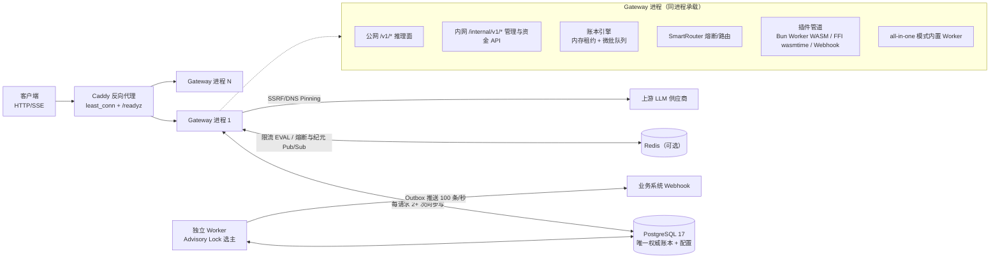
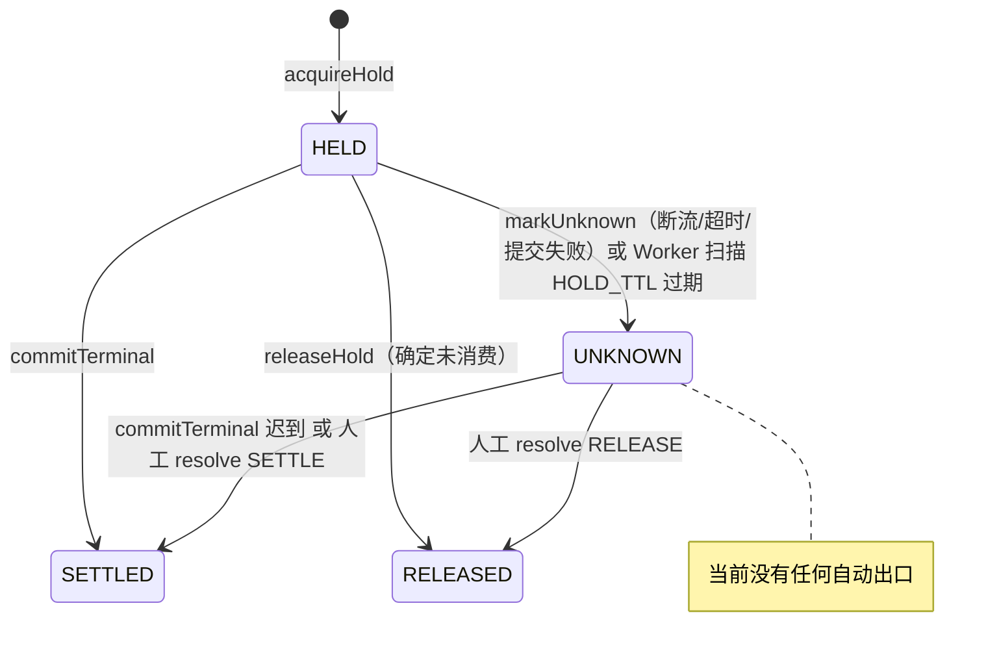
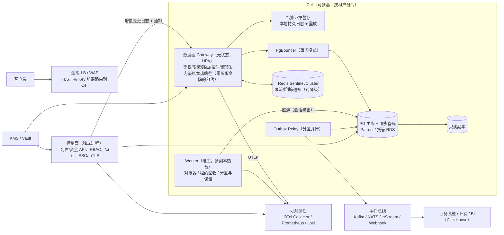

# Super Token Gateway 架构与实现评审报告

- **评审日期**：2026-11-21
- **评审对象**：`main` 分支提交 `5525ae5`（评审开始时为 `5d4044e` + 未提交改动，评审期间被原样提交为 `5525ae5`，内容一致）
- **评审范围**：`apps/{gateway,worker}`、`packages/{kernel,contracts,protocol,runtime,plugin-engine,ledger}`（含迁移 SQL）、`native/*/src`、`scripts/`、`infra/`、`.github/workflows/verify.yml`、`tests/`；排除 `.local/`、`dist/`、`docs/performance/`、`reports/`、`beyond-new-api/`
- **版本边界**：本报告所有结论与行号均以提交 `5525ae5` 为准。撰写期间工作区出现他人在途改动（ADR 0010 渠道插件化），涉及 `apps/gateway/src/{app,internal-api,proxy,upstream}.ts`、`packages/ledger/src/{catalog,schema,types}.ts` 与迁移、`packages/plugin-engine`、`packages/protocol`、`packages/runtime/src/cloud-auth.ts`，以及新增的 `docs/decisions/0010-provider-plugin-architecture.md`、`packages/plugin-engine/src/providers/`。这些改动**不在评审范围内**，相关文件的行号会随之偏移。账本核心 `engine.ts`、`leases.ts`、`apps/worker`、`cluster.ts`、`lifecycle.ts`、`snapshot.ts`、`database.ts` 未被改动。撰写时抽查，S-01、A-01、A-02、A-05、A-06、S-07 在工作区中仍然存在。在途改动合入后，应按本报告重新核对。
- **评审方式**：两路全新上下文的独立只读审查（行为与资金正确性 / 结构与企业级能力）+ 主评审逐条沿调用链核实；关键缺陷在隔离临时库中动态复现。

---

## 0. 执行摘要

### 0.1 总体结论

**当前实现尚未达到生产级高可用、高并发、高可扩展，也未达到企业级 LLM Gateway 标准。**

正常路径设计是扎实的：精确 `BigInt` 有理数计价、多批次 lot 账本与复式分录、PG 持久化分片租约 + 微批原子提交、全局升序锁序、SSRF/DNS Pinning、首字节前故障切换。单机 12.9k RPS 的压测数字在正常路径上可信。

但系统在**故障态**（节点续租失败、PG 抖动或主备切换、滚动发布、用户中途断流、多节点并发写入、配置变更竞态）存在多条会**破坏资金守恒、造成资金永久冻结、或让整个集群同时崩溃**的路径。最严重的一条（租约缺少隔离令牌）已在临时库中复现：Worker 关闭租约后，存活节点仍继续用内存租约签发预扣，随后整批结算因 `wallets_reserved_atoms_check` 违例全部回滚，而守恒审计仍报告 `ok: true`。

### 0.2 维度评分

| 维度         | 结论                          | 主要依据（详见第 3、4 章）                                                                                                                                                   |
| ------------ | ----------------------------- | ---------------------------------------------------------------------------------------------------------------------------------------------------------------------------- |
| 资金正确性   | ❌ 不达标                     | 租约无隔离（F-01，已复现）、切换补扣泄漏（F-03）、供应商未明预扣永不释放（F-04）、守恒审计检测不到上述问题（F-06）                                                           |
| 高可用       | ❌ 不达标                     | PG 一次抖动可致资金错账（F-01）与全集群崩溃（A-02）；滚动发布截断所有在途流（A-01）；Redis 宕机网关无法启动（A-03）                                                          |
| 高并发       | ⚠️ 正常路径达标，故障态不达标 | 微批跨租户整批失败（F-02）；流不计入准入（A-01）；故障风暴时锁住供应商全部 16 个分片（P-02）；插件沙箱池仅 4 且队列无界（S-06）                                              |
| 高可扩展     | ⚠️ 有明确天花板               | 每请求同步写单一 PG 主库且无连接池中间件方案（AD-10）；Outbox 投递上限约 100 条/秒，远低于写入速率（D-02）；快照全量重载且非原子（A-05、D-04）；数据无分区与保留策略（D-03） |
| 安全与合规   | ⚠️ 基础到位，企业级缺失       | 故障切换绕过 DLP 插件（S-01）；管理面单一共享令牌、无 RBAC 与审计（S-02）；运行时以 PG 属主身份执行并在运行期禁用触发器（S-03）                                              |
| 可观测与运维 | ❌ 不达标                     | 无 UNKNOWN、批次失败、Outbox 积压、租约异常等关键指标；Trace 只透传不导出；Worker 健康检查恒为 ready；不支持滚动升级                                                         |
| 工程治理     | ❌ 不达标                     | AGENTS.md / CLAUDE.md 描述的目录结构与实际严重不符；根目录设计文档与 `docs/openapi.json` 仍是 v2；账本与网关核心无单测                                                       |

### 0.3 最需要优先处理的十个问题

| 排名 | ID   | 问题                                                           | 严重度 |
| ---- | ---- | -------------------------------------------------------------- | ------ |
| 1    | F-01 | 租约缺少隔离令牌，存活节点在已关闭租约上继续签发预扣（已复现） | P0     |
| 2    | F-02 | 微批任一项失败导致整批（≤512 笔、跨租户）回滚                  | P1     |
| 3    | A-01 | SSE 不受 Lifecycle 管理，每次滚动发布截断在途流并遗留预扣      | P1     |
| 4    | A-02 | 配置纪元消息触发的重载未捕获异常，PG 抖动时全集群同时退出      | P1     |
| 5    | F-05 | UNKNOWN 无任何自动收敛，用户"停止生成"即长期冻结资金           | P1     |
| 6    | D-01 | Outbox 以 BIGSERIAL 为游标，并发提交下永久漏投事件             | P1     |
| 7    | S-01 | 故障切换不执行备选路由的 `on_request` 插件，绕过 DLP           | P1     |
| 8    | F-03 | 切换到更贵路由时补扣成功但切换失败，预留额度永久泄漏           | P1     |
| 9    | A-05 | 配置快照非原子读取，吊销的 API Key 可能长期有效                | P1     |
| 10   | D-02 | Outbox 推送约 100 条/秒，生产写入速率下积压无界增长            | P1     |

---

## 1. 评审方法、证据等级与严重度定义

### 1.1 证据等级

| 标记       | 含义                                           |
| ---------- | ---------------------------------------------- |
| 【复现】   | 在隔离临时数据库中编写脚本动态复现，附实际输出 |
| 【实测】   | 在本机对相关运行时行为做最小实验验证           |
| 【静态】   | 沿真实调用链逐行核实触发条件与后果，未动态运行 |
| 【待核实】 | 基于依赖默认值或文档的推断，需在集成环境确认   |

### 1.2 严重度

| 级别        | 定义                                                                |
| ----------- | ------------------------------------------------------------------- |
| P0 阻断     | 可在常见运维事件中触发，直接破坏资金守恒或造成大面积不可恢复错误    |
| P1 实质缺陷 | 可达且后果明确：资金冻结/泄漏、可用性事故、合规边界被绕过、事件丢失 |
| P2 局部风险 | 触发条件较窄或后果有界，但在生产规模下会产生实际成本                |
| P3 建议     | 结构、可维护性或工程治理改进                                        |

---

## 2. 现状架构概览（As-Is）

### 2.1 进程与依赖



### 2.2 一次推理请求的生命周期

1. 鉴权（内存快照查 `keysByVerifier`）→ 项目级 Redis/本地限流。
2. 从快照水合候选路由 → `SmartRouter.selectCandidates` 排序（含半开探针）。
3. 执行**首选路由**的 `on_request` 插件链，改写请求体。
4. `ledger.acquireHold`：热点钱包走内存租约快路径（只写一行 `billing_holds`），否则走慢路径（锁钱包/lot/分片）。
5. 调用上游；首字节前可重试错误按 `switchSupplierAttempt` 切换候选。
6. 非流式：读完响应 → 响应插件 → `commitTerminal`（微批 9 表 CTE）→ 返回。
7. 流式：边转发边解析 usage，终止帧扣留至 `commitTerminal` 成功后发送；异常或客户端中断时 `markUnknown`。

### 2.3 资金状态机



### 2.4 值得保留的设计

- **精确计价**：`packages/kernel` 的有理数 `BigInt` 计价与单次向上取整，`NUMERIC(38,0)` 原子单位，避免浮点误差。
- **lot 账本**：`issued = available + reserved + spent + expired` 的 CHECK 约束、`DEFERRABLE` 复式平衡触发器、不可变凭证触发器。
- **租约 + 微批**：把热点钱包的行锁竞争移出请求路径，是单机万级 RPS 的关键，方向正确。
- **全局锁序**：结算 CTE 以统一升序 `FOR NO KEY UPDATE` 加锁，正常路径无死锁。
- **SSRF 防护**：DNS Pinning、私网 CIDR 拦截、禁止重定向，注册与调用全链路复用同一传输层。
- **零明文落库**：提示词、模型输出、工具参数不写入 PG、日志或 Outbox。
- **耐久验证**：`test:durability` 覆盖 SIGKILL 预扣回收与 `pg_dump` 备份恢复。

---

## 3. 实现层问题清单

### 3.0 问题总表

| ID   | 类别      | 问题                                                  | 严重度 | 证据                |
| ---- | --------- | ----------------------------------------------------- | ------ | ------------------- |
| F-01 | 资金      | 租约缺少隔离令牌，已关闭租约仍被存活节点使用          | P0     | 【复现】            |
| F-02 | 资金/可用 | 微批任一项失败整批回滚，无拆分重试                    | P1     | 【复现】            |
| F-03 | 资金      | 切换补扣后返回失败，事务仍提交，额度泄漏              | P1     | 【静态】            |
| F-04 | 资金      | 未明尝试的供应商预扣在客户结算后永不释放              | P1     | 【静态】            |
| F-05 | 资金/运营 | UNKNOWN 无自动收敛，客户端中断一律冻结资金            | P1     | 【静态】            |
| F-06 | 资金      | 守恒审计缺少 reserved 与供应商侧不变量                | P1     | 【复现】            |
| F-07 | 资金      | 流式审核拦截分支不检查结算结果                        | P2     | 【静态】            |
| F-08 | 资金      | 人工 `resolve SETTLE` 供应商成本与外键处理错误        | P2     | 【静态】            |
| F-09 | 资金      | 退款与收债的锁顺序相反，可能死锁                      | P2     | 【静态】            |
| F-10 | 资金      | 多节点租约各取剩余一半，冷路径大请求误报 402          | P2     | 【静态】            |
| A-01 | 可用      | SSE 不受 Lifecycle 管理，停机顺序错误                 | P1     | 【静态】            |
| A-02 | 可用      | 纪元重载未捕获异常导致全集群进程退出                  | P1     | 【实测】            |
| A-03 | 可用      | Redis 不可用时无法启动；运行期可能挂起                | P1     | 【静态】+【待核实】 |
| A-04 | 可用      | PG 提交失败被计入渠道熔断并广播全集群                 | P1     | 【静态】            |
| A-05 | 可用/安全 | 配置快照非原子读取，吊销 Key 长期有效                 | P1     | 【静态】            |
| A-06 | 可用      | 过载返回 500；环境变量不校验                          | P2     | 【静态】            |
| A-07 | 可用      | all-in-one 默认模式跳过选主，多副本多主               | P2     | 【静态】            |
| A-08 | 可用      | 健康检查不反映真实依赖状态                            | P2     | 【静态】            |
| A-09 | 可用      | 长流并发计数 60s 后失效；首字节后无空闲超时           | P2     | 【静态】            |
| A-10 | 运维      | 严格版本相等，不支持滚动升级                          | P2     | 【静态】            |
| D-01 | 事件      | Outbox BIGSERIAL 游标在并发提交下漏投                 | P1     | 【静态】            |
| D-02 | 事件/扩展 | Outbox 投递约 100 条/秒且事件种类不全                 | P1     | 【静态】            |
| D-03 | 数据      | 热表无分区与保留；归档整月读入内存                    | P1     | 【静态】            |
| D-04 | 扩展      | 每次配置变更全节点全量重载快照                        | P2     | 【静态】            |
| S-01 | 合规      | 故障切换绕过备选路由 `on_request` 插件                | P1     | 【静态】            |
| S-02 | 安全      | 管理面单一共享令牌，无 RBAC/审计，Key 角色失效        | P1     | 【静态】            |
| S-03 | 安全      | 运行时以 PG 属主运行并在运行期禁用触发器              | P2     | 【静态】            |
| S-04 | 安全      | 默认密钥、公网 `/metrics`、渠道名响应头泄露           | P2     | 【静态】            |
| S-05 | 安全      | multipart 先全量缓冲再校验大小                        | P2     | 【静态】            |
| S-06 | 安全/性能 | WASM 沙箱内存上限不完整、FFI 阻塞事件循环、池无界排队 | P2     | 【静态】            |
| S-07 | 契约      | 内网资金 API 错误统一 400 并透传 PG 原始错误          | P2     | 【静态】            |
| P-01 | 扩展      | PG 每请求同步强依赖，连接预算与中间件方案缺失         | 架构   | 【静态】            |
| P-02 | 性能      | 释放与切换锁住供应商账户全部 16 个分片                | P2     | 【静态】            |
| P-03 | 性能      | 插件审计条目按 SSE 分片无界膨胀                       | P2     | 【静态】            |
| P-04 | 性能      | 固定窗口限流；Redis 回退后限额按节点数放大            | P2     | 【静态】            |
| P-05 | 性能      | 请求侧插件按消息串行调用；流转发无背压                | P2     | 【静态】            |
| E-01 | 治理      | AGENTS.md / CLAUDE.md 与实际结构严重不符且互不一致    | P1     | 【静态】            |
| E-02 | 治理      | 根目录设计文档、OpenAPI、ADR 0009 与代码漂移          | P2     | 【静态】            |
| E-03 | 治理      | 双轨残留：无调用方的契约与加密函数及其测试            | P3     | 【静态】            |
| E-04 | 结构      | 巨型请求函数与双套结算实现                            | P3     | 【静态】            |
| E-05 | 测试      | 核心模块无单测，关键交错场景零覆盖，CI 静默跳过 FFI   | P2     | 【静态】            |
| E-06 | 治理      | CI 与工具链杂项                                       | P3     | 【静态】            |

### 3.1 资金正确性

#### F-01【P0】【复现】租约缺少隔离令牌：Worker 已关闭的租约仍被存活节点用于签发预扣

- **位置**
  - `packages/ledger/src/engine.ts:800-827`：续租 `UPDATE ... WHERE l.state = 'ACTIVE' AND w.freeze_reason IS NULL` 的错误被 `.catch(() => undefined)` 吞掉；更新 0 行也不检查；随后无条件执行 `wl.expiresAtMs = nowMs + leaseTtlMs`。
  - `engine.ts:3046-3089`：`acquireHold` 快路径只依据内存中的 `expiresAtMs`、`freeInMemory` 判断租约有效。
  - `engine.ts:855-905`：`runFastHoldBatch` 直接 `INSERT billing_holds`，不校验租约在 PG 中的状态。
  - `engine.ts:582-708`：`closeWalletLeaseInPg` 先锁开放预扣、后锁租约，把剩余额度退回钱包可用余额并置 `CLOSED`。
  - `packages/ledger/src/leases.ts:120-145`：`detachHoldFromLeaseTx` 遇到非 `ACTIVE` 租约什么都不做。
  - `engine.ts:2533-2534`：直连结算执行 `wallet.reserved_atoms -= heldFunded`。
- **触发条件**（任一即可，且该租约上有持续流量）
  1. 一次续租 SQL 因 PG 抖动、主备切换、连接重置失败；
  2. 钱包 `freeze_reason` 变为非空（例如欠款超过授信 `DEBT_EXCEEDS_CREDIT_LIMIT`），续租被 SQL 条件过滤为 0 行；
  3. 事件循环长时间卡顿或节点与 PG 时钟偏差（租约过期时间由节点时钟写入，由 PG `now()` 判定）。
- **交错**
  1. 节点 A 续租失败，但内存过期时间被延长 15s；
  2. PG 中租约到期，Worker `sweepExpiredLeases` 关闭租约、把剩余额度退回可用余额；
  3. 节点 A 永远不会发现租约已关闭（后续续租同样命中 0 行但继续延长内存过期时间），持续按 `freeInMemory` 写入 `wallet_lease_id` 指向 `CLOSED` 租约、`lot_allocations = []` 的预扣；
  4. 结算时快路径因租约非 `ACTIVE` 回落到直连路径，`detach` 空操作，直连路径从未预留过的 `reserved_atoms` 中扣减。
- **后果**
  - 同一笔资金被分配两次（已退回可用余额 + 节点内存租约）。
  - `reserved_atoms` 下溢触发 CHECK，**整批结算回滚**（见 F-02），批内其他租户的正常请求一并失败并转为 UNKNOWN；若未下溢，则钱包与 lot 汇总悄然不一致。
  - 这类坏预扣用 `resolve SETTLE` 和 `RELEASE` 都处理不掉（同样会让 reserved 下溢）。
  - 冻结在其他节点不生效：`configureWalletCredit` 只调用本节点 `retireWalletLeaseByKey`（`engine.ts:3939`）。
  - 供应商侧租约存在同构问题。
- **复现**（隔离临时库，见附录 A）：预热后 1 个活跃钱包租约 → 模拟 PG 侧过期并由 Worker 清扫（关闭 2 个租约）→ 存活节点又成功签发 4 笔预扣，全部指向 `CLOSED` 租约且 `lot_allocations=[]` → 随后 20 笔结算（16 笔正常 + 4 笔坏预扣）**全部抛出** `wallets_reserved_atoms_check` 违例 → `auditConservation()` 仍返回 `ok: true`。
- **修复**：见 5.2.1（租约隔离令牌方案）。

#### F-02【P1】【复现】微批任一项失败导致整批回滚

- **位置**：`engine.ts:450-461`（`MicroBatchQueue.pump` 对批次 reject 时 `for (const entry of slice) entry.reject(error)`）；`commitQueue` 单批上限 512、并发 2（`engine.ts:2923-2935`）；`packages/ledger/src/database.ts:24-25`（`statement_timeout 8000`、`lock_timeout 5000`）。
- **触发**：任意一项产生异常——锁等待超时（55P03）、死锁（40P01）、PG 主备切换导致连接重置、单笔 CHECK 违例（如 F-01）、`Missing reserved lot` 等防御性抛错。
- **后果**：最多 512 个跨租户请求同时得到 `ledger_commit_failed`，非流式返回 500，流式发送错误帧；随后全部 `markUnknown`，在没有自动收敛（F-05）的情况下转为人工工单。一个坏请求可反复毒化后续批次。
- **证据**：F-01 复现中 16 笔完全正常的预扣与 4 笔坏预扣同批失败。
- **修复**：见 5.2.2。

#### F-03【P1】【静态】首字节前切换到更贵路由：补扣已落库但切换失败，预留额度永久泄漏

- **位置**：`engine.ts:3205-3224` 在事务内已 `flushDirtyLots`、`flushDirtyWallets`、`insertJournalLines`（补扣客户预扣）；之后 `engine.ts:3226-3234` 与 `engine.ts:3289` 以 `return { ok: false, code: "supplier_unavailable" | "supplier_insufficient_balance" }` 退出。`db.begin` 回调正常返回 → **事务提交**，但 `billing_holds.held_atoms/lot_allocations` 未回写。
- **触发**：备选路由价格高于当前预扣（需要补扣），且备选供应商账户非 `ACTIVE` 或分片余额不足。
- **后果**：钱包与 lot 的 `reserved_atoms` 多出一份无主差额；`proxy.ts:790-793` 收到这两种错误会 `continue` 到下一个候选，再次补扣，泄漏叠加；因 F-06 无法被审计发现。
- **修复**：先完成供应商侧校验再做客户补扣；或任何失败返回改为 `throw` 让事务回滚；补充"补扣后切换失败"的回归用例。

#### F-04【P1】【静态】未明尝试的供应商风险预扣在客户结算后永远无法释放

- **位置**：`engine.ts:2596-2652` 结算时，非选中尝试且状态为 `UNKNOWN` 的供应商预扣走 `else updatedSupplierHolds.push(sh)` 原样保留，而 hold 本身变为 `SETTLED`；`resolveRequest`（`engine.ts:4137-4153`）拒绝处理非 `HELD/UNKNOWN` 的 hold；Worker 没有任何供应商对账逻辑。
- **触发**：路由开启 `retry_on_ambiguous`，首个尝试读头超时（标记供应商 `UNKNOWN`）后切换成功。
- **后果**：原供应商分片 `reserved_atoms` 永久增加、可用余额只降不升，最终导致供应商"余额不足"而误判不可用。现有测试 `tests/integration/gateway-v4.test.ts:1228` 断言的正是这一行为（`reserved_atoms > 0n`），缺陷被固化为预期。ADR 0009 §3.3 写的"交 Worker 对账"在代码中不存在。
- **修复**：见 5.2.4（供应商风险预扣收敛）。

#### F-05【P1】【静态】UNKNOWN 无任何自动收敛

- **位置**：客户端中断或流异常一律 `markUnknown`（`apps/gateway/src/proxy.ts:1566`、`1887`、`2201`）；`apps/worker/src/runner.ts:179-185`、`230-239` 只把过期 `HELD` 改为 `UNKNOWN`；唯一出口是 `/internal/v1/requests/:id/resolve` 人工处理（集成测试 `ledger-v4.test.ts:979-996` 也由 "ops" 人工调用）。
- **触发**：用户点击"停止生成"、网络中断、上游中途断流、提交失败、节点崩溃——都是高频事件。
- **后果**：每次都把整笔上限报价（`max_output_tokens × 单价`）长期冻结在客户 `reserved_atoms`，客户可用余额被持续侵蚀；平台未确认收入、上游成本未入账；人工工单随流量线性增长，无法运营。`/metrics` 也没有 UNKNOWN 数量与账龄指标。README/ADR 0009 宣称的"Worker UNKNOWN 恢复"未实现。
- **修复**：见 5.2.3（对账子系统与结算证据暂存）。

#### F-06【P1】【复现】守恒审计无法发现上述资金错误

- **位置**：`engine.ts:4466-4520` `auditConservation` 只检查：分录借贷平衡、lot 恒等式、活跃租约剩余额与其 lot 分配一致、钱包聚合与 lot 聚合一致、开放预扣计数。
- **缺失的不变量**
  - 钱包 `reserved_atoms = Σ 未挂租约的开放预扣（扣除授信部分）+ Σ 活跃租约剩余额`；
  - 钱包 `credit_reserved_atoms = Σ 开放预扣的授信部分`；
  - 供应商分片 `reserved_atoms = Σ 开放供应商预扣 + Σ 活跃供应商租约剩余额`；
  - 供应商根余额 + 分片余额与充值、成本分录的一致性。
- **证据**：F-01 复现中，钱包 `reserved_atoms = 3200`，而开放预扣为 20 × 200 = 4000，审计仍返回 `ok: true`。
- **修复**：见 5.2.5。

#### F-07【P2】【静态】流式审核拦截分支不检查结算结果

- **位置**：`proxy.ts:1756-1784`（WASM 渠道流）与 `proxy.ts:2071-2099`（通用流）两处 `finalMod.blocked` 分支 `await deps.ledger.commitTerminal(...)` 后都未检查 `ok`；同时 usage 在缺失时按 `chars / 4` 估算（`proxy.ts:329-339`），与 ADR 0009"按实际 usage 结算"的表述不一致。
- **后果**：结算失败时客户端仍收到 `content_blocked`，预扣停在 `HELD`，60s 后被扫为 UNKNOWN。
- **修复**：统一走 5.3.6 的单一终结路径，失败进入证据暂存重试。

#### F-08【P2】【静态】人工 `resolve SETTLE` 的供应商侧处理错误

- **位置**：`engine.ts:4166-4190`：`cost_version_id` 填客户价目 ID；`supplier_pricing.rates = {}`，未传 `supplier_cost_atoms` 时供应商成本记 0 但仍释放供应商预扣；无供应商预扣时 `channel_id` 使用 `crypto.randomUUID()`，违反 `billing_charges.channel_id` 外键。
- **后果**：人工对账后供应商支出被低估；边缘场景人工处理直接失败。
- **修复**：`SETTLE` 必须显式提供供应商成本或供应商价目版本；`channel_id` 取 hold 的最后尝试或置空。

#### F-09【P2】【静态】退款与收债锁顺序相反

- **位置**：`refundCharge` 先 `billing_charges ... FOR UPDATE` 再锁钱包（`engine.ts:3659-3690`）；`collectDebtInTx` 先锁钱包再锁 `billing_charges`（`engine.ts:2937-2960`）。
- **后果**：同一钱包上并发退款与自动收债可互相等待，PG 检测死锁后中止其一，内网 API 返回 400（见 S-07），业务方误判为不可重试。
- **修复**：在 5.2.6 的全局锁序规范中规定"钱包先于 charge"，退款改为先锁钱包。

#### F-10【P2】【静态】多节点租约各取剩余一半，冷路径大请求误报 402

- **位置**：`engine.ts:1352-1375`，租约块大小为 `min(目标额度, 钱包可用余额 / 2)`；慢路径只看钱包可用余额，不包含其他节点租约中的空闲额度。
- **后果**：多节点持续流量下，钱包大部分额度散落在各节点租约中，单笔大额请求可能得到 `insufficient_balance`，尽管钱包总余额充足。
- **修复**：慢路径余额不足时先触发"租约召回"（见 5.2.1），召回后重试，仍不足才返回 402；限制单节点租约占比上限。

### 3.2 可用性与故障恢复

#### A-01【P1】【静态】SSE 不受 Lifecycle 管理，停机顺序错误

- **位置**：`proxy.ts:378` 进入准入；流式分支 `proxy.ts:1427-1453` 只把项目与渠道限流器转交给流，**guard 没有转交**；外层 `finally`（`proxy.ts:2265-2269`）在返回流式 `Response` 时即调用 `releaseGuard()`，`cleanupStream` 中的那次是空操作。`packages/runtime/src/lifecycle.ts:28-37` 的 `drain` 只等待并中止仍在集合中的控制器；`apps/gateway/src/app.ts:296-305` 依次关闭账本、Worker、Redis、传输层、DB；`apps/gateway/src/main.ts:36-44` 先 `runtime.close` 后 `server.stop`，最后 `process.exit(0)`。
- **后果**
  - `MAX_IN_FLIGHT` 与 `gateway_in_flight` 都不统计 SSE，准入上限对流无效。
  - 停机时 `drain` 立即返回且不中止流；随后传输层关闭销毁上游连接、DB 关闭，在途流的结算与 `markUnknown` 均失败（后者被 `.catch` 吞掉），预扣停在 `HELD`，60s 后被扫成 UNKNOWN。
  - **每次滚动发布都会制造一批截断的流与人工工单。**
- **修复**：见 5.3.1。

#### A-02【P1】【实测】配置纪元消息触发的重载未捕获异常，PG 抖动时全集群同时退出

- **位置**：`app.ts:74-78` `onConfigEpoch` 中 `void snapshot.load()` 无 `catch`；`SnapshotManager.load`（`snapshot.ts:18-36`）不吞错。
- **证据**：本机 Bun 对未处理的 Promise rejection 实测 `exit=1`。
- **触发**：配置变更（任何 Key/路由/价目写入）恰逢 PG 抖动或主备切换。
- **后果**：Redis 广播被所有节点同时收到，所有节点同时退出；重启时 `assertSchemaVersion` 又依赖 PG，进入反复重启。
- **修复**：所有 fire-and-forget Promise 必须 `catch` 并计数；重载失败交由轮询兜底；见 5.3.2。

#### A-03【P1】【静态】+【待核实】Redis 并非"可选降级"

- **已核实**：`packages/runtime/src/cluster.ts:102-108` 启动时 `await client.connect()` 失败直接抛错，`app.ts:288-291` `start()` 随之失败——配置了 `REDIS_URL` 而 Redis 不可用时网关无法启动。README 宣称"单机降级"。
- **待核实**：`cluster.ts:135-141` 仅在 `!this.connected` 时回退本地限流，而 `connected` 启动后从不置回 `false`；EVAL 无命令超时。按 Bun `RedisClient` 默认的离线队列与重连参数，断线期间命令可能排队等待，热路径上所有请求卡在限流一步，直到客户端放弃重连才回退。需在集成环境以断开 Redis 的方式确认。
- **其他**：订阅连接断线重连后的重新订阅行为未验证；Redis 回退为每节点本地限流时，全局限额被放大为"节点数 × 限额"（见 P-04）。
- **修复**：见 5.3.3。

#### A-04【P1】【静态】PG 提交失败被当作渠道故障并广播全集群

- **位置**：`proxy.ts:1564-1578`、`1883-1898`、`2197-2212` 三个流式 `catch` 中，除客户端中断外一律 `recordFailure(cand.channel.id, "retryable")`，包括 `ledger_commit_failed`；熔断状态变化经 `ClusterCoordinator.publishCircuitEvent` 广播，远程 `OPEN` 覆盖所有节点（`packages/runtime/src/router.ts` `applyRemoteEvent`）。非流式路径的 `usage` 缺失同样计入渠道失败。
- **后果**：PG 一次抖动导致大量提交失败 → 所有正在服务的渠道被判为故障 → 全集群熔断 → 故障从数据库扩散为全量 503。
- **修复**：见 5.3.4（错误归因分类）。

#### A-05【P1】【静态】配置快照非原子读取，吊销的 Key 可能长期有效

- **位置**：`packages/ledger/src/catalog.ts:618-647` 以 `Promise.all` 在连接池的不同连接上并发执行 9 条查询，每条语句各自取快照；`snapshot.ts:64-72` 只在 `epoch > current.epoch` 时重载；Redis 纪元事件同理（`app.ts:74-78`）。
- **交错**：读取期间一个配置写事务提交，`config_epoch` 读到新值、`api_keys` 读到旧数据 → 节点持有"新纪元 + 旧 Key 表" → 之后轮询与 Pub/Sub 都判断无需重载 → 直到下一次配置变更前一直使用旧数据。
- **后果**：被吊销或禁用的 API Key、被禁用的项目/路由/渠道可能在部分节点上无限期有效——安全事件响应失效。
- **修复**：见 5.3.5。

#### A-06【P2】【静态】过载返回 500；环境变量不校验

- **位置**：`proxy.ts:378` `deps.lifecycle.enter()` 位于 `try`（`proxy.ts:448`）之外，公网 Hono 应用未注册 `onError`，过载或排空期间返回 500 纯文本而不是 `503 overloaded` + `Retry-After`。`apps/gateway/src/config.ts:79-95` 直接 `Number(env.X)`：`MAX_IN_FLIGHT` 写错为 `NaN` 时 `controllers.size >= NaN` 恒假，准入上限失效；`HOLD_TTL_MS` 为 `NaN` 时每个请求在 `new Date(NaN).toISOString()` 抛 `RangeError`。
- **修复**：准入移入 `try` 并返回 503；用 Zod 定义环境变量 schema，启动时失败即退出。

#### A-07【P2】【静态】all-in-one 默认模式跳过选主

- **位置**：`app.ts:263-270` all-in-one 以 `leaseKey: 0` 创建 Worker；`runner.ts:50-53` `leaseKey === 0` 直接视为 leader；`config.ts:47` 默认模式就是 all-in-one；`infra/docker-compose.yml` 也使用 all-in-one。
- **后果**：多副本 all-in-one 或与独立 Worker 并存时多主运行；当前多数任务靠行锁勉强幂等，但 Outbox 认领会互相覆盖租约令牌造成重复投递。
- **修复**：all-in-one 同样走 Advisory Lock 选主；文档明确 all-in-one 仅限单副本。

#### A-08【P2】【静态】健康检查不反映真实依赖状态

- **位置**：网关 `/readyz`（`app.ts:140-154`）只做 `SELECT 1`，不反映快照新鲜度、提交队列积压、Redis（若必需）状态；Worker `/readyz`（`apps/worker/src/main.ts:37-40`）恒返回 `ready`，不检查 DB、选主状态与最近一次成功执行时间。
- **修复**：见 5.6.3。

#### A-09【P2】【静态】长流的并发计数失效；首字节后无空闲超时

- **位置**：项目与渠道并发租约的 TTL 等于 `HOLD_TTL_MS`（60s，`proxy.ts:526`、`808`；`cluster.ts:63` `ZADD ... nowMs + leaseTtlMs`）且不续期，超过 60s 的流不再计入并发；`proxy.ts:1427` 在进入流式前 `clearTimeout(timeoutTimer)`，之后上游停滞只能依赖 Bun `idleTimeout: 120` 被动断开（`main.ts:11`），且没有 SSE 心跳。`HOLD_TTL_MS=60s` 也小于默认 3 次 × 30s 的切换链总时长。
- **修复**：见 5.3.7。

#### A-10【P2】【静态】不支持滚动升级

- **位置**：`packages/ledger/src/database.ts:33-43` `assertSchemaVersion` 要求版本严格相等；迁移在应用启动链路中执行（`infra/docker-compose.yml` `migrate.js && main.js`），且受 8s `statement_timeout` 约束。
- **后果**：任何 schema 变更都要求全量停机或接受新旧版本互相拒绝启动；大表迁移会超时。
- **修复**：见 5.6.4。

### 3.3 事件与数据

#### D-01【P1】【静态】Outbox 以 BIGSERIAL 为消费游标，并发提交下永久漏投

- **位置**：`engine.ts:4403-4446` `claimOutboxEvents` 以 `seq > acked_seq` 读取、`ackOutboxEvents` 推进到批内最大 seq；表结构 `packages/ledger/src/migrations/0000_v4_baseline.sql:346-354`。
- **交错**：批次 A 先取得 seq 100–110 但后提交，批次 B 取得 111–120 先提交；消费者认领只看到 111–120 并 ack 到 120；A 提交后 100–110 永远不会被读到。写入并发 = 每节点 `commitQueue` 并发 2 × 节点数 + 资金操作。
- **后果**：业务系统永久缺失账单事件，违反 ADR 0009 承诺的"至少一次"。旧设计文档 `funds-and-billing.md:53` 已明确"seq 是诊断浏览序号，不能当提交顺序游标"，实现仍如此使用。
- **修复**：见 5.4.1。

#### D-02【P1】【静态】Outbox 投递吞吐远低于写入速率，且事件种类不全

- **位置**：`runner.ts:134-155` 每次认领 100 条、`runner.ts:248-253` 每 1000ms 一次，且串行在同一 Promise 链上——**推送上限约 100 条/秒**；每笔结算产生一条 `billing.settled`（`engine.ts:2074-2075`、`2835`）。
- **后果**：按 README 的 9k–12k RPS 结算速率，积压以每秒约万条增长，永不追平；`outbox_events` 无分区无清理（D-03），表无界膨胀。充值、退款、调账、lot 过期、收债、释放、UNKNOWN 都**没有事件**，业务系统无法据此对账。
- **修复**：见 5.4.1、5.4.2。

#### D-03【P1】【静态】热表无分区与保留策略；归档不可扩展

- **位置**：迁移中仅 `ledger_entries` 分区（`0000_v4_baseline.sql:313`）；`billing_holds`、`billing_charges`、`outbox_events` 无分区、无清理任务。归档 `database.ts:186-210` 将整月 `billing_charges` 与 `ledger_entries` 一次性读入内存再写 gzip，且受 8s `statement_timeout` 约束；校验时把解压内容拼成单个字符串。`listCharges` 使用 offset + `count(*)`；`auditConservation` 为全表聚合。
- **后果**：按 1k RPS 计，每月新增约 26 亿条 charge 与百亿级分录行，归档必然 OOM 或超时；热表膨胀拖慢 VACUUM、索引与审计。
- **修复**：见 5.4.3。

#### D-04【P2】【静态】每次配置变更全节点全量重载快照

- **位置**：`catalog.ts:618-647` 每次全表读取 `projects`、`api_keys`、`upstream_accounts`、`channels`、`models`、全部历史 `price_versions`（不可变、只增不减）、`routes`、`plugins`（含 WASM 字节）；任何一条配置写入都会 `bumpEpoch`（`catalog.ts:48`）。
- **后果**：成本为 O(配置总量 × 节点数 × 变更频率)。租户规模扩大、Key 频繁创建时，PG 与网关 CPU 被快照重载占用。
- **修复**：见 5.3.5（增量变更日志）。

### 3.4 安全与合规

#### S-01【P1】【静态】故障切换绕过备选路由的 `on_request` 插件

- **位置**：`proxy.ts:587-640` 固定取 `selected[0].route.route.plugin_pipeline` 执行 `on_request`，改写后的请求体在所有候选间复用；切换（`proxy.ts:763-803`）不会对新路由重新执行；而响应侧（`proxy.ts:1339-1346`、`1631-1640`、`1951-1960`）使用实际命中路由的插件链。首选路由在 hold 获取阶段失败（`activeIndex > 0`）时同样如此。
- **触发**：常见企业配置——自建模型路由不挂插件、外部供应商路由挂 `pii-guard`；首选路由 5xx 或供应商余额不足后切换。`WEIGHTED` 策略下谁是首选本身是随机的。
- **后果**：原文（含 PII、密钥）直接发送给外部供应商，合规边界被绕过；请求侧与响应侧插件语义不一致。
- **修复**：见 5.5.1。

#### S-02【P1】【静态】管理面单一共享令牌，无 RBAC、无审计

- **位置**：`apps/gateway/src/internal-api.ts:642-649` 全部 `/internal/v1/*` 用同一个 `ADMIN_TOKEN` 比对；资金操作的 `actor` 由调用方在请求体中自报（`internal-api.ts:1115-1128`）；API Key 的 `ADMIN`/`BILLING` 角色在 schema 中存在（`0000_v4_baseline.sql:35`），但网关只判断 `VIEWER`（`proxy.ts:213`）。
- **后果**：令牌泄露即获得全部配置与资金操作权限；无法区分操作者、无法追责；无法满足 SOX/等保类审计要求。
- **修复**：见 5.5.2。

#### S-03【P2】【静态】运行时以 PG 属主身份运行并在运行期禁用触发器

- **位置**：`database.ts:126`、`135` 在分区准备时 `ALTER TABLE ... DISABLE TRIGGER immutable_ledger_entries / balanced_ledger_journal`（该函数由 Worker 定时调用）；仓库中没有任何 `GRANT`/角色定义，网关、Worker、迁移共用同一数据库属主账号。
- **后果**：不可变凭证与借贷平衡触发器挡不住被攻破的网关进程；任何 SQL 注入或依赖投毒都可直接改写账本。
- **修复**：见 5.5.3。

#### S-04【P2】【静态】默认密钥与信息暴露

- **位置**：`infra/docker-compose.yml:43-45` 为 `KEY_PEPPER`、`ENCRYPTION_KEY`、`ADMIN_TOKEN` 提供公开的默认值，且 `8080` 对外暴露；`/metrics` 位于公网端口且无鉴权（`app.ts:156-169`）；所有成功响应携带 `x-gateway-channel` 头，向客户泄露供应商渠道名。
- **修复**：去掉默认值并在启动时拒绝已知占位值；`/metrics` 移到内网端口；渠道头改为可选的调试开关。

#### S-05【P2】【静态】multipart 先全量缓冲再校验大小

- **位置**：`proxy.ts:464-480` 先 `await c.req.raw.formData()` 再累加文件大小判断上限；`main.ts` 未设置 `maxRequestBodySize`，使用 Bun 默认 128MB。
- **后果**：持有有效 Key 的租户可用并发大文件上传耗尽网关内存。
- **修复**：按 `Content-Length` 先拒绝；设置 `maxRequestBodySize`；改用流式 multipart 解析并逐部分限额。

#### S-06【P2】【静态】WASM 沙箱资源限制不完整

- **位置**：`packages/plugin-engine/src/wasm-host.ts:89-111` 内存上限只在调用前后检查，执行中的 `memory.grow` 已经发生；`wasm-host.ts:190-214` Worker 池默认 4、等待队列无上限，排队时间不计入超时；FFI wasmtime 执行器在主事件循环同步调用（`wasm-host.ts:486`），长时间插件会阻塞所有请求；manifest 的 `fuel_budget` 未做上限校验。
- **前瞻风险**：ADR 0010 计划把 WASM 渠道插件放到每个请求的热路径上，上述执行模型问题会被放大为全局吞吐瓶颈，应先于 ADR 0010 解决。
- **修复**：见 5.5.4。

#### S-07【P2】【静态】内网资金 API 错误语义不正确

- **位置**：账本对所有业务错误抛普通 `Error`（如 `engine.ts:3586`、`3680`、`3690`、`3953`），`internal-api.ts:636-640` 一律映射为 `400 internal_api_error` 并回传 `err.message`。
- **后果**：PG 故障返回 400（业务方不会重试）；`external_ref` 冲突返回 400（ADR 0009 §4.1.6 要求 409）；资源不存在返回 400；PG 原始错误信息泄露给调用方。
- **修复**：见 5.5.5。

### 3.5 性能与扩展

#### P-01【架构】【静态】PG 是每个请求的同步强依赖，连接预算与中间件方案缺失

- **现状**：每个推理请求至少一次 hold 写入与一次结算 CTE；每节点 `DB_MAX_CONNECTIONS=32`，公网流量、内网资金 API、快照重载共用同一连接池；`docker-compose` 中 PG `max_connections=200`；没有 PgBouncer 方案；Worker 选主依赖会话级 Advisory Lock。
- **后果**：水平扩容受 `节点数 × 32 ≤ max_connections` 约束；单 PG 主库是写入天花板与单点；管理面大查询可抢占热路径连接。
- **方案**：见 5.7。

#### P-02【P2】【静态】释放与切换锁住供应商账户全部 16 个分片

- **位置**：`switchSupplierAttempt` 以 `WHERE account_id = ANY(touchedAccounts)` 锁定涉及账户的全部分片（`engine.ts:3241-3247`）；`releaseHold` 同样按账户锁全部分片（`engine.ts:3448`）。
- **后果**：上游故障风暴时大量释放与切换恰好集中在同一供应商账户，分片设计的并发收益被抵消，形成串行化热点。
- **修复**：只锁定实际涉及的分片键 `(account_id, currency, cell)`，按统一顺序加锁。

#### P-03【P2】【静态】插件审计条目按 SSE 分片无界膨胀

- **位置**：`packages/plugin-engine/src/pipeline.ts:306-313` 每次插件调用追加一条审计；流式会话按分片调用，全部写入 `billing_charges.plugin_audit` 与 Outbox。
- **后果**：长输出产生数千条审计，单笔 WAL 远超 ADR 0009"≤ 3KB/笔"的目标，放大 PG 写入与 Outbox 负载。
- **修复**：会话内按插件聚合（调用次数、动作计数、最大/总延迟、首个拦截规则），设置大小上限。

#### P-04【P2】【静态】限流算法与降级

- **位置**：`cluster.ts:25-63` 按分钟桶固定窗口计数，窗口边界允许 2 倍突发；每次请求发送完整 Lua 脚本（`EVAL` 而非 `EVALSHA`/`FUNCTION`）；Redis 回退时每节点本地限流，全局限额被放大为节点数倍。
- **修复**：见 5.3.3、5.7.4。

#### P-05【P2】【静态】请求侧插件按消息串行调用；流转发无背压

- **位置**：`apps/gateway/src/upstream.ts:854-900` 对每条消息、每个内容片段依次 `await` 插件调用，Webhook 插件的往返次数随对话轮数线性放大；流式转发在 `ReadableStream.start()` 中持续泵数据（`proxy.ts:1467`、`1626`、`1938`），不依据 `desiredSize`，慢客户端导致内存持续累积。
- **修复**：请求侧插件对整个请求的文本片段批量调用一次（协议内携带片段数组）；流转发改为 `pull()` 驱动并设置有界缓冲与慢消费者超时。

### 3.6 工程治理

#### E-01【P1】【静态】规则文件与实际结构严重不符且互不一致

- AGENTS.md 与 CLAUDE.md 描述的 `apps/core-api`、`apps/core-worker`、`apps/legacy-gateway`、`packages/adapters`、`packages/storage`、`tests/fixtures`、`test:backup` 脚本均不存在；"gateway 无 PG、经 Core RPC 执行"与实际（网关直连 PG）正好相反；两份文件之间的目录描述与测试规范也不一致。
- **后果**：规则文件是开发者与自动化代理的首要事实来源，失真会持续引导错误的修改位置与验证方式。

#### E-02【P2】【静态】设计文档、OpenAPI、ADR 与代码漂移

- 根目录 `architecture.md`、`database.md`、`reliability-and-operations.md`、`funds-and-billing.md` 等仍描述 v2（Core RPC、mTLS、BullMQ）架构。
- `docs/openapi.json` 共 91 个路径，其中 74 个未实现（`/admin/*`、`/v1/files`、`/v1/batches`、`/v1/videos`、`/v1/usage` 等），`/internal/v1/*` 一个都没有。
- ADR 0009 内部矛盾或与实现不符：第 56 行称 wasmtime 沙箱"~600 行、同步/异步双通道 ABI"，实际 `native/plugin-wasmtime/src/lib.rs` 210 行且仅同步；第 113 行"热路径仅触碰 5 张核心表"与第 164 行"9 表单一 CTE"矛盾；第 229 行"Bearer/mTLS 鉴权"未实现 mTLS；"Worker UNKNOWN 恢复""冷归档"未实现。

#### E-03【P3】【静态】双轨残留

- `packages/contracts/src/{public,billing,enterprise,upstream-funding}.ts` 中 34 个导出 schema（`organizationSchema`、`principalSchema`、`tariffSchema`、`financialVoucherUploadSchema`、`supplierBrandSchema`、`routeSchema` 等）在 contracts 包外零引用；`packages/runtime/src/crypto.ts` 的 `batchIdentityDigest`、`canonicalEd25519Spki`、`decodeCanonicalBase64url`、`verifyEd25519Proof` 无生产调用方，但仍有单测；`internal-api.ts` 又自定义了一套同名语义的 schema，契约存在两份。
- 违反 AGENTS.md"确认无使用后删除旧实现"与 ADR 0009"零双轨"。

#### E-04【P3】【静态】巨型请求函数与双套结算实现

- `handleInferenceRequest`（`proxy.ts:366-2270`）约 1900 行（`5525ae5` 时约 1280 行，ADR 0010 又新增一套 WASM 渠道流实现），含 20 余个可变状态标志、7 处手工拼装 `commitTerminal` 参数、30 余处手工 `releaseHold`/`markUnknown`。A-01、S-01、F-07 均是手工搬运资源与状态出错的直接产物。
- `engine.ts` 4520 行，快路径结算（约 570 行）与直连结算（约 700 行）各自实现一遍计费与分配规则；F-01 正出在两条路径的衔接处。

#### E-05【P2】【静态】测试体系缺口

- `bun run test` 不覆盖 `packages/ledger`、`apps/gateway`、`apps/worker`；账本与网关只靠 3 个上千行的集成测试文件中的少量巨型用例覆盖。
- 本报告所有交错场景（续租失败、Worker 关闭存活节点租约、补扣后切换失败、在途流停机、快照竞态、Outbox 并发提交、纪元重载失败）均无用例；F-04 的错误行为被测试固化为预期。
- FFI 用例 `if (!libPath) return;`，CI 未安装 Rust 时静默通过；`pii-guard.wasm` 产物与 Rust 源码无一致性校验。

#### E-06【P3】【静态】CI 与工具链杂项

- `.github/workflows/verify.yml` 中 `test:durability` 在 `verify` 与独立步骤各跑一次；残留 `setup-go` 与 `QUEUE_REDIS_URL` 等 v2 配置；架构测试未校验 `package.json` 依赖声明与实际 import 一致（如 `plugin-engine` 声明了 `runtime` 但未使用，仅为类型依赖 `ledger`）。
- 本机 Bun 为 1.4.5，仓库锁定 1.4.4。

---

## 4. 架构设计层问题

本章讨论问题的**设计根因**，第 3 章的实现缺陷大多是这些根因的表现。

### AD-01 数据面、控制面、资金面同进程同凭证

- **现状**：每个网关节点同时承载公网推理、内网配置与资金 API、内存资金租约，并持有数据库属主权限。
- **问题**：公网攻击面与资金管理面共享进程、连接池与凭证，单一漏洞的影响范围是整个账本；管理面的重查询与公网热路径争抢连接；无法对控制面单独加固（SSO、mTLS、限流、审计）与独立扩缩容。
- **取舍**：ADR 0009 将账本引擎内嵌到网关进程以消除 v2 的 4 次同步 RPC（v2 仅 175 RPS），这一决定在热路径上是正确的，应保留。需要拆分的是**控制面**与**权限**，而不是热路径。
- **方案**：5.1、5.5.2、5.5.3。

### AD-02 分布式租约没有隔离令牌与统一时钟

- **现状**：租约有效性由节点内存判断，PG 侧过期由 Worker 依据 PG 时钟回收，两者之间没有任何栅栏。
- **问题**：这是分布式租约的经典错误——持有者无法确知自己是否仍持有租约时，必须由**存储侧**拒绝过期持有者的写入（fencing token），否则任何 GC 停顿、网络抖动、时钟偏差都会产生双重分配。
- **方案**：5.2.1。

### AD-03 跨租户微批共享单个事务

- **现状**：不同租户的提交被合并到同一个 PG 事务以摊薄提交开销。
- **问题**：吞吐收益以故障隔离为代价——单项失败的影响半径等于批大小；没有区分瞬时错误（可整批重试）与毒项（需隔离）。
- **方案**：5.2.2。

### AD-04 资金状态机不闭合，缺少对账子系统

- **现状**：`UNKNOWN` 与供应商侧 `UNKNOWN` 没有自动出口；结算失败直接降级为 `UNKNOWN`；没有"结算证据"的持久化通道。
- **问题**：企业级计费系统的核心要求是**每笔资金都在有界时间内收敛到终态**，且收敛规则可配置、可审计。当前系统把所有不确定性都推给人工。
- **方案**：5.2.3、5.2.4。

### AD-05 事件投递语义与容量

- **现状**：单消费者、BIGSERIAL 游标、100 条/秒推送、仅一种事件类型、无分区无清理。
- **问题**：Outbox 是网关与业务系统之间唯一的异步契约，其正确性（不漏、不乱、可重放）与容量（≥ 峰值写入速率）是系统边界的硬要求。
- **方案**：5.4.1、5.4.2。

### AD-06 配置分发：全量、非原子、尽力而为

- **现状**：单行 `config_epoch` + 全量重载 + Redis Pub/Sub 尽力通知 + 2s 轮询。
- **问题**：缺少一致性快照、增量变更、陈旧度上限与安全事件（吊销）快速通道。
- **方案**：5.3.5。

### AD-07 集群协同状态与错误归因

- **现状**：熔断、限流、轮询游标是进程本地状态，经 Redis 尽力同步；远程 `OPEN` 直接覆盖本地；任何流异常都归咎于渠道。
- **问题**：没有错误归因（上游 / 网关自身 / 客户端），网关内部故障会被放大为全集群渠道熔断；Redis 降级时没有限额分摊。
- **方案**：5.3.3、5.3.4。

### AD-08 插件策略绑定在路由层，执行模型无隔离

- **现状**：合规类插件（DLP、注入防护）挂在路由上，请求侧只执行首选路由的插件；插件按 SSE 分片同步调用，Worker 池 4、FFI 同步阻塞事件循环。
- **问题**：合规策略的作用对象应是**租户/项目/模型**，与路由选择无关；路由层只应承载协议适配。执行模型缺少并发隔离、排队上限与负载卸除。
- **方案**：5.5.1、5.5.4。

### AD-09 请求编排是手工状态搬运

- **现状**：一个约 1900 行的函数用 20 多个可变标志管理 guard、限流、探针、hold、流转交。
- **问题**：资源所有权不显式，转交（unary → stream）靠手工置空变量，遗漏即泄漏或提前释放（A-01）；每个出口手工决定 `release` 还是 `markUnknown`，规则分散。
- **方案**：5.8.1。

### AD-10 PG 是同步强依赖，缺少容量模型与降级策略

- **现状**：没有连接预算公式、没有 PgBouncer 方案、没有单主写入上限的扩展路径；PG 不可用时行为未定义（部分请求 500、部分 UNKNOWN、可能全集群熔断）。
- **问题**：企业级网关需要明确"数据库不可用时做什么"（默认拒绝新请求并快速失败，已完成上游调用的结算证据不丢失），以及超过单主容量时的扩展方式。
- **方案**：5.2.3、5.7。

### AD-11 数据生命周期缺失

- **现状**：只有 `ledger_entries` 按月分区；其余热表无分区、无保留；归档为内存全量导出。
- **方案**：5.4.3。

### AD-12 运维面不完整

- **现状**：不支持滚动迁移；健康检查失真；指标稀少；Trace 不导出；约 20 处 `.catch(() => undefined)` 吞错且无日志；无 SLO 与告警。
- **方案**：5.6。

### AD-13 多租户模型偏薄

- **现状**：只有项目一级；用量不记录 `api_key_id`；没有 Key 级预算与限流、组织层级、租户级策略。
- **方案**：5.9。

---

## 5. 企业级目标架构与解决方案

### 5.1 目标架构（To-Be）



**关键设计决策**

| 决策           | 选择                                                     | 理由                                                     |
| -------------- | -------------------------------------------------------- | -------------------------------------------------------- |
| 账本热路径位置 | 保留在数据面进程内                                       | 延续 ADR 0009：消除 RPC 开销是万级 RPS 的前提            |
| 控制面         | 拆为独立进程（同一构建产物，`--mode=control`）           | 隔离攻击面、独立加固与扩缩容，数据面不再持有资金管理 API |
| 数据库权限     | 按角色最小权限（数据面 / Worker / 控制面 / 迁移 / 归档） | 账本不可变性不再依赖"进程没被攻破"                       |
| 结算证据       | 本地持久日志 + 幂等重放                                  | PG 暂不可用时已知 usage 不丢失，不再降级为 UNKNOWN       |
| 事件           | 可见性水位 Outbox + 分区并行 Relay，可接 Kafka/NATS      | 不漏投、容量可水平扩展                                   |
| 超越单主容量   | Cell 架构：租户分片到多套独立 PG                         | 写入能力线性扩展、故障域隔离                             |

### 5.2 资金一致性

#### 5.2.1 租约隔离令牌（修复 F-01、F-10，根因 AD-02）

1. **存储侧栅栏**：快路径写 hold 时，在同一语句中对租约行加 `FOR SHARE` 并校验状态与 PG 时钟；未插入的行回落慢路径并立即在本地退役该租约。

   ```sql
   WITH lw AS (
     SELECT id FROM public.wallet_leases
     WHERE id = ANY($wallet_lease_ids::uuid[])
       AND state = 'ACTIVE' AND expires_at > now() + interval '2 seconds'
     ORDER BY id FOR SHARE
   ), ls AS (
     SELECT id FROM public.supplier_leases
     WHERE id = ANY($supplier_lease_ids::uuid[])
       AND state = 'ACTIVE' AND expires_at > now() + interval '2 seconds'
     ORDER BY id FOR SHARE
   )
   INSERT INTO public.billing_holds (...)
   SELECT u.* FROM unnest(...) AS u(...)
   JOIN lw ON lw.id = u.wallet_lease_id
   JOIN ls ON ls.id = u.supplier_lease_id
   RETURNING request_id;
   ```

2. **关闭侧加锁顺序**：`closeWalletLeaseInPg` / `closeSupplierLeaseInPg` 改为**先** `FOR NO KEY UPDATE` 锁租约行、**再**读取开放预扣。`FOR SHARE` 与 `FOR NO KEY UPDATE` 互斥，保证关闭事务看到所有已提交的挂靠预扣，且关闭后不会再有新预扣挂入。
3. **续租以 PG 为准**：续租使用 `expires_at = now() + interval` 并 `RETURNING id, expires_at`；只有返回的租约才延长本地过期时间。本地过期时间按"发起续租时的单调时钟 + TTL − 安全边际"计算，消除节点与 PG 的时钟偏差。续租失败或未返回的租约立即退役，热路径回落慢路径。
4. **结算侧自愈**：快路径结算发现租约非 `ACTIVE` 时，除回落直连外，必须在本地退役该租约。
5. **冻结与策略变更的集群生效**：`configureWalletCredit`、冻结、争议等操作在同一事务内把该钱包所有 `ACTIVE` 租约置为 `REVOKING`（或直接关闭并回收），配合上面的存储侧栅栏，其他节点的下一次写入即被拒绝；再通过通知通道（Redis/`LISTEN/NOTIFY`）促使各节点尽快退役。
6. **租约召回（修复 F-10）**：慢路径余额不足时，发布"召回钱包 X 租约"通知并等待短时窗口（例如 200ms）后重试；限制单节点租约占钱包可用余额的比例上限。
7. **回归用例**：续租 SQL 注入失败、冻结过滤续租、Worker 关闭存活节点租约后继续签发——三者均须断言"签发被拒绝或回落慢路径，守恒审计全部通过"。

#### 5.2.2 微批故障隔离（修复 F-02，根因 AD-03）

1. **错误分类**：瞬时错误（`40001`、`40P01`、`55P03`、`57014`、`08xxx` 连接类）→ 整批带抖动退避重试，最多 3 次；结算以 `request_id` 幂等（已有 `existingCharges` 重放分支），重试安全。
2. **毒项隔离**：非瞬时错误 → 二分拆批重试，直至隔离出单个毒项，仅该项返回失败并记录 `ledger_poison_items_total`。
3. **缩小影响半径**：按钱包哈希分组成批，避免一个钱包的问题牵连全部租户。
4. **快速失败**：重试总时长受请求截止时间约束，超时进入 5.2.3 的证据暂存，而不是直接 `markUnknown`。

#### 5.2.3 对账子系统与结算证据暂存（修复 F-05、F-07，根因 AD-04、AD-10）

**(a) 结算证据暂存**：上游已完成、usage 已知但提交失败时：

1. 在进程内按 5.2.2 重试；
2. 仍失败则把结算意图（`request_id`、`attempt_id`、usage、价目版本 ID、插件审计摘要）追加到**本地持久日志**（追加写 + `fsync`，部署在持久卷），向客户端返回成功；
3. 节点后台重放器与 Worker 定期重放，结算接口按 `request_id` 幂等，并接受 `UNKNOWN` 状态的 hold（直连路径已支持）；
4. 指标：暂存积压条数、最老条目账龄；超过阈值告警。

**(b) UNKNOWN 原因建模**：`billing_holds` 增加 `unknown_reason`（`CLIENT_ABORT`、`UPSTREAM_TIMEOUT`、`STREAM_INTERRUPTED`、`COMMIT_FAILED`、`HOLD_TTL_EXPIRED`、`NODE_CRASH`）与 `observed_evidence`（已观测 usage、已转发输出字符数、是否已收首字节等纯数字证据，不含正文）。

**(c) 收敛策略**（按租户可配置，默认值需业务确认）：

| 原因                                        | 默认收敛策略                                                                                      | 时限                                     |
| ------------------------------------------- | ------------------------------------------------------------------------------------------------- | ---------------------------------------- |
| `CLIENT_ABORT`（已转发部分输出）            | 按已观测 usage 结算；无 usage 时按输入 token + 已转发输出 token 估算结算，charge 标记 `ESTIMATED` | 立即（请求结束时即结算，不进入 UNKNOWN） |
| `COMMIT_FAILED`                             | 由证据暂存重放结算                                                                                | 分钟级                                   |
| `STREAM_INTERRUPTED`（上游中断）            | 按已观测证据结算，或按策略只收输入部分                                                            | 立即                                     |
| `UPSTREAM_TIMEOUT`（未收到响应头）          | 若供应商提供用量查询接口则查询后结算；否则宽限期后释放客户预扣，供应商侧转入风险科目              | 15 分钟–1 小时                           |
| `HOLD_TTL_EXPIRED` / `NODE_CRASH`（无证据） | 宽限期后释放客户预扣（客户有利原则），供应商侧转入风险科目待月度对账                              | 1 小时                                   |

**(d) Worker 对账器**：按原因与账龄扫描 UNKNOWN，执行上述策略，每次动作写入 `billing_resolutions`（`actor = system:reconciler`、策略版本、证据摘要）；超出时限仍未收敛的进入人工队列并告警。

**(e) 指标与 SLO**：`billing_holds_by_state{state,reason,age_bucket}`；"UNKNOWN 24 小时内收敛率 ≥ 99.9%"。

#### 5.2.4 供应商风险预扣收敛（修复 F-04）

1. 客户结算时，非选中尝试的供应商 `UNKNOWN` 预扣转入独立的 `supplier_risk_holds` 表（账户、分片、金额、尝试 ID、到期时间），并从分片 `reserved_atoms` 中移出、记入"供应商风险"科目分录。
2. Worker 依据供应商用量导出（如有）核销；到期仍无证据时按策略确认为风险成本或释放，均有分录与审计。
3. 修正 `gateway-v4.test.ts:1228` 的期望：结算后原供应商 `reserved_atoms` 应为 0，风险金额体现在风险科目中。

#### 5.2.5 守恒审计增强与持续审计（修复 F-06）

1. 增加 3.1 F-06 列出的四类不变量，覆盖客户与供应商两侧。
2. Worker 每分钟增量审计最近变更的钱包与供应商账户，每日全量审计；结果写入指标 `ledger_conservation_violations{kind}`，任一非零立即告警。
3. 所有集成测试统一在结束时执行增强版审计。

#### 5.2.6 全局锁序规范（修复 F-09、P-02）

- 在 ADR 中固定唯一锁序：`billing_holds` → `wallet_leases` → `supplier_leases` → `wallets` → `wallet_lots` → `billing_charges` → `supplier_cells`（按 `(account_id, currency, cell)` 升序）→ `supplier_root_balances`。
- 所有资金函数按此顺序加锁，只锁定实际涉及的分片；用一个集中的加锁辅助函数实现，避免各函数自行拼写加锁 SQL。

#### 5.2.7 切换补扣原子性（修复 F-03）

- `switchSupplierAttempt` 改为"先校验供应商账户与分片余额 → 再执行客户补扣 → 最后统一写回 hold"；任何失败分支 `throw` 以回滚整个事务。
- 新增用例：补扣后供应商不可用 / 余额不足，断言钱包与 lot 的 reserved 不变。

### 5.3 高可用与生命周期

#### 5.3.1 优雅停机与流的生命周期（修复 A-01）

1. **资源所有权转交**：流式分支把 guard 与限流器的所有权一并转交给流的清理函数，外层 `finally` 不再释放已转交的资源（见 5.8.1 的 `RequestScope`）。
2. **停机顺序**：

   | 步骤 | 动作                                                             |
   | ---- | ---------------------------------------------------------------- |
   | 1    | `/readyz` 返回 503，等待 LB 摘除（K8s `preStop` 休眠 5–10s）     |
   | 2    | `server.stop(false)` 停止接受新连接，保留现有连接                |
   | 3    | 等待非流式请求完成（≤ 30s）                                      |
   | 4    | 等待流自然结束（≤ `STREAM_DRAIN_MS`，例如 120s）                 |
   | 5    | 仍未结束的流：中止上游、按已观测证据结算、向客户端发送终止错误帧 |
   | 6    | `ledger.drain()`（含 5.2.2 重试与 5.2.3 暂存）                   |
   | 7    | 停止 Worker、关闭 Redis、关闭传输层                              |
   | 8    | 关闭 DB 连接池，退出                                             |

3. K8s `terminationGracePeriodSeconds` ≥ 步骤 1–8 的总时长；PDB 保证滚动时最小可用副本。
4. 回归用例：停机时存在在途流，断言流收到终止帧、hold 已结算或释放、无遗留 `HELD`。

#### 5.3.2 进程级错误隔离（修复 A-02）

- 所有 fire-and-forget Promise 统一经 `fireAndForget(promise, metricName)` 辅助函数：`catch` 后记录结构化日志与计数，不让异常冒泡成未处理 rejection。
- 注册进程级 `unhandledRejection` 处理器：记录并计数；对确认为致命的错误显式退出，非致命错误不再导致全集群同时崩溃。
- 快照重载失败保留旧快照继续服务，由轮询兜底，并上报 `config_reload_failures_total` 与 `config_snapshot_age_seconds`。

#### 5.3.3 Redis 可降级（修复 A-03、P-04）

1. **启动不阻塞**：连接失败时以降级模式启动并后台重连，`/readyz` 中体现 `redis: degraded`（Redis 被配置为必需时才影响就绪）。
2. **命令超时与熔断**：`RedisClient` 关闭离线队列（`enableOfflineQueue: false`）；每条限流命令设置 20–50ms 超时；连续失败触发 Redis 熔断，熔断期间直接走本地限流，半开探测恢复。
3. **降级限额分摊**：节点在 PG 中维护心跳注册表（`gateway_nodes(node_id, heartbeat_at)`），本地限额 = `ceil(全局限额 / 活跃节点数)`，避免降级后放大为节点数倍。
4. **订阅恢复**：重连后重新订阅；订阅中断期间依靠轮询与增量变更日志（5.3.5）保证配置收敛。
5. **算法**：限流改为 GCRA 或滑动窗口；脚本用 `FUNCTION LOAD`/`EVALSHA`；高 QPS 租户使用"本地令牌预取"（从 Redis 批量获取令牌）减少往返。
6. **长流并发**：并发租约按心跳续期（例如每 20s），流结束时删除。

#### 5.3.4 错误归因分类（修复 A-04，根因 AD-07）

- 定义 `FailureAttribution = "upstream" | "gateway" | "client"`：
  - `upstream`：连接/TLS 失败、上游 5xx/429/401/403、上游中途断流、上游缺失 usage；
  - `gateway`：账本提交失败、插件执行器故障、内部异常；
  - `client`：客户端中断、请求不合法。
- 只有 `upstream` 计入渠道健康与熔断；`gateway` 计入网关自身的降级状态（触发就绪摘除或告警），绝不广播为渠道熔断。
- 远程熔断事件只作为参考信号与本地统计合并，不无条件覆盖本地状态；事件携带来源节点与证据计数。

#### 5.3.5 一致性快照与增量配置分发（修复 A-05、D-04，根因 AD-06）

1. **原子快照**：全量加载在单个 `REPEATABLE READ READ ONLY` 事务内执行，epoch 与各表读取来自同一快照。
2. **增量变更日志**：新增 `config_changes(epoch BIGINT PRIMARY KEY, entity TEXT, entity_id TEXT, op TEXT)`，在 `bumpEpoch` 的同一事务内写入。由于所有配置写事务都对 `config_epoch` 单行加锁直至提交，**epoch 的分配顺序即提交顺序**，变更日志天然无空洞。节点按 `epoch > current` 拉取并逐条应用，只读取变更实体。
3. **安全兜底**：每 10 分钟全量重载一次并比对快照摘要；摘要不一致上报指标并以全量为准。
4. **吊销快速通道**：Key/项目禁用写入变更日志的同时经 Redis 与 `LISTEN/NOTIFY` 双通道广播，节点优先应用。
5. **SLO**：配置传播 p99 < 3s；`config_epoch_lag` 超过阈值告警。
6. **数据瘦身**：快照只加载生效中的价目版本；WASM 字节按摘要单独加载并缓存，不随每次变更重读。

#### 5.3.6 准入与配置健壮性（修复 A-06）

- 准入放入请求处理的 `try` 内，过载返回 `503 overloaded` + `Retry-After`；公网应用注册 `onError` 统一错误格式。
- 环境变量使用 Zod schema 解析（类型、范围、跨字段约束如 `HOLD_TTL_MS > max_attempts × ATTEMPT_TIMEOUT_MS`），启动时失败即退出并打印具体字段。
- 租户级公平准入：按项目的加权并发配额，防止单租户占满全局 `MAX_IN_FLIGHT`。

#### 5.3.7 超时体系（修复 A-09）

| 超时               | 作用域   | 建议默认值                                                    |
| ------------------ | -------- | ------------------------------------------------------------- |
| 连接/派发超时      | 每次尝试 | 5s                                                            |
| 首字节超时（TTFB） | 每次尝试 | 30–60s（按路由配置，推理模型更长）                            |
| 分片间空闲超时     | 流式     | 60s                                                           |
| 流总时长上限       | 流式     | 按路由配置（例如 15 分钟）                                    |
| 客户端心跳         | 流式     | 每 15s 发送 SSE 注释行，避免中间代理与 Bun `idleTimeout` 误断 |
| hold TTL           | 预扣     | 流式期间按心跳续期；初始 TTL ≥ 切换链总时长 + 余量            |

### 5.4 事件与数据

#### 5.4.1 可见性水位 Outbox（修复 D-01、D-02，根因 AD-05）

1. **表结构**：`outbox_events` 增加 `txid xid8 NOT NULL DEFAULT pg_current_xact_id()`，按 `(txid, seq)` 建索引，按天分区。
2. **消费查询**：只读取"所有更早事务都已结束"的事件，游标为 `(txid, seq)`：

   ```sql
   SELECT seq, txid, event_id, kind, request_id, project_id, payload, created_at
   FROM public.outbox_events
   WHERE (txid, seq) > ($last_txid::xid8, $last_seq::bigint)
     AND txid < pg_snapshot_xmin(pg_current_snapshot())
   ORDER BY txid, seq
   LIMIT $batch;
   ```

   `txid < xmin` 保证这些事务都已提交或回滚，不会再有更小游标的事件出现。长事务会推迟水位，由 `statement_timeout` 约束其上限。

3. **并行与容量**：按 `hash(project_id) % P` 分区，每个分区独立游标与 Relay 协程；批大小 500–1000；目标投递能力 ≥ 2 倍峰值结算速率；指标 `outbox_lag_events`、`outbox_oldest_age_seconds`。
4. **投递目标**：Webhook（批量、HMAC 签名、指数退避、死信表）或事件总线（Kafka / NATS JetStream）；消费方按 `event_id` 幂等。
5. **替代方案**：规模更大时用逻辑复制/CDC（Debezium）把 Outbox 表直接流式写入 Kafka，Relay 退化为监控角色。

#### 5.4.2 事件目录与契约（修复 D-02）

- 采用 CloudEvents 信封，`type` 带版本：`billing.settled.v1`、`billing.released.v1`、`billing.unknown.v1`、`billing.resolved.v1`、`wallet.credited.v1`、`wallet.refunded.v1`、`wallet.adjusted.v1`、`wallet.lot_expired.v1`、`wallet.debt_collected.v1`、`supplier.recharged.v1`、`supplier.risk_resolved.v1`。
- 每个资金操作在同一事务内写入对应事件；schema 由 Zod 定义并生成 JSON Schema 发布给业务方。

#### 5.4.3 数据生命周期（修复 D-03，根因 AD-11）

| 表                              | 分区         | 保留                          | 归档                                                    |
| ------------------------------- | ------------ | ----------------------------- | ------------------------------------------------------- |
| `billing_holds`                 | 按天         | 终态后 7 天删除分区           | 不归档（证据已进入 charge）                             |
| `billing_charges`               | 按月         | 热数据 3–6 个月               | 冷数据流式导出至对象存储，保留期按财务合规（例如 7 年） |
| `ledger_entries`                | 按月（已有） | 同上                          | 同上                                                    |
| `outbox_events`                 | 按天         | 所有消费者确认后 3 天删除分区 | 不归档                                                  |
| `billing_resolutions`、审计日志 | 按月         | 长期                          | 同 charge                                               |

- **归档**：使用游标或 `COPY ... TO STDOUT` 流式导出，边读边压缩边计算摘要；使用无 `statement_timeout` 的专用归档角色连接；生成清单（行数、摘要、范围）并做恢复演练。
- **分区预建**：Worker 提前创建未来 3 个月分区，默认分区保持为空；有数据落入默认分区即告警，不在运行期禁用触发器搬迁数据（见 5.5.3）。
- **查询**：分页改为 keyset（`(created_at, id) > cursor`），补齐 `created_at` 索引；分析类查询走只读副本或 OLAP（ClickHouse，由事件总线写入）。

### 5.5 安全与合规

#### 5.5.1 合规策略与路由解耦（修复 S-01，根因 AD-08）

1. **两层策略**：
   - **合规层**（租户 / 项目 / 模型级 Policy Set）：DLP、提示注入防护、内容审核，在路由选择**之前**对原始请求执行一次，对响应在路由无关的层面执行；任何路由都无法绕过。
   - **适配层**（路由 / 渠道级）：协议转换、参数改写，切换时针对每个候选路由从"合规处理后的请求体"重新生成。
2. **兜底规则**：在两层模型落地前，切换到插件链不同的路由时必须用**原始请求体**重新执行该路由的 `on_request`；若该路由的插件执行失败且策略为 `FAIL_CLOSED`，不得切换。
3. **回归用例**：首选路由无插件、备选路由挂 `pii-guard`，首选返回 503 → 断言发往备选的请求体已脱敏。

#### 5.5.2 控制面拆分与访问治理（修复 S-02，根因 AD-01）

1. **进程拆分**：同一构建产物以 `--mode=control` 运行控制面，承载全部 `/internal/v1/*`；数据面不再挂载内网管理 API。
2. **认证**：人员经 OIDC/SAML SSO 获取短期 JWT；服务（业务系统）使用 mTLS（SPIFFE ID）或带轮换的签名服务令牌；废弃单一 `ADMIN_TOKEN`。
3. **授权（RBAC）**：

   | 角色               | 权限                             |
   | ------------------ | -------------------------------- |
   | `platform-admin`   | 渠道、路由、插件、价目配置       |
   | `finance-operator` | 充值、退款、调账、供应商充值     |
   | `finance-approver` | 超过阈值的资金操作二次审批       |
   | `ops`              | UNKNOWN 处理、健康查看、熔断操作 |
   | `auditor`          | 只读查询与审计日志               |
   | `tenant-admin`     | 本租户 Key 与预算管理            |

4. **审计日志**：`admin_audit_log` 追加写、不可变触发器保护；`actor` 来自已验证身份而非请求体；记录请求摘要、变更前后差异、来源 IP、追踪 ID。
5. **API Key 角色**：落实 `ADMIN`/`BILLING`/`INVOKER`/`VIEWER` 的权限语义，或删除无效角色。

#### 5.5.3 数据库最小权限（修复 S-03）

| 角色           | 权限                                                                                                |
| -------------- | --------------------------------------------------------------------------------------------------- |
| `stg_migrator` | 表属主，仅迁移任务使用                                                                              |
| `stg_gateway`  | 热路径表的 `SELECT/INSERT/UPDATE`；`ledger_entries` 仅 `INSERT`；无 DDL、无 `TRUNCATE`、无 `DELETE` |
| `stg_worker`   | 清扫、对账、分区维护（经 `SECURITY DEFINER` 函数）所需权限                                          |
| `stg_control`  | 配置表写入、资金函数执行、只读查询                                                                  |
| `stg_archive`  | 历史分区只读                                                                                        |

- 分区创建封装为 `stg_migrator` 所有的 `SECURITY DEFINER` 函数；运行时角色无权 `ALTER TABLE ... DISABLE TRIGGER`。
- `ledger_entries` 撤销 `UPDATE/DELETE`，不可变性由权限与触发器双重保障。

#### 5.5.4 插件执行模型（修复 S-06、P-03、P-05，根因 AD-08）

- **隔离执行**：FFI wasmtime 调用移入 Worker 线程池，池大小与 CPU 核数匹配；等待队列有界，排队时间计入超时；队列满时按插件 `FAIL_CLOSED`/`FAIL_OPEN` 策略处理并计数。
- **资源上限**：实例化时声明内存最大值（wasmtime `StoreLimits` / `WebAssembly.Memory` 的 `maximum`），在 grow 时即拒绝；manifest 的 `fuel_budget` 设平台上限。
- **调用合并**：流式按字符数或时间窗合并分片后再调用（例如 ≥ 256 字符或 20ms）；请求侧对整个请求的文本片段批量调用一次。
- **审计聚合**：见 P-03。
- **供应链**：生产环境强制插件签名校验与密钥轮换；内置插件产物在 CI 中由源码重新构建并比对摘要。
- **顺序约束**：ADR 0010 的 WASM 渠道插件进入热路径之前，必须先完成本节改造并做压测验证。

#### 5.5.5 错误契约（修复 S-07）

- 账本抛出带类型的 `LedgerError(code, httpStatus, retryable)`：`not_found → 404`、`conflict / external_ref_conflict → 409`、`invalid_* → 422`、`insufficient_* → 402/409`、PG 连接与超时 → `503 retryable`。
- 对外只返回稳定的错误码与安全消息，原始数据库错误仅记入日志。

#### 5.5.6 密钥管理（修复 S-04）

- 渠道密钥采用信封加密：每条密文携带 `key_id`，DEK 由 KMS/Vault 的 KEK 保护；支持 KEK 轮换与后台重加密。
- `KEY_PEPPER` 轮换：校验器带版本，轮换期间同时接受新旧版本，逐步迁移。
- 启动时拒绝已知占位值与默认值；`docker-compose` 去掉所有密钥默认值。

### 5.6 可观测性与运维

#### 5.6.1 指标目录

| 类别     | 指标                                                                                                                                                                    |
| -------- | ----------------------------------------------------------------------------------------------------------------------------------------------------------------------- |
| 流量     | `gateway_http_requests_total{route,status,project_tier}`、`gateway_http_request_duration_seconds`、`gateway_ttft_seconds{channel}`、`gateway_streams_active`            |
| 上游     | `gateway_upstream_errors_total{channel,attribution,kind}`、`gateway_circuit_state{channel}`                                                                             |
| 账本     | `ledger_batch_size`、`ledger_batch_duration_seconds{queue}`、`ledger_batch_failures_total{queue,class}`、`ledger_poison_items_total`、`ledger_settlement_spool_backlog` |
| 资金状态 | `billing_holds_by_state{state,reason,age_bucket}`、`ledger_conservation_violations{kind}`                                                                               |
| 租约     | `ledger_leases_active{kind}`、`ledger_lease_renew_failures_total`、`ledger_lease_fencing_rejects_total`                                                                 |
| 事件     | `outbox_lag_events{partition}`、`outbox_oldest_age_seconds`、`outbox_delivery_failures_total`                                                                           |
| 配置     | `config_epoch`、`config_epoch_lag`、`config_snapshot_age_seconds`、`config_reload_failures_total`                                                                       |
| 依赖     | `db_pool_in_use`、`db_pool_wait_seconds`、`redis_command_duration_seconds`、`redis_degraded`                                                                            |
| 插件     | `plugin_invocation_duration_seconds{plugin,hook}`、`plugin_queue_depth`、`plugin_timeouts_total`                                                                        |
| Worker   | `worker_is_leader`、`worker_task_last_success_timestamp{task}`、`worker_task_failures_total{task}`                                                                      |

标签基数受控：租户只以分层或 Top-N 形式出现。

#### 5.6.2 Trace 与日志

- 引入 OpenTelemetry SDK，Span 覆盖鉴权、路由、hold、每次上游尝试、插件、结算，OTLP 导出；`billing_charges` 记录 `trace_id` 与 `api_key_id`。
- 消除约 20 处 `.catch(() => undefined)`：改为结构化错误日志（带 `request_id`、`trace_id`）+ 计数，必要时采样。

#### 5.6.3 健康检查

- 网关 `/readyz`：快照已加载且陈旧度 < 阈值、DB 连接池可用、提交队列积压 < 阈值、未处于排空、Redis 必需时已连接。
- Worker `/readyz`：DB 可达；Leader 的各任务最近成功时间 < 阈值；非 Leader 只检查 DB。

#### 5.6.4 发布与迁移

- **版本兼容区间**：应用声明 `min_schema_version` 与 `max_schema_version`，允许新旧版本共存。
- **扩展-收缩迁移**：新增列/表 → 双写 → 回填 → 切读 → 删除旧结构，分多个版本完成。
- **迁移任务独立**：迁移作为单独的 Job 执行，使用 `stg_migrator` 与专用超时（`lock_timeout` 短 + 重试，`statement_timeout` 放宽），不在应用启动链路中执行。
- **部署编排**：Helm Chart / K8s 清单——数据面 Deployment（HPA 按并发与 CPU、PDB、`preStop`）、控制面 Deployment、Worker 多副本 + 选主、迁移 Job；裸机继续提供 systemd 模板。

#### 5.6.5 SLO、告警与容灾

| SLO                          | 目标                       |
| ---------------------------- | -------------------------- |
| 数据面可用性（排除上游原因） | 99.95%                     |
| 网关附加延迟 p99             | < 20ms（非流式，不含上游） |
| 资金守恒违例                 | 0                          |
| UNKNOWN 24 小时收敛率        | ≥ 99.9%                    |
| 配置传播 p99                 | < 3s                       |
| Outbox 投递延迟 p99          | < 30s                      |

- 告警按 SLO 错误预算消耗率触发；为 PG 主备切换、Redis 故障、UNKNOWN 积压、Outbox 积压、租约异常、守恒违例编写 Runbook。
- 容灾：PG WAL 归档 + PITR，明确 RPO（≤ 1 分钟）/RTO（≤ 15 分钟）；每季度恢复演练；`test:durability` 扩展为包含 PG 主备切换与 Redis 断连的混沌场景。

### 5.7 性能与扩展

#### 5.7.1 连接预算与连接池中间件（P-01）

- 预算公式：`Σ(数据面节点 × 池大小) + Worker + 控制面 + 迁移/归档 ≤ 0.8 × max_connections`。
- 数据面经 PgBouncer 事务模式接入以突破连接数约束；需验证 Bun.SQL 预编译语句与 PgBouncer 的兼容性（PgBouncer ≥ 1.21 的 `max_prepared_statements`，或关闭命名预编译）。
- Worker（会话级 Advisory Lock）与迁移任务直连 PG。
- 控制面与数据面使用独立连接池，控制面查询走只读副本。

#### 5.7.2 单主容量内的优化

- 维持热路径最小写集（hold 单行 + 结算单 CTE）；P-03 审计聚合与 D-03 分区可显著降低 WAL 与 VACUUM 压力。
- 结算 CTE 的锁范围按 5.2.6 收窄；`fastHoldQueue`、`commitQueue` 的批大小与并发按 PG 核数与延迟自适应调整。

#### 5.7.3 超越单主：Cell 架构

- 租户按 `project_id` 分配到 Cell；每个 Cell 是一套完整的数据面 + PG 集群 + Redis + Worker，彼此独立。
- API Key 前缀编码 Cell ID，边缘层无需查表即可路由；租户迁移通过"冻结 → 复制 → 切换路由"完成。
- 控制面全局唯一，经增量变更日志把目录配置分发到各 Cell；供应商资金按 Cell 预分配额度（与现有供应商分片同构的上一层），由全局对账任务定期再平衡。
- 收益：写入能力随 Cell 数线性扩展；单个 PG 故障只影响该 Cell 的租户。

#### 5.7.4 限流与流转发

- 见 5.3.3 的 GCRA、令牌预取与并发心跳；流转发采用 `pull()` 背压与有界缓冲，慢消费者超过阈值即断开并按已观测证据结算。

### 5.8 代码结构与工程治理

#### 5.8.1 请求编排重构（修复 E-04，根因 AD-09）

- 引入 `RequestScope`：统一持有 guard、限流许可、探针、hold；提供 `transferToStream()` 显式转交所有权，以及唯一的 `finalize(outcome)`，根据结果（成功 / 确定未消费 / 结果未明 / 已观测证据）决定结算、释放或暂存。
- 拆分 `proxy.ts`：`auth.ts`（鉴权与 Key 策略）、`admission.ts`（准入与限流）、`candidates.ts`（路由水合与排序）、`attempt.ts`（派发、切换、错误归因）、`settlement.ts`（结算参数构建与终结）、`stream-relay.ts`（流转发、背压、终止帧）。
- 各模块通过公开接口做单测，交错场景用可注入的时钟、传输层与账本替身覆盖。

#### 5.8.2 账本模块重构

- 抽出纯函数"结算计划器"：输入 hold、lot、价目、usage，输出 lot 扣减、分录、供应商动作、事件；快路径与直连路径共用同一计划器，只在加锁与写入方式上不同，消除两套计费规则。
- 拆分 `engine.ts`：`leases.ts`（租约生命周期与隔离）、`holds.ts`、`settlement-planner.ts`、`commit-fast.ts`、`commit-direct.ts`、`funding.ts`（充值/退款/调账/授信）、`maintenance.ts`（清扫/过期/收债/再平衡）、`outbox.ts`、`audit.ts`。
- 对计划器做属性测试（随机 lot 组合、价目、usage，断言守恒恒等式）。

#### 5.8.3 测试体系

| 层级     | 内容                                                                                                                         |
| -------- | ---------------------------------------------------------------------------------------------------------------------------- |
| 单测     | 账本计划器、租约状态机、错误归因、配置解析、`RequestScope`                                                                   |
| 交错测试 | 续租失败、Worker 关闭存活节点租约、补扣后切换失败、停机时在途流、快照读取竞态、Outbox 并发提交顺序、纪元重载失败、Redis 断连 |
| 故障注入 | Toxiproxy 注入 PG/Redis 延迟与断连；可注入失败的 DB 包装器                                                                   |
| 混沌     | 预发环境定期执行 PG 主备切换、节点 SIGKILL、Redis 重启，全程守恒审计                                                         |
| 契约     | 内网 API 由 Zod 生成 OpenAPI 并做契约测试                                                                                    |
| CI       | 安装 Rust 与 `wasm32-unknown-unknown`，`REQUIRE_FFI=1` 时缺失动态库即失败；内置插件由源码重建并比对摘要                      |

#### 5.8.4 文档治理（修复 E-01、E-02、E-03、E-06）

- 按实际结构重写 AGENTS.md，CLAUDE.md 只引用 AGENTS.md，保持单一事实来源。
- 根目录 v2 设计文档迁入 `docs/archive/v2/` 并标注已废弃；ADR 0009 增加勘误节。
- `docs/openapi.json` 由 Zod schema 与路由注册表生成，CI 校验与实现一致。
- 删除无调用方的契约与加密函数及其测试；架构测试增加"`package.json` 依赖声明与实际 import 一致"的约束。
- CI 去除重复的 `test:durability` 与残留的 Go、`QUEUE_REDIS_URL` 配置；本地与 CI 统一 Bun 版本。

### 5.9 企业级能力补齐（AD-13）

| 能力       | 方案                                                                                      |
| ---------- | ----------------------------------------------------------------------------------------- |
| 组织层级   | `organizations → projects → api_keys`，预算、策略、限额可在组织与项目两级继承             |
| Key 级治理 | Key 级预算（硬/软上限）、RPM/TPM、模型白名单、到期与轮换；用量与 charge 记录 `api_key_id` |
| 用量可见性 | 租户自助用量 API 与导出（来自 OLAP），按 Key/模型/日聚合                                  |
| 缓存       | 可选的精确匹配响应缓存（按租户隔离、可关闭），以及上游提示缓存 usage 字段的精确计费       |
| 跨模型回退 | 模型级回退链（显式配置、计费按实际模型），与首字节前切换规则一致                          |
| 数据驻留   | Cell 绑定地域，租户按驻留要求分配 Cell                                                    |
| 合规审计   | 管理审计日志、资金操作审批流、导出接口                                                    |

---

## 6. 实施路线图

| 阶段      | 周期     | 内容                                                                                                                                                                                            | 验收标准                                                                                                                                |
| --------- | -------- | ----------------------------------------------------------------------------------------------------------------------------------------------------------------------------------------------- | --------------------------------------------------------------------------------------------------------------------------------------- |
| P0 止血   | 1–2 周   | F-01 租约隔离；F-02 批次隔离；F-03 补扣原子性；F-06 审计增强；A-01 流生命周期与停机顺序；A-02 错误隔离；A-04 错误归因；S-01 切换重跑插件；D-01 可见性水位 Outbox                                | 每项都有先失败后通过的回归用例；PG 主备切换 + 持续压测混沌场景下守恒违例为 0、无遗留 `HELD`；滚动发布期间在途流全部收到终止帧并完成结算 |
| P1 收敛   | 2–4 周   | F-05 对账子系统与证据暂存；F-04 供应商风险收敛；A-03 Redis 降级；A-05 原子快照 + 增量变更日志；D-02 Outbox 分区并行与事件目录；A-06/A-08/A-09 准入、健康、超时；S-07 错误契约；5.6.1 指标与告警 | UNKNOWN 24 小时收敛率 ≥ 99.9%；Redis 断连时 p99 延迟增幅 < 50ms 且无请求挂起；配置传播 p99 < 3s；Outbox 投递能力 ≥ 2 倍峰值结算速率     |
| P2 企业化 | 1–2 个月 | 控制面拆分 + SSO/mTLS + RBAC + 审计；数据库最小权限；KMS 信封加密；分区、保留与流式归档；滚动迁移；插件执行模型；`RequestScope` 与账本计划器重构；测试体系与文档治理                            | 安全评审通过；单月归档在恒定内存内完成；新旧版本可共存滚动升级；`proxy.ts`/`engine.ts` 核心逻辑单测覆盖关键不变量                       |
| P3 规模化 | 按需     | Cell 架构；OLAP；组织层级与 Key 级预算；缓存；跨模型回退；数据驻留                                                                                                                              | 两个 Cell 独立故障演练；写入能力随 Cell 数线性扩展                                                                                      |

---

## 附录 A：F-01 复现

- **脚本**：`/private/tmp/claude-501/-Users-wr-work-super-token-gateway/814410bb-f8a6-4d8a-b9be-d2d1c14e9eac/scratchpad/repro/stale-lease.test.ts`（评审者临时目录，未加入仓库）
- **方式**：在 `.env.local` 指向的 PG 上 `CREATE DATABASE review_repro_<uuid>`，执行 `migrate`，结束后 `DROP DATABASE ... WITH (FORCE)`。
- **步骤**：
  1. 节点账本实例（启用租约）对同一钱包并发签发 16 笔预扣，形成 1 个活跃钱包租约；
  2. 把 PG 中租约的 `expires_at` 设为过去，模拟续租失败后 PG 侧到期；另一个账本实例（Worker 角色）执行 `sweepExpiredLeases`；
  3. 节点实例继续签发 4 笔预扣；
  4. 对全部 20 笔执行 `commitTerminal`，再执行 `auditConservation`。
- **实际输出（摘录）**：

  ```text
  active wallet leases after warmup: 1
  worker swept leases: 2
  late holds ok: [ true, true, true, true ]
  late holds referencing lease: [{"lot_allocations":[],"lease_state":"CLOSED"} x4]
  wallet before commits: {"available_atoms":"99996800","reserved_atoms":"3200",...}
  commit results: 20 x "throw:new row for relation \"wallets\" violates check constraint \"wallets_reserved_atoms_check\""
  audit: {"ok":true,"unbalanced_journals":0,"broken_lots":0,"wallet_mismatches":0,"open_holds":20,"unknown_holds":0}
  ```

- **解读**：4 笔预扣挂在已关闭租约上且没有任何 lot 分配；钱包 `reserved_atoms` 只覆盖 16 笔（3200），而开放预扣为 20 笔（4000）；整批结算全部失败；审计未发现异常。

## 附录 B：已执行的验证

| 命令                      | 结果                                          |
| ------------------------- | --------------------------------------------- |
| `bun run check`           | 94 个文件，0 个类型错误                       |
| `bun run lint`            | exit 0                                        |
| `bun run fmt:check`       | 461 个文件全部通过                            |
| `bun run test`            | 82 pass / 0 fail，1501 个 expect，16 个文件   |
| F-01 复现脚本             | 见附录 A                                      |
| Bun 未处理 rejection 行为 | 最小脚本 `void Promise.reject(...)`，`exit=1` |

**未执行**：`test:integration`、`build`、`test:artifact`、`test:durability`、各类 bench。除附录 A 与 A-02 外，其余结论均为沿调用链的静态核实；A-03 的运行期挂起行为标记为待核实。

## 附录 C：企业级 Gateway 能力对照

| 状态     | 能力                                                                                                                                                                                                                        |
| -------- | --------------------------------------------------------------------------------------------------------------------------------------------------------------------------------------------------------------------------- |
| 已具备   | 多协议透传与跨协议转换；lot 账本与复式分录；资金操作幂等；路由策略、熔断与首字节前切换；项目级 RPM/TPM/并发；Key 级 CIDR/模型/操作限制；SSRF 防护；插件管道（WASM/Webhook）；配置热更新；SIGKILL 恢复验证；systemd 加固模板 |
| 缺失     | 管理面 RBAC/SSO/审计；Key 级预算与限流；组织层级；用量按 Key 归属；OTel 导出；关键告警指标；KMS 与密钥轮换；mTLS；数据分区、保留与归档自动化；滚动迁移；响应缓存；跨模型回退；数据驻留                                      |
| 名不副实 | "Worker UNKNOWN 恢复"；"优雅排空"；"可选 Redis 单机降级"；"traceparent 链路追踪"（只透传）；"Bearer/mTLS 鉴权"；"冷归档"；"零双轨"；Key 角色 `ADMIN`/`BILLING`（仅 `VIEWER` 生效）                                          |

## 附录 D：文档与代码不一致清单

| 文档                                                                                                | 不一致内容                                                                                                                                                             |
| --------------------------------------------------------------------------------------------------- | ---------------------------------------------------------------------------------------------------------------------------------------------------------------------- |
| `AGENTS.md`、`CLAUDE.md`                                                                            | 不存在的目录与脚本（`core-api`、`core-worker`、`legacy-gateway`、`adapters`、`storage`、`tests/fixtures`、`test:backup`）；"gateway 无 PG"与事实相反；两份文件互不一致 |
| 根目录 `architecture.md`、`database.md`、`reliability-and-operations.md`、`funds-and-billing.md` 等 | 描述 v2 三进程、Core RPC、mTLS、BullMQ 架构                                                                                                                            |
| `docs/openapi.json`                                                                                 | 91 个路径中 74 个未实现；无 `/internal/v1/*`                                                                                                                           |
| ADR 0009                                                                                            | wasmtime 沙箱规模与 ABI 描述不符；"5 表"与"9 表"矛盾；mTLS、Worker UNKNOWN 恢复、冷归档、`billing_charges` 月分区未实现                                                |
| README                                                                                              | "Redis 集群协同 + 单机降级""traceparent 链路追踪"等能力描述超出实现                                                                                                    |
