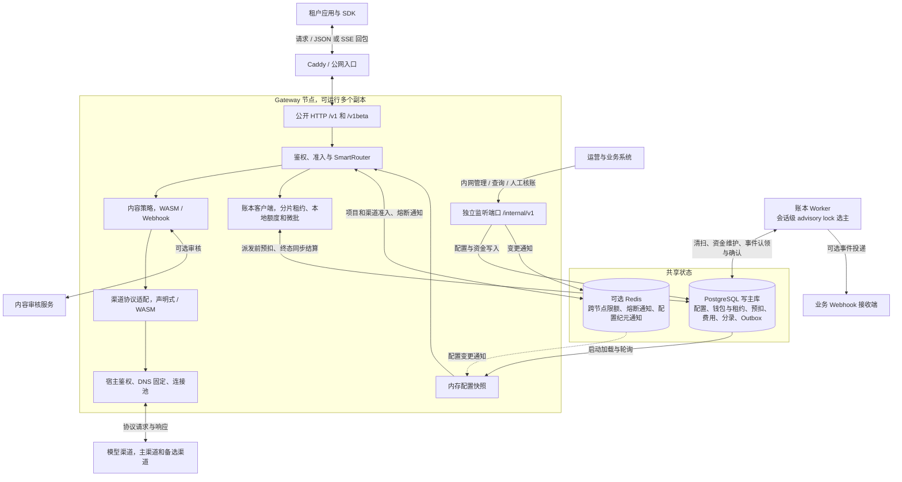
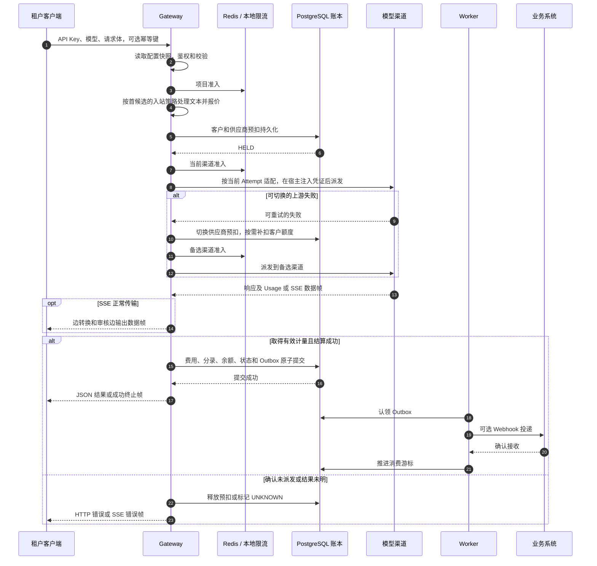

# Super Token Gateway 生产就绪审查

**审查版本** `main@ffdcbc65204bd695375c8422f4d4a72db49d2b98` · 2026-11-21

**上线判断** 本版具备高吞吐设计和单机短请求的万级实测记录，适合继续预发验证。对承载真实余额、要求跨节点配额一致或有可用性承诺的生产流量，建议暂缓放行。租约回收与资金写入缺少共同的有效性校验，存量数据库无法走当前发布流程升级，滚动停机期间的活流也没有被可靠纳管。

| 审查维度       | 判断                                               | 决定因素                                                                                                               |
| -------------- | -------------------------------------------------- | ---------------------------------------------------------------------------------------------------------------------- |
| 正常路径性能   | 单机短请求表现强                                   | 当前 ADR 记录短 JSON 13,205.3 RPS 和短 SSE 9,038.3 RPS。实际容量随上游延迟、租户分布、幂等键、插件、长流和部署拓扑变化 |
| 资金正确性     | 存在放行阻断                                       | 已回收租约可被旧节点继续引用，切换失败可留下无归属预扣，混合计价口径可漏记供应商成本                                   |
| 高可用         | 已具备渠道切换和应用多副本要件，故障态达标证据不足 | Redis 并发租约过早消失，活流脱离停机管理，配置刷新可能放大 PG 故障，仓库部署模板使用单主 PG                            |
| 企业级生产治理 | 基础能力已形成，发布和运行治理有缺口               | 存量升级、管理面授权、财务对账、业务事件可靠投递与保留期限需闭环                                                       |

审查覆盖 Gateway、Worker、协议与插件宿主、账本和迁移、部署、测试及性能证据。两路独立只读审查分别核对请求和资金行为、部署和工程风险，主审沿实际调用链复核。现有 [第一轮报告](./2026-11-21-architecture-review.md) 针对 `5525ae5`。本次覆盖之后的 ADR 0010 实现，并以当前代码、独立运行结果及具备版本边界的历史证据定级。未获取实际生产拓扑、业务流量分布或承诺的 SLO、RPO、RTO，因此放行判断适用于仓库所交付的系统及模板。

## 1. 当前系统架构

图中一个 Gateway 框代表一个进程。公开入口和内部入口在同一进程内共享配置、插件和账本组件。常规部署由独立 Worker 维护资金和投递事件，`all-in-one` 在 Gateway 内启动 Worker 并跳过选主。PostgreSQL 是资金、配置和业务事件的权威存储。Redis 协调运行态配额与通知，未配置时使用进程内配额。仓库的 Caddy 配置代理同一主机的两个 Gateway 端口。 [Gateway 组装](../../apps/gateway/src/app.ts#L40) · [Gateway 启停](../../apps/gateway/src/main.ts#L4) · [Worker](../../apps/worker/src/runner.ts#L35) · [Caddy](../../infra/Caddyfile#L1)

## 2. 推理与资金数据流

- **请求和路由**　Gateway 用快照中的项目、Key、路由、价目和插件生成候选。项目限额在选路前取得。渠道限额在候选预扣后、每次派发前取得。每次 Attempt 独立执行目标渠道的协议适配，宿主负责密钥注入及网络连接。 [请求编排](../../apps/gateway/src/proxy.ts#L525) · [渠道请求](../../apps/gateway/src/upstream.ts#L232)
- **资金**　客户余额按 wallet lot 和授信管理，供应商余额有根账户和分片。普通热路径用已在 PG 划拨的租约额度与批量 hold INSERT 降低锁开销。带幂等键的请求进入常规预扣队列。成功结算把费用、分录和业务事件与余额变更一起提交。上游消耗不确定时保留预扣并进入 `UNKNOWN`，等待核账。 [预扣入口](../../packages/ledger/src/engine.ts#L3046) · [结算批处理](../../packages/ledger/src/engine.ts#L2853) · [人工核账](../../packages/ledger/src/engine.ts#L4137)
- **配置**　运营写 PG，目录事务更新配置纪元。Gateway 通过本地重载、Redis 消息和周期轮询刷新，单次请求持有已读取的快照引用。快照内部跨表读取的一致性见下文。 [目录读取](../../packages/ledger/src/catalog.ts#L618) · [快照刷新](../../apps/gateway/src/snapshot.ts#L18)
- **后台**　独立 Worker 负责过期 hold 和租约清扫、余额批次过期、收债、供应商再平衡、分录分区和可选 Webhook。客户终态结算在 Gateway 的同步路径。 [任务调度](../../apps/worker/src/runner.ts#L226)

## 3. 放行阻断与高优先级发现

P0 表示当前交付阻断，P1 表示须在相应资金、生产流量或企业能力开放前解决。**本次实测**表示本次在独立环境观测。**静态**表示已核对当前入口、触发条件及下游结果。历史复现有单独的版本标注。

### P0 资金租约回收后仍能签发新预扣

**静态，上一版已复现。** 本地续租处理吞掉数据库错误，并对请求续租的所有 ID 更新本地到期时间，即使 PG 未更新任何行。Worker 先选出过期租约，再按状态关闭，关闭事务缺少到期条件的最终复核。新预扣只检查本地余额和时间，批量 INSERT 也未检查 PG 租约的有效状态和所有权。因此活节点可能在 Worker 已回收额度后写入新的 `HELD` 并派发上游。

先前报告在 `5525ae5` 记录了关闭租约后 4 笔新预扣被接纳、20 笔同批结算回滚而 `auditConservation.ok=true`。相关实现文件在这两版间未变，本次核对了路径，未重跑该故障注入。修复应让续租以 PG 成功返回的版本为准，在批量写 hold 时对同批租约做有效性检查，与回收采用统一锁序及所有权校验。为提交结果未明的批次建立按请求 ID 的核验和重试路径，避免 `INSERT` 失去提交确认时直接归还本地额度。守恒审计需覆盖开放 hold、租约余额、钱包预留、授信及供应商预留之间的交叉关系。验收用例应验证故障时旧节点无法继续使用已回收额度，合法同批请求可独立收敛。 [续租](../../packages/ledger/src/engine.ts#L760) · [批量写入](../../packages/ledger/src/engine.ts#L855) · [回收](../../packages/ledger/src/engine.ts#L4270) · [现有审计](../../packages/ledger/src/engine.ts#L4466) · [历史复现](./2026-11-21-architecture-review.md#附录-af-01-复现)

### P0 存量数据库无法按当前发布流程升级

**本次实测。** ADR 0010 改写了已发布的版本 1 基线及校验和。以 `5525ae5` 基线和迁移记录初始化 PostgreSQL 17.11，再执行当前迁移器，得到 `Applied migration manifest checksum mismatch`。当前 `assertSchemaVersion` 仍返回 1，接着目录读取包含 `provider_plugin_id` 和 `adapter_config` 的渠道列时失败。直接启动的新 Gateway 也依赖该目录读取。全新库初始化通过，所交付的校验设计能够防止历史迁移被无意改写。

保留已发布迁移，提供可执行的新增版本和数据迁移测试。先用存量数据验证旧、新产物分别运行所需的兼容窗口，再确定约束收紧和退回流程。已有安装存在不同的版本 1 校验和时，应先识别各真实起点并明确支持路径。 [迁移清单](../../packages/ledger/src/migrations/manifest.json#L1) · [启动检查与迁移校验](../../packages/ledger/src/database.ts#L33) · [启动加载](../../apps/gateway/src/app.ts#L288) · [Compose 启动命令](../../infra/docker-compose.yml#L45)

### P1 资金终态存在三条独立缺口

| 条件                                                     | 结果                                                                                                                                                           | 修复与验证                                                                                                                                                                                                                                                                                                                          |
| -------------------------------------------------------- | -------------------------------------------------------------------------------------------------------------------------------------------------------------- | ----------------------------------------------------------------------------------------------------------------------------------------------------------------------------------------------------------------------------------------------------------------------------------------------------------------------------------- |
| 切到更贵渠道，客户需要补扣，但目标供应商不可用或余额不足 | 事务先更新 wallet 和 lot，再正常返回失败。hold 未记录补扣，余额出现无归属预留。**静态**                                                                        | 在发布资金写入前完成供应商校验，或将失败明确映射为事务回滚。断言失败前后余额、lot、授信与 hold 一致。 [补扣与返回](../../packages/ledger/src/engine.ts#L3167) · [余额不足分支](../../packages/ledger/src/engine.ts#L3272)                                                                                                           |
| 客户按请求或字符计价，供应商按 Token 计价                | Gateway 用客户口径替换原始 usage，再把同一份 usage 传给供应商计费。成本函数将缺失 Token 维度按零处理，可能产生正常 HTTP 200 和零供应商成本。**静态**           | 保存经宿主校验的原始用量，分别派生客户与供应商计价输入。用真实 Token 账单与固定客户价分别断言费用。 [用量替换](../../apps/gateway/src/proxy.ts#L314) · [路由定价](../../packages/ledger/src/catalog.ts#L413) · [供应商计价](../../packages/ledger/src/engine.ts#L2876) · [缺省用量](../../packages/kernel/src/cost.ts#L15)          |
| 断流、超时或不明 Attempt 留下 `UNKNOWN`                  | Worker 会把过期 `HELD` 标未知，未实现基于供应商证据自动核账。备路由成功后，旧 `UNKNOWN` 供应商预扣可以继续存在，人工 resolve 又拒绝已终态的客户 hold。**静态** | 记录每次 Attempt 的可追溯用量证据，让客户结算和旧供应商风险分别收敛。对没有供应商证据的请求设置账龄告警及人工处理，核验重试下不会重复派发或扣款。 [Worker 清扫](../../apps/worker/src/runner.ts#L234) · [旧供应商 hold 保留](../../packages/ledger/src/engine.ts#L2596) · [人工终态限制](../../packages/ledger/src/engine.ts#L4137) |

### P1 Redis 并发限制以毫秒计，键在几十毫秒后过期

**本次实测。** 两个 `ClusterCoordinator` 连接同一台临时 Redis，配置并发上限为 1、租约为 60,000 ms。第一个许可尚未释放时，Redis 返回该键仅剩 **69 ms**。等待 150 ms 以后，第二个节点也拿到许可。Lua 给有序集合成员使用毫秒时间戳，却将键的 `PEXPIRE` 设为 `ceil(leaseTtlMs / 1000) + 10`。项目与渠道均使用该实现。正常长请求、慢上游或活流都可能超过这个时间。

统一时间单位，验证长流在全生命周期持续持有许可，并测试丢失客户端、节点退出、释放失败及 Redis 断连的回收。当前运行期 Redis 命令报错会降级为整份进程内限额，多副本下失去全局上限。启动时已配置 Redis 的连接或订阅错误会阻断启动。生产需为不同配额明确启用有界本地降级或拒绝准入的策略。 [Redis 实现](../../packages/runtime/src/cluster.ts#L26) · [启动与运行期分支](../../packages/runtime/src/cluster.ts#L102) · [项目许可](../../apps/gateway/src/proxy.ts#L526) · [渠道许可](../../apps/gateway/src/proxy.ts#L808)

### P1 活流脱离全局准入、排空与内存控制

**静态。** 流式分支把项目和渠道许可转交给流清理，但外层 `finally` 在返回 `Response` 时释放 Lifecycle guard。流仍需要上游连接、PG 和插件执行器。全局 `in_flight` 因此低估实际在途工作，SIGTERM 排空可能提前关闭依赖。转交流时还清理了 Attempt 定时器，各流式分支持续从上游读并推入队列，缺少应用层按下游需求限制排队字节的机制。

让流持有请求生命周期直到结算和资源释放。停机先撤出就绪并拒绝新准入，再排空或有界取消流，最后关账本与连接。为首帧、帧间空闲、总时长和慢客户端设独立边界。验收时持续发流，覆盖慢读、停读、并发饱和和滚动停机，按请求核对成功终止帧与数据库终态。 [流交接](../../apps/gateway/src/proxy.ts#L1426) · [持续读流](../../apps/gateway/src/proxy.ts#L1972) · [外层清理](../../apps/gateway/src/proxy.ts#L2240) · [排空条件](../../packages/runtime/src/lifecycle.ts#L28) · [依赖关闭](../../apps/gateway/src/app.ts#L296)

### P1 配置刷新能安装混合版本，也能放大 PG 故障

**静态。** 目录用独立并发查询分别读 epoch、Key、渠道、路由、价目和插件。配置事务恰好在查询之间提交时，可读到新 epoch 和旧 Key 行。轮询只在 PG epoch 更高时重载，Key 缓存也以 epoch 更新，同一混合版本可一直保留到下一次配置变更或重启。Redis 消息回调另外以 `void snapshot.load()` 启动异步重载，外层同步异常捕获无法接住该 Promise 拒绝。多个节点同时收到通知，短时目录查询错误会扩大为多节点进程错误。

在同一个只读一致性事务中读取 epoch 和配置，收敛处理通知并捕获刷新失败。测试并发禁用 Key、禁用插件、配置写入和 PG 短暂断连，记录最近成功刷新、配置年龄和生效时延。 [快照查询](../../packages/ledger/src/catalog.ts#L618) · [刷新触发](../../apps/gateway/src/app.ts#L74) · [轮询](../../apps/gateway/src/snapshot.ts#L64) · [Key 缓存](../../apps/gateway/src/proxy.ts#L116)

### P1 Outbox 在并发提交下可能永久漏投

**静态。** 事件序列号在写事务内分配。事务先取得序号 N 后尚未提交，另一事务先提交 N+1 时，消费者可以看到 N+1 并推进游标。N 随后提交就落在游标背后。消费端锁住游标行，写入端仍可独立提交。当前 claim 也会覆盖仍有效的认领令牌，ACK 缺少对实际已认领范围的校验。

采用每消费者逐事件的持久确认，或使用能保证提交顺序的 CDC 位点。保留稳定事件 ID，让重复投递由消费端幂等处理。验收覆盖逆序提交、消费者重启、发送后确认前崩溃、并行认领以及过期认领回收。 [事件表](../../packages/ledger/src/migrations/0000_v4_baseline.sql#L346) · [并行结算](../../packages/ledger/src/engine.ts#L2923) · [认领与确认](../../packages/ledger/src/engine.ts#L4403)

### P1 路由切换改变策略边界，SSE 首帧切换缺失

**静态。** 入站内容处理以 `selected[0]` 的插件步骤执行一次，实际预扣获准和成功派发的路由可能是其他候选。重试执行其独立的渠道协议转换，但没有执行该候选专属的入站策略。若企业租户依赖渠道级脱敏或审核，流量切换会改变策略覆盖。另外，ADR 0010 承诺收到可重试的 SSE 首帧错误且尚未向客户端输出时允许切备。当前在返回流式 HTTP 响应后才解析首帧，识别错误后进入流内错误分支，候选循环已结束。现有伪 HTTP 200 切换测试验证了 JSON 路径。

先确定全局内容策略与渠道策略的责任，以及计费依据是策略处理前还是处理后的内容。每次派发必须满足实际目标的策略。为 SSE 增加受大小和时限约束的首帧分类，仅在消费状态允许时切换。分别验证主备策略不同、首帧错误及输出后错误。 [入站策略](../../apps/gateway/src/proxy.ts#L587) · [每次派发](../../apps/gateway/src/proxy.ts#L845) · [SSE 错误处理](../../apps/gateway/src/proxy.ts#L1988) · [ADR 0010 §6.3](../decisions/0010-provider-plugin-architecture.md#63-关键失败窗口与一致性保证)

### 其他需覆盖的生产路径

| 优先级 | 条件与影响                                                                                                                                                     | 验收方向                                                                                                                                                                                                                                                                 |
| ------ | -------------------------------------------------------------------------------------------------------------------------------------------------------------- | ------------------------------------------------------------------------------------------------------------------------------------------------------------------------------------------------------------------------------------------------------------------------ |
| P1     | 原生 Responses SSE 透传完整事件。内容插件识别并处理 `response.output_text.delta`，完整文本事件和成功终止对象仍可含原始文本，在启用脱敏时影响最终输出。**静态** | 对外输出的文本字段统一执行审核，使用已审核文本重建完整对象。使用协议样例检查所有输出事件的一致性。 [原生透传](../../packages/protocol/src/stream.ts#L310) · [文本提取](../../apps/gateway/src/upstream.ts#L1131) · [终止事件输出](../../apps/gateway/src/proxy.ts#L2190) |
| P1     | 模型输出上限应用到报价，原生请求的上限字段并未统一收紧到实际发出的请求。缺少显式限制或经适配改写时，实际消耗可超过预扣，走补扣或记债路径。**静态**             | 在最终派发边界同时校验有效上限和报价依据，覆盖原生、跨协议和声明式覆盖。 [报价上限](../../apps/gateway/src/proxy.ts#L236) · [出站请求体](../../apps/gateway/src/upstream.ts#L150) · [超额结算](../../packages/ledger/src/engine.ts#L2507)                                |
| P2     | Multipart 完整解析后才检查文件大小，且文本域与格式开销未计入配置预算。幂等指纹只含文件名、大小和类型，相同元信息的不同文件会被当作相同内容。**静态**           | 解析前限制入站字节，并用有界摘要为文件内容建立指纹。覆盖多文件、长文本域、同大小内容变更和真正重试。 [解析与文件元信息](../../apps/gateway/src/proxy.ts#L463) · [指纹](../../apps/gateway/src/proxy.ts#L651)                                                             |
| P2     | 全局准入在请求处理的 `try` 外执行。超载抛出的 503 类型错误落入 Hono 默认 500，监控无法通过统一错误响应区分预期拒绝。**静态**                                   | 饱和和排空状态下检查公开 HTTP 状态、错误体和过载计数。 [准入入口](../../apps/gateway/src/proxy.ts#L375) · [准入错误](../../packages/runtime/src/lifecycle.ts#L8)                                                                                                         |
| P2     | 原生 Wasmtime 调用在 Gateway 的事件循环内同步执行。Bun Worker 模式的等待队列也在每次执行超时开始前排队。重负载插件可能影响同进程其他请求或就绪探测。**静态**   | 给插件排队和执行统一的截止时间与容量预算，测量插件饱和时其他租户的尾延迟。 [排队与超时](../../packages/plugin-engine/src/wasm-host.ts#L287) · [原生调用](../../packages/plugin-engine/src/wasm-host.ts#L474)                                                             |

## 4. 性能证据与容量判定

ADR 0010 的数据来自 Bun 1.4.4、PostgreSQL 17、本机独立 Gateway 产物和两个 mock 上游，PG 开启 `fsync`、`synchronous_commit` 和 `full_page_writes`。以下是 ADR 记录的历史结果。ADR 0009 的 12,930.1 RPS 是前一阶段基线。11 月 20 日性能目录中的多进程、主备测试使用旧的 Gateway + Core 拓扑，不能直接用于当前版本的 HA 验收。 [ADR 0010 数据](../decisions/0010-provider-plugin-architecture.md#11-未决事项假设与实测验收记录) · [ADR 0009 基线](../decisions/0009-enterprise-gateway-worker-architecture.md) · [11 月 20 日测试环境](../performance/stream-2026-11-20.md#L43)

| 工作负载                 |  并发 |      RPS |       P99 |
| ------------------------ | ----: | -------: | --------: |
| 短 Chat JSON，多项目     | 1,024 | 13,205.3 | 107.14 ms |
| 短 Chat JSON，单热点钱包 |   512 | 11,316.6 |  63.67 ms |
| 短 SSE，多项目           |   512 |  9,038.3 |  93.01 ms |

- **吞吐提升有实现依据。** 预扣与结算分别微批、钱和 lot 额度提前持久划拨、集合 SQL 写入、本地目录读取、上游连接复用，能减少每请求锁争用与 IO 往返。保留这些优化及正常响应终态等结算的顺序。事务聚合也扩大失败范围，资金修补应优先保持集合写入，用明确的业务条件隔离坏项，再以故障态容量验证批次策略。 [微批队列配置](../../packages/ledger/src/engine.ts#L2923) · [标准结算终止帧](../../apps/gateway/src/proxy.ts#L2164)
- **13.2k 是峰值场景数据。** `bench:single` 使用 32 个项目、很宽的项目和渠道限额、2 ms 微批窗口、自动压测循环，并关闭访问日志与快照轮询。它未包含线上 TLS/负载均衡、生产 Redis 热路径、Webhook 投递、长时间运行和真实上游时延分布。脚本会打印失败数及吞吐，但末尾没有将错误率、每请求唯一结算和 `unknown_holds` 设为失败条件。双节点历史演示中，503 切换是模型渠道切换。节点、PG 和 Redis 故障恢复需要独立演练。 [单机配置](../../scripts/bench-single.ts#L135) · [流量生成](../../scripts/bench-single.ts#L264) · [校验条件](../../scripts/bench-single.ts#L385) · [双节点故障场景](../../scripts/bench-prod.ts#L530)
- **多副本吞吐受同一个 PG 写路径限制。** 普通收费请求的持久预扣和结算均同步依赖 PG。节点增加后，连接、锁、WAL、IO、复制延迟和同一热点钱包需要共同测量。按模板的 200 连接上限，6 个默认 32 连接的 Gateway 加 1 个 8 连接 Worker 就耗尽名义预算，尚需为数据库管理、迁移与容错留空间。客户端幂等请求走另一条准入路径，因此应纳入容量样本。 [连接预算](../../infra/docker-compose.yml#L8) · [Gateway 默认值](../../apps/gateway/src/config.ts#L72) · [Worker 默认值](../../apps/worker/src/main.ts#L9) · [预扣分流](../../packages/ledger/src/engine.ts#L3046)
- **各阶段吞吐可能相差两个数量级。** Worker 默认每秒认领至多 100 条，每次成功结算生成业务事件。开启投递后，单次 Webhook 等待最多 5 秒，且和清扫共用串行任务链。只要任务平均完成速度低于定时入队速度，任务与事件就会积压。应拆开维护和投递的执行预算、限制待执行任务数量、持续监控最老未确认事件和资金 sweep 延迟。压测应覆盖目标峰值时的事件处理能力及积压恢复速度。 [事件生成](../../packages/ledger/src/engine.ts#L2074) · [每批投递](../../apps/worker/src/runner.ts#L134) · [共用调度](../../apps/worker/src/runner.ts#L198)
- **声明式适配仍有逐请求成本。** 当前每次 Attempt 解析 Provider、合并三级覆盖、创建规则数组并解析路径，错误规则遇到正则时也会现场构造 `RegExp`。ADR 的快照预编译和低于 5 µs 指标需要专门测量。建议先采样成本，再把可预计算部分移到发布或快照阶段，同时保持每 Attempt 请求体独立。WASM、Webhook、媒体、慢消费和大流分别给出容量曲线。 [适配入口](../../apps/gateway/src/upstream.ts#L236) · [规则合并](../../packages/plugin-engine/src/providers/executor.ts#L238) · [错误规则](../../packages/plugin-engine/src/providers/executor.ts#L437)

截至本次审查，**可确认的是短请求高吞吐和热路径设计有效**。生产容量应取业务流量模型下仍能满足 P99、错误率、资金守恒和恢复约束的持续负载。入口还需跟踪 TTFT、首个有效数据帧、流内错误率、活流内存和尾帧结算延迟。用独立负载机做固定到达速率测试，加入冷热租户、带幂等键请求和真实插件比例，并分别报告稳定态、故障态、恢复段及对应数据库负载。

## 5. 部署与企业治理

| 领域               | 当前能力与差距                                                                                                                                                                                                                                                                                                                                                                                                                      | 生产验收                                                                                                                                                       |
| ------------------ | ----------------------------------------------------------------------------------------------------------------------------------------------------------------------------------------------------------------------------------------------------------------------------------------------------------------------------------------------------------------------------------------------------------------------------------- | -------------------------------------------------------------------------------------------------------------------------------------------------------------- |
| 主机及数据库故障   | Caddy 两个后端都在 loopback，Compose 为单 Gateway / 单 PG。独立 Worker 支持 PG 会话锁选主，`all-in-one` 跳过选主。Gateway 就绪检查包含 `SELECT 1`，但该检查在只读副本也能通过，且不验证配置新鲜度。Worker 就绪只返回当前内存 leader 标志。 [Caddy](../../infra/Caddyfile#L1) · [Compose](../../infra/docker-compose.yml#L1) · [Gateway 就绪](../../apps/gateway/src/app.ts#L140) · [Worker 就绪](../../apps/worker/src/main.ts#L25) | 按实际 SLA 提供跨故障域流量入口和 Gateway，明确 PG 写主发现、主备复制及切换。演练可写性探测、单节点退出、主备切换与 Worker 接管，记录中断、异常单和恢复耗时    |
| 访问授权和账本身份 | 控制面与公开面分端口，Caddy 只转发允许的公开路由。内部资金与插件管理共用管理令牌。Compose 缺省带可预测配置值，迁移和应用复用引导数据库账号。Worker 的某些分区维护路径依赖变更触发器权限。 [内部鉴权](../../apps/gateway/src/internal-api.ts#L640) · [部署环境](../../infra/docker-compose.yml#L28) · [分区维护](../../packages/ledger/src/database.ts#L108)                                                                         | 用私网受控管理入口、可归因操作身份与角色划分保护资金和插件控制。移除可用于生产的缺省密钥，拆分迁移、业务写入、维护与查询角色，核验所需最小授权以及管理动作审计 |
| 数据保留和灾备     | 月分区覆盖分录，但 hold、费用、Outbox 随在线量增长。归档批量把整月数据读入堆，校验也拼接解压后文本。现有逻辑备份恢复覆盖测试账本数据。 [存储定义](../../packages/ledger/src/migrations/0000_v4_baseline.sql#L242) · [归档实现](../../packages/ledger/src/database.ts#L154) · [恢复测试](../../scripts/verify-durability.ts#L317)                                                                                                    | 定义在线留存、可重放窗口和审计保留期，使用一致性截点及有界数据流归档。演练基线恢复和按时间点恢复，核对账本、消费游标、角色和密钥，并测得 RPO、RTO              |
| 日常可观测性       | 已有访问日志、traceparent、请求与上游错误指标、网关耗时分布和熔断状态。账本终态、活流、租约续期失败、真实快照年龄、Worker sweep 和 Outbox 积压缺少足够的运行信号。 [现有指标](../../apps/gateway/src/observability.ts#L130)                                                                                                                                                                                                         | 仪表盘能定位客户断流、供应商错误、本地结算失败及 PG/Redis 故障，能按请求与 Attempt 关联供应商成本和客户扣款。以未结账龄和队列最老年龄触发告警                  |
| 构建与文档契约     | 模块依赖及 fresh schema 有测试门禁。当前 CI 默认没有构建原生 Wasmtime；构建脚本会打包本地恰好存在的动态库，产物随构建环境变化。AGENTS、根目录设计和 OpenAPI 仍含前一代拓扑和管理接口描述。 [架构测试](../../tests/unit/architecture.test.ts#L4) · [CI](../../.github/workflows/verify.yml#L41) · [原生产物规则](../../scripts/build.ts#L51) · [AGENTS](../../AGENTS.md#L3) · [OpenAPI](../openapi.json)                             | 将可选原生能力与发布变体明确绑定，记录提交、平台和工具链。以实际 API 和运行入口更新维护文档，增加存量升级门禁与双节点故障用例                                  |

现有实现值得保留的是精确金额、复式分录、持久化预扣、正常响应后置成功终态、双端口部署及分层的 Provider 适配。结构上的主要风险来自同一结算规则横跨直连与快路径，以及请求终结逻辑分别散布在非流式、普通 SSE、WASM SSE 和媒体路径。可先统一交易与流的终结契约，并让测试覆盖跨路径行为，再逐步减少重复。项目级 Key、配额和企业合规插件已具备产品基础。组织级审批、区域驻留、自助计量等能力应依合同需求决定投入。

## 6. 建议的放行顺序

| 顺序              | 工作范围                                                                        | 放行证据                                                                                                                     |
| ----------------- | ------------------------------------------------------------------------------- | ---------------------------------------------------------------------------------------------------------------------------- |
| 1. 资金与升级     | 租约校验和回收、失败补扣回滚、混合口径计价、提交结果未知恢复、存量迁移          | 运行旧库及有资金历史的升级夹具。租约被回收后拒绝依赖该租约的新派发。每笔客户与供应商费用按独立算例校验，且正常批次可继续结算 |
| 2. 请求故障与配置 | 活流排空和背压、Redis 配额租约、原子快照和刷新错误隔离、渠道策略与 SSE 首帧切换 | 双节点故障注入能保持配额与策略边界。逐请求核对结算、流终止与取消，观测配置撤销生效时延                                       |
| 3. 运营闭环与容量 | UNKNOWN 对账、可靠 Outbox、最小授权、监控告警、数据保留、跨故障域部署及容灾     | 在目标部署拓扑以业务混合流量跑持续负载和主备切换，核对余额、唯一收费、事件投递、资源上限和 RPO/RTO                           |

最优先的改进是让已有单主事务和分片租约在故障中保持正确，再用明确的容量曲线决定扩展方向。只有同一套回归已收敛且持续写入确实达到单主成本或容量上限时，才值得评估按租户分 Cell。供应商账户跨 Cell 使用时应同时设计预算归属与风险隔离。

## 7. 本次验证与边界

| 检查                                                       | 结果                                                                                                                         |
| ---------------------------------------------------------- | ---------------------------------------------------------------------------------------------------------------------------- |
| `bun run check`、`bun run lint`、`bun run fmt:check`       | 97 个文件完成类型检查，lint 退出码 0，报告写入前格式检查通过                                                                 |
| `bun run test`                                             | 87 通过、0 失败，17 个测试文件，1,649 个断言。沙箱内首次运行的 10 个网络用例在监听本地端口时失败，经允许绑定回环端口后全通过 |
| `bun --no-env-file test tests/integration --timeout 30000` | 17 通过、0 失败，3 个文件，451 个断言。使用隔离 PostgreSQL 17.11、Redis 7.4.12 和本地 mock 上游                              |
| 存量升级定向验证                                           | 复现旧基线迁移校验失败，以及同版本号通过启动检查后读新渠道列失败                                                             |
| Redis 并发定向验证                                         | 复现 60 秒配置的集合实际仅剩约 69 ms，第二个节点在第一个许可未释放时获得许可                                                 |
| 隔离构建与产物验证                                         | 从受审提交构建 5 个产物，采用 Bun WASM Worker 回退模式。独立启动 Gateway、Worker 和 mock，验证 1 笔收费、8 条分录及归档      |
| SIGKILL 耐久与逻辑恢复                                     | 通过。恢复 16 笔预扣，测试通过管理 API 释放 8 笔、结算 8 笔，完成 `pg_dump` 和 `psql` 恢复，恢复后的当前审计返回 OK          |

本机使用 Bun 1.4.5，仓库固定版本为 1.4.4。验证使用临时目录、独立数据库和本地上游。本次未运行目标拓扑容量压测、PG/Redis 主备切换、跨故障域演练和 PITR。耐久用例验证的是应用进程强杀后的账本恢复及人工处置。报告中的正常基准值沿用 ADR 记录，故障路径的静态结论已标出证据级别。

## 8. 重构后的实现与验收

以上为 `ffdcbc6` 的历史审查。当前工作区保留 Gateway、PostgreSQL 账本及后台 Worker 的进程边界。账本准确性和请求故障处理已通过本机回归，跨故障域部署和灾备仍需在目标环境验收。

| 范围           | 当前实现与回归                                                                                                                                                                                                                                                                                                                 |
| -------------- | ------------------------------------------------------------------------------------------------------------------------------------------------------------------------------------------------------------------------------------------------------------------------------------------------------------------------------ |
| 存量升级       | 新增 schema `2026112102`。保留历史基线及其迁移记录，验证两份已发布布局可升级并保留既有资金。发布需要停写窗口和升级前备份。 [迁移清单](../../packages/ledger/src/migrations/manifest.json) · [升级说明](../decisions/0010-provider-plugin-architecture.md#41-postgresql-ddl-变更与存量升级)                                     |
| 资金预扣与结算 | PG 校验租约状态、所有权和有效期。按真实供应商价目保留独立计量，切换失败回滚客户补扣，失败结算与同批正常请求隔离，清扫和退款采用一致的并发约束。守恒审计覆盖租约、预留、客户钱包及供应商余额。 [账本实现](../../packages/ledger/src/engine.ts) · [资金回归](../../tests/integration/ledger-v4.test.ts)                          |
| 故障与内容策略 | 配置原子刷新，Redis 共享准入失联时拒绝新增调用，SSE 保留并发许可直至结算和清理。上游派发按目标渠道执行策略，首帧出错时按证据切换，原生 Responses 的文本事件和完整对象使用审核后的内容。 [Gateway 回归](../../tests/integration/gateway-v4.test.ts) · [双节点回归](../../tests/integration/cluster-and-media.test.ts)           |
| 运营恢复       | 失败或结果不明的供应商尝试可依据明确证据独立结算或释放。Outbox 固定认领区间，拒绝过界 ACK，序号分配顺序受 PG 事务锁约束。投递等待与账务清扫使用独立队列，归档流式生成和校验。 [运营 API](../../apps/gateway/src/internal-api.ts) · [后台调度](../../apps/worker/src/runner.ts) · [归档](../../packages/ledger/src/database.ts) |
| 发布与插件     | OpenAPI 由实际路由和内部请求校验生成，CI 校验文档和真实产物。Wasmtime 编译和调用在有界 Worker 池中执行。流式审核串行约束未完成的截断检查，并聚合调用审计。 [OpenAPI](../openapi.json) · [WASM 执行池](../../packages/plugin-engine/src/wasm-host.ts) · [内容策略](../../packages/plugin-engine/src/pipeline.ts)                |

### 本机负载复测

Bun 1.4.4、PostgreSQL 17.11、Redis 7.4.12、独立构建产物和本地 mock 上游。PostgreSQL 启用 `fsync`、`full_page_writes`、`synchronous_commit`。基准校验每个成功响应对应唯一的结算，校验重复请求扣款、持有中和结果不明的预扣、空闲进程的活跃租约及资金守恒。

| 双 Gateway、Worker 与 Redis |  并发 |             结果 |         P99 |
| --------------------------- | ----: | ---------------: | ----------: |
| 15 秒短 JSON                |   256 |     14,029.8 RPS |    30.01 ms |
| 15 秒短 SSE                 |   128 |      9,052.4 RPS |    26.34 ms |
| 10 秒单热点钱包             |   128 |     10,656.6 RPS |    32.84 ms |
| 5 秒长 SSE                  | 1,000 | 1,000/1,000 成功 | 5,132.93 ms |
| 主渠道 503 切备用渠道       |    64 | 1,000/1,000 成功 |    59.13 ms |

双节点压力基准共完成 622,267 笔唯一结算，零请求错误。Gateway 活流归零，审计各项异常为零。初次改进门禁后的压力测试暴露本机负载客户端临时端口耗尽。将客户端切换为明确管理的 HTTP 持久连接后，完成上述复测。两种压测都使用合成请求，双节点测试使用单主机、单写主和单 Redis。 [双节点基准](../../scripts/bench-prod.ts) · [压测传输](../../scripts/bench-http.ts)

单 Gateway 的 8 秒分档基准共完成 618,076 笔唯一结算，零错误。短 JSON 1,024 并发为 11,899.9 RPS，P99 为 114.95 ms。短 SSE 512 并发为 8,472.6 RPS，P99 为 82.97 ms。单热点钱包 512 并发为 12,028.3 RPS，P99 为 66.06 ms。 [单节点基准](../../scripts/bench-single.ts)

类型检查和格式检查通过。88 项单测通过，共 1,667 个断言。27 项 PG、Redis 和 HTTP 集成测试通过，共 547 个断言，覆盖 Redis 停止时两节点拒绝准入及重启后的恢复。构建生成 7 个产物，完成独立启动和归档校验。强杀演练检查 16 笔预扣，按证据释放 8 笔、结算 8 笔，逻辑备份恢复后通过守恒审计。 [包脚本](../../package.json) · [耐久演练](../../scripts/verify-durability.ts)

### 生产放行仍需验证的事项

后续实现、隔离故障演练结果和目标环境验收依据见 [ADR 0011](../decisions/0011-production-operations.md)。

- 使用目标环境的负载均衡与跨故障域实例，实测 PostgreSQL 写主切换、Redis 主备切换、Worker 接管、恢复后的实际 RPO/RTO 和按时间点恢复。本文验证的逻辑备份恢复与 Redis 单实例重启适用于已执行的测试环境。
- 资金与插件运营仍使用共享管理令牌。生产应落实可归因的管理身份、角色权限、迁移与运行账号分离，并按目标留存周期配置归档和消费端事件 ID 去重。历史 Outbox 如出现过被旧游标跳过的事件，可通过新消费者重放并按事件 ID 去重。
- 自动核账依赖供应商账单及其证据接口。无证据的供应商费用继续保留，按账龄监控并进入人工复核。运行告警还需接入目标环境的监控平台，尤其是未结账龄、Outbox 积压、快照新鲜度与资金租约失败。
- 单主写能力会受结算、WAL、复制和热点钱包限制。使用目标供应商、幂等请求、启用插件、Webhook 和 TLS 的混合长跑确定限额，使用原生协议的输出上限做验收，自定义适配协议由插件契约提供等价上限。
