# 插件系统高可用与高性能审查报告

- **审查日期**：2026-11-22
- **审查对象**：HEAD `5b63227` 加当前工作区（含未提交和未跟踪文件）。全程只读，未改动代码。
- **审查范围**：`packages/plugin-engine`、`native/plugin-wasmtime`、网关插件调用链（`proxy.ts`、`upstream.ts`、`snapshot.ts`、`internal-api.ts`、`plugin-release-validation.ts`、`stream-relay.ts`）、`packages/ledger` 的插件目录表和发布表、`packages/runtime` 的路由熔断与集群广播、ADR 0009–0012、性能文档。
- **版本边界**：插件相关代码最后修改于 10:07–10:19，审查期间没有变化。ADR 0012、README 和混合稳态文档在 14:11–14:14 更新过，已按新内容核对。审查期间他人在并行修改 ledger 租约文件和 scripts，不在本报告范围内。
- **审查方式**：两路全新上下文的独立只读审查（需求与行为 / 规范、结构与性能），主审查逐条沿调用链核实。阻断项全部由主审查编写探针亲自复现。
- **严重程度**：阻断 = 上生产前必须修；实质 = 影响可用性或性能的已证实问题；局部 = 影响范围小或只有静态证据；待核实 = 证据不足以定性。
- **补测修订（同日）**：
  - B3 的瓶颈归因更正为原生实例化的跨线程争用，不是主线程分发；补充池化分配器的实测数据。
  - 第 7 节的决定按复审修订：性能路线改为池化分配器优先，D3 改为按内容是否交付计费，D8 改用代号加 epoch。
  - 新增第 8 节，说明对外多协议 API 的现状与推荐方案；验证记录顺延为第 9 节。

## 0. 结论

**控制面设计合理，可以保留。执行面的架构方向合理，但现有实现有 4 个阻断问题，挂 WASM 或 Webhook 插件的路由在修复前不应上生产。**

| 部分                                                                        | 判定       | 理由                                                                                                                                                                                                                                            |
| --------------------------------------------------------------------------- | ---------- | ----------------------------------------------------------------------------------------------------------------------------------------------------------------------------------------------------------------------------------------------- |
| 控制面（修订、发布、回滚、撤销、快照传播）                                  | 合理，保留 | 发布、回滚、撤销都在一个事务里完成，有幂等、`expected_epoch` 并发检查和不可变修订。撤销同时走 Redis 和 PG 两条路径，并会中止进行中的调用                                                                                                        |
| 执行面架构方向（零导入 WASM、原生 wasmtime、Webhook、按摘要缓存、有界队列） | 合理       | 隔离模型是对的，原生运行时的燃料和内存上限实测有效                                                                                                                                                                                              |
| 执行面现有实现                                                              | 不合理     | 回退运行时隔离失效；内置 pii-guard 处理长文本必定失败；插件重负载达不到 3000 RPS；插件基础设施故障向客户计费                                                                                                                                    |
| 性能                                                                        | 部分成立   | 不挂插件的路由单网关实测约 16k RPS。每请求只调一次插件的轻负载（占 25% 流量）30 分钟稳态约 1,980 RPS 零错误。按流分片逐次调用插件的路径实测离 3000 RPS 差 1–2 个数量级；原生侧换成池化分配器后执行池吞吐实测提升 2–3 倍，仍需按目标流量组成复测 |

**上生产的边界：**

- 不挂插件的路由和声明式渠道：按现有证据可以上线。
- 挂 WASM 或 Webhook 插件的路由：B1、B2、B4 修好之前不要上生产。
- 插件重负载流量（流式 WASM、多轮 on_request、WASM Provider）：B3 解决并实测达到 3000 RPS 之前不承诺容量。

**对外多协议 API：** 把各家上游统一成 OpenAI、Claude 或 Gemini 格式给调用端，已在核心协议层 `packages/protocol` 实现，不依赖插件。跨格式时只接受中间结构能完整表达的字段，覆盖面缺口和推荐方案见第 8 节。

## 1. 现状架构

### 1.1 插件代码架构图

网关负责编排，`plugin-engine` 负责插件语义和执行，原生 wasmtime 是唯一能强制燃料和内存上限的沙箱。图中虚线是缺原生库时的静默回退路径。

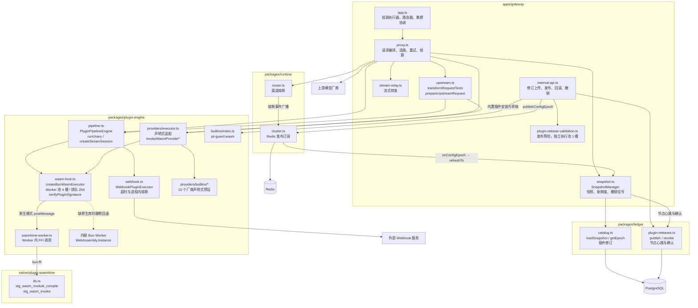

### 1.2 请求数据流程图

一次请求最多经过 5 类插件调用点：on_request、adapt_request、adapt_response 或 adapt_stream_event、on_response 或 on_stream_chunk、on_stream_end。方括号里是本报告的问题编号。

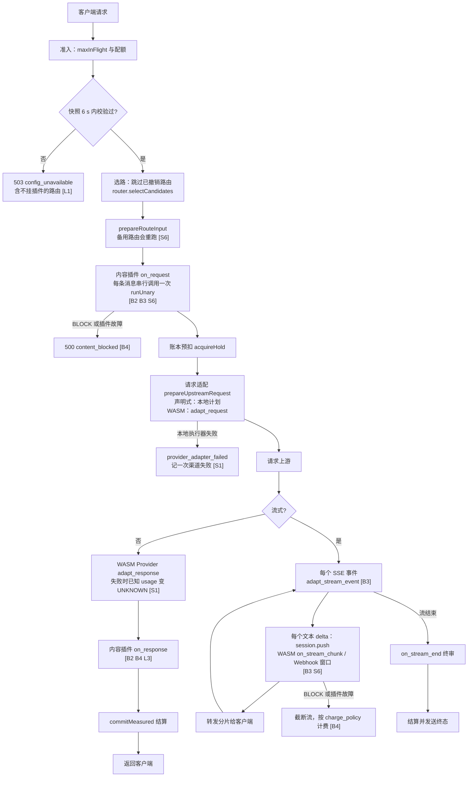

### 1.3 单次 WASM 调用流程

每次插件调用都要先在主线程验签，再排队拿槽，原生模式下每次新建 Store 和实例。Bun 回退分支既不计量燃料，超时后也杀不掉线程。

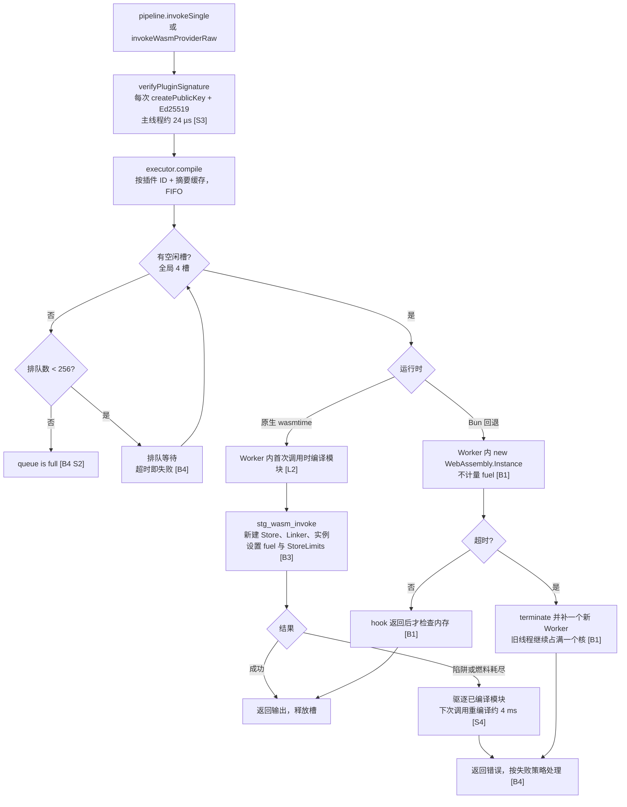

### 1.4 流式响应的调用放大

一个 300 分片的流，在 WASM Provider 和 WASM 内容插件同时启用时，会产生约 600 次插件调用，每次都验签并新建实例。

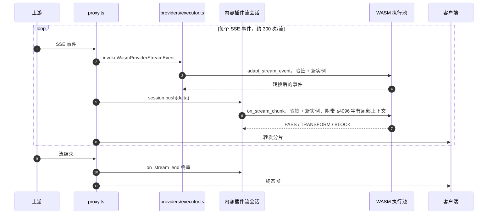

### 1.5 失败处理流程（现状）

插件基础设施故障和内容判定走同一条路径：被当成 BLOCK 返回不可重试错误并计费。Provider 插件的本地故障还会被算成渠道故障，经 Redis 广播成全集群熔断。

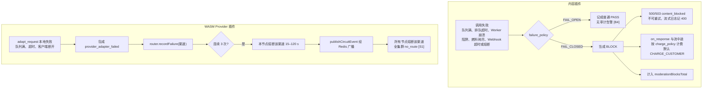

### 1.6 控制面：发布、传播与撤销

发布和撤销都是单事务加纪元递增，再经 Redis 推送和 PG 轮询两条路径收敛到所有节点。这部分设计是本系统做得最扎实的地方。

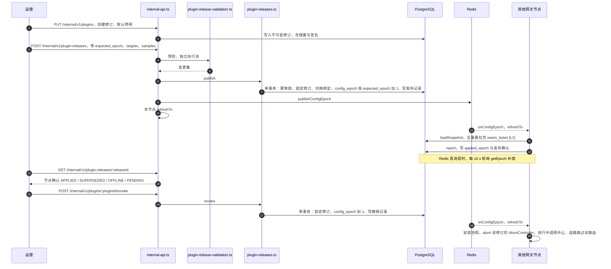

### 1.7 快照轮询与新鲜度

节点只用 epoch 大小判断快照是否最新。epoch 回退时节点静默卡住，追平后又把内容不同的旧快照当成新鲜的继续服务。

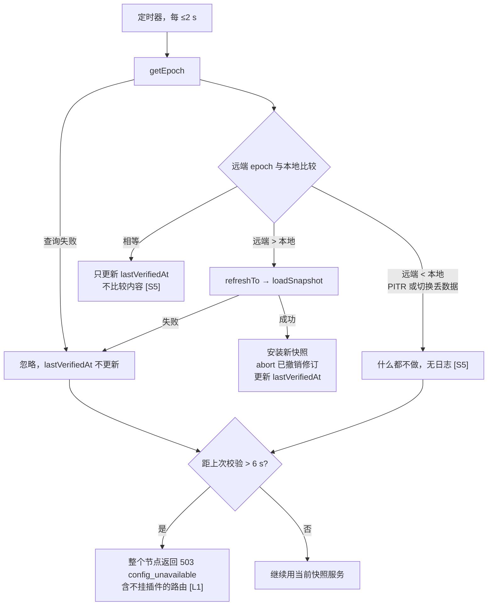

## 2. 阻断问题

4 个阻断问题都由主审查实测或沿代码路径核实，任何一个都足以阻止挂插件的路由上生产。

### B1. Bun 回退运行时不是沙箱

死循环杀不掉，内存上限是事后才检查，而且回退时没有任何提示。

- **位置：**
  - `packages/plugin-engine/src/wasm-host.ts:405-414`：超时后 terminate，再补一个新 Worker。
  - `wasm-host.ts:64-128`：Worker 源码不使用 fuel；第 93-111 行只在 hook 返回后才检查内存。
  - `apps/gateway/src/app.ts:116-124`：找不到原生库时直接改用 Bun，不打日志。
  - `scripts/build.ts:56-58`：缺库时跳过构建。
- **触发：** 部署产物里没有 `libstg_plugin_wasmtime`，然后有插件死循环或执行 `memory.grow`。缺库很常见：README:74 把 `build:wasmtime` 写成“可选”，ADR 0009 §5.2 把 Bun 写成“开箱即用”的默认选项。
- **后果：** 每超时一次就永久占满一个 CPU 核，调 `close()` 也不释放，只能重启进程。内存上限也挡不住峰值。
- **证据（Bun 1.4.4 和 1.4.5 都能复现）：**
  - 超时 3 次后，空闲进程仍占约 2,990 ms/s CPU。
  - 内存上限设 32 MiB，RSS 峰值仍增加 516 MiB。
  - 同样的输入换成原生 wasmtime，1–6 ms 内被燃料终止，RSS 只增加 7 MiB。
- **修复：** 见 D1。

### B2. 原生运行时下，内置 pii-guard 处理超过约 5 KB 的文本必定失败

- **位置：** `packages/plugin-engine/src/builtins/index.ts:52` 把 fuel 固定为 5,000,000；`native/plugin-wasmtime/src/lib.rs:134-139`。
- **触发：** 原生运行时（文档基准用的就是它），on_request 收到一条超过约 4.9 KB 的消息。
- **后果：**
  - FAIL_CLOSED 下返回 500 `wasm_execution_failed`。长 system prompt、贴代码、长文档的请求全部失败。
  - on_response 用同一套扫描逻辑，超过约 1,200 token 的回复大概率也会失败（未单独实测）。
  - 同一个修订在 Bun 下放行、在原生下拦截，违反 ADR 0009:206 的“两种执行器一致”。
  - 每次失败还会触发一次重编译（见 S4）。
- **证据：**
  - 2 KB 和 4 KB 通过，6 KB 和 16 KB 燃料耗尽。最大能通过 4,952 字节，约每字节消耗 1,000 fuel。
  - fuel 调到 schema 上限 50M，128 KB 仍然失败，说明光放宽预算解决不了。
  - 混合稳态没暴露这个问题，是因为夹具的回复只有 5 个 token。
- **修复：** 见 D2。

### B3. 逐分片 / 逐帧调用一次插件的设计与 3000 RPS 下限冲突（实测）

- **位置：**
  - 内容插件每收到一个流 delta 调用一次：`pipeline.ts:379-455`。
  - WASM Provider 每个 SSE 事件调用一次：`proxy.ts:1963-1990`。
  - on_request 对每条消息串行调用一次：`upstream.ts:937`。
  - 每次调用都新建 Store、Linker 和实例，没有用 InstancePre 或池化分配器：`lib.rs:127-147`。
  - 每次调用都在主线程重新验签（见 S3）。
- **实测（插件层，单进程，pii-guard）：**

| 运行时        | 单次串行延迟 | 饱和吞吐（4 槽） | 300 分片的流（个/秒） |
| ------------- | -----------: | ---------------: | --------------------: |
| 原生 wasmtime |     37–60 µs |    22k–33k 次/秒 |                约 106 |
| Bun 回退      |    75–175 µs |     5k–11k 次/秒 |                 约 37 |

槽数加大后吞吐反而下降。

- **瓶颈定位（补测更正）：** 初版把原因写成“主线程分发”，补测推翻了这个判断。真正的瓶颈在原生层：每次调用都新建实例，多个线程同时新建时会互相争抢。
  - 纯 JS 的 Worker 在 8 个线程时仍能并行，问题只出现在原生调用上。
  - 推断原因是 wasmtime 默认分配器每次实例化都要映射和释放线性内存，这些操作会抢进程级的锁（未用系统工具采样证实）。
  - 原生库启用池化分配器后（约 5 行配置，不改插件 ABI，仍然每次新建实例），争用消失。配置见 D4。
- **线程数与单次耗时（进程内直接调用原生库，每线程一个 engine）：**

| 线程数 | 默认分配器：单次耗时 / 总吞吐 | 池化分配器：单次耗时 / 总吞吐 |
| -----: | ----------------------------- | ----------------------------- |
|      1 | 22–25 µs / 约 40k 次/秒       | 约 35 µs / —                  |
|      2 | 39–41 µs / 46k–48k 次/秒      | 39.5 µs / 约 48k 次/秒        |
|      4 | 112–124 µs / 31k–34k 次/秒    | 41 µs / 约 90k 次/秒          |
|      8 | 321–339 µs / 23k–24k 次/秒    | 60 µs / 约 120k 次/秒         |

- **网关实际执行池 `createBunWasmExecutor`（含主线程分发）：**

| 槽数 |  默认分配器 |  池化分配器 |
| ---: | ----------: | ----------: |
|    4 | 16.3k 次/秒 | 32.5k 次/秒 |
|    8 | 23.0k 次/秒 | 55.2k 次/秒 |
|   16 | 19.6k 次/秒 | 65.9k 次/秒 |

这两张表用的是 `on_stream_chunk` 短输入，和上面的初测表输入不同，绝对值不能直接对比。测量环境都是 macOS arm64，Linux 未测。

- **推算：**
  - 3000 RPS × 每流 300 分片 ≈ 每秒 90 万次调用，是原生单进程现有上限的约 30 倍，换成池化分配器后仍差约 14 倍。
  - 非流式请求带 10 条历史消息时，3000 RPS 约为每秒 3.3 万次调用，正好打满现有原生上限。
- **已有的正面证据：** 混合稳态单网关和双网关都跑到约 1,980 RPS，WASM JSON 和 Webhook SSE 各占 12.5%，零错误，单网关 CPU 24.9–51.5%。
- **这份证据的局限：**
  - 每请求只调一次插件（on_response / on_stream_end），即每秒约 250 次 WASM 加 250 次 Webhook。
  - 没有覆盖流式 WASM、on_request、WASM Provider 和 HOLD 模式。
  - 计划速率是 2000 RPS，低于 3000 的下限。
- **修复：** 见 D4（池化分配器优先），复测不达标再做 D5 或 ABI v2。

### B4. 插件基础设施故障被当成内容拦截

结果是返回不可重试的错误，还向客户计费（流程见 1.5）。

- **位置：** `pipeline.ts:125-138,170-183`、`webhook.ts:21-62`、`proxy.ts:1488-1520` 和 `2102-2135`。
- **触发：** 执行池队列满、排队超时、Worker 崩溃、guest 陷阱或燃料耗尽、Webhook 超时或熔断打开。
- **后果：**
  - FAIL_CLOSED 下被当成 BLOCK，返回不可重试的 500/503 `content_blocked`，流式日志里记成 400。
  - on_response 和流中途的拦截按步骤的 `charge_policy` 计费，默认是 CHARGE_CUSTOMER，即向客户收费。
  - 被计入 `moderationBlocksTotal`。
  - FAIL_OPEN 下只记成普通 PASS，缺少 ADR 0009:221 要求的审计告警。
- **怎么触发：** 原生运行时并发 300 时，98.7% 的调用报 `queue is full`。全局只有 4 个槽、256 个排队位（见 S2）。
- **为什么列为阻断：** 计费规则定为“只有内容决定才按 charge_policy 计费”（见 D3），现有行为违反这条规则。这个项目的核心是精确结算，过载或平台故障时向客户收取没交付内容的费用，是账务错误。
- **修复：** 见 D3。

## 3. 实质问题

6 个实质问题影响可用性或性能，其中 S1 会把单节点的本地故障放大成全集群不可用。

### S1. 本地执行器故障被算成渠道故障，熔断扩散到整个集群

调用链（流程见 1.5）：

1. `upstream.ts:418-441` 把 adapt_request 抛出的任何异常都包成 `provider_adapter_failed`，包括本地队列满、超时和客户端断开。
2. `proxy.ts:1008-1024` 随后调用 `router.recordFailure`。
3. `packages/runtime/src/router.ts:78-82` 连续失败 3 次就打开熔断，持续 15–120 s。
4. `app.ts:60-71` 通过 Redis 把熔断广播到所有节点。

- **后果：** 一个节点的执行池饱和，所有节点上的这个 WASM 渠道就都被熔断，整个集群返回 `no_route`。
- **另一条路径：** adapt_response 本地失败时，已经拿到的 usage 会被标成 UNKNOWN（`proxy.ts:1242-1253`）。
- **修复：** 见 D3。

### S2. 没有隔离舱（bulkhead）

- **现状：**
  - 整个进程只有一个 4 槽、256 排队位的池，内容插件、Provider 插件和所有租户共用。
  - 网关不传 poolSize，也没有环境变量能配（`app.ts:121`），代码里上限是 16。
  - `async_pool` 字段在 schema、类型和 OpenAPI 里都有，运行时却没用到（`internal-api.ts:497`）。
- **实测：** 一路死循环调用就把健康调用的吞吐从约 11k/s 压到 4.2k/s，下降 62%。
- **Webhook：** 没有按插件的并发上限。一个慢但不报错的 Webhook 不会触发熔断，却会一直占着全局 `maxInFlight`（默认 2000）。
- **修复：** 见 D6。

### S3. 每次调用都重新验签，却没有校验实际执行的字节

- **性能：** `pipeline.ts:106` 和 `providers/executor.ts:678` 每次调用都执行 `createPublicKey` 和 Ed25519 校验，在主线程上每次约 24 µs。单并发下流吞吐约减半，原生从每秒 75 个流降到 31 个。
- **完整性：** `packages/ledger/src/catalog.ts:743-747` 加载时不重新计算 `sha256(wasm_bytes)`。签名校验的是摘要，不覆盖实际执行的字节，和 ADR 0012:17 的“按修订摘要校验执行身份”不符。
- **修复：** 见 D7。

### S4. guest 只要报错一次，就会驱逐已编译的模块

- **位置：** `wasmtime-worker.ts:51-53`、`wasm-host.ts:120` 和 `427-430`。
- **影响：** 陷阱之后的下一次调用约 4 ms，平时约 43 µs，慢了约 93 倍。和 B2 叠加后，每个长文本请求都要重编译一次。
- **修复：** 只在编译失败或摘要不符时驱逐，列在第二批（7.5）。

### S5. config_epoch 回退后节点静默卡住，追平后又把旧快照当成新鲜的

流程见 1.7。

- **位置：** `apps/gateway/src/snapshot.ts:185-196`。
- **行为：**
  - 远端 epoch 小于本地时什么都不做，6 s 后整个节点开始返回 503。
  - 远端 epoch 追平后，只要 `epoch === current` 就把快照标记为新鲜。内容不同的旧快照继续服务，可能漏掉之后做的撤销。
  - 第 45-47 行的“回退”检查永远走不到。
- **触发：** PITR，或者异步复制切换时丢了数据。ADR 0011 的 PITR 流程里没有重启网关这一步。
- **证据：** 子审查用真实的 SnapshotManager 复现了这个行为，主审查核对过对应的代码路径。
- **修复：** 见 D8。

### S6. 调用次数被放大

- **HOLD 模式：** 遇到标点或换行就送审（`pipeline.ts:438-442`）。300 个分片的代码输出约产生 100 次串行 Webhook 调用。
- **on_request：**
  - 对每条消息串行调用，多轮对话每轮都重新扫描全部历史。
  - 每个备用路由都会重跑一遍，`preRequestAudit` 在候选路由之间重复累积。
- **修复：** on_request 去重与缓存见 D2b，HOLD 模式送审见 D5。

## 4. 局部问题与待核实项

### 4.1 局部问题

- **L1 全量快照重载和全局新鲜度闸门绑在一起：**
  - 每次 epoch 变化都全量重拉所有已启用修订的 `wasm_bytes`。创建 API Key 也会触发 epoch 变化（`catalog.ts:176-227`）。
  - 修订本身不可变，却每次都重拉，数据量随修订数量增长。
  - 快照加载失败或超过 6 s，整个节点的所有路由都返回 503，包括不挂插件的路由（`proxy.ts:473`）。
  - 这条是读代码推断的，没有压测。
- **L2 冷编译：**
  - 编译在首次调用时才做。Bun 模式在主线程同步执行 `new WebAssembly.Module`（`wasm-host.ts:306-318`）。
  - 快照安装后没有预热。缓存淘汰用 FIFO，不是 LRU。
- **L3 on_response 超时：** on_response 运行在 attempt 计时器下，超时会把已知的 usage 记成 UNKNOWN 并返回 500（`proxy.ts:1478-1485`，读代码推断）。
- **L4 缺自检和指标：**
  - 没有运行时自检。原生库架构不匹配时所有 WASM 插件都会失败，但 `/readyz` 一直显示正常。
  - 没有插件延迟、队列深度、拒绝、超时、重启、fail-open 这些指标。
- **L5 Webhook 熔断：** 没有半开探测，冷却时间一到就全部放行。
- **L6 节点表：** `gateway_config_nodes` 只增不删。

### 4.2 待核实

- **发布预检偶发失败：** 混合稳态文档记录，双网关第一次做内置 WASM 发布预检时返回了 `422 plugin_preflight_failed`，重试后通过，原因没有分析。预检用独立池（1 个槽，最多 2 个并发），可能是排队或超时，但没有证据。
- **原生模式槽位丢失：** 原生模式下槽位可能永久丢失，概率低，没有复现。
- **Linux 进程内 FFI 崩溃：** 在 Linux 上的影响没有测。

## 5. 规范与结构

文档对沙箱的承诺只在原生运行时下成立，ADR 0012 标记为“已实施”但阶段 4 没有收尾。

| 编号 | 问题                                 | 依据与位置                                                                                                                                                                                                                                            |
| ---- | ------------------------------------ | ----------------------------------------------------------------------------------------------------------------------------------------------------------------------------------------------------------------------------------------------------- |
| R1   | 文档承诺和实测矛盾                   | ADR 0009:210 写“terminate 强杀线程（实测释放后 0 CPU 残留）”，与 B1 不符；ADR 0009:206 写“同一 .wasm 两种执行器一致运行”，与 B2 不符；README:22 和 :40 的“按插件内存硬上限、死循环精准 Fuel/超时强杀”只在原生运行时成立，README:74 却把原生写成“可选” |
| R2   | ADR 0012 状态“已实施”，阶段 4 未收尾 | 隐式按名解析仍在（`providers/executor.ts` 的 `resolveProviderPlugin` 使用 `providerPluginsByName` 并回退到内置插件）；混合稳态按 2000 RPS 跑且脚本自己的门禁判了退出码 1；插件重负载没有覆盖 3000 RPS 下限                                            |
| R3   | ADR 0012:17 与实现不符               | “队列、并发和缓存按资源预算收敛”，实际是固定 4 槽、不可配、FIFO 缓存；“按修订摘要校验执行身份”，实际不重算字节哈希                                                                                                                                    |
| R4   | 死字段 `async_pool`                  | 出现在 schema、类型和 OpenAPI 里，运行时不用；违反 CLAUDE.md“不保留双轨字段”                                                                                                                                                                          |
| R5   | 契约和运行时不一致                   | Webhook 窗口 schema 允许更大的值，运行时静默截断到 256 字符 / 300 ms / 4096 字节（`internal-api.ts:476-478` 对比 `pipeline.ts:284-295`）；Webhook 默认超时 ADR 0009 写 200 ms，代码是 250 ms                                                          |
| R6   | 测试缺口                             | 没有原生运行时的大输入回归；没有 Bun 超时后 CPU 释放的测试（ADR 声称“实测”）；没有“基础设施故障不计费”“本地故障不计入渠道熔断”的测试；没有 epoch 回退的测试                                                                                           |

## 6. 应保留的设计

以下设计经核实是正确的，修复时不应改动。

- **撤销：**
  - 持久化且单向，数据库触发器禁止重新启用。
  - 每个修订共用一个 AbortController，用来中止进行中的调用。
  - 选路时跳过已撤销的路由，备用路由继续服务（`proxy.ts:590-603`）。
  - 结果不确定的请求保留 UNKNOWN 语义。
- **快照：** 用可重复读事务加载；同时只跑一个刷新，不阻塞请求；加载失败时保留上一个快照。
- **发布：** 发布和回滚有幂等锁、`expected_epoch` 并发检查、幂等重放和节点确认（APPLIED、SUPERSEDED、OFFLINE、PENDING）。预检用独立的执行池。
- **原生 wasmtime：** 燃料上限、StoreLimits 和零 host import 都有效。
- **执行与缓存：** 队列有界，满了直接快速失败；编译缓存按修订 ID 和摘要两级索引。
- **资源回收：** 定时器和监听器都能清理干净。请求级 `AbortSignal.any` 和长期存在的插件信号组合专门测过，监听器都会被移除，没有泄漏。
- **零开销路径：** 不挂插件的路由和声明式渠道完全不进入 WASM。

## 7. 决定与修复路线

主审查做了三个关键取舍，补测后仍然成立：

- 只用原生 wasmtime 运行时。
- 按“内容是否交付”决定计费，平台侧故障不让客户为没拿到的完整内容付钱。
- 保留“每次调用新建实例”的隔离。

补测改变的是性能路线的排序：先上池化分配器（实测执行池吞吐提升 2–3 倍，不改插件 ABI），再按复测差距决定要不要改 ABI 或做窗口化。

### 7.1 复审：对初版方案的修订

初版决定按安全、账务、性能、可用性、运维和成本逐项复审。D7、D10 保留，其余修订如下。

| 决定          | 初版的问题                                                                                                                                                                                       | 修订                                                                                                                  |
| ------------- | ------------------------------------------------------------------------------------------------------------------------------------------------------------------------------------------------ | --------------------------------------------------------------------------------------------------------------------- |
| D1 只用原生   | FFI 导出函数没有 `catch_unwind`。wasmtime 内部一旦 panic，会直接终止整个网关进程，进行中的预扣和结算一起中断                                                                                     | 每个导出函数捕获 panic 并转成错误码；对 FFI 边界做模糊测试；CI 产出各目标平台的原生库；升级到仍在维护的 wasmtime 版本 |
| D2 燃料缩放   | schema 的燃料上限 50M 只够约 57 KB；多轮对话每轮都重扫全部历史，这才是 CPU 的大头                                                                                                                | 超过上限分段扫描；内置插件改用 opt-level=3；调用上游前检查输入长度；第二批加消息级结果缓存（D2b）                     |
| D3 失败三分类 | ① 两类故障一律“不计费”，没区分内容有没有交付，FAIL_OPEN 已放行内容就应正常计费；② “平台承担”可被利用：客户构造让插件出故障的输入，反复消耗平台的上游成本；③ 回程才因容量失败时，上游的钱已经花了 | 按内容是否交付计费；按租户设平台承担额度；准入阶段预留插件执行额度，排不上就在调用上游之前返回 503                    |
| D4 性能路线   | 优先级排错：多帧 ABI 排在前面，实测传输层合批没有收益，真正的瓶颈是原生实例化的跨线程争用（见 B3）                                                                                               | 池化分配器 → 每修订只验签一次 → 陷阱不驱逐模块 → 复测；仍不够再做可选的 ABI v2、窗口化或增加进程                      |
| D5 统一窗口   | 统一的默认窗口会改变所有现有客户的流式延迟；改写类插件必须扣住内容，拦截类可以先发后截断；256 字符 / 100 ms 是估计值                                                                             | 插件在 manifest 声明模式，默认保持现状，按插件开启；窗口值实测后再定；属性测试验证跨窗口边界的匹配                    |
| D6 隔离舱     | 按插件设配额保护不了租户：所有租户都用同一个 pii-guard 时，一个租户的流量仍能把它占满                                                                                                            | 按租户公平排队，并与准入阶段的插件额度联动                                                                            |
| D8 快照       | ① 只比较 epoch 数字，回退后又追平到相同数字时察觉不到；② 回退时按数据库重载会悄悄撤回恢复点之后的撤销；③ 快照加载和节点心跳都走数据面连接池（`app.ts:47-56`），数据面打满时控制面也会被拖住      | 比较（代号，epoch）；发现分叉时挂插件的路由失败关闭并告警；快照和心跳改用独立的小连接池                               |
| D9 可观测性   | 指标放在第三批，但第二批每一步都要靠指标量化收益，D3 的平台承担额度也要靠指标计算                                                                                                                | 最小指标集挪到第一批（D9a），其余留在第三批（D9b）                                                                    |

D8 第 ③ 点是读代码推断：快照加载和数据面请求争用同一个池时，加载会排队，超过 6 s 就触发整节点 503（L1），没有压测。

### 7.2 修复路线图

第一批过闸门后插件路由才能上生产。第二批每做一步复测一次，按目标流量组成达标后才承诺插件重负载容量，不达标再按差距选做后备项。

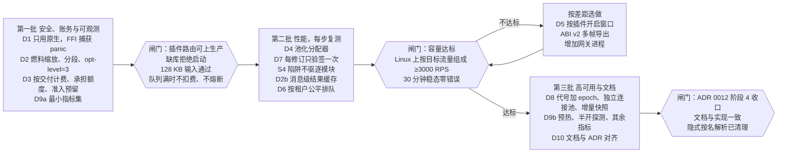

### 7.3 修复后的调用路径

验签和哈希在快照安装时做一次；准入阶段先预留插件额度，容量不足在调用上游之前就拒绝；原生侧用池化分配器，每次调用仍是新实例；结果按三类处理。

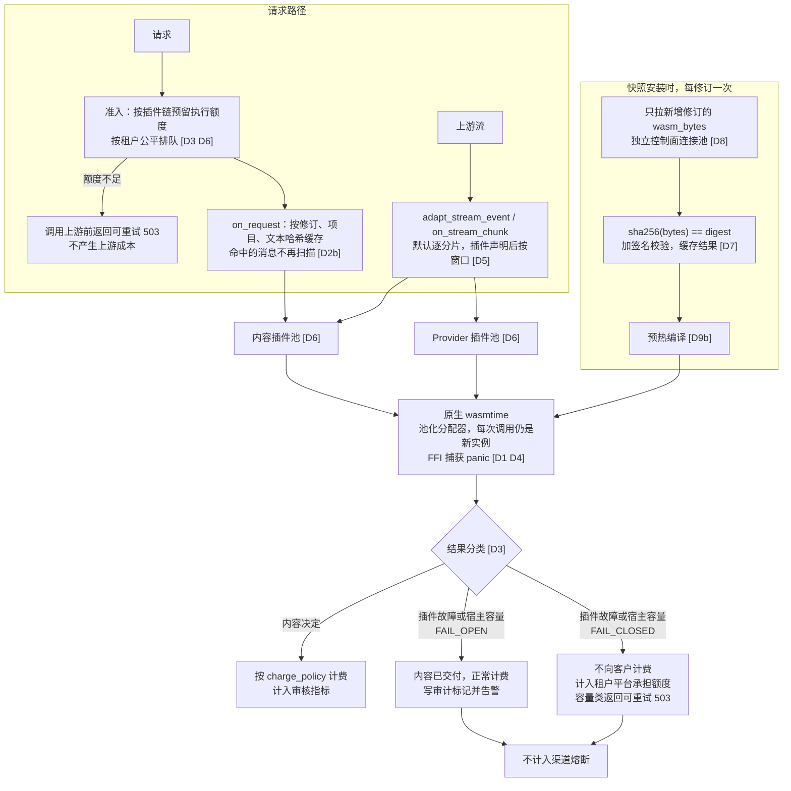

### 7.4 第一批：安全、账务与可观测

**D1 运行时**

- **决定：** 原生 wasmtime 作为唯一运行时，删除 Bun WASM 执行模式。它强制不了燃料和内存，达不到沙箱的要求，留着只会再次静默回退。
- **做法：**
  - 启动时加载原生库，并实例化一个自检模块，失败就拒绝启动。
  - 每个 FFI 导出函数都用 `catch_unwind` 包住，panic 转成错误码，按插件故障处理。
  - 对 `stg_wasm_module_compile` 和 `stg_wasm_invoke` 做模糊测试：随机模块字节、随机输入、非法长度和空指针。
  - CI 产出各目标平台的原生库，`verify-artifact` 检查产物里有目标平台的库。
  - `/readyz` 和指标里暴露运行时类型。
  - wasmtime 现在固定在 27.0.0（2024 年 11 月发布），不是 LTS 版本。按 wasmtime 的发布与支持策略推断，已不在维护窗口内（未联网核实）。升级到仍在维护的版本，并建立跟进安全公告的流程。
- **代价：** 开发和 CI 环境必须构建原生库，现有 FFI 测试本来就要求这个。删除 Bun 模式对没装原生库的部署是破坏性变更，需要在发布说明里写明。
- **验收：** 缺库时启动失败；死循环插件触发 3 次后，空闲 CPU 回到基线；FFI 收到非法参数时返回错误码，进程存活。

**D2 燃料、输入长度与 CPU**

- **实测依据（pii-guard，原生运行时）：**
  - 燃料随输入长度线性增长，每字节约 870–1,090，没有出现二次方增长。按长度放大燃料预算不会让 CPU 失控。
  - 现在的编译设置 opt-level=z 每字节约 38 ns；opt-level=3 约 21 ns，实际耗时少约 45%，燃料只少约 15%。
  - opt-level=3 的产物 31,711 字节，比现在的 26,648 字节大约 19%。
  - schema 允许的最大燃料 50M 只够约 50–57 KB 的文本，光放大预算解决不了长文本。
- **决定：**
  - fuel = 基础预算 + 每字节系数 × 输入长度，系数和单次最大输入长度都在 manifest 里声明。
  - 单次输入超过最大长度时分段扫描，段与段之间有重叠，复用流式路径的 lookahead 逻辑。
  - 内置插件改用 opt-level=3。
  - 调用上游之前按路由插件链的最大输入长度检查请求，超限直接拒绝，避免上游已经扣费才失败。新增的错误码先在 contracts 里定义。
- **验收：** 4、16、64、128 KB 的输入在原生运行时下都能通过，回归用例名注明症状。

**D3 失败分类与计费**

| 类别     | 例子                                               | 处理                                                                                                               | 向客户计费                                                         | 计入渠道熔断 |
| -------- | -------------------------------------------------- | ------------------------------------------------------------------------------------------------------------------ | ------------------------------------------------------------------ | ------------ |
| 内容决定 | 插件返回 BLOCK 或 TRANSFORM                        | 按插件结果执行，计入审核指标                                                                                       | 按 `charge_policy`                                                 | 否           |
| 插件故障 | 陷阱、燃料耗尽、输出非法、FFI panic                | 按 `failure_policy`，发告警                                                                                        | FAIL_OPEN：内容已交付，正常计费；FAIL_CLOSED：不计费，计入平台承担 | 否           |
| 宿主容量 | 准入额度不足、队列满、排队超时、Webhook 超时或熔断 | 准入阶段不足时调用上游前返回可重试 503；回程不足时按 `failure_policy`，FAIL_CLOSED 返回可重试 503 并带 Retry-After | 同插件故障                                                         | 否           |

- **准入预留：** 按路由的插件链估算这个请求要用的插件执行额度（并发许可），拿不到就在调用上游之前返回可重试 503，不产生上游成本。拿到额度的请求在回程优先执行，回程因容量失败的情况降到很少。
- **平台承担额度：** 按租户统计 FAIL_CLOSED 导致的平台承担金额和次数。超出阈值就告警，并按合同约定转为计费或对该租户限流。这样防止有人构造让插件出故障的输入，反复消耗平台的上游成本。
- **其他配套：**
  - adapt_response 本地失败时保留已知的 usage。
  - FAIL_OPEN 写审计标记并计数。
  - 新增的错误码先在 contracts 里定义。
- **验收（均要有集成测试）：**
  - 队列满时 on_response 不产生客户扣费，渠道熔断状态不变。
  - FAIL_OPEN 下正常计费，并有审计标记。
  - 准入额度不足时上游收不到请求。
  - 平台承担额度超限时触发告警和限流。

**D9a 最小插件指标集**

- 插件调用延迟（按插件和 hook）、队列深度、拒绝、超时、陷阱、fail-open 次数、平台承担金额、运行时类型。
- 第二批的每一步都靠这些指标量化收益，D3 的承担额度也靠它计算，所以放在第一批。

### 7.5 第二批：性能

每做一步复测一次，按实测收益决定是否继续下一步。

**实测依据（macOS arm64，Bun 1.4.5，pii-guard，`on_stream_chunk` 短输入）**

- 进程内直接调用原生库，单次约 22–29 µs，其中新建实例约 25 µs。主线程验签每次约 24 µs。
- 传输层合批（每条 postMessage 带 1、4、16、64 个调用）吞吐都在 35k–39k 次/秒，没有收益。
- 多线程同时新建实例会互相争抢，换成池化分配器后争用消失。数据见 B3。

**D4 池化分配器（最先做）**

- **做法：** 在 `stg_wasm_engine_new` 里启用 wasmtime 的池化分配策略，约 5 行改动。不改插件 ABI，每次调用仍是新实例。
- **池化不改变隔离：** 它复用的是内存槽位，实例释放后槽位会清零或重新映射，下一个实例看不到上一次调用的数据。
- **scratchpad 里验证过的配置**（插在 `cranelift_opt_level` 之后）：

```rust
cfg.static_memory_maximum_size(64 << 20);
cfg.memory_guard_size(64 << 10);
let mut pool = wasmtime::PoolingAllocationConfig::default();
pool.total_core_instances(256)
    .total_memories(256)
    .total_tables(256)
    .max_memory_size((max_memory_bytes as usize).max(64 << 20));
cfg.allocation_strategy(wasmtime::InstanceAllocationStrategy::Pooling(pool));
```

- **实施时要处理的点：**
  - 每个 Worker 各建一个 engine（`wasm-host.ts:560`），同时只跑一个调用，池容量可以按每个 Worker 的并发设得很小。实验里设成 256，engine 启动约 1.8 s；缩小池容量预计能消掉这部分开销，未单独测。
  - 池化下单线程单次调用变慢（约 35 µs，默认约 22–25 µs），收益来自多线程不再互相争抢。
  - 池满时实例化会失败，这类失败要归到“宿主容量”。
  - `max_memory_size` 不能小于插件声明的内存上限，否则合法插件会失败。
  - `linear_memory_keep_resident` 等参数可以在内存复用和清零开销之间调。
  - 只在 macOS arm64 上测过。Linux 的内存映射行为不同，必须在 Linux 上复测。

**D7 完整性校验与只验签一次**

- 快照安装时，每个修订只校验一次：`sha256(bytes)==digest` 和签名。
- 缓存 KeyObject 和校验结果。
- 校验失败的修订标记为不可用并告警。
- 补一个签名公钥轮换的流程：新旧公钥并存一段时间，所有修订用新钥重签后再撤掉旧钥。

**S4 陷阱不驱逐模块**

只在编译失败或摘要不符时驱逐，guest 陷阱和燃料耗尽不再触发重编译。

**D2b on_request 消息级结果缓存**

- 按（修订摘要，项目，消息文本哈希）缓存扫描结果，用有界 LRU。
- 只对在 manifest 里声明“结果只取决于输入文本”的插件启用。插件结果可能依赖项目配置，所以缓存键里带项目。
- 多轮对话每轮只扫新增的消息。
- 同一请求内按（修订，输入摘要）去重，备用路由不再重复审计。

**D6 隔离舱**

- 内容插件和 Provider 插件分成两个池。
- 池大小可配置。池化后 8–16 个槽吞吐仍在增长（见 B3），默认值按 CPU 核数和 Linux 复测结果定。
- 按租户公平排队（例如按租户加权轮转），并与准入阶段的插件额度联动。
- Webhook 按插件设并发上限。
- 删除 `async_pool`。

**容量推算**

- 池化后执行池上限约 55k–66k 次/秒（8–16 槽）。这个数没算验签和管线开销，是上限。
- 按每个流 300 个分片、挂 1 个 WASM 内容插件算，单进程约能撑 180–220 个流/秒。
- 如果 3000 RPS 里有 25% 是这种流（每秒 750 个），需要约 4 个网关进程，或者做窗口化。
- 所以第二批做到哪一步就够，取决于目标流量组成（见 7.8）。

**复测不达标时的后备项（按差距选做）**

- **D5 窗口化（按插件开启）：**
  - 插件在 manifest 里声明模式：
    - 改写类（脱敏）：必须扣住窗口内的内容，送审后再发出，延迟有界；
    - 拦截类：内容先发出，按窗口送审，命中就截断；
    - 不声明：保持现在的逐分片行为。
  - 窗口值按实测定，不用估计值。
  - HOLD 模式的“遇到标点就送审”改成按窗口送审，同样按插件开启。
  - schema 的取值范围和运行时保持一致，越界直接拒绝，不再静默截断。
  - 用属性测试验证：把敏感串随机切到窗口边界两侧，窗口化的结果与整段扫描一致。
- **ABI v2 多帧导出：** 一个实例处理多个事件，省掉的是每个事件约 25 µs 的实例化，和已证明无效的传输层合批不是一回事。做成可选的 v2 导出，旧插件继续用 v1，宿主按导出自动选择。
- **增加网关进程：** 改动最小，代价是多占机器。

**合并验收**

- 在 Linux 上，用真实网关、按目标流量组成，跑 ≥3000 RPS 的 30 分钟稳态，零错误。
- 组合至少包含：
  - 多轮 on_request：至少 10 条历史，并含 ≥16 KB 的消息；
  - 流式 WASM 内容插件；
  - WASM Provider SSE；
  - HOLD 模式 Webhook；
  - 现有的混合比例。
- 达不到就如实报告实测差距，不悄悄放宽隔离。

### 7.6 第三批：高可用收尾与文档

**D8 快照**

- `config_epoch` 每次递增时同时写一个随机代号。节点比较（代号，epoch），两者都一致才算新鲜。需要新增迁移字段，字段名在实施时定义。
- 发现分叉（epoch 回退，或者 epoch 相同但代号不同）时：
  - 记录错误事件并告警；
  - 挂插件的路由一律失败关闭，不按数据库内容悄悄重载，避免撤回恢复点之后的撤销；
  - 运维核对并重新执行恢复点之后的撤销，再用一次新的发布（epoch 加 1、新代号）解除。
- API Key、渠道等其他配置同样受恢复点影响，属于 ADR 0011 的 PITR 流程范围，本报告只要求插件路由失败关闭。
- 快照加载和节点心跳改用独立的小连接池，不再和数据面请求抢连接。
- 修订字节不可变，加载时只拉新增修订的 `wasm_bytes`。
- ADR 0011 的 PITR 流程加一步：核对恢复点之后的撤销，并重新执行。

**D9b 冷启动与其余可观测性**

- 快照安装后预热编译，缓存改成 LRU。
- 补齐 D9a 之外的指标。
- Webhook 熔断加半开探测。
- 清理过期的 `gateway_config_nodes`。
- 查清发布预检偶发 422 的原因。

**D10 文档**

- 按实际行为修改 ADR 0009 §5.2 和 §5.3，以及 README:22、README:40、README:74。
- 阶段 4 收尾之前，把 ADR 0012 的状态改成“部分实施”。
- Webhook 超时按 ADR 改成 200 ms；如果有实测理由要用 250 ms，就改 ADR。
- 清理隐式按名解析。

### 7.7 考虑过但不采用的方案

| 方案                                        | 不采用的理由                                                                                                                                 |
| ------------------------------------------- | -------------------------------------------------------------------------------------------------------------------------------------------- |
| 插件放到独立进程（sidecar）                 | 崩溃隔离更强，但多一跳进程间通信，多一个部署单元和故障域。D1 的 panic 捕获加模糊测试已覆盖主要风险，出现无法捕获的崩溃（例如段错误）时再评估 |
| 传输层合批（一条 postMessage 带多个调用）   | 实测每条消息带 1、4、16、64 个调用，吞吐都在 35k–39k 次/秒，没有收益                                                                         |
| 复用实例（Worker 常驻实例，调用之间不重建） | 性能最好，但上一次调用的内存状态会留给下一次，跨租户隔离被破坏。池化分配器已经拿到大部分收益                                                 |
| 保留 Bun 回退作为降级                       | 强制不了燃料和内存，回退就等于隔离失效（B1）                                                                                                 |

### 7.8 需要确认的输入

只有一件事需要业务方决定：3000 RPS 验收的目标流量组成。具体包括：

- 挂插件的流量占多少，挂哪些插件；
- 流式请求的占比和平均分片数；
- 多轮对话的历史长度。

这个组成决定第二批做到池化分配器就够，还是必须继续做窗口化、ABI v2 或增加进程。

## 8. 对外多协议 API：现状与方案

这一节回答：能不能把所有上游接入的模型统一成 OpenAI 或 Claude 格式给调用端用，是不是靠插件实现的。

**结论：已经实现，但不是靠插件。** 格式转换在核心协议层 `packages/protocol`，所有渠道共用。插件只负责“怎么连上某个上游”。现有实现的主要缺口是跨格式时字段覆盖面窄，推荐在核心层补齐，不改成插件。

### 8.1 现状

**调用端能用的格式**

| 格式             | 入口                                                                 | 跨协议转换     |
| ---------------- | -------------------------------------------------------------------- | -------------- |
| OpenAI Chat      | `/v1/chat/completions`                                               | 有             |
| OpenAI Responses | `/v1/responses`                                                      | 有             |
| Claude Messages  | `/v1/messages`                                                       | 有             |
| Gemini           | `/v1beta/models/{model}:generateContent` 和 `:streamGenerateContent` | 有             |
| OpenAI 其他接口  | embeddings、completions、images、audio、moderations、`/v1/models`    | 没有，原样透传 |

入口定义在 `apps/gateway/src/app.ts:211-284`。

**上游方言与内置预设**

渠道绑定的 Provider 插件用 `base_dialect` 声明上游讲哪种格式（`upstream.ts:51-71`）。

| 方言                 | 内置预设                                                                                                   |
| -------------------- | ---------------------------------------------------------------------------------------------------------- |
| `openai_chat`        | openai、azure、deepseek、qwen、moonshot、zhipu、minimax、volcengine、openrouter、ollama、openai-compatible |
| `anthropic_messages` | anthropic、bedrock                                                                                         |
| `gemini`             | gemini、vertex                                                                                             |
| `openai_responses`   | 没有内置预设，数据库插件可以声明                                                                           |

**转换流程**

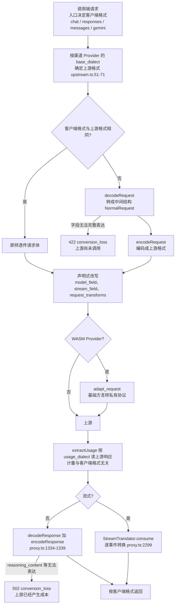

举例：调用端用 Claude 格式请求一个 DeepSeek 模型，流程是 `/v1/messages` → 转成 OpenAI Chat 发给 DeepSeek → 把返回结果和流转回 Claude 格式。

**插件在这里管什么**

- **声明式 Provider 插件：** 配置上游方言、端点、鉴权、模型字段名，以及字段改名、裁剪、限值，还有错误匹配规则和 usage 字段映射。
- **WASM Provider 插件：** 用于私有或非标准协议的上游。核心层先把请求转成插件声明的基础方言，再交给插件改写成私有格式，同时告诉插件客户端用的是哪种格式（`upstream.ts:420-432`）。
- **内容插件（pii-guard 这类）：** 只做审核和脱敏，和格式转换无关。

**性能实测（scratchpad 探针 `convert-bench.ts`）**

- 10 条消息、约 12 KB 的请求，从 Claude 格式转成 OpenAI 格式约 2.3 µs。
- 流式转换每个事件约 1 µs，一个 300 分片的流合计约 0.29 ms。
- 3000 个流/秒算下来不到 1 个 CPU 核。转换不是性能瓶颈。

### 8.2 现状缺口

**1. 跨格式只接受中间结构能完整表达的字段，其他字段一律拒绝**（`request.ts:30-36,124-182`）

- 中间结构能表达的：
  - 内容：文本，以及 png、jpeg、gif、webp 四种图片；
  - 工具：函数工具的定义、调用和结果，以及 `tool_choice`；
  - 参数：输出上限、temperature、top_p、stop、JSON schema 输出。
- 其他字段遇到跨格式就返回 422 `conversion_loss`。同格式透传不受影响。这时上游还没调用，不产生成本。
- 会被拒绝的常见字段：

| 调用格式 | 会被拒绝的字段                                                                                                                                      |
| -------- | --------------------------------------------------------------------------------------------------------------------------------------------------- |
| Claude   | `thinking`、`cache_control`、`metadata`、`top_k`、文档和 PDF、带版本号的内置工具                                                                    |
| OpenAI   | `seed`、`presence_penalty`、`frequency_penalty`、`logprobs`、`parallel_tool_calls`、`reasoning_effort`、`user`、`n>1`、`store`、音频、`strict` 工具 |
| Gemini   | thought signature、远程图片 URL                                                                                                                     |

- **实际影响：** Claude Code 这类客户端通常会带 `metadata` 和 `cache_control`，往往还开着 `thinking`。所以用 Claude 格式调 DeepSeek、Qwen 这类 OpenAI 方言的模型，现在会直接收到 422。

**2. 推理内容在响应侧报 502，而且发生在上游扣费之后**

OpenAI 兼容的上游（DeepSeek、Qwen 等）返回 `reasoning_content` 时，跨格式直接报 502 `conversion_loss`（`response.ts:46-48`）。这一条最急：客户拿不到结果，平台却已经付了上游的钱。

**3. 非对话接口完全不转换**

embeddings、images、audio 等操作不选上游协议，请求原样发出（`upstream.ts:55,204-205`）。只有上游本身兼容 OpenAI 格式时才能用；用 OpenAI 格式调 Gemini 或 Vertex 的 embedding 不会被转换。

**4. Claude 格式的配套接口没跟上**

- `/v1/models` 只返回 OpenAI 格式的列表（`app.ts:211-217`）。
- 错误响应统一是 `{error:{code,message,request_id}}`（`proxy.ts:364-370`），不是 Claude 的 `{type:"error", error:{type,message}}`。SDK 能拿到 HTTP 状态码，但错误类型字段对不上。
- 没有 `/v1/messages/count_tokens`。
- 鉴权已经支持 `x-api-key` 和 `x-goog-api-key`（`proxy.ts:202-206`），这块没有缺口。

**5. Responses 有限制**

只有预设里配了 responses 端点时才直接发给上游，否则转成 Chat（`upstream.ts:60-66`）。`store` 和续接之前的响应会被拒绝。

**6. 选路不看协议**

`router.selectCandidates` 只看渠道支持的操作、健康状态和权重，不看协议（`packages/runtime/src/router.ts:292-304`）。同一个模型同时有同协议和跨协议渠道时，可能选中跨协议渠道，白白损失字段。

### 8.3 方案比较

| 方案                                   | 结论 | 理由                                                                                                                                                    |
| -------------------------------------- | ---- | ------------------------------------------------------------------------------------------------------------------------------------------------------- |
| 每个 Provider 插件自己转换             | 不选 | 每个插件都要为每种客户端格式写一遍转换，计量和流终态没法统一保证。逐帧调用 WASM 又正好是 B3 的性能瓶颈，每次调用 60–80 µs，比核心层贵 60 倍以上         |
| 两两直接转换                           | 不选 | 4 种客户端格式 × 3 种上游格式 = 12 对，每加一种格式成倍增长。保真度略高，但维护成本最高                                                                 |
| 外挂转换服务（LiteLLM 一类的独立代理） | 不选 | 多一跳网络、多一个故障域。预扣和结算要跨进程对账，与精确结算和 3000 RPS 的目标冲突                                                                      |
| 核心层中间结构（现状）                 | 选   | 每种格式只写一对编解码器。计量直接读上游响应（`proxy.ts:1320`），转换出错不影响账务口径。现有 `conversion.test.ts` 已经保证“不静默丢字段”和“流终态正确” |

### 8.4 推荐方案

保留核心层中间结构，在这个基础上补五样东西。

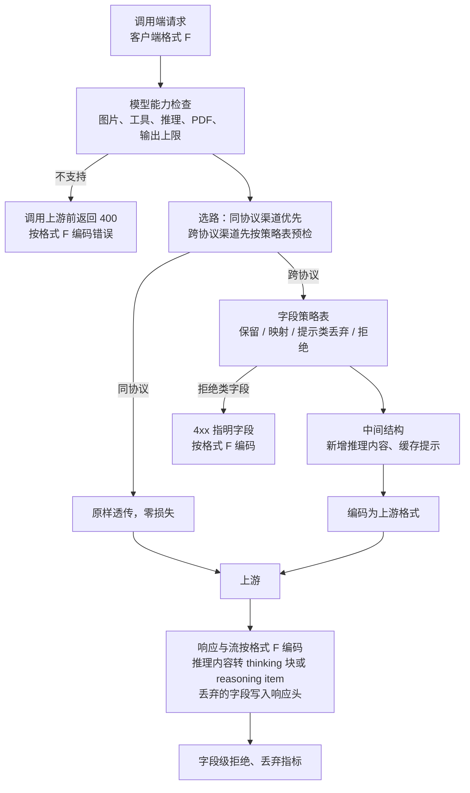

**1. 能不转就不转：同协议优先选路**

- 同一个模型有多个渠道时，优先选和调用端格式相同的渠道。同协议直接透传，既不损失字段，也没有转换开销。
- 选跨协议渠道之前，先按策略表检查这个请求能不能转过去；转不了就跳过这个渠道，而不是发出去再失败。
- 例子：Claude Code 调 claude 模型时走 Anthropic 或 Bedrock 渠道，`thinking`、`cache_control` 原样保留；调 deepseek 时才走跨协议转换。

**2. 字段级转换策略**

每个字段按目标格式归入四类之一，写成一张数据表，不分散在编解码代码里。这张表本身也是测试用例的来源。

| 类别           | 处理                                         | 例子                                                                                                                                |
| -------------- | -------------------------------------------- | ----------------------------------------------------------------------------------------------------------------------------------- |
| 保留           | 中间结构原样表达                             | 文本、图片、函数工具、`tool_choice`、输出上限、temperature、top_p、stop、JSON schema                                                |
| 映射           | 换成目标格式里的等价字段                     | `thinking` ↔ `reasoning_effort` ↔ Gemini 的 `thinkingConfig`；`disable_parallel_tool_use` ↔ `parallel_tool_calls`；缓存用量字段互转 |
| 提示类，可丢弃 | 兼容模式下丢弃，并在响应头里列出被丢弃的字段 | `cache_control`、`metadata`、`user`、`seed`（OpenAI 对 seed 也只承诺尽力而为）                                                      |
| 必须拒绝       | 返回 4xx 并指明是哪个字段                    | `n>1`、音频和视频、目标不支持的 `strict` 校验、托管工具（web search、code execution、computer use）、Responses 的 `store` 和续接    |

- **两种模式，按 API Key 或路由配置：**
  - 严格模式：保持现在的行为，转不了的字段一律拒绝。
  - 兼容模式：只丢弃提示类字段，语义字段仍然拒绝。
- 响应头名称和新增错误码先在 contracts 里定义。
- 按字段统计拒绝和丢弃的次数，用数据决定下一个该补哪个字段。

**3. 补中间结构，先补最常用的字段**

- **推理内容（最急）：**
  - 中间结构加一种推理内容。输出成 Claude 格式时转成 thinking 块，输出成 Responses 格式时转成 reasoning item，解决缺口 2 的 502。
  - 网关自己生成的 thinking 块要打上标记，以后这段历史被发往 Anthropic 时剥掉，否则签名校验会失败。
  - 发往非 Anthropic 上游时，客户端历史里的 thinking 块直接丢弃。
- **缓存：** `cache_control` 只对 Anthropic 有效，对 OpenAI（自动缓存）和 Gemini 丢弃。缓存读写的 token 用量在各格式之间互相转换。计费仍然读上游原始用量，不受影响。
- **其他：** `top_k`、并行工具调用开关、文档和 PDF。上游支持就映射，不支持就按策略丢弃或拒绝。
- **模型能力声明：** 在渠道或模型上声明是否支持图片、工具、JSON schema、推理、PDF，以及最大输出长度。发请求之前就检查，不支持就在调用上游之前返回 400，避免上游已经扣费才失败。

**4. 补齐调用端格式的配套接口**

- **错误格式：** 按调用端格式编码。
  - OpenAI：`{error:{message,type,code}}`。
  - Claude：`{type:"error", error:{type,message}}`，`type` 取 `invalid_request_error`、`rate_limit_error`、`overloaded_error` 等。
  - Gemini：`{error:{code,message,status}}`。
  - 流中途出错也按格式发，例如 Claude 格式发 `event: error`。
- **模型列表：** `/v1/models` 按调用端返回对应格式。
- **count_tokens：** 如果目标调用端用到，补上 `/v1/messages/count_tokens`。上游是 Anthropic 就直接转发，其他上游用本地估算，并在响应里标明是估算值。

**5. 非对话接口只做 embeddings**

- **embeddings 值得做：** OpenAI 格式 ↔ Gemini 的 `embedContent` / `batchEmbedContents` ↔ Bedrock。各家结构简单，用量也只有输入 token。
- **images、audio、moderations 不做通用转换：** 各家的参数、返回形式（URL 还是 base64）、计费维度差别太大。继续透传，只接 OpenAI 兼容的上游，个别需要时用声明式插件做字段映射。

### 8.5 分层职责

| 层                         | 职责                                                                                                                                             |
| -------------------------- | ------------------------------------------------------------------------------------------------------------------------------------------------ |
| 核心层 `packages/protocol` | 所有客户端格式 ↔ 中间结构 ↔ 三种上游格式的编解码，以及策略表、流转换、错误编码                                                                   |
| 声明式 Provider 插件       | 上游讲哪种格式、端点、鉴权、模型能力声明，以及各家厂商的特殊情况（推理字段叫 `reasoning_content` 还是 `reasoning`、伪 200 错误、usage 字段别名） |
| WASM Provider 插件         | 只给私有协议的上游用，负责私有格式和某种基础格式互转，不负责客户端格式的转换                                                                     |
| 内容插件                   | 审核和脱敏，不参与格式转换                                                                                                                       |

### 8.6 测试与验收

- **官方 SDK 对接：** 用官方 SDK（`openai`、`@anthropic-ai/sdk`、`@google/genai`）当调用端，对接 `apps/mock-providers` 里已有的 OpenAI、Anthropic、Gemini 协议 Mock。4 种客户端格式 × 3 种上游格式，12 对组合每对都覆盖：
  - 文本、图片、JSON schema、推理内容；
  - 工具调用，包括并行调用和流式参数；
  - 长度截断、内容过滤、上游报错、流中途断开。
- **真实请求回放：** 录下 Claude Code、Cursor、OpenAI Agents SDK 的真实请求当测试夹具，验证它们在兼容模式下都能跑通。
- **性能：** 跨协议转换的 CPU 开销纳入 3000 RPS 压测。

### 8.7 分阶段与待定事项

| 阶段 | 内容                                                          | 理由                                                  |
| ---- | ------------------------------------------------------------- | ----------------------------------------------------- |
| 1    | 推理内容不再报 502；错误按调用端格式编码；同协议优先选路      | 价值最高，改动集中；推理内容的 502 发生在上游扣费之后 |
| 2    | 策略表、兼容模式、提示类字段的丢弃与响应头告知、字段级指标    | 扩大覆盖面，同时保留严格模式                          |
| 3    | 模型能力声明和发送前校验；`thinking`、缓存、并行工具的映射    | 需要第 2 阶段的指标确定优先级                         |
| 4    | embeddings 转换；按需补 count_tokens 和 Claude 格式的模型列表 | 只在目标调用端需要时做                                |

需要业务方决定两件事：

1. **默认用严格模式还是兼容模式。** 建议默认用兼容模式，只丢弃提示类字段，语义字段仍然拒绝。
2. **首批要支持哪些调用端**（例如 Claude Code、OpenAI SDK、Cursor）。这决定第 3 阶段先补哪些字段。

## 9. 验证记录

实际跑过的只有插件引擎单测和审查探针；全量门禁和带插件的网关全链路压测都没有跑。

### 9.1 已执行

- `bun test packages/plugin-engine`：15 个用例通过，0 失败，242 个断言。
- 主审查探针，位于 `/private/tmp/claude-501/-Users-wr-work-super-token-gateway/c3358c51-9a8d-4aba-84c8-7873cd11216d/scratchpad/`。这是临时目录，重启后可能被清理。
- **初审探针**（`main/` 下）：
  - `memgrow.ts`、`loop.ts`：B1，在 Bun 1.4.4 和 1.4.5 上都跑过。
  - `pii-big.ts`：B2。
  - `invoke-bench.ts`：调用延迟、吞吐和验签开销。
  - `anyleak*.ts`：排除 `AbortSignal.any` 泄漏。
- **补测探针**（macOS arm64，Bun 1.4.5）：
  - `main/fuel-opt.ts`：二分查找 pii-guard 的最小燃料，对比 opt-level=z 和 opt-level=3 的燃料与耗时。两种构建在 `piiopt/` 下。
  - `main/breakdown.ts`：拆分进程内 FFI 调用和 Worker 池调用的开销。
  - `main/batch-main.ts`、`main/batch-worker.ts`：传输层合批。
  - `main/contend-main.ts`、`main/contend-worker.ts`：不同线程数下单次 FFI 调用的耗时，对比默认分配器和池化分配器。
  - `main/pool-e2e.ts`：网关实际使用的 `createBunWasmExecutor` 在不同槽数下的吞吐，对比两种分配器。
  - `wtpool/`：加了池化分配器的原生库副本，构建产物在 `wtpool/target/release/libstg_plugin_wasmtime.dylib`。仓库里的原生库没有改动。
  - `main/convert-bench.ts`：跨协议请求转换和流式转换的 CPU 开销（第 8 节）。
- 子审查的探针在 `routeA/` 和 `routeB/` 下，已确认没有残留进程。
- 版本核对：插件代码修改时间都早于审查开始；重新读了 14:11–14:14 更新的 ADR 0012、README 和混合稳态文档；复核了 15:11 修改的 `scripts/bench-mixed.ts`，它仍然只启用 `on_response` 和 `on_stream_end`（第 37、50 行）。

### 9.2 未执行

- `check`、`lint`、`fmt:check`、全量 `test`、`test:integration`、`build`、`test:artifact`、`test:durability`。这是只读审查，没有跑这些。
- 带插件的网关全链路压测。B3 的数字是插件层的局部测量，真实网关的上限只会更低。
- Linux 上的所有补测，包括池化分配器的效果和 FFI 行为。
- 池化分配器缩小池容量后的启动时间。
- 第 8 节的协议缺口按代码路径核对，没有用官方 SDK 做端到端复现。
- 除 S5 外，其余读代码推断的问题都没有做端到端复现。
