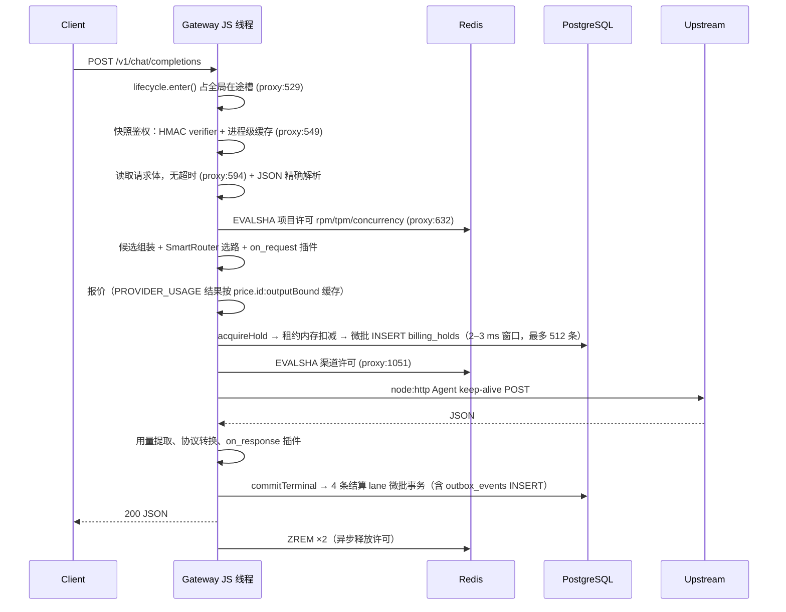

# apps/gateway 深度分析与并发性能报告

- **日期**：2026-11-23
- **对象**：`main` 提交 `1360133`，`apps/gateway` 及其热路径依赖的 `packages/{ledger,runtime,kernel}`
- **被测产物**：在干净工作区执行 `bun run build`，`dist/gateway/main.js` SHA-256 `716d531525c5dc0596d7fcde6da270628e9effe1fb86e6d371e161d30f816dbd`，schema `2026112204`
- **版本边界**：本报告结论、行号与数据均以 `1360133` 为准。压测全部结束后，工作区出现他人在途改动（含未解决冲突的 `apps/gateway/src/proxy.ts`、`packages/ledger/src/settlement-leased.ts`、`packages/runtime/src/cluster.ts`，新增 `packages/runtime/src/bun-http1.ts`、`0006_ledger_settlement_perf.sql` 等）。这些改动不在被测范围内。
- **方式**：只读阅读源码，并沿调用链核实；用仓库现有基准脚本及两个临时变体压测（变体只加参数，见附录）；采集 CPU 画像、PG 等待和 checkpoint 日志。

---

## 0. 结论摘要

1. **短请求吞吐远高于 3000 RPS 底线。** 无上游时延的短 Chat JSON，单网关闭环峰值 **14,214.7 RPS**（1024 并发，P99 110.66 ms）。混合负载（JSON / SSE / WASM / Webhook）固定到达 **6000 RPS** 时，单网关全部发出、全部完成，P99 102 ms。所有零时延轮次成功响应与结算一一对应，无重复，资金守恒。
2. **3000 RPS 固定到达 6 轮通过 5 轮。** 唯一失败的一轮（单网关、32 钱包）有 1,753 笔（0.97%）未由发生器发出，P99 299 ms。同一时间 PG 正在执行一次 26.9 s 的 WAL 触发 checkpoint，该轮每请求 WAL 19.0 KiB，其他轮次为 4.4–8.8 KiB。同配置复测通过，P99 69 ms。尾延迟受存储与同机负载影响，3000 RPS 下单网关 P99 在 69–364 ms 之间波动。
3. **单网关的上限是 JS 主线程 CPU。** 闭环饱和时网关进程 CPU 为 100–113%，上游 Mock 约 10%。双网关闭环时 PG 容器约 2–2.5 核，主机仍有 18–34% 空闲。双网关闭环只有 12.2k–16.3k RPS，没有线性扩展；PG 侧最突出的串行点是 Outbox 全局咨询锁（§7.2）。
4. **真实上游时延下，容量由在途上限决定。** 上游固定 1 s 时延，单网关在 4000 在途时为 3,660 RPS，P99 1,035 ms，网关本身只加约 15–28 ms。默认 `MAX_IN_FLIGHT=2000`，单节点上限约为 2000 / 上游时延。上游平均 5 s 时只有 400 RPS/节点，要达到 3000 RPS 需要扩节点或调大上限（§6.5、F2）。
5. **主要风险**：持有效密钥的单个租户可用慢速上传占满全局准入槽位（F1，代码推断）；`apps/gateway` 唯一的单测没有接入 `bun run test`/`verify`（F3）；容量契约文档引用的脚本和文档已不存在，与当前架构脱节（F4）。

---

## 1. 环境与口径

| 项目         | 值                                                                                                                                                                                                                                        |
| ------------ | ----------------------------------------------------------------------------------------------------------------------------------------------------------------------------------------------------------------------------------------- |
| 主机         | Apple M6，12 核，24 GiB，macOS（Darwin 27.0.0）                                                                                                                                                                                           |
| Bun          | 1.4.5（`package.json` 的 `engines` 写 1.4.4，见 F6）                                                                                                                                                                                      |
| PostgreSQL   | 17.11，OrbStack Linux 容器（虚拟机 12 vCPU / 11.7 GiB），`fsync`、`synchronous_commit`、`full_page_writes` 全开，`wal_sync_method=fdatasync`，`shared_buffers=2.5 GiB`，`max_wal_size=4 GiB`，`checkpoint_timeout=900s`，单实例无同步备库 |
| Redis        | 基准脚本自启 7.4，`--appendonly no --save ""`（当前架构只用于限流与熔断协同）                                                                                                                                                             |
| 拓扑         | 全部进程同机：负载发生器、网关、Mock 上游、Worker、Redis，以及容器内的 PG。macOS `kern.ipc.somaxconn=128`，临时端口区间 49152–65535                                                                                                       |
| 上游         | `dist/mock-providers`，默认零时延，HTTP 明文、IP 直连（不经 DNS、TLS）                                                                                                                                                                    |
| 同机其他负载 | OrbStack 内另有 `oneaster-*`、`new-cms-postgres` 等容器在运行                                                                                                                                                                             |

结果解读口径：

- **闭环**（`bench:single`、`bench:prod --limit`）：固定并发 worker 循环发请求，衡量饱和吞吐与对应延迟。
- **固定到达**（`bench:prod --mixed-soak`）：按计划时刻发请求，最多 1024 在途；按 50% JSON、25% SSE、12.5% 内置 WASM 脱敏 JSON、12.5% Webhook 脱敏 SSE 轮转。逐笔校验正文、脱敏和终态，按模型核对用量、金额和插件审计。
- 每轮结束后脚本校验：零错误、成功数等于结算数、无重复结算、无开放或未知预扣、无活跃租约、资金守恒。
- 进程 CPU 来自 `ps %cpu`，macOS 上是衰减平均，只作量级参考。

---

## 2. 架构与职责

```
Bun.serve(public :8080)  ── Hono publicApp ── handleInferenceRequest (proxy.ts)
Bun.serve(internal :8081) ─ /metrics + Hono internalApp (internal-api.ts, 角色鉴权 + 审计)
                                   │
   SnapshotManager (snapshot.ts) ──┤ 内存配置快照: keys/projects/models/routes/channels/prices/plugins
   ClusterCoordinator (runtime) ───┤ Redis Lua 限流许可 + 熔断/epoch 广播 (无 Redis 时本地限流)
   SmartRouter (runtime) ──────────┤ 候选排序、熔断、探测
   LedgerEngine (ledger) ──────────┤ 资金租约 + 微批预扣 + 微批结算 + Outbox
   Transport (runtime http-pool) ──┤ node:http Agent 连接池 + DNS 钉扎 + 私网防护
   PluginPipelineEngine ───────────┘ 内容插件 (WASM Worker / Webhook)；渠道插件 (WASM)
```

| 文件（HEAD 行数）                                                                               | 职责                                                                                                             |
| ----------------------------------------------------------------------------------------------- | ---------------------------------------------------------------------------------------------------------------- |
| `main.ts`（58）                                                                                 | 启动两个 `Bun.serve`，处理信号与排空                                                                             |
| `config.ts`（218）                                                                              | 环境变量校验与默认值；生产强制独立模式、内部凭据、控制面库和 Redis                                               |
| `app.ts`（469）                                                                                 | 组装运行时：三个 PG 池（数据面 32 / 快照 2 / 控制面 4）、WASM 执行器、路由器、集群、账本、插件引擎；注册公开路由 |
| `proxy.ts`（2922）                                                                              | 推理热路径：鉴权、解析、限流、选路、插件、报价、预扣、上游调用、协议转换、用量提取、结算、SSE 中继               |
| `upstream.ts`（1519）                                                                           | 构造上游请求（协议转换、鉴权方案、渠道插件）、文本抽取与替换、Bedrock 事件流                                     |
| `internal-api.ts`（1750）                                                                       | 管理面 API，Zod 校验、角色模型（ops / catalog / security / finance / auditor / events）、审计双写                |
| `snapshot.ts`（384）                                                                            | 快照加载与轮询、epoch 谱系分歧检测、插件完整性校验、渠道密钥解密缓存、插件撤销信号                               |
| `observability.ts`（425）                                                                       | Prometheus 计数器与直方图、访问日志                                                                              |
| `stream-relay.ts`（215）                                                                        | 有背压的 SSE 中继（`highWaterMark` 64 KiB）                                                                      |
| `responses-moderation.ts`、`tool-policy.ts`、`plugin-release-validation.ts`、`internal-auth.ts` | Responses 流审核、未计量工具拒绝、插件发布校验、内部凭据                                                         |

`proxy.ts` 的 `handleInferenceRequest`（第 440 行至文件末尾）是一个约 2,500 行的单函数，靠闭包变量（`holdAcquired`、`holdFinalized`、`anyUnknownAttempt`、`pendingSwitchFrom` 等）维护状态机。每条错误分支都要自己选择 `releaseHold` 或 `markUnknown`，并释放探测和限流许可。这是正确性风险最集中的地方，在途改动也正集中在这里。

---

## 3. 请求热路径

以非流式 Chat 为例，括号为 HEAD 行号：



每请求的固定外部 I/O：Redis 2 次 EVALSHA 和 2 次异步 ZREM；PG 1 次批量预扣语句和 1 次批量结算事务，均需 WAL fsync；上游 1 次。资金租约（每钱包、每供应账户 × lane）把预扣变成内存扣减加批量插入。所以单钱包热点仍有 11.2k RPS（§6.1）。

---

## 4. 并发控制与资源边界

| 机制            | 默认值                                                                                 | 位置                                            | 说明                                                                 |
| --------------- | -------------------------------------------------------------------------------------- | ----------------------------------------------- | -------------------------------------------------------------------- |
| 全局在途上限    | `MAX_IN_FLIGHT=2000`                                                                   | `config.ts:193`、`runtime/lifecycle.ts`         | 超限立即 503 `overloaded`；SSE 存续期间一直占用                      |
| 上游连接池      | `clamp(MAX_IN_FLIGHT, 1024, 16384)`                                                    | `app.ts:70`、`runtime/http-pool.ts`             | 全局槽位，等待队列同样大小，满则 `upstream_capacity`                 |
| 项目 / 渠道限流 | 每请求 2 个 Redis 许可                                                                 | `runtime/cluster.ts:321`                        | 许可 TTL 为 `HOLD_TTL_MS`（60 s），每 TTL/3 续租；Redis 不可用则 503 |
| PG 数据面池     | `DB_MAX_CONNECTIONS=32`                                                                | `config.ts:170`                                 | 另有快照池 2、控制面池 4                                             |
| 预扣微批        | 窗口 3 ms；有租约的快路径每批最多 512 条、并发 4；无租约的事务慢路径每批 64 条、并发 1 | `app.ts:184`、`ledger/hold-acquisition.ts`      | 基准设置窗口 2 ms、批量 512 / 256                                    |
| 结算微批        | 4 条 lane，每条并发 1，另有 direct 并发 2                                              | `ledger/settlement-dispatch.ts`、`funds.ts:151` | 按项目哈希分 lane，lane 内串行                                       |
| 资金租约        | TTL 15 s，空闲 250 ms 释放                                                             | `ledger/lease-manager.ts:12-14`                 | 每 100–500 ms 维护一次                                               |
| WASM 池         | 内容 4、渠道 4                                                                         | `config.ts:205-206`                             | 每进程                                                               |
| HTTP 空闲超时   | 公开 120 s，内部 60 s                                                                  | `main.ts:11,21`                                 | 收发任意字节即重置                                                   |

---

## 5. 压测方法

所有被测进程从同一份 `dist` 启动，每轮新建隔离库，结束后删除。命令见附录。

| 编号 | 脚本                                     | 拓扑                              | 负载                                                                     |
| ---- | ---------------------------------------- | --------------------------------- | ------------------------------------------------------------------------ |
| A    | `bench:single` + `BENCH_PG_WAITS=1`      | 1 网关，无 Redis，2 Mock，32 钱包 | 闭环 JSON 128 → 1024 并发，SSE 512，热钱包 512，各 10 s                  |
| B    | `bench:single` + `BENCH_CPU_PROFILE_DIR` | 同 A                              | 闭环 JSON 768 并发 10 s，采集 CPU 画像                                   |
| C    | 变体 `bench-single`                      | 同 A                              | 访问日志开 / 关 A/B，512 和 1024 并发                                    |
| D    | `bench:prod --limit`                     | 2 网关 + Redis + Worker           | 闭环 JSON 1024 和 2048 并发，8 s，连接预热                               |
| E    | `bench:prod --mixed-soak` 及钱包数变体   | 1 或 2 网关 + Redis + Worker      | 固定到达 1500 / 3000 / 6000 RPS，60 s                                    |
| F    | 变体 `bench-single`                      | 1 网关                            | Mock 上游时延 1 s，`MAX_IN_FLIGHT=10000`，闭环 1000 → 6000 并发，各 15 s |

---

## 6. 结果

### 6.1 单网关闭环（A）

| 阶段   | 并发 |    完成 |          RPS | P50 ms | P95 ms | P99 ms | WAL B/请求 | 网关 RSS MiB | 网关 CPU |
| ------ | ---: | ------: | -----------: | -----: | -----: | -----: | ---------: | -----------: | -------: |
| JSON   |  128 |  73,294 |      7,321.5 |  17.10 |  24.26 |  28.46 |      4,645 |        307.8 |      80% |
| JSON   |  256 | 100,271 |     10,009.2 |  25.06 |  34.66 |  39.43 |      4,109 |        239.8 |      85% |
| JSON   |  512 | 127,786 |     12,751.0 |  39.30 |  53.48 |  60.93 |      3,792 |        261.6 |      99% |
| JSON   |  768 | 137,330 |     13,681.3 |  54.76 |  74.25 |  90.71 |      3,702 |        292.9 |     104% |
| JSON   | 1024 | 142,633 | **14,214.7** |  70.25 |  95.18 | 110.66 |      4,131 |        316.1 |     113% |
| SSE    |  512 |  92,024 |      9,165.7 |  54.75 |  74.19 |  83.05 |      3,922 |        394.0 |     108% |
| 热钱包 |  512 | 112,473 |     11,217.2 |  42.96 |  54.31 |  93.87 |      3,482 |        410.6 |      75% |

总计 800,226 个成功响应，错误 0；800,226 笔 SETTLED 结算，重复 0；排空后在途 0，活跃租约 0；守恒审计全部通过。512 并发起吞吐增长放缓，网关 CPU 达到单核上限。

### 6.2 访问日志 A/B（C）

| 访问日志                            | 512 并发 RPS | 1024 并发 RPS | 1024 P99 ms |
| ----------------------------------- | -----------: | ------------: | ----------: |
| 开（写入文件，约 25 s 产生 115 MB） |     12,480.9 |      13,360.7 |      130.49 |
| 关                                  |     12,489.4 |      13,486.4 |      134.22 |

差异不超过 1%，在噪声范围内。生产默认开启访问日志不构成瓶颈；写入管道或日志采集器的情况未测。另外，同一 1024 档在 A 和 C 两轮相差约 6%（14.2k 对 13.4k），可视为本机轮间噪声的量级。

### 6.3 双网关 + Redis 闭环（D）

| 轮次       | 并发 |    完成 |      RPS | P50 ms | P99 ms | 合计网关 RSS MiB |
| ---------- | ---: | ------: | -------: | -----: | -----: | ---------------: |
| D1         | 1024 |  98,187 | 12,180.5 |  78.99 | 185.36 |            536.0 |
| D1         | 2048 | 107,846 | 13,344.8 | 148.09 | 268.15 |            646.3 |
| D2（复测） | 2048 | 131,398 | 16,302.5 | 120.17 | 347.32 |            697.2 |

错误 0，结算唯一，守恒通过。D2 期间按秒采样：PG 容器 CPU 205–255%，主机空闲 18–34%。双网关没有比单网关多出一倍吞吐，同机的发生器、两个网关、Mock、Worker 与 PG 争用 CPU 是原因之一，PG 侧的全局串行点见 §7.2。同档两轮相差 22%，单轮双网关数字不宜单独引用。

### 6.4 固定到达混合负载与 3000 RPS 底线（E）

按执行顺序：

| 轮次 | 网关 | 钱包 | 目标 RPS | 计划 / 完成       | 未发出 | 最大欠账 | 调度滞后 P99 | P99 ms（服务 P99） | 每请求 WAL | 结果           |
| ---- | ---: | ---: | -------: | ----------------- | -----: | -------: | -----------: | ------------------ | ---------: | -------------- |
| E1   |    1 |   32 |     3000 | 180,000 / 178,247 |  1,753 |    1,753 |         6 ms | 299（296）         |   19.0 KiB | **失败**       |
| E2   |    1 |   32 |     1500 | 90,000 / 90,000   |      0 |       19 |         6 ms | 140（137）         |    8.8 KiB | 通过           |
| E3   |    2 |   32 |     3000 | 180,000 / 180,000 |      0 |       36 |         6 ms | 148（145）         |    5.6 KiB | 通过           |
| E4   |    2 | 1000 |     3000 | 180,000 / 180,000 |      0 |       21 |         6 ms | 91（88）           |    7.2 KiB | 通过           |
| E5   |    1 | 1000 |     3000 | 180,000 / 180,000 |      0 |      487 |        35 ms | 364（301）         |    7.2 KiB | 通过，尾延迟高 |
| E6   |    1 |   32 |     3000 | 180,000 / 180,000 |      0 |       40 |         6 ms | 69（66）           |    5.3 KiB | 通过           |
| E7   |    1 |   32 |     6000 | 360,000 / 360,000 |      0 |      138 |         6 ms | 102（100）         |    4.4 KiB | 通过           |
| E8   |    2 |   32 |     6000 | 360,000 / 360,000 |      0 |    1,217 |       101 ms | 259（219）         |    4.5 KiB | 通过，尾延迟高 |

所有轮次 HTTP、传输、协议和脱敏错误均为 0。逐笔用量、金额和插件审计误差为 0，钱包与供应资金单元无差异，排空后无开放或未知预扣，守恒通过。单网关 E7 时网关 CPU 约 82%，四个分道 P99 为 93–114 ms。

**E1 失败归因（相关性证据）**：E1 的输出文件最后写入时间为 17:16:46 UTC。PG 日志记录了 `checkpoint starting: wal`（17:16:21）至 `checkpoint complete`（17:16:48），共写 127,624 个缓冲区（shared_buffers 的 48.7%），历时 26.9 s，与 E1 窗口最后约 10 s 重叠。未发出的请求集中在窗口末尾（60 s 处仍为 0，60.2 s 时变为 1,753）。E1 的提交事务数 26,363，其他 3000 档为 39k–58k，说明提交变慢、批次变大。同配置的 E6 通过，P99 69 ms。以上能把 E1 归因到存储 checkpoint，但不是因果证明。

**曾检验并排除的假设**：资金租约空闲 250 ms 释放，契约口径的 1000 钱包下每钱包约 3 RPS，可能导致租约反复开关、进入串行慢路径。E4（双网关，1000 钱包）P99 91 ms，反而好于 E3（32 钱包）的 148 ms，因此租约开关不是 3000 档的主因。E5 的 364 ms 是否来自租约开关无法与噪声区分。

**对 3000 RPS 契约的判定边界**：本组在单 PG 实例、无同步备库、Redis 无持久化、32 或 1000 钱包、60 s 窗口下取得。契约要求的 PG 同步备库、外部消费者 ACK 交集、两轮 60 s 后 60 分钟长测均未执行（见 F4、§10）。只能说当前架构的单机推理链路在本口径下能承载 3000–6000 RPS，不等于契约验收通过。

### 6.5 上游时延 1 s 的在途并发（F）

| 并发 |   完成 |     RPS |   P50 ms |   P99 ms | 网关 RSS MiB | 网关 CPU |
| ---: | -----: | ------: | -------: | -------: | -----------: | -------: |
| 1000 | 15,000 |   960.1 | 1,028.46 | 1,079.81 |        314.1 |      35% |
| 2000 | 30,000 | 1,899.2 | 1,018.37 | 1,052.13 |        418.8 |      37% |
| 4000 | 58,589 | 3,660.4 | 1,015.10 | 1,034.74 |        527.6 |      36% |
| 6000 |  3,427 |    无效 |        — |        — |        535.3 |        — |

- 1000–4000 在途时吞吐约等于在途数除以时延，网关自身开销约 15–28 ms（P50），CPU 只有约 36%。
- RSS 从 1000 在途到 4000 在途增加 213.5 MiB，约 **73 KiB / 在途请求**（阶段末单点采样，粗略估计）。
- 6000 档无效：发生器出现 42,922 次 `connect EADDRNOTAVAIL`。同机回环上，客户端到网关、网关到 Mock 的连接加上前几档留下的 TIME_WAIT，耗尽了 16k 临时端口。这是单机测试环境的限制。该档结束后结算 109,367 笔，成功响应 107,272 笔，即 2,095 笔已结算但客户端未收到成功；另有 92 笔 UNKNOWN 预扣（该夹具没有 Worker 做后续处理），守恒审计通过。这符合“上游已派发后客户端断开仍保留资金责任”的设计，但本轮没有逐笔核对断开时序。
- 推论：默认 `MAX_IN_FLIGHT=2000` 时，单节点吞吐上限约为 2000 / 平均上游时延，1 s 时约 1,900 RPS，5 s 时约 400 RPS，20 s 时约 100 RPS。

### 6.6 CPU 画像（B，768 并发，13,268.6 RPS，6,281 个样本）

按自身样本数排序（画像器会把空闲期计入定时器回调的时间，`maintainLeases` 的 4 个样本显示 1.00 s 即属此类，因此按样本数而非时间排序）：

|               占比 | 函数                                                          | 归属                                                                                   |
| -----------------: | ------------------------------------------------------------- | -------------------------------------------------------------------------------------- |
|               9.2% | 原生 `(anonymous)`，由 `processTicksAndRejections` 调用       | `handleInferenceRequest` 的 Promise 续体调度                                           |
|               7.5% | `quoteElement`（6.5%）+ `/[\\"]/g`（1.0%），经 `arrayLiteral` | Bun SQL 把 `unnest(${array}::type[])` 参数序列化为文本数组字面量（预扣与结算批量语句） |
|               6.9% | `writeBuffered`，经 `_write` / `_writev`                      | `node:http` 客户端向上游写 socket                                                      |
|               4.6% | `JSON.stringify`                                              | `stringifyExact`、供应预扣 JSON、`canonical`、指标键                                   |
|               4.2% | `AbortSignal.any`                                             | 每请求组合 4–6 个信号                                                                  |
| 1.9% / 1.7% / 1.4% | `Response`、`BigInt`、`toString`                              | 响应构造、精确金额                                                                     |

### 6.7 PG 活动采样（A，每 53 ms 一次，覆盖全部阶段）

|    样本数 | 等待 / 语句                                                        |
| --------: | ------------------------------------------------------------------ |
|       755 | 运行中：批量语句                                                   |
|       499 | 运行中：预扣栅栏（`active_wallet_leases` CTE）                     |
|   **479** | **`Lock:advisory`：`INSERT INTO public.outbox_events`**            |
| 299 / 248 | `IO:WalSync`：预扣栅栏 / COMMIT                                    |
|       188 | 运行中：结算锁（`FOR NO KEY UPDATE`）                              |
|       155 | `LWLock:WALWrite`                                                  |
|  约 1,000 | autovacuum 的 `VacuumDelay` / `VacuumTruncate`（后台，非前台等待） |

---

## 7. 瓶颈分析

### 7.1 单网关：JS 主线程

闭环吞吐在 512 并发后趋平，网关 CPU 达到 100–113%，PG 与主机仍有余量，上游 Mock 只用约 10% CPU。Bun 的请求处理、JSON 解析与序列化、`node:http` 兼容层、Bun SQL 参数编码都在同一个 JS 线程上。画像中可直接优化的约占 20%：SQL 数组字面量 7.5%、`node:http` 写入 6.9%、`AbortSignal.any` 4.2%，以及部分 `JSON.stringify`。单进程横向扩展依赖多实例。

### 7.2 多网关：Outbox 全局咨询锁

`0001_v4_schema_upgrade.sql:88-100` 在 `outbox_events` 上建了语句级 `BEFORE INSERT` 触发器，执行 `pg_advisory_xact_lock(81442591, 1)`。结算事务在事务内插入 Outbox（`settlement-leased.ts:537`、`settlement-direct.ts:720`），所以**全集群所有结算事务从插入 Outbox 起到提交（含 WAL fsync）止，全局串行**。这样做是为了保证 Outbox 序号按提交顺序可见、消费者不漏投，正确性上必要；代价是整库结算吞吐上限约为批量大小除以（锁持有时间 + fsync）。单网关时微批能摊薄这段时间，多网关时各节点 4 条 lane 都会在这把锁上排队，这与双网关吞吐不能线性增长一致。工作树中的在途分支 `perf/settlement-outbox-50pct` 似乎正在处理此处，本报告未评估其改动。

### 7.3 存储：WAL 与 checkpoint

闭环 JSON 每请求 WAL 3.5–4.6 KB，混合负载 4.4–8.8 KiB。3000 RPS 约 13–26 MB/s，每天 1.1–2.2 TB WAL。本次日志中 WAL 触发的 checkpoint 间距约 2.1 GB（`max_wal_size=4 GiB`），按上述速率约每 1.5–3 分钟一次，期间全页写放大和 I/O 争用会推高提交时延（E1）。本机 PG 在 OrbStack 虚拟机内，`fdatasync` 落到虚拟磁盘，耐久语义和时延都不代表生产存储。

---

## 8. 发现

严重程度：**中** 指影响可用性或容量判断、建议放行前处理；**低** 指工程质量或可观测性问题。

### F1（中）持有效密钥的单个租户可用慢速上传占满全局准入槽位

- **路径**：`proxy.ts:529` 先占全局槽位（`lifecycle.enter()`），`:549` 鉴权，`:594` 读请求体，`:632` 才获取项目并发许可。
- **问题**：JSON 请求体读取没有截止时间。`readRequestBytesFast`（`:159-178`）在 `content-length ≤ 256 KiB` 时直接 `await req.bytes()`，否则用 `readBounded`，两者都只响应客户端断开信号。只有 multipart 路径加了 `AbortSignal.timeout(attemptTimeoutMs)`。`Bun.serve` 的 `idleTimeout: 120` 在收到任意字节后就会重置。
- **影响**：持有效密钥的客户端每 100 s 左右发 1 个字节，就能长期占住槽位；2,000 个这样的连接即可让所有租户收到 503 `overloaded`。项目 `concurrency` 限额在读完请求体后才生效，挡不住。
- **验证状态**：代码推断，未动态复现。
- **建议**：给请求体读取加截止时间（例如沿用 `attemptTimeoutMs`，或单独设置 `BODY_READ_TIMEOUT_MS`），或在读请求体之前先取项目并发许可或按租户的在途计数。

### F2（中）默认在途上限与真实上游时延下的容量

- 单节点吞吐上限约为 `MAX_IN_FLIGHT / 平均上游时延`（§6.5 实测吻合）。默认 2000、上游平均 5 s 时只有 400 RPS/节点，3000 RPS 需要约 8 个节点，或把上限调到 15,000 以上：按 73 KiB/在途估算约 1 GiB RSS，还需要相应的文件描述符和端口预算。
- 容量契约中 5 / 30 / 120 s 流各需约 15k / 90k / 360k 在途，远超默认值。
- 现有基准都用零时延上游，“14k RPS”不能直接用于真实 LLM 流量的容量规划。
- **建议**：在部署文档中给出 `MAX_IN_FLIGHT` 与内存、FD、端口的配比；在基准中加入 1–30 s 上游时延与长流场景，并分机部署发生器。

### F3（中）`apps/gateway` 单测没有接入测试门禁

`package.json` 的 `test` 只列出 `scripts/__test__ tests/unit packages/{kernel,contracts,protocol,runtime,plugin-engine}/src/__test__`；`test:integration` 只跑 `tests/integration`。`apps/gateway/src/__test__/snapshot.test.ts`（4 个用例，覆盖 epoch 谱系分歧、插件完整性、SSE 文本抽取）不在任何门禁内，CI 的 `verify` 不会执行。单独运行 `bun test apps/gateway/src/__test__` 时 4 个通过、0 个失败。`packages/ledger` 没有模块单测目录，账本行为只由 `tests/integration` 覆盖。

### F4（中）容量契约文档与当前实现脱节

- `docs/performance/capacity-contract.md` 有 7 处引用 `scripts/bench-system.ts` 与 `beyond-new-api/13-execution-core.md`，仓库中均不存在。
- 契约要求的“证据 Redis AOF always + 副本确认”“执行 Core”属于已移除的架构；当前 Redis 只做限流，基准以 `--appendonly no` 启动。`.env.local` 中的 `QUEUE_REDIS_URL` 和 `QUEUE_REQUIRED_REPLICAS` 在 `apps/`、`packages/`、`scripts/`、`tests/` 中都没有引用。
- 契约口径为均匀 1000 钱包、PG 同步备库、外部 ACK 交集、60 分钟长测；现有 `bench:prod` 固定 32 钱包（`scripts/bench-prod.ts:395`）、单 PG、无外部 ACK 交集统计。
- 后果：没有一个仓库内脚本能按契约口径判定 3000 RPS 是否达标。
- **建议**：按当前架构重写契约（列出仍有效的耐久要求），让 `bench:prod` 支持钱包数与同步备库参数，并把 checkpoint 纳入长测证据。

### F5（低）文档中的性能数字无法在本机同口径复现

`gateway-mixed-soak-2026-11-22.md` 记录单网关峰值约 16.0k–16.3k RPS、双网关约 18.6k–19.5k RPS。本次单网关 13.4k–14.2k，双网关 12.2k–16.3k，同档轮间差异最大 22%。文档没有记录对应的 PG 部署形态和同机负载，无法判断是代码回退还是环境差异。HEAD 提交 `1360133` 的说明写的是测试增强，实际改动了 `proxy.ts` 761 行、`internal-api.ts` 327 行，性能数字与构建的对应关系难以追溯。

### F6（低）运行时版本声明与实际不一致

`package.json` 声明 `packageManager: bun@1.4.4`、`engines.bun: 1.4.4`。本机与 2026-11-22 性能文档都用 1.4.5，`dist/manifest.json` 也记录 1.4.5。`.local/toolchain/bun-1.4.4` 存在但未被 `PATH` 使用。

### F7（低）热路径中未被基准覆盖的分支

- `runtime/network.ts` 的 `safeFetch` 对主机名每请求调用一次 `node:dns/promises` 的 `lookup`，应用层没有缓存。基准上游都是 IP 直连，这一分支的成本未测；Bun 内部是否缓存 DNS 未核实。
- HTTPS 上游的 TLS 握手与 `https.Agent` 复用未测。
- 访问日志写入管道或日志采集器的成本未测（写文件已测，见 §6.2）。

### F8（低）进程级鉴权缓存

`proxy.ts:135-158` 的 `verifiedKeyCache` 是模块级 `Map`，以原始 API Key 为键，达到 4,096 条后整表清空。活跃密钥超过 4,096 时会反复清空，每次清空后所有请求都要重算 HMAC（成本低，但会抖动）。同一进程内的多个运行时实例（例如测试）会共享 `verifiedKeyCache`、`quoteCache` 和 epoch 状态。建议改为 LRU，并放到运行时实例内部。

### F9（信息）基准发生器的局限

- `mixed-schedule.ts` 每个 tick 最多补发 `min(64, ceil(rate × 15 ms))` 个请求，tick 之间 `Bun.sleep(5)`。发生器事件循环一次停顿超过约 15 ms 就会开始积压，0.97% 以内的积压也不会体现在调度滞后 P99 上。
- 进程资源采样使用同步的 `spawnSync("ps")`，会阻塞发生器的事件循环。
- 发生器与被测进程同机，6000 在途以上会耗尽临时端口（§6.5）。

---

## 9. 优点（经本次实测确认）

- 零时延闭环 6 轮（A、B、C 两轮、D 两轮）共 1,830,718 个成功响应，固定到达 8 轮共 1,709,847 个（均含预热），成功响应与结算一一对应，无重复，资金守恒。上游时延轮（F）因 6000 档发生器端口耗尽，结算 109,367 笔、成功响应 107,272 笔，有 92 笔 UNKNOWN 预扣，同样无重复且守恒（§6.5）。
- 资金租约加微批，把单钱包热点做到 11.2k RPS，P99 93.87 ms。
- 预扣与结算都会按 PG 错误类别分别退回慢路径或拆批重试；失败时释放内存租约。
- SSE 中继有背压；上游连接池有全局槽位与等待队列上限。
- 在途、租约与微批队列在空闲后都能排空：每轮结束后在途为 0、活跃租约为 0。

---

## 10. 未执行与限制

- 未执行 `bun run check`、`lint`、`fmt:check`、`test`、`test:integration`、`test:artifact`、`test:durability`。本次没有修改任何运行时代码、测试或配置。只执行了 `bun run build`（生成被测产物）和 `bun test apps/gateway/src/__test__`（4 通过）。
- 未测：PG 同步备库、Redis Sentinel 故障切换、60 分钟长测、契约口径的外部 ACK 交集、真实供应商、TLS 与 DNS 上游、长流（5 / 30 / 120 s）、多机部署。
- 所有进程同机运行，PG 位于虚拟机内，吞吐与尾延迟受同机竞争和虚拟磁盘影响，轮间差异最大约 22%。
- 本机 `TMPDIR` 下有 4 个 2026-11-22 22:20–22:27 遗留的 `stg-bench-*` 临时目录，不是本次产生，未处理。

---

## 11. 建议（按优先级）

| 优先级 | 建议                                                                                                                                                 | 关联   |
| ------ | ---------------------------------------------------------------------------------------------------------------------------------------------------- | ------ |
| P1     | JSON 请求体读取加截止时间，或在读请求体前先占租户级在途许可                                                                                          | F1     |
| P1     | 发布 `MAX_IN_FLIGHT` 容量配比，基准加入上游时延与长流场景，发生器分机                                                                                | F2     |
| P1     | 把 `apps/gateway/src/__test__` 加入 `bun run test`                                                                                                   | F3     |
| P1     | 按当前架构重写容量契约，让 `bench:prod` 支持钱包数、同步备库和长测 checkpoint 证据                                                                   | F4     |
| P2     | 评估 Outbox 排序方案，缩短或拆分全局咨询锁的持有区间，以提升多网关吞吐                                                                               | §7.2   |
| P2     | 热路径 CPU：批量参数改用 JSON 或 `jsonb_to_recordset` 等方式，减少数组字面量编码；上游客户端从 `node:http` 换成原生实现；减少 `AbortSignal.any` 组合 | §6.6   |
| P2     | 生产 PG 按实测 WAL 速率配置 `max_wal_size` 与 `checkpoint_completion_target`，并监控 checkpoint 时长                                                 | §7.3   |
| P3     | 性能证据记录构建 SHA、PG 部署形态、同机负载和 checkpoint 日志                                                                                        | F5、F9 |
| P3     | 鉴权缓存改为实例内 LRU；统一 Bun 版本声明                                                                                                            | F6、F8 |

---

## 附录 A：复跑命令

```sh
bun run build
BENCH_PG_WAITS=1 bun run bench:single
BENCH_CPU_PROFILE_DIR=<dir> BENCH_JSON_CONCURRENCY=768 BENCH_SECONDS=10 bun --env-file=.env.local scripts/bench-single.ts
BENCH_JSON_CONCURRENCY=1024,2048 bun run bench:prod --limit
BENCH_GATEWAY_NODES=1 BENCH_SOAK_SECONDS=60 BENCH_SOAK_RPS=3000 bun run bench:prod --mixed-soak
BENCH_GATEWAY_NODES=1 BENCH_SOAK_SECONDS=60 BENCH_SOAK_RPS=1500 bun run bench:prod --mixed-soak
BENCH_GATEWAY_NODES=2 BENCH_SOAK_SECONDS=60 BENCH_SOAK_RPS=3000 bun run bench:prod --mixed-soak
docker logs super-token-gateway-postgres-1 --since 30m | grep checkpoint
```

## 附录 B：临时变体（未入库）

变体放在会话临时目录，只把相对导入改成绝对路径，并增加以下参数：

- `bench-single` 访问日志变体：`ACCESS_LOG` 取 `BENCH_ACCESS_LOG`；网关 stdout 可写入 `BENCH_GW_LOG` 指定的文件。
- `bench-single` 上游时延变体：在上一个变体基础上，`MAX_IN_FLIGHT` 取 `BENCH_MAX_IN_FLIGHT`；若设置 `BENCH_UPSTREAM_DELAY_MS`，向两个 Mock 的 `/__control/scenarios` 为 `bsingle-up` 设置 `headerDelayMs`。
- `bench-prod` 钱包数变体：项目（钱包）数量取 `BENCH_PROJECTS`，默认 32。E4、E5、E6、E7、E8 由此变体运行，E6 至 E8 使用默认 32 钱包，与原脚本等价。
