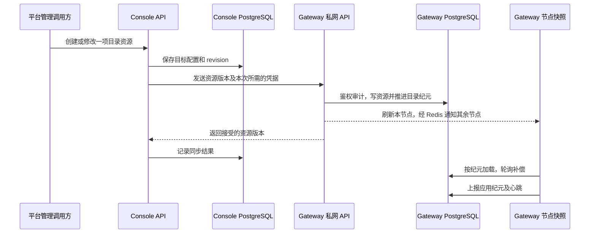
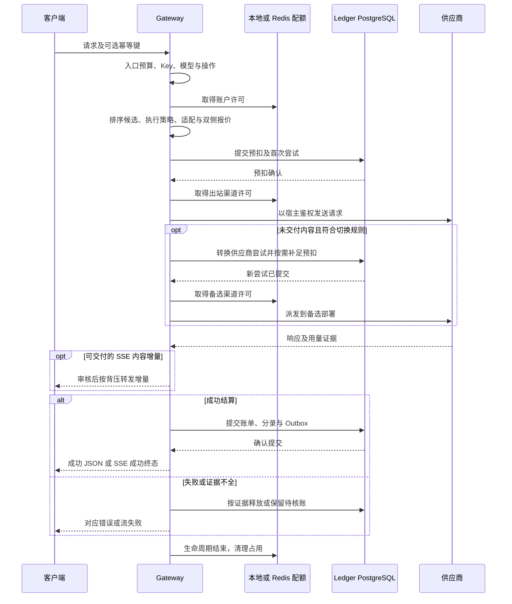
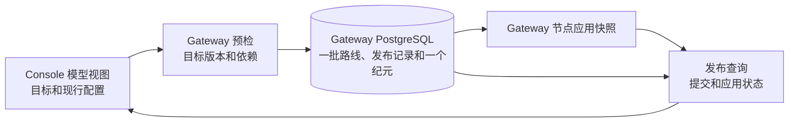

# Super Token Gateway 数据流与重构评估

基线为 **STG `67a9486`** 和用于比较的 **LiteLLM `1a1b924a6ff`**。范围从 Console 上架和身份管理开始，追到推理、上游、账本、Outbox、恢复和观测。本文依据运行时代码、数据库迁移、接口契约与定向测试评估。系统拓扑见 [架构图](../../diagrams.md)。

## 结论

**保留 Gateway、Ledger、Worker、Console 的部署和权威边界，先补目录变更的发布边界，再拆开推理里的策略耦合。** STG 已将同一对外模型的多供应商尝试、客户账单和供应商成本纳入账本。最大缺口出现在把多个资源组合成一项运营变更时。单资源提交有事务，同一批模型、路由和价卡变更没有共同提交点，Console 又缺少面向这批变更的节点应用状态。

首个实现切片宜选择**已有模型的两条已验证路由**，以现有账户、渠道和价卡引用，原子发布主备权重与优先级，并返回生效证据。它能验证新的管理闭环，并避开首次发钥、密钥轮换和资金交易的不同恢复规则。随后才扩展到模型上架、价格预览与更复杂的路由策略。上架体验借鉴 LiteLLM 的部署视图，执行继续由 STG 的预扣、派发证据和收口保证。

## 数据归属与跨边界标识

| 权威位置                | 负责的数据                                                                                              | 主要读写者和跨边界标识                                                                                                             |
| ----------------------- | ------------------------------------------------------------------------------------------------------- | ---------------------------------------------------------------------------------------------------------------------------------- |
| Console PostgreSQL      | 用户、会话、组织和成员、个人与团队计费关系、展示目录、目标配置、同步进度、用量投影和告警                | Console 读写。用 `billing_account_id`、资源 ID 和目标 revision 与 Gateway 对应                                                     |
| Gateway PostgreSQL 目录 | 执行模型、路由、上游账户、渠道加密凭据、插件修订、有效价格、Key 验证材料、组织准入                      | Gateway 管理 API 执行变更，快照池读取。单资源采用 `source_revision`，目录以 `config_epoch` 和世代标识传播                          |
| Gateway PostgreSQL 账本 | 客户钱包及现金、赠额、信用、供应商资金与分片、租约、预扣、尝试、账单、平衡分录、核账、视频任务和 Outbox | Gateway 预扣、结算、查询，Worker 恢复与维护。以 `request_id` 统合逻辑调用，`attempt_id` 区分出站尝试，`event_id` 区分业务事件      |
| Gateway 进程内          | 已装载的目录、执行计划与解密缓存、渠道健康、自适应样本、在途正文与缓冲、配额和账本租约的本地工作状态    | 请求固定所读快照，插件撤销信号可以中断相关在途工作。资金仍由账本持久状态裁决                                                       |
| Redis                   | 已配置共享模式下的运行配额、许可和集群通知                                                              | Gateway 获取、续期、释放许可和同步配置纪元、熔断。配置 Redis 但共享配额不可用时，准入失败关闭。目录最终从 PostgreSQL 轮询补偿      |
| 可选 Trace PostgreSQL   | 抽样诊断 Span 和有限期限的排查索引                                                                      | Gateway 通过独立有界队列写入，以 `trace_id` 和 `request_id` 关联。常规账务与 Outbox 保存数字用量、金额和受控审计。视频任务另存结果 |

[数据归属](../../architecture.md) · [账本 schema](../../packages/ledger/src/schema.ts) · [Console schema](../../apps/console-api/src/db/schema.ts) · [Redis 集群协调](../../packages/runtime/src/cluster.ts) · [Trace 存储](../../apps/gateway/src/trace-storage.ts)

## 管理面现状

### 上架、调价和撤销

1. Console 平台管理端把上游账户、渠道、价格模板、模型和路由作为不同资源同步。目录更新包含角色授权，Gateway 私网写入口先持久化审计开始记录。每个资源各自校验和提交，并推进纪元。Console 的实体锁可跨私网请求，其作用域为单一资源。普通后台补偿处理符合重试条件的待同步版本。 [Console 同步](../../apps/console-api/src/sync-catalog.ts) · [实体锁](../../apps/console-api/src/sync-state.ts) · [后台补偿](../../apps/console-api/src/sync-reconciler.ts) · [Gateway 写入口](../../apps/gateway/src/internal-api.ts)

2. 渠道明文凭据随同步请求进入 Gateway，由 Gateway 按渠道加密。Console 保存凭据提示和待同步状态。凭据提交失败或响应丢失时，后台没有原明文可重发。管理方按同一渠道 ID 补交，Gateway 可能已经提交对应版本。变更渠道的上游来源时需要对应的新凭据。 [渠道入口](../../apps/console-api/src/routes/admin-upstream.ts) · [渠道同步](../../apps/console-api/src/sync-catalog.ts#L234) · [Gateway 渠道事务](../../packages/ledger/src/catalog.ts#L176)

3. Gateway 目录快照通过 PostgreSQL 的只读可重复读事务装载。节点核对世代、纪元与撤销历史，验证修订并安装快照。Redis 通知加速，轮询补齐失联和漏通知，超过新鲜度阈值时准入拒绝。Gateway 通用上报有最高应用纪元，精确确认记录当前绑定已有的插件发布记录。普通目录同步的 `SYNCED` 与节点应用是两个事实。 [快照读取](../../packages/ledger/src/catalog-snapshot.ts#L198) · [快照安装](../../apps/gateway/src/snapshot.ts#L144) · [节点报告](../../packages/ledger/src/plugin-releases.ts#L25)

4. 插件走独立的草稿、预检、发布、回滚和紧急撤销。发布核对预期纪元与绑定，写入变更、幂等标识和当时在册的节点。紧急撤销在各节点观察到新纪元时中止受影响的在途工作。声明式和 WASM 供应商修订由渠道固定，内容插件由路由按顺序引用。 [插件发布 API](../../apps/gateway/src/internal-plugin-routes.ts) · [修订事务](../../packages/ledger/src/plugin-releases.ts#L215)

5. Console 的价格模板和市场展示使用平面费率及展示价，并读取 Gateway 已应用的账户价格覆盖。绑定路由时，模板解析为不可变价卡 ID，修改模板后需要显式更新所影响的路由引用。Gateway 实际报价还考虑标准价卡、产品与商业修饰器、FX、上下文和所选部署。Gateway 私网试算读取当前快照，并可指定路由及报价上下文。 [市场报价](../../apps/console-api/src/routes/marketplace-billing.ts#L175) · [模板与路由绑定](../../apps/console-api/src/routes/admin-catalog.ts#L421) · [Gateway 价格解析](../../apps/gateway/src/pricing.ts#L440) · [试算](../../apps/gateway/src/pricing-simulate.ts#L93)

### 客户身份、Key 和钱款操作

| 动作                               | 当前数据流和可观察结果                                                                                                                                                      |
| ---------------------------------- | --------------------------------------------------------------------------------------------------------------------------------------------------------------------------- |
| 注册、登录、邀请和团队             | Console 事务创建或校验身份与会话，按角色解析组织和计费账户。个人注册和团队创建各有默认计费账户。业务身份和技术准入分别同步                                                  |
| 签发、轮换、撤销 Key               | Console 保存 Key 目标记录。Gateway 生成验证材料，首次签发返回一次明文。Console 处理失败创建的补偿及轮换旧 Key 的撤销进度                                                    |
| 暂停组织或修改 Key 策略            | Console 记录目标状态和已确认 revision。推理入口在 Gateway 数据库复核对应组织、账户和 Key，旧快照策略与实时状态不符时拒绝。这个约束独立于普通目录最终一致性                  |
| 充值、授信、冻结、退款、调账和核账 | Console 授权后调用 Gateway 私网角色接口，账本写权威状态。具体资金操作按业务引用和幂等契约记录，同一动作重试遵循原结果与冲突规则。实际支付、发票及原路退款由外部业务系统处理 |
| 查余额、账单、用量                 | 权威余额和账单走 Gateway 查询。Console 用量视图来自已消费事件，适用于可接受投影延迟的报表与告警                                                                             |

[Console 身份及账务契约](../console-api.md) · [Key 路由](../../apps/console-api/src/routes/api-keys.ts) · [运行准入复核](../../apps/gateway/src/console-admission.ts) · [资金管理路由](../../apps/gateway/src/internal-finance-routes.ts)

## 推理与资源路径现状

1. **入口和授权。** 公网入口检查节点容量、可选 IP 限额、请求体和并发缓冲预算。请求读取目录快照，核对 Key、账户、模型、操作、来源 IP，对 Console 管理身份执行实时校验。账户配额计入请求量、估计 token 与并发。解析同时检查本协议输出上限、媒体大小、可计量能力和任务名额。生命周期持有请求体、配额、连接、流、取消及停机资源。 [公开入口](../../apps/gateway/src/public-ingress.ts) · [准入](../../apps/gateway/src/inference/request.ts) · [请求资源](../../apps/gateway/src/inference/resources.ts)

2. **选路和报价。** 候选引用模型、渠道、上游账户、操作及两侧价卡。过滤停用、撤销、不可用的路线，按优先级、同协议优先和模型策略排序。选择后对该路由执行内容策略、字段策略、协议准备、计量与双侧报价。某些路径可以在资金预扣前预建连接，实际发送必须取得预扣和渠道许可。供应商认证、签名和安全出站由 Gateway 宿主持有。 [候选组装](../../apps/gateway/src/inference/candidates.ts) · [排序及探针](../../packages/runtime/src/router.ts#L355) · [尝试编排](../../apps/gateway/src/inference/route-attempts.ts) · [出站派发](../../apps/gateway/src/inference/dispatch.ts)

3. **失败切换。** 上游异常按发送与执行证据、允许的错误类型、是否已交付内容、时限和尝试预算判断。备选重新执行本路线的约束和报价，账本在原 `request_id` 下登记新尝试，并可补客户预扣。旧供应商尝试已证实未执行时释放，结果未明时按策略留存核账。当前兼容路径允许备选携带不同的客户价格和快照。显式自适应配置的严格切换分支与继承默认配置的分支行为有差异。 [派发证据](../../apps/gateway/src/inference/dispatch.ts) · [尝试切换](../../apps/gateway/src/inference/accounting.ts#L250) · [账本切换事务](../../packages/ledger/src/supplier-switch.ts)

4. **响应与计量。** JSON、二进制、对话 SSE 和媒体 SSE 使用各自的解码、终态和用量处理。辅助维度按其证据来源判断，例如图片数量、输入字符、缓存维度和工具调用。内容插件有入口、出口以及流阶段的处理，异常后的收费策略随内容裁决、插件故障或容量原因决定。最终选中尝试的报价和可信用量支撑结算，部分对话流可按配置使用有界估算。仅在 PostgreSQL 确认后返回成功 JSON 或流成功终态。 [非流式](../../apps/gateway/src/inference/unary.ts) · [对话 SSE](../../apps/gateway/src/inference/conversation-stream.ts) · [媒体 SSE](../../apps/gateway/src/inference/media-stream.ts) · [定价和证据](../../funds-and-billing.md)

5. **视频和查询。** 视频创建另有持久名额，注册任务、转换名额和初始结算进入同一直接事务。查询以固定渠道和任务身份去上游读取，使用同节点在途查询合并。取消在写状态前复核当前权限。符合配置的系统故障可以幂等退款，陈旧任务与过期名额由 Worker 清理。模型列表是权限与可见性查询，从其结果还需要进一步确认当前路由可派发。 [视频处理](../../apps/gateway/src/async-tasks.ts#L413) · [任务仓储](../../packages/ledger/src/async-tasks.ts) · [模型接口](../../apps/gateway/src/app.ts#L455)

## 账本、恢复和事件路径现状

| 路径              | 原子边界与恢复方式                                                                                                                                                                      |
| ----------------- | --------------------------------------------------------------------------------------------------------------------------------------------------------------------------------------- |
| `acquireHold`     | 幂等请求、资金来源分配和首次尝试持久化。满足条件时利用 PostgreSQL 支持的钱包和供应商租约与微批，其他请求走直接事务。余额、信用、Key 消费限额和供应商资金在该路径受约束                  |
| `commitTerminal`  | 根据最终证据及预扣时捕获的价格上下文结算。租约快路径批量提交，余额归并可后置，标准化价卡或视频等走直接路径。账单、分录和 Outbox 同库同事务，提交结果不明时按原请求 ID 核对              |
| `UNKNOWN`         | 请求和供应商尝试有各自状态。Worker 根据已配置的供应商来源或人工收据导入证据，推进释放、结算或受预算限制的豁免。旧尝试的供应商成本可能晚于客户账单确认                                   |
| Worker 恢复       | 以 PostgreSQL 会话级 advisory lock 选主，清理到期预扣与租约、资金批次和视频名额，处理欠款、分片维护和月分区。独立 Worker 与 Gateway 内置模式复用同一 Runner                             |
| Outbox 到 Console | 按消费方和分片认领，租约保护进度。Console 拉取或 Worker 推送。Console 用 `event_id` 去重并同事务写明细、聚合和告警评估任务，提交后才 ACK。失败可重投，消费者游标属于 Gateway PostgreSQL |
| 告警和观测        | 客户告警按余额和当日支出评估，Webhook 可重试。平台用量异常扫描已提交结算事件，持久化窗口、覆盖及发现，Prometheus 采集私网指标并交给 Alertmanager。运维按标识回账本核实证据              |

[预扣](../../packages/ledger/src/hold-acquisition.ts) · [结算分派](../../packages/ledger/src/settlement-dispatch.ts) · [核账证据](../../packages/ledger/src/reconciliation-evidence.ts) · [Worker Runner](../../apps/worker/src/runner.ts) · [Outbox](../../packages/ledger/src/outbox.ts) · [Console 事件消费](../../apps/console-api/src/outbox-consumer.ts) · [平台监控](../decisions/0014-upstream-usage-monitoring.md)

## 重构前应解决的具体问题

| 问题                           | 证据与影响                                                                                                                                                                                     | 建议                                                                                                     |
| ------------------------------ | ---------------------------------------------------------------------------------------------------------------------------------------------------------------------------------------------- | -------------------------------------------------------------------------------------------------------- |
| 多资源上架分次生效             | 每次目录写入自行推进纪元。已在隔离 PostgreSQL 与本地模拟上游复现。模型先出现于公开列表，推理返回 `503 no_route`，上游零调用。补上路由后，调用返回 200 并产生一张账单                           | 在 Gateway 增加受控的目录批量发布能力。Console 提供模型视图和统一入口。用实际快照确认节点应用进度        |
| 目录有普通写入口与补偿写入     | Console 的资源锁在自己库内。Gateway 当前路由版本比较允许等版本，也有省略版本的调用方式。新增发布入口要处理旧写与后台重放，否则批量效果可能被后续写入部分覆盖                                   | 同一资源继续由原目录仓储持有。发布按目标记录做并发校验，旧编辑与补偿也遵守所有权，先验证并发写矩阵       |
| 展示价和执行价存在表达差异     | Console 平面模板无法完整表达 Gateway 的阶梯、附加修饰器与汇率。基于展示价确认毛利或同价主备会遗漏报价上下文                                                                                    | 上架和调价预览复用 Gateway 的价格解析，在给定时间、操作、账户、币种和路由下校验，并展示报价域与价卡版本  |
| 显式自适应策略牵动其他行为     | 重构前由同一个显式自适应标记决定幂等预检顺序、重放兼容、出站次数及 HTTP 执行证据。现有集成用例断言显式 `observe` 的两次尝试上限与默认三次行为                                                  | 先拆出评分、失败切换、幂等身份三个边界并保持现行映射。再单独决定观察策略和失败证据的目标契约             |
| 一个不兼容部署可削弱同模型排序 | 当前在模型与操作范围评估兼容，入口传入的是撤销过滤前的候选基集。排序时才分优先级与协议组。未参与同组权重竞争的部署可能使模型退回基础权重，标准化供应商费用也会退出现有比较路径。影响是静态推导 | 将权重比较约束到实际竞争的等价组，显式给出基础权重回退原因。跨主备兼容仍独立校验，避免借评分改动放宽切换 |
| 配额和健康的作用域不同         | 渠道有自己的 RPM、并发和熔断，钱包按供应商账户。拆成多渠道的同一供应商配额可能需要共享限制，取决于供应商实际配额维度                                                                           | 先在目录显示资金账户、出站渠道与实际上游配额边界。用受控验证证明共享限额问题后，再评估账户级许可         |

[普通目录事务](../../packages/ledger/src/catalog.ts#L381) · [默认自适应与保护](../../docs/adaptive-provider-routing.md#3-选路策略与配置) · [候选基集](../../apps/gateway/src/inference/candidates.ts#L59) · [可比较条件](../../apps/gateway/src/inference/adaptive-routing.ts#L83) · [兼容用例](../../tests/integration/adaptive-routing.test.ts)

## 目标结构和方案取舍

| 方案                                    | 上架体验                                               | 写入与故障语义                                                                                 | 判断                                                         |
| --------------------------------------- | ------------------------------------------------------ | ---------------------------------------------------------------------------------------------- | ------------------------------------------------------------ |
| Console 封装现有逐项请求                | 可较快做出单页表单                                     | 部分成功、响应丢失后对账及各节点应用仍由多次调用收敛                                           | 可以先做只读模型视图。需要整组生效的写入交给 Gateway 事务    |
| Console 编排、Gateway 原子发布          | 以模型聚合主备部署和价格引用，展示预检、提交与应用进度 | Gateway 现有目录内构造短事务。Console 保有业务配置和展示职责。外部通信失败可用发布 ID 查询结果 | **推荐**。能改善上架和回退，同时保留账务及快照边界           |
| 采用 LiteLLM 式独立运行目录或外接代理层 | 更容易复用丰富的部署及跨模型策略                       | 需要重做配置权威、供应商执行证据和计费交接，增加运行边界                                       | 作为比较方案保留。当前证据指向管理发布与策略装配两个局部缺口 |

LiteLLM 的 `Deployment` 把对外模型、上游参数和模型信息组合到同一操作单元。STG 的模型视图可以采用这个组织方式，通过现有渠道、价卡和路由引用表达。部署表单及模型到部署的视图属于管理接口，推理仍从 Gateway 内存快照读取生效目录。

### 发布与恢复契约建议

- 首期仅编辑已有路由的优先级与权重，限同一模型及操作下客户计费契约等价的路线。收紧到相同客户价卡、相同计价维度、同币种，且无渠道或上游账户相关的客户定价修饰。Console 保存待发布 ID、目标及摘要，记录操作者。
- Gateway 预检读取授权及快照。事务内比对目标当前生效行、关联依赖和预检纪元，原子写入变更、前后值、审计与纪元。使用生效行版本或摘要作为前置条件。旧单项写和补偿写必须服从相同校验。响应丢失时按发布 ID 回读结果，Console 更新已发布投影并保留更新的草稿。相同意图重放收敛到同一结果，内容变化明确冲突。
- 发布事务固定当时活跃节点名单。状态分别显示已提交，以及各节点已应用、待追平、已越过该版本或已离线。最高应用纪元与该发布确实被应用是不同证据，精确确认需要对应的发布记录。
- 回退用原发布的前值做反向变更，逐行比对当前状态与原发布后值及版本，整个反向变更生成一个新纪元。目标后来被更新时要求重新预检。已经接受在途请求的快照和历史账务按各自既有契约处理。
- 目录发布维持 Catalog、Finance、Security 的角色边界。首期复用已生效的价格、凭据和插件修订引用。涉及价格写入、凭据补交、插件紧急撤销及 Key 轮换的后续切片分别沿其权限、幂等与恢复规则设计。

首期验收示例是把同价的路线 A 和 B 由 70/30 改为 30/70。两条路线应出现在同一个已应用快照中，固定用量在两条路的客户结算金额相同。如果 B 的目标版本已被普通编辑推进，A 的权重也应保留原值。如果发布成功但响应丢失，用相同发布 ID 查询或重放后应得到同一个提交纪元。两节点不同步时，应能按节点判断观测到哪份目录。

### 首期实施契约

- Console 与 Gateway 提供模型路由视图、预检、发布、查询及反向发布。每次变更恰好包含两条现有路由，调用方提供视图中的目录纪元和路由版本。Gateway 继续使用原目录表存放优先级、权重和价卡引用。
- 路由发布与插件发布共用配置发布记录、节点名单和精确纪元确认。按发布类型隔离 Catalog 和 Security 接口。发布与反向发布均使用客户端生成的 UUID，重放同一版本及内容返回既有提交。
- Console 在发出发布前，原子记录待发布请求并标记两条路由待处理。期间同一目标的单项编辑返回冲突。响应丢失后，版本相同的重放或后台补偿按同一发布 ID 恢复，提交确认后一个 Console 事务更新本地视图。
- Gateway 发布时推进两条路由的来源版本。已经过路由发布的记录，普通更新携带当前已确认版本。旧请求以及不含前置版本的旧写入会被拒绝。普通写入在同一版本且内容相同时可重放。
- 迁移同时包含 Gateway 与 Console 的向前迁移及角色授权。回退某次运营变更使用反向发布。进程版本因 schema 门禁需要与数据库版本协调。

首期已实现。实际预检覆盖受影响操作的启用竞争路由，也校验供应商账户和插件绑定。补偿单独调度，Console 投影核对 Gateway 回读的请求摘要。进程升级及接口细节见 [Console 路由发布](../console-api.md#模型主备路由发布) 和 [运行手册](../../reliability-and-operations.md#生产发布)。

### 第二个切片的实施契约

- 新模型上架一次提交模型和全部部署。部署引用已同步渠道及不可变客户和供应商价卡。渠道凭据和新价卡继续通过各自现有管理权限创建。
- Console 复用发布意图、查询和补偿机制。待发布模型在客户市场隐藏，并拒绝并发单项模型或路由写入。Gateway 提交后，以节点应用状态驱动 Console 市场投影。Gateway 对外模型列表从相同快照读取模型及已提交的部署。
- 预览在原快照价格计划上用草稿部署复用 Gateway 试算，使用明确的部署、操作、账单账户、币种、计量与价格上下文。市场展示保存客户价卡的基础费率，实际报价按账户和计量上下文计算。
- 丢失响应使用原发布 ID 安全查询或重试。下架使用现有模型停用语义，已发布版本和历史账务可查询。

### 推理重构应当停在什么位置

沿现有入口分别归属三种决定。

- **候选排序**读取同一快照与有界健康观测，输出候选顺序和原因。观察模式只记录比较结果是目标行为。
- **切换策略**读取剩余尝试、期限、是否已交付、是否已发送、供应商执行证据，以及当前允许的费用上界，输出继续、收口或待核账。跨模型兜底需要单独的模型授权、能力和价格契约。
- **请求身份与资金执行**固定同一逻辑请求的幂等行为，继续由 Ledger 提交每次预扣、转换与终态。切分时必须核对存量指纹与重放。对于同一售卖产品锁定客户价卡可以作为新发布规则，现有允许备选改价的路线需先盘点后迁移。

`routeInference` 已有候选、派发、账务、响应、资源和观测模块。第一步应分离具体策略参数并验证旧行为映射，继续使用现有推理入口和账本事务。只有发现稳定复用边界或代码重构后的测量证据时再拆实现。 [推理阶段边界检查](../../tests/unit/architecture.test.ts) · [请求编排](../../apps/gateway/src/inference/route-attempts.ts) · [请求身份](../../apps/gateway/src/inference/request-identity.ts)

### 第三个切片的行为映射

| 输入                                                 | 排序                               | 失败切换                                                           | 幂等查询                                                       |
| ---------------------------------------------------- | ---------------------------------- | ------------------------------------------------------------------ | -------------------------------------------------------------- |
| WEIGHTED Chat 继承默认配置                           | 保留当前自适应权重与候选兼容性检查 | 沿用首个获准部署的尝试数，缺省三次。歧义切换沿用部署授权和速率预算 | 首个候选内容策略处理后生成旧版兼容指纹，沿用原来的原子预扣查询 |
| Chat 显式配置 observe 或 active                      | 沿用配置模式、优先级和协议分组     | 最多两次。已派发的拒绝需要未执行证据才允许切换                     | 先查询版本化指纹，旧版指纹依旧在内容策略处理后匹配             |
| Chat 显式关闭、非 WEIGHTED Chat 继承默认，或其他操作 | 沿用基础路由策略                   | 沿用各部署超时、执行证据与视频任务准入约束                         | 沿用预扣查询                                                   |
| SSE 已交付                                           | 已锁定选中部署                     | 错误沿既有流协议与结算收口                                         | 同一逻辑请求沿用既有账本状态                                   |

策略边界分别接收排序设置、发送与执行证据、以及请求身份。统一读取旧路由字段的默认值，所有预扣、切换和资金终态继续由现有账本调用提交。排序的观测条件与模型间兜底留在既有契约范围内。 [路由策略](../../apps/gateway/src/inference/routing-policy.ts) · [切换策略](../../apps/gateway/src/inference/failover-policy.ts) · [账务执行](../../apps/gateway/src/inference/accounting.ts)

### 第四个切片的原试点契约

`adaptive_routing.mode` 选择排序方式，新增的 `execution_policy` 选择执行约束。现有显式配置省略该字段时沿用 `protected`，原两次上限、执行证据和提前重放继续生效。对原本使用基础权重和路由级执行规则的试点，`mode: observe` 与 `execution_policy: route` 组合只增加影子观察。明确配置的供应商预留上限在两种执行策略下均生效。

影子比较在实际可用的同优先级、同协议候选组内判断协议、价卡和策略是否可比较，再复用实际首选的抽样。低优先级应急渠道和已剔除部署不参与该组的比较。启用模式沿用原全模型兼容性门槛，现有切换和结算继续按实际部署的价格上下文执行。

单模型在隔离数据库和受控上游下从基本排序切到纯观察再回退，使用相同请求顺序和抽样序列。核对首内容 P95、完整交付率、每千次交付供应商成本、唯一扣款和未明尝试账龄。评估同基础价在渠道修饰器下的实际结算差异，避免把相同基础价卡当作锁定有效价格的充分条件。

### 运行时收敛契约

观察和启用共用实际竞争组中的协议、基础价和修饰器判定。两种执行约束继续作为同一次推理编排的显式参数，供应商预扣上限继续在派发前校验。Gateway 与 Console 一次性为存量显式配置补齐 `execution_policy: protected`，新显式配置要求选择 `route` 或 `protected`。关闭和重置依旧使用 `false` 与 `null`。

所有带幂等键的推理请求在选路前检查同一种版本化身份，Ledger 在预扣事务内用同一值检查并发冲突。已保存的旧摘要缺少原始输入，旧键继续占用并返回 `409 idempotency_conflict`。现有请求、账单和历史迁移保留。

## 实施切片与验收矩阵

| 切片                        | 迁移范围与既有行为                                                                                                       | 完成判据                                                                                                                                                     | 回退或清理条件                                                                                                   |
| --------------------------- | ------------------------------------------------------------------------------------------------------------------------ | ------------------------------------------------------------------------------------------------------------------------------------------------------------ | ---------------------------------------------------------------------------------------------------------------- |
| 1．已有模型的原子主备变更   | Console 增加可读模型视图与发布入口，Gateway 管理面和 Ledger 复用目录存储及快照。公共推理入口、价卡和资金路径沿用当前契约 | 已有两个部署一起切换。任何目标校验失败时两条都不变。并行发布冲突明确，丢失成功响应可重放，两个节点各自报告看到的状态。旧补偿与写入口不能无声覆盖推进后的版本 | 停止使用新入口，已发布记录按预期版本做反向发布。稳定后先迁完受影响调用方，再决定逐项写入口继续承担哪些资源级编辑 |
| 2．完整上架与价格预览       | 扩展到模型、部署引用和价格版本绑定。列表的上架语义与 Gateway 生效状态对齐。把展示和实际执行的价格上下文交代清楚          | 客户在约定生效点能看见并正常调用，发布失败仍可查询原因。标准价卡、FX、账户覆盖与约定样例的实际结算、试算一致。凭据补交与新价格写入按原授权核对               | 老客户端、模板、存量价格版本和请求重放均通过后切换对应写入责任。历史账务继续引用原版本                           |
| 3．隔离排序、失败切换和身份 | 拆开策略输入，按旧字段和已有历史请求映射，维持显式与继承默认的现行行为                                                   | 现有默认三次、显式两次、有无未执行证据、SSE 已交付、失败后重复请求及历史指纹在同一矩阵等价。用相同条件核对实际出站次数、最终状态与可见响应                   | 对照失败时撤回切分。确认所有调用方完成迁移后，删除无必要的内部双轨                                               |
| 4．单模型验证策略变化       | 单独让观察只影响排序统计，评估按同组比较，以及同一产品锁定有效客户价的适用范围                                           | 完整交付率、P95 首内容、每千次完整交付供应商实际成本和核账账龄在相同流量及观察窗口对照。账本守恒、唯一扣款、允许才发送和未明尝试留存逐项核对                 | 阶段可回到既有排序和切换契约。资金状态及已提交账单按实际结果核对                                                 |

阶段 1 复用 Console 同步与目录恢复夹具，阶段 2 复用标准化价格与账户权限夹具，阶段 3 至 4 复用自适应路由、故障切换、流式收口、账本恢复和 Outbox 夹具。生产确认需要对应部署环境的节点数量、上游能力和容量数据。当前静态评估未给出跨产品 fallback 的商业规则与对真实供应商证据的授权承诺。

## 数据流分析验证

- 单元与架构检查选取 Gateway 自适应、路由韧性、账务切换、流式结算、Console 单测和 Ledger 核心，**49 项通过**。
- 隔离 PostgreSQL 17.12、本地 Redis 8.12.0 和 Bun 1.4.6-canary.1 上，Console 同步与权限、消费与监控，推理切换、标准化价格、集群与媒体，以及账本预扣、租约、对账和 Outbox 的 **184 项定向集成测试通过**。首轮隔离库的管理员名称与 `stg_audit` 能力角色重名，权限用例拒绝初始化。换用独立管理员名称后复跑通过。
- 另有 **3 项插件集成测试通过**，覆盖修订草稿、跨节点应用确认、紧急撤销、供应商适配、回退内容策略与 WASM 执行。 [集成入口](../../tests/integration/gateway-v4.test.ts)
- 另用真实 PostgreSQL 和本地 Mock 上游复现上架空窗。对有资金的账号，先提交启用模型，使用同一 Key 分别调用列表和推理。列表有该模型，推理返回 `503 no_route`，上游零调用。再提交绑定了两侧价卡的路由，以同一 Key 和请求体重试，返回 200，上游一次调用，账本生成一张账单。
- 管理发布、快照确认、价卡和幂等边界经过独立只读核对。排序兼容受非竞争候选影响的判断来自当前控制流，仍需针对实际同组候选和健康状态补实测。
- 现有负载记录可作为后续同口径基线。本轮分析未运行生产部署、真实供应商调用或压测。仓库完整代码门禁适用于后续实现阶段。 [容量记录](../performance/gateway-capacity-2026-11-25.md) · [现有 CI](../../.github/workflows/verify.yml)

## 首期实现验证

新用例覆盖实际主备渠道切换及同用量同金额、提交响应丢失、双节点精确确认、并发冲突、回退、补偿重放、发布标识碰撞和第三条不同价竞争路由。旧账本 schema 的迁移探针确认插件发布记录与精确 ACK 保留。部署需按两库迁移和角色授权要求执行。 [路由发布用例](../../tests/integration/console-route-releases.test.ts) · [迁移说明](../../reliability-and-operations.md#生产发布)

## 第二切片实现验证

新增七项集成用例。验证标准价卡及 FX、账户折扣场景中的试算和实结相符。模拟请求未送达、结果丢失、双节点确认、单项编辑冲突，以及 Gateway 配置偏离和恢复。测试还覆盖目录凭证访问价格预览被拒、渠道操作不受支持时两库保留原状，并用受控阻塞复现了取价期间停用模型的竞态。Console 在读取价卡后再次核对 Gateway 状态。 [上架集成用例](../../tests/integration/console-model-onboarding.test.ts)

本切片复用已同步渠道和不可变价卡。Gateway 管理面以目录角色执行上架，价卡详情与实际试算继续使用审计角色。首次市场投影在最后一次状态回读时核对 Gateway 配置及节点状态，并按该快照对应的来源版本投影。配置偏离时，原意图保留为待确认，恢复绑定后沿同一 ID 继续投影。 [接口与恢复](../console-api.md#新模型上架与价格预览) · [上架时序](../../diagrams.md#新模型上架与价格预览)

最终验证通过 lint、类型、格式、OpenAPI 一致性和构建检查。单元及架构测试 365 项通过，隔离 PostgreSQL 和 Redis 上的全量集成测试 282 项通过。打包工件、账本耐久性、PostgreSQL 主备和 PITR、Redis Sentinel 演练均通过。验证使用本地隔离环境及上游替身。 [生产迁移顺序](../../reliability-and-operations.md#生产发布)

## 第三切片实现验证

从同一个目录设置分别解析候选排序、失败切换和幂等查询时机。候选排序读取快照、候选和健康数据。切换策略集中管理默认尝试数、首包预算、派发证据和供应商预扣上限。请求身份负责构造版本化及历史指纹，并且只读查询已有请求。账务层继续执行原有预扣、原子切换和结算。 [推理时序](../../diagrams.md#推理请求与故障切换) · [编排入口](../../apps/gateway/src/inference/route-attempts.ts)

定向集成对照缺省三次、显式至多两次、未执行证据、歧义尝试的资金留存与同键重放。四项新增用例核对继承默认与显式配置对应的实际出站计数、账单、请求 ID、资金状态，以及路由全部下线后的重放时机。原有 SSE 交付边界、请求脱敏冲突和历史脱敏指纹用例继续执行。独立审查以重构前表达式对照 2,637 组策略输入，并逐字节比较原有指纹算法。 [主路径用例](../../tests/integration/adaptive-routing.test.ts) · [历史重放用例](../../tests/integration/adversarial-recovery-cases.ts)

本轮通过 lint、类型、格式、OpenAPI 一致性及构建。365 项单元与架构测试、286 项全量集成测试通过。打包工件、账本耐久性和本地 PostgreSQL 主备、PITR、Redis Sentinel 演练通过。第三切片沿用第二切片的数据库版本。

## 第四切片单模型试点

在本地 Gateway、隔离 PostgreSQL 和可控 HTTP 上游上，先为同一模型预热两条主渠道，再依次跑基础排序、纯观察、配置回退。各阶段用相同的确定性抽样序列，包含 24 次成功交付和 1 次首段已交付后截断的流。首内容 P95 从调用 Gateway 到读出首段正文，包含截断前实际读到的正文。各阶段完成后立即读取独立的原请求窗口，录入同样的 3 atoms 模拟后到回执，再重查账本。

| 模式     | 完整交付 | 首内容 P95 | 每千次完整交付供应商成本 | 待核账时的最早有记录账龄 |
| -------- | -------- | ---------- | ------------------------ | ------------------------ |
| 基础排序 | 24/25    | 20.87 ms   | 15,125 USD atoms         | 10 ms                    |
| 纯观察   | 24/25    | 22.53 ms   | 15,125 USD atoms         | 1 ms                     |
| 配置回退 | 24/25    | 21.00 ms   | 15,125 USD atoms         | 3 ms                     |

三组的逐请求渠道序列一致，各发送 25 次，备用发送为 0。每组只有 24 笔唯一客户扣款，账本守恒。影子在实际候选组里记录了 8 次不同首选。只匹配低优先级备用的渠道价格修饰器未阻断主组比较。在主组新增同类渠道修饰器后，主组比较报告不兼容。全量集成复测的首内容 P95 分别为 22.38、18.24、33.04 ms，延迟差异方向随本地运行而变化。真实供应商流量和对账成熟期仍需按部署环境验证。 [可复现实验](../../tests/integration/routing-policy-pilot.test.ts)

超时清扫的回归用例先验证在途预留未进入待对账敞口。清扫把整笔预留改为 `UNKNOWN` 后，即使内嵌尝试为 `HELD`，报表也会计入金额、次数和已记录账龄。备用成功后保留的旧未明尝试仍可能没有核账起点，分别报告数量与金额。 [成本与账龄测试](../../tests/integration/routing-observation.test.ts)

同一基础价卡在试验中的首选实扣 15 atoms，带渠道倍率的备用在故障切换后实扣 30 atoms。两种执行模式的计费结果和 `UNKNOWN`、`RELEASED`、`SETTLED` 三种供应商尝试状态均相同。产品级锁价需要核对同一客户、同一操作、同一计价时点的**有效**价卡和修饰器，还要覆盖渠道、账户和影响计价的请求变换。锁定的规则仍按实际用量结算。本轮用这些证据评估锁价范围，实际切换保留逐部署报价。 [配置与回退](../adaptive-provider-routing.md#3-选路策略与配置)

最终通过 lint、类型、格式、OpenAPI 一致性和构建检查。366 项单元与架构测试、290 项隔离集成测试通过，工件、账本耐久性、PostgreSQL 主备及 PITR、Redis Sentinel 演练通过。纯观察配置和成本报表沿用现有数据库版本。

## 单实现清理验收

观察和主动模式共用同组判定。低优先级且有独立渠道修饰器的备用部署保留其原有切换顺序，主竞争组仍可用自适应权重。网关按传输返回的类型化证据判定未派发。所有带幂等键的请求共用原始输入的当前版本指纹，并在结算前的预扣事务中原子检查。回归验证旧原始摘要和旧脱敏摘要都返回 409，原请求只产生一次出站和扣款。 [排序和回退测试](../../tests/integration/routing-policy-pilot.test.ts) · [幂等回归](../../tests/integration/adversarial-recovery-cases.ts)

Gateway 和 Console 升级用例从各自的上一版迁移记录启动，检查存量显式策略补齐 `protected`、`false` 与空策略保持原语义、现有显式 `route` 保留、以及待同步状态和来源版本保留。两库版本均为 `2026112901`。366 项单元与架构测试、293 项隔离集成测试通过，lint、类型、格式、OpenAPI、构建、工件、账本耐久性和隔离恢复演练均通过。 [迁移验收](../../tests/integration/routing-policy-migration.test.ts) · [升级顺序](../../reliability-and-operations.md#生产发布)

## 工作区复核与修正

- 单项模型及路由编辑在覆盖本地意图前先补发未确认版本。Gateway 直发后的旧路由写入返回冲突，Console 可以按顺序采纳发布。上架 ID 被另一意图占用时，补偿确认冲突并释放隐藏草稿。省略市场价格字段的模型编辑沿用已发布费率。 [路由发布回归](../../tests/integration/console-route-releases.test.ts) · [模型上架回归](../../tests/integration/console-model-onboarding.test.ts)
- 公开模型列表检查同一快照中的启用部署。主备预检查客户价格与启用内容插件配置，使切换可复用本次请求已有的输入策略结果。草稿报价复用原快照的费率计划。 [公开模型列表](../../api-contracts.md#数据面与资源) · [管理契约](../console-api.md#模型主备路由发布)
- Multipart 预检和推理派发共用端点解析。视频上架要求可按任务 ID 查询，轮询用实际发送的 GET 生成 HMAC 或 SigV4 签名。创建任务直接复用已派发的适配器，轮询从渠道绑定的修订读取配置。 [媒体上架回归](../../tests/integration/console-model-onboarding-media.test.ts) · [SigV4 回归](../../packages/runtime/src/__test__/cloud-auth.test.ts)

使用仓库锁定的 Bun 1.4.5，在隔离的 UTF-8 PostgreSQL 17.12 与 Redis 8.12.0 上通过 367 项单元及架构测试和 303 项集成测试，单元套件行覆盖率为 65.35%。Lint、格式、OpenAPI、构建、工件、账本耐久性及故障恢复演练通过。Bun 1.4.5 的类型检查在基线 `67a9486` 和当前工作区均对定价解析器报两项 TS7022。Bun 1.4.6-canary.1 的类型检查通过。 [基线类型错误位置](../../packages/kernel/src/pricing/resolver.ts#L155)

定价矩阵的局部变量已补充 `MatrixEntry` 类型，消除上述两项 TS7022。使用 Bun 1.4.5 重跑类型检查通过，变更前后的编译 JavaScript 逐字节相同。367 项单元与架构测试、9 项标准化定价集成测试以及 lint、格式、OpenAPI 和构建均通过。 [定价矩阵匹配](../../packages/kernel/src/pricing/resolver.ts#L156)
